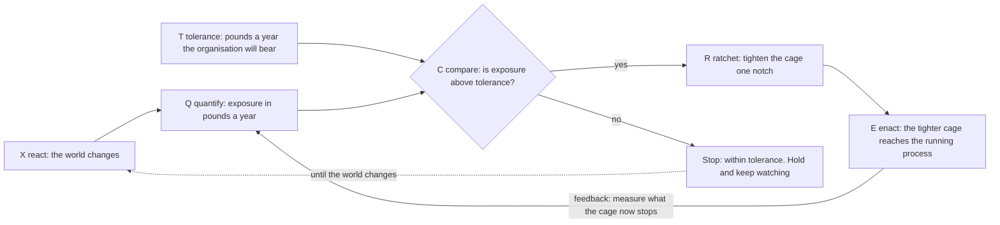
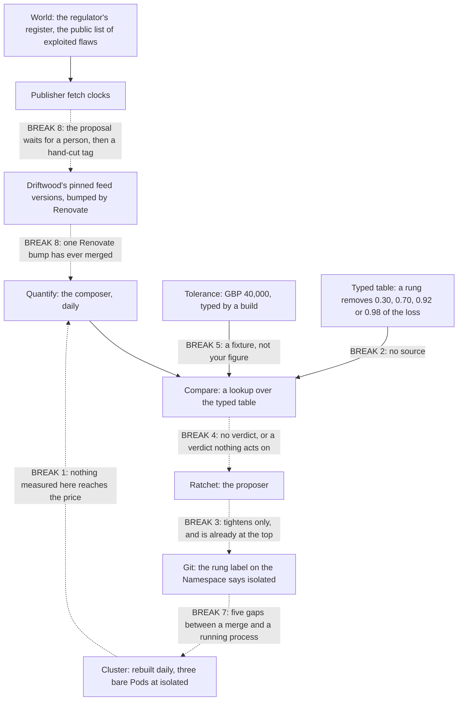
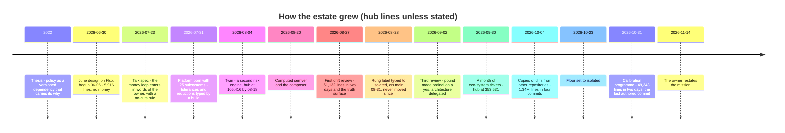
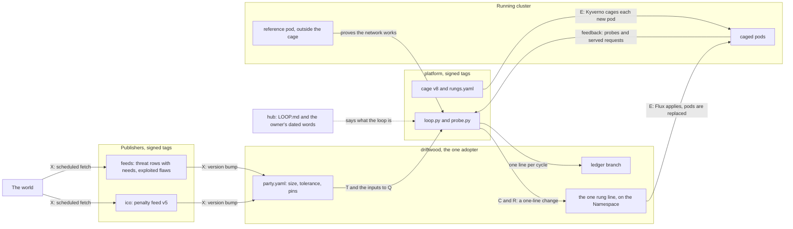

# DISTILLATION: the mission as one loop, what exists against it, and what to do with the rest

Written 2026-11-14. This was a read-only review. Nothing has been built, run, moved or removed, and nothing in this document authorises removal. Section 6 says where each thing would stay recoverable. The full ledger is `LEDGER.md` beside this file. The target design in full is `TARGET.md` beside this file.

## The short version

- **The mission is one loop.** Price the organisation's risk in pounds a year. Compare it with the tolerance the organisation declares. While it is over, tighten the cage on the running processes one notch and measure again. Stop when it is within. Start again when the world changes. (Section 1)
- **The loop has never closed.** Five of the six steps have code that runs every day. No step has ever handed its result to the next so that a running process changed, and nothing measured on a cluster has ever reached the price. There are eight breaks, each cited to code. (Sections 2 and 3)
- **The estate grew by addition.** 2.2 million lines were counted. The chain that serves the loop today is 24,636 lines of code, 7.4% of the code. Every review added machinery and none removed any. (Section 4)
- **The distilled design is small.** One adopter, two publishers, the platform and a hub that holds records: 3,000 authored lines by budget, nearer 3,600 after checking. One change closes the loop: the figure falls only when a probe finds closed, on the running pods, a capability that a published loss row says the loss needs. (Section 5)
- **On today's published numbers the new loop would not move.** Driftwood's upper bound is GBP 16.3M a year against a tolerance of GBP 40,000. No published row yet says which capability the loss needs, so no rung can be shown to help, and the loop would report `saturated` at the loosest rung and say why. A notch needs that list published with an outside source. Whether driftwood needs any cage at all turns on a penalty rate that nobody has counted. (Sections 5.4 and 5.5)
- **Nothing is removed by this document.** The ledger gives a call for each of 26 areas. About 20,300 lines would stay in working trees; the rest would stay in git history. (Section 6, `LEDGER.md`)
- **Protect first.** 40 local branches, 8 detached checkouts and 1 stash on your machine are in no remote history. (Section 6. Done on 2026-11-14: see `ARCHIVE.md`.)
- **Ten decisions are yours.** The first is what "ratcheting" means: whether the cage can ever release. (Section 7)

**Citations.** `repo/path:line` is a path in the clones of the nine remote default branches taken 2026-11-14. AT:n is line n of `hub/.scratch/drift-review-2026-08-27/evidence/AMBITION_TIMELINE.json`, the record of your dated words. T75:n is `hub/.scratch/ecosystem/issues/75-grilling-what-is-this-for-the-twelve-questions.md`. RA:n is `hub/.scratch/drift-review-2026-08-27/REGRILL-ANSWERS.md`. `maps/A4` and the like are the mapping files. K1 to K4 are the four keystone checks, each an attempt to refute a main finding. `verdicts/L12` and the like are the blind checks of each ledger row. "Relayed" means a map or verdict found it and I did not open the source. Section 9 lists what I opened myself.

**Words used.**
- **Exposure**: the organisation's expected loss in pounds a year. **Tolerance**: the loss a year it says it will bear. The record calls it appetite.
- **Cage**: limits put on a running process from outside. **Rung**: a named cage setting. Today's rungs, loosest first: baseline, restricted, quarantine, isolated. **Notch**: a move of one rung.
- **Adopter**: the organisation that is caged. Driftwood, tuppence and ludlow are invented demonstration firms. **Publisher**: a party that publishes numbers about the world as a **feed**, a file cut under a signed version tag. Ico publishes the regulator's fines. Feeds publishes threats and exploited flaws.
- **Pod**: Kubernetes' unit of running processes. **Namespace**: a named area of a cluster. **Deployment**: the Kubernetes object that replaces pods when their template changes. **Admission**: the moment a cluster accepts a new pod.
- **Flux**: makes a cluster match git. **Kyverno**: rewrites a pod at admission. **Renovate**: opens a pull request when a pinned version has a newer one.
- **Ref**: a named pointer into git history, a branch or a tag. **Pin**: a fixed version one repository holds another at. **Self-pin**: driftwood's own Flux source, held at one of driftwood's own old tags. **Floor**: a minimum rung typed into `party.yaml`.
- **CI**: the automated jobs a repository runs on a schedule or on a change. **Forge**: the hosting service, GitHub. **ADR**: an architecture decision record under `hub/docs/adr/`.
- **Monte-Carlo**: estimating a figure by simulating many random years. **By formula** (closed form): the same figure worked out exactly. **Codex**: the second coding assistant, used in October.
- **Composer**: `platform/compose/composition.py`, the 10,142-line program that prices today. **Proposer**: the daily job that may propose a rung change. **Truth surface**: the hub's daily run of 151 checks on the build. **Twin**: the hub's model of an organisation.
- **Park**: leaves the working tree and the scheduled jobs; stays in git history and on an archive branch. **Cut**: leaves the tree with no archive branch; git history still holds it.
- **Blind check**: a second reader's attempt, for each row of `LEDGER.md`, to show the loop runs without it and to show the loop breaks without it. **Bare agree**: a one-word or one-letter reply to a recommendation. **Eco-system tickets**: the estate's numbered work items since August (maps/H13).
- **Upper bound**: a figure the true value cannot exceed under the stated rules. **Break-even penalty rate**: the chance of a penalty per breach at which exposure equals tolerance. **Half-life**: the time after which a refused proposal may be raised again. **DBIR**: Verizon's yearly Data Breach Investigations Report. **Self-insured retention**: the loss a firm bears itself before its insurance pays.
- **GitHub App**: a machine identity on the forge with its own key. The estate's is `pavc-other-hand`. **Ruleset**: the forge's rules for who may push or merge to a branch. **Default token**: the credential the forge gives a workflow run; a pull request or tag made with it starts no further workflow.

---

## 1. The mission

**It is one control loop of six steps, and your sentence states all of it.**

> "quantified risk and a reactive ratcheting process cage to mitigate the quantified risk until the risk is within financial tolerance of the organisation" (owner, 2026-11-14)

No file in any repository holds this sentence yet. A search of the hub clone for "financial tolerance" finds nothing.



- **Q quantify.** State the organisation's risk exposure as money.
- **T tolerance.** The organisation declares the loss it will bear.
- **C compare.** Is exposure above tolerance?
- **R ratchet.** If so, tighten the cage one notch. Each notch limits what a running process may do and buys a cut in exposure.
- **E enact.** Put the tighter cage onto the running system.
- **X react.** The world changes, exposure is priced again, and the loop runs until exposure is within tolerance.

Your dated words back four of the six before today: Q (AT:324), E (AT:513), X (AT:2263) and R, in full: "tightens and also makes your thing more expensive to run by partially mitigating the risk which can be factored into the balance sheet" (AT:1026). The cost half of that sentence is decision 6. T existed only as "risk appetite", never as a number (AT:338, AT:2927). C, and the stop "until within tolerance", appear nowhere before today (maps/A1).

---

## 2. What exists today, measured against the loop

**Five of the six steps have code that runs daily. No step has ever handed its result to the next so that a running process changed. The feedback from cage to price has never delivered a number.**

| Step | What exists | Ever seen working | The one fact |
|---|---|---|---|
| Q quantify | The composer, run daily at 06:47 (`driftwood/.github/workflows/propose-tier.yml:43`) | Yes, daily | Priced subtotal GBP 1,807,494 (`driftwood/composed/HEADER.yaml:1368`). The same header calls it "not an expected annual loss" (`:1371`) |
| T tolerance | One line: GBP 40,000 a year (`driftwood/party.yaml:60`) | It is read on every run. No sentence of yours sets it | It first appears in a build commit of 2026-07-31 (platform 7a36bf7, K3). No owner sentence gives a figure (maps/A1) |
| C compare | A lookup: the loosest rung whose typed residual fits (`platform/graded/cage.py:343-347`), and a total that is "shown, never denied" (`platform/compose/composition.py:5197-5198`) | It runs. It has never produced a verdict that moved anything | Driftwood's verdict is `breaches_band: null` (`driftwood/composed/HEADER.yaml:1380`). Tuppence's is `true` and nothing reacts (K3) |
| R ratchet | A proposer that can write the rung label, tighter only (`platform/wargamer/wargamer.py:316-323`) | Never | No rung proposal exists on any surviving ref of any adopter (K1). The label was committed on 2026-08-28 under your git identity as eco-system ticket 26, citing ADR-0022's tighten-only rule (driftwood 348b97c). The build commit platform 7a36bf7 carries the same identity, so who typed it could not be determined |
| E enact | Flux and Kyverno. The label is read when a pod is admitted (`driftwood/composed/policies/v7.0.0/cage-tier.yaml:20-22`) | Only as a still picture: one rung, on a cluster built and thrown away each day | Three pods ran at `isolated` on 2026-11-13 (maps/A4, relayed). A rung change has never reached a running pod |
| X react | Publisher fetch clocks and Renovate | The clocks tick. Almost nothing arrives | One Renovate bump has merged (driftwood 27f1cf2, 2026-09-01) and it moved no money (maps/A4). Later feed moves were adoption commits made by hand or by an agent (driftwood aa92363 on 10-04, dc5e1c8 and 120a48c on 10-23). None was automatic |
| Feedback, E back to Q | Three paths are built: control claims, cluster samples into a modelled premium, the twin's corroborated enactment | None has delivered a number | No measurement taken on a cluster has changed a pound figure in any version of any adopter's evidence (K2) |



Solid arrows run. Dotted arrows are breaks. The chain as found is 67 files and 24,636 lines of code, 7.4% of the estate's code (maps/A4).

---

## 3. Why the loop does not close

**Break 1 is what makes the loop open. Breaks 2 to 8 mean it could not move even if it were closed.**

1. **Nothing measured feeds the price.** The compared total sums each line's residual at the rung the code selects, not the rung the Namespace declares or a cluster enacts (`platform/compose/composition.py:5207-5215`). On 2026-10-23 driftwood's total went from GBP 49,965 to GBP 36,150 because a setting was typed into `party.yaml`, with the rung label untouched (K2). Three feedback paths are built and none has ever delivered a number (K2).
2. **What a rung buys is typed, not measured.** The four reductions are constants that their own file calls "self-declared, evidenced by nothing but this comment" (`platform/graded/cage.py:71-72`, `:82-111`). The one rival set that cited a measurement withdrew it on 2026-10-04 for want of a record (K2).
3. **The ratchet has one direction and nowhere left to go.** Every adopter's label is `isolated`, the tightest rung, and the floor is `isolated` too (`driftwood/gitops/apps/namespace.yaml:30`, `driftwood/party.yaml:106`). The proposer writes only a tighter rung (`platform/wargamer/wargamer.py:316-323`), and the label's one move was a jump by hand to the top, never a notch at a time (K1). The decision record had rejected a tighten-only proposer because it "ratchets the estate toward deny and never recovers" (`hub/docs/adr/0015-*.md:68-69`); one shipped eleven days later.
4. **Compare is a lookup with no stop and no consequence.** It picks a rung in one shot (`platform/graded/cage.py:343-347`). No code, decision record or glossary entry defines a notch, a stop condition or a way back down (maps/A4, verdicts/L05). When the total breaches, the code says it "is priced and shown, never denied" (`composition.py:5197-5198`).
5. **The tolerance is a build fixture, and two of three adopters cannot reach it.** GBP 40,000, GBP 15,000 and GBP 5,000 date from the 2026-07-31 build and have never changed; on 2026-10-23 you are recorded as adopting bands built around them, and your words could not be found (K3). At the tightest rung tuppence leaves GBP 2,057,390 against GBP 15,000 and ludlow at least GBP 61,725,982 against GBP 5,000 (K3). Driftwood's GBP 36,150 is a partial sum with no verdict, under GBP 40,000 only because of the typed 0.98 (K3).
6. **The figure cannot be "within" anything.** The record made the pound ordinal, a ranking and not an estimate, on a one-word reply (T75:78, T75:111; `driftwood/composed/HEADER.yaml:1371`). And 98.9% of driftwood's figure is one fine line fixed at 2.0781% of turnover, so it measures size, not risk (K3). That line does not dominate tuppence, where a twin line is 81.8% (K3).
7. **A tighter rung cannot reach a running process.** Between a merge and a pod there are five gaps: a merge nobody has automated; a tag cut by hand (`driftwood/.github/workflows/cut-release.yml:21-22`); a self-pin 164 commits behind `main` (`driftwood/gitops/flux-system/gotk-sync.yaml:21`); no cluster that outlives a day in any recorded run (`driftwood/gitops/apps/storefront.yaml:51`); and bare Pods. The cage is applied once, at admission, so a running pod keeps the rung it started with (`platform/currency-controller/README.md:14-18`).
8. **The world's changes stall at a merge.** The publisher's clock opens a proposal and stops: "A HUMAN merges it, and a human then dispatches cut-release.yml" (`feeds/.github/workflows/fetch.yml:8-9`). While a proposal sits open the clock exits (`:97-99`). The list of exploited flaws has been frozen at one tag since 2026-10-03 (maps/A4).

---

## 4. How it grew

**The money loop was added to a delivery design on 2026-07-23, inside a spec for a talk. From then on every correction added machinery and none removed any.** Tracked lines in hub, platform and driftwood went from 5,916 to 1,894,389 (maps/A3).



| Mechanism of growth | The number | Source |
|---|---|---|
| Your no-cuts rule of 2026-07-23, on a talk spec ("no cuts will be tolerated") | The platform was born eight days later with 25 subsystems | `hub/.scratch/ecosystem/review-2026-09-02/evidence/purpose/PURPOSE.md:137`, maps/A3 |
| Build a second one instead of reconciling | Five money engines, six rung selectors, three reduction tables. A check that the copies agree was added; no copy was removed | maps/A4 |
| Reviews that add | Three reviews. Hub 123,388 lines on 08-26, 286,530 on 09-10. No top-level directory was removed from hub, platform or driftwood after 08-26 | maps/A3 |
| Tickets that service tickets | 80 of 169 exist only to repair, record or verify an earlier ticket. From ticket 98 on, 56 of 72 | maps/H13 |
| Checking the build, not the loop | The checks grew from 1,233 to 29,548 lines. Of 117 passes, 61 are self-proof. The daily line carries no money | maps/A3, maps/H15 |
| A rule that needed machinery to live with itself | "A human merges" led to required review, which refused the clocks' own pushes, which led to a delivery controller of 6,734 lines | `hub/docs/adr/0037-*.md:9-12`, maps/A5 |
| Records of records | 1,336,371 lines of copied diffs and run logs: 70.5% of all tracked lines in hub, platform and driftwood | maps/A3 |
| Decisions by fatigue, then by delegation | 306 of 482 decisions got a bare agree or letter. You said those were often fatigue (AT:3060). Between 25 and 28 of the 37 decision records are delegated, depending on whether a passing mention counts: maps/A1 counts 25, and a search for the word finds 28 files | verdicts/L01, maps/A1 |
| A copy per adopter | Three near-clones with 76 byte-identical files | maps/D2 |
| Work with no caller | The calibration programme: about 49,000 lines, an empty registry, nothing calls it | K4 |

**Whose idea each major part was.**

| Part | Whose | Evidence |
|---|---|---|
| Risk in money, in proportion to the organisation, with the regulator's fine as the example | Yours, 2026-07-23 and 08-19 | AT:324, AT:345, AT:2291 |
| The cage: graded limits, always on, never a deny | Yours, 07-31, 08-20, 09-02 | AT:1005, AT:2780, T75:79 |
| Published risk feeds, constant refresh, Monte-Carlo | Yours, 08-19 | AT:2263, AT:2312 |
| The twin of the organisation | Your idea, 08-04. Its 22 design tickets closed on bare letters | AT:1215, maps/A1 |
| The words ratchet and tolerance, the compare step, the stop | Nobody's before today. "Ratchet" appears only as the assistant's name for a defect | maps/A1, `platform/computed-semver/coverage.py:508-513` |
| Four named rungs and a floor | The assistant's, on a bare agree | `hub/docs/adr/0022-*.md:35-38` (relayed) |
| The four reductions and the three tolerances | A build commit, 2026-07-31; 0.98 on 08-28 | K2, K3 |
| The pound as ordinal; the pricing method | The assistant's. Your reply was "yes" | T75:78, T75:111 |
| The tighten-only proposer | The assistant's, delegated 09-04, against a record that had rejected it | `hub/docs/adr/0015-*.md:68`, `0022-*.md:110` |
| The truth surface | The assistant's, after agents claimed deployments while Docker was off | maps/A3 |
| Architecture delegated to the assistant | Yours, five words: "ask fable to decide then record" | T75:85 |
| The October copies of diffs | A Codex session. What you asked for: could not determine | maps/A3 |
| The calibration programme | You chose its purpose by the bare letter "A" on 10-30. About 29,000 of its 49,000 lines are in no text you confirmed | K4, `backup/.scratch/calibration-programme/interview.md` |
| `floor: isolated` | Recorded as "Owner-adopted 2026-10-23". Your words could not be found | `driftwood/party.yaml:105-106`, verdicts/L26 |

---

## 5. The distilled design

**One adopter, two publishers, the platform, and a hub that holds records. About 3,000 authored lines by budget, nearer 3,600 after the blind checks, against 24,636 on today's chain. One change closes the loop: the figure falls only when a probe finds closed, on the running pods, a capability that a published loss row says the loss needs. It never falls because of a typed reduction or the label in git.** Four designs were written and three independent readers chose between them. This is the merged result, with the corrections the blind checks made (5.6). Full text: `TARGET.md`, which is superseded wherever 5.6, section 7 or `LEDGER.md` differ. Its last section lists the passages.

### 5.1 What remains

Seven repositories remain live: platform, ico, feeds, driftwood, hub, and the two that build driftwood's served images, `driftwood/api` and `driftwood/storefront` (`driftwood/gitops/apps/api.yaml:19`, `storefront.yaml:69`). Those two are outside the nine that were cloned, and nobody in this review read them. Tuppence, ludlow, nist and insurer are parked, and with them the image repositories `tuppence/ledger` and `ludlow/reports`.

| Repository | What remains | Lines | Made from |
|---|---|---|---|
| platform | `loop/loop.py`: price each published loss row by what the probe finds open, read tolerance, decide, rewrite the one rung line, write the ledger line | 280 | Lifts from `fair/fair.py:106-130`, `risk/enforce.py:52-91`, `wargamer/tier_pr.py:327-360` |
| platform | `loop/probe.py`: read the rung on every pod, test each capability on the workload's own pods, bracket network tests with a reference pod, count served requests | 170 | Condensed from `driftwood/drift/five-facts.py`. The inward tests are new |
| platform | `loop/inventory.py` and `loop/test_loop.py` | 260 | A shrink of `wargamer/inventory.py`; the tests are new |
| platform | Cage version 8: two Kyverno bodies, `rungs.yaml` naming what each rung closes, a consumer test | 240 | `distribution/policies/v7.0.0/` reshaped |
| platform | A laptop harness | 200 | Driftwood's bring-up scripts |
| platform | Three workflows: the reusable loop, the proof with a label-only control, the signed release | 420 | Shrinks of today's workflows |
| ico | Penalty feed v5 with a penalty-rate field; fetch and release | 400 | A trim of v4 |
| feeds | Threat rows with `needs` lists; rows for losses outside the cage; a daily fetch of exploited flaws | 390 | v4 plus `needs` |
| driftwood | `party.yaml`; gitops with the rung on the governed Namespace and the workloads as Deployments; Renovate with its runner; a caller; a ledger branch | 340 | A shrink of 1,428 lines |
| hub | `LOOP.md`, `CONTEXT.md`, ADR-0039, README | 300 | New, beside your dated words |
| | **Total** | **3,000** | |

The 3,000 is the design's own budget. The blind checks put it nearer 3,600: about 100 more for `inventory.py`, 280 of release-signing guards, 40 for driftwood's Renovate runner and 171 for the helper that mints the App's token (5.6). The merge job of decision 2 has no budget. Nobody has checked any of these figures by building.

A **capability** is one thing a running process can do that a test can check, such as "open a connection to the internet". A **row** is one way a loss happens, published in a feed with events a year, pounds an event and `needs`: the capabilities the loss requires. A row is open while every capability in its `needs` list is open. Closing any one of them closes the row. A **probe** is a test on the running cluster that reports one capability open or closed. A **reference** is a pod outside the cage that runs the same network test, so a silence can be blamed on the cage and not on a broken network. The **ledger** is a file with one line per run.

### 5.2 The parts



**The regulator's path stays with a person.** Ico's clock has no fetcher of the regulator's register today: it only observes what ico has already published (`ico/.github/workflows/fetch.yml:23-24`). So a change in fines, your first example of react (AT:324), arrives only when a person edits, merges and tags. Counting the register is new work. Decision 2(b) does not change this: it frees the list of exploited flaws, not the regulator's feed.

### 5.3 What "ratchet" means

- **One notch.** Exactly one rung, in ladder order, per cycle. A cycle is one pass of probe, price, compare, decide, enact.
- **When it tightens.** Only when measured exposure is above tolerance and some tighter rung in the allowed range declares that it closes a capability an open row needs. The declarations in `rungs.yaml` answer only "could a tighter rung help". They never move money.
- **It waits.** No new notch until every governed pod is observed at the last commanded rung. The pods are then "settled". At most one tightening pull request is open. While it waits for a merge, each cycle appends a ledger line marked `waiting_on_merge` and opens nothing. Until decision 2(b) is authorised and tested, every notch waits for a person.
- **It holds.** It never loosens by itself.
- **Stop.** Measured exposure is at or below tolerance, on settled pods, with a reference that worked. The verdict is `within`. No pull request. The loop keeps sampling. A row with a missing number makes exposure a lower bound: above tolerance it still tightens; at or below gives `within-partial`, names the row and never releases.
- **Saturated.** Exposure is above tolerance and no rung in range declares a gain. The loop decides this early and does not climb for nothing. It holds, ends red every cycle, and prints the shortfall in pounds, the open rows, the unreachable part (the rows no rung in range can close) and `reachable: yes/no`. It names the levers outside the cage and takes none: fix a control, insure, restate tolerance in a dated change for the whole organisation, stop running. It opens one issue per saturated episode, assigned to the person named in `party.yaml`, so a red run has a reader. You foresaw this state: "if the org finds itself deadlocked we may later need to consider a overrides or reconciler stage" (AT:2857). No reconciler is designed here.
- **Cage not working.** A capability that `rungs.yaml` declares closed at the commanded rung is measured open on settled pods. The verdict is `cage-ineffective`: red, no further notch, the capability named. Without it the loop would climb on declarations alone.
- **Range.** It ends at the tightest rung on which the workload still serves, unless `party.yaml` sets `may_stop_serving: true`. Serving is measured. If it is lost on a rung declared serving, the loop takes no further notch, goes red with `serving-lost` and opens a one-notch release proposal for a person. Nothing is ever denied.
- **Loosening.** Only by release, one notch. When the verdict is `within`, and the exposure predicted one rung looser stays at or below tolerance less a 20% margin on every cycle for 7 days, the loop opens one pull request and a person merges it. One proposal open at a time. A proposal you close is not raised again for a half-life set in `party.yaml`, or until an input changes, whichever comes first. That is your rule: "Flood guard with a half life. Point in time rejection does not mean never" (RA:28). Today's code uses 30 days (verdicts/L11, relayed). The 20% and the 7 days are this design's own choice with no outside source; both are `party.yaml` settings. A rung loosened by hand is corrected at the next cycle, not blocked.
- **No measurement, no move.** Pods not settled, reference failed, no cluster, or a feed or probe unreadable: could-not-look. No verdict, no move, red after 10 minutes by default.

### 5.4 Where every number comes from

```
row amount = mean events a year x ( mean direct loss + penalty rate x mean penalty at the adopter's turnover )
exposure   = sum of the amounts of the rows that still have every needed capability open
```

| Number | Who supplies it | State today |
|---|---|---|
| Tolerance | The organisation, in `party.yaml`, with one line of basis | GBP 40,000, a 2026-07-31 fixture. Printed as such on every line until you answer decision 3 |
| Events a year, direct loss | The threat publisher | Editorial: "DBIR retail-sector web-app-attack base rate, editorial midpoint" (`feeds/threat-register/v4/feed.json`, driftwood row) |
| Which capabilities a row needs | The threat publisher, in a signed tag dated before use, each need citing an outside source for the attack technique | Not published. The v4 rows have no `needs` (verdicts/L24). The list is an editorial claim by the estate's own publisher |
| Penalty size | The regulator publisher: published fines scaled to turnover | Published (`ico/schema/to_fair_scenario.py:206-250`) |
| Penalty rate: the chance a breach draws a penalty | The regulator publisher | Nobody has counted it (`ico/penalty-schema/v4/feed.json:65`). Taken as 1 |
| Which fine tier a breach draws | The row cites it | Not cited. Taken as the higher tier |
| Whether a capability is open | Nobody. Measured each cycle | New. Nothing on this path has run |
| What a rung buys | Not a number: the rows the probes find closed | The typed table is dropped |

**One rule on numbers.** An unsourced number may raise the figure. Only a measured closure of a capability that a signed, dated `needs` list names may lower it. The closure is measured. The claim that the closure stops the loss is not: the `needs` list is editorial, and the ledger prints its basis. A need that cites no outside source is ignored, so it cannot lower the figure. An uncounted penalty rate is 1. An uncited fine tier is the higher tier. So each priced row is an upper bound, not an estimate, and the ledger prints `bound: upper` until the rate and the tier are sourced. A row with a missing number is left out and named, and the total is then a lower bound on the whole. Every ledger line prints the share of the figure that is sourced (nought today), the weakest basis and the break-even penalty rate.

Driftwood on committed inputs. One priced threat row: mean 4.5 events a year at a mean GBP 4,333, so GBP 19,500 a year direct. Turnover GBP 86,000,000 (`driftwood/party.yaml:43`). I re-ran these sums from the feed files. A second driftwood row, `scheduled-agent-misuses-write-credential`, has a published frequency and no magnitude: "This register publishes no loss magnitude for this row" (`feeds/threat-register/v4/feed.json:44`, `:64`). The twin and the composer supplied its magnitude, and both are parked. Left as it is, driftwood could reach only `within-partial`, which never releases. Feeds v5 must publish that magnitude with a basis. The row cannot simply be dropped: under decision 2(b) the loop's own merge job is a scheduled agent with a write credential.

| Regulator feed and tier | Mean penalty per breach | Exposure at rate 1 | Break-even penalty rate |
|---|---|---|---|
| v3, lower tier (driftwood's pin today) | GBP 823,556 | GBP 3,725,501 | 1 in 181 |
| v4, lower tier (signed, not adopted) | GBP 301,824 | GBP 1,377,707 | 1 in 66 |
| higher tier (what the rule selects until a row cites a tier) | GBP 3,613,638 | GBP 16,280,871 | 1 in 793 |

GBP 16,280,871 against today's GBP 1,807,494 comes from the modelling rule (higher tier, rate 1), not from any change in the world. It is 18.9% of turnover a year in fines: an upper bound, not an estimate. Below the break-even rate driftwood is within tolerance with no cage beyond the loosest rung. Whether driftwood needs any ratcheting turns on a count the regulator publishes and nobody in the estate has made.

### 5.5 The demonstration that proves the loop closed

**On today's inputs items 1 to 3 cannot occur.** At rate 1, the higher tier and GBP 40,000, driftwood reads `saturated` at baseline and takes no notch (section 8, step 6; `TARGET.md` section 7 walks it by hand). A notch followed by a stop needs `needs` lists that a serving rung can close and that cite an outside source, or `may_stop_serving: true`. A stop with no notch needs a penalty rate counted below about 1 in 793, or a restated tolerance. Tuppence's own row could never stop at its figures: its direct loss alone is GBP 325,000 a year against GBP 15,000.

With one of those in place and nothing else prepared, an observer on driftwood sees:

1. **A notch closed by measurement.** A ledger line above tolerance. A one-line pull request with pounds before and after. A merge. New pod identifiers. A probe refused that got through the cycle before, while the reference still gets through. The served-request count unchanged. The next line lower by exactly the rows that closed.
2. **The stop.** A line reads `within`, and the next run opens nothing.
3. **The world changes.** A publisher cuts a tag after its scheduled fetch, the pin moves, the next line is above tolerance and the loop takes one notch.
4. **The break test.** Someone suspends Flux and deletes the network policy by hand. Git still says the tighter rung. The next probe gets through and the figure returns to the uncaged amount. This one observation tells feedback from a lookup. Today's estate cannot pass it.
5. **The negative control**, on every change to the loop: a cage that is only the label. Every probe stays open. If the figure falls at all, the build fails.
6. **Saturated is loud.** A row no rung can close turns the run red and names the row, the shortfall and the levers.
7. **The release.** The disturbance reverses. After the dwell one proposal opens and waits for a person.

It would be staged if any figure fell without a probe being refused, if a reduction were typed anywhere, if a person or agent edited the rung and it was presented as the loop's, or if a cluster created after the merge were presented as a running process being re-caged. Each ledger line therefore names its cluster kind and who merged.

### 5.6 Corrections the blind checks and the critic made to the target

1. **The signing workflow keeps its file name.** It stays at `.github/workflows/cut-release.yml` in platform and in ico, because driftwood's check of who signed a tag names that file (`driftwood/.github/scripts/platform-tools.py:19-21`; verdicts/L16, L23). The target called it `release.yml`.
2. **Driftwood's CI is two files, about 65 lines.** `renovate.json` switches Renovate off (`:4`) and only the runner workflow switches it back on (`driftwood/.github/workflows/renovate-run.yml:84`). "One 25-line caller" was wrong (verdicts/L20).
3. **The list of exploited flaws must not wait for a person.** A hand-merged, hand-cut tag is what froze it. "Pinned feeds and Renovate" reacts only if decision 2 lets the feeds clock tag that list and lets small bumps merge (verdicts/L24).
4. **Two more things may lower the figure.** A sourced correction by a publisher, and a patched image. The move from v3 to v4 lowers the penalty mean by about 63% and is allowed (verdicts/L23).
5. **The 3,000 is a budget nobody has checked by building.** Lifts alone are about 190 lines into `loop.py` (budget 280) and about 190 into `inventory.py` (budget 90), before any new code (verdicts/L11:105-115). About 280 lines of release-signing guards should be kept (verdicts/L15). The helper that mints the App's token is 171 lines (verdicts/L07). Eleven measured rules must fit into ADR-0039 (verdicts/L05). The total is nearer 3,600.
6. **The hub is not 300 lines.** It is 300 authored lines beside about 17,500 lines of records kept as they are, chiefly your dated words (12,103 lines) and the 37 decision records (4,646).
7. **On the cage served today the first notch already stops outsiders reaching the shop.** Every rung above baseline admits traffic at most from its own Namespace (`driftwood/composed/policies/v7.0.0/cage-netpol.yaml:43`). Version 8 reorders the ladder so serving ends only at the last rung (verdicts/L12).
8. **A refused release decays.** The target held a closed release proposal as a veto until an input changes. Your words are a half-life (RA:28), and a veto that never decays is close to the register of accepted risk you banned (AT:2815). The half-life is adopted (5.3).
9. **The cage tag is `policy/v8.0.0`.** Platform already carries `policy/v7.0.0`, which settles the shape.
10. **Cost was dropped as settled, against your words.** It is now decision 6.
11. **A model is not banned from the clock.** The fetches use none because a count needs none. Your rule stands: "A model may judge on a GitHub clock, within thresholds" (T75:172). A model's assertion never lowers a figure.

---

## 6. What happens to everything else

**Nothing is removed by this document. Of 2,207,933 lines counted, about 20,300 would stay in working trees: your dated words, the decision records, and the parts the new loop is made from. The rest leaves the working trees and stays in git history.** Once the new files are written, the working trees would hold about 3,000 authored lines by budget, nearer 3,600 after the checks, beside about 17,500 lines of records. The row-by-row ledger, with each blind check and each disagreement, is `LEDGER.md`.

| Final call | Rows | Lines today | What would stay in a working tree | Where the rest stays recoverable |
|---|---|---|---|---|
| Keep in place | L05 (decision records) | 4,646 | All 37 files, plus ADR-0039 and dated banners | Nothing leaves |
| Shrink | L01, L02, L04, L06, L09, L12, L15, L16, L17, L20, L23, L24, L26 | 455,047 | About 14,900, of which 12,103 are your dated words kept byte for byte | Git history of each repository; every signed tag |
| Merge | L11, L18 (sources of the new loop; the sampler) | 13,622 | About 750 lines lifted into `platform/loop` and the harness | Platform tag v6.3.0; driftwood history |
| Park | L03, L07, L08, L10, L13, L14, L21, L22, L25 | 1,708,181 | None | Hub at commit fc37a668; tag `twin/v0.1.0`; platform tag v6.3.0; the four parked repositories whole |
| Cut | L19 (driftwood's generated tree) | 26,437 | None | Driftwood tag v5.3.0 carries it |
| | **Total** | **2,207,933** | **about 20,300** | |

**Update, 2026-11-14:** the first two points below were dealt with the same day. The local-only work is on archive refs and nothing was removed before that; see `ARCHIVE.md`.

Three things are **not** safe today and need an act before any tidy-up:

- **Work on your machine that is in no remote history**: 40 branches, 8 detached checkouts and 1 stash (verdicts/L26; the earlier count of 31 was low). Also 79 planning files of the calibration programme that exist only on your backup disk, a 25-file build packet that exists only in your working copy, and the untracked keynote build.
- **No archive branch or tag exists on the hub remote.** Its only tag is `twin/v0.1.0`. "Park" assumes one is pushed first.
- **Removing files from `main` does not shrink a clone.** History keeps the 1.3M lines, and nobody proposes rewriting history (verdicts/L10).

The blind check found that the loop runs without 17 of the 26 rows outright and partly without 6 more. It cannot run without 3: the cage (L12), driftwood's declaration (L17) and ico (L23).

Two things sit outside the 26 rows. The four repositories that build the served images are row L27 of `LEDGER.md`: two stay live, two are archived with their adopters, and none was cloned or counted. Remote branches other than the default are out of scope and left untouched: hub has 314 and driftwood 113, one of them dated 2026-11-13. Parking `main` does not remove them.

The blind check disagreed with the proposal on eight rows. My call sides with the check on all eight, each for its own reason (`LEDGER.md`, section 2). The ones that change what you would do: your dated words stay where they are and are not moved (L01); the decision records stay in place (L05); the 1.3M lines of October copies are parked, not cut, because they hold the only working-tree record of about eight of your October approvals (L10); and two parts you chose to keep, the currency controller and the 2027 recovery-expense pilot, are named for your decision, not parked silently (L15).

---

## 7. Decisions only you can make

Ten, ordered by how much each changes the design. The target works under every recommended option. `TARGET.md` numbers its decisions differently; the table in its last section maps them.

**Two earlier questions are now decided, because your sentence settles them.** The figure is cardinal: pounds a year on the same scale as the tolerance, since a ranking cannot be "within" anything. That reverses the delegated "yes" that made the pound ordinal (T75:78, T75:111) and is listed under decision 7. The exposure compared is the whole organisation's, including losses outside the cage: the tolerance is the organisation's, so the risk compared with it must be too.

1. **What does "ratcheting" mean: can the cage release?** *Why:* it decides whether the cage can ever come down. One-way is where the estate has sat since August. Two-way without a damper can flap. No sentence of yours before today uses the word. *Options:* (a) one-way, never loosens; (b) tightens by itself, releases one notch by a proposal the loop opens after a 20% margin and 7 days, merged by a person; (c) both ways by itself. *Recommend* (b). The margin and the dwell are settings with no outside basis. A refused release is raised again after a half-life, as you said (RA:28).
2. **Who merges, and under which identity?** This covers tightenings, small feed bumps, and the feeds clock tagging the list of exploited flaws. *Why:* every hop stalls at a merge today. Your answer of 2026-09-02 was that the assistant approves and merges everything in development, while the story says a person does (T75:80). Option (b) matches that in substance. Option (a) matches only the story. As a standing rule outside a development window, (b) is a new authorisation, and it reverses ADR-0002, ADR-0023 and ADR-0024. *Options:* (a) a person merges everything and the ledger shows the wait; (b) the loop merges tightenings and small feed bumps, the feeds clock tags the list of exploited flaws, and a person merges releases, tolerance changes, major versions and every change to the regulator's feed; (c) the loop commits straight to `main`. *How (b) would work, hop by hop:*
   - **A tightening.** The loop's workflow opens the pull request with the default token. A second job holds the key of the GitHub App `pavc-other-hand`, which is already a secret in driftwood (`driftwood/.github/workflows/observation-delivery.yml:75`). It checks that the diff is exactly the one rung line, one notch tighter, then approves and merges. Observation rows merge this way today: all 67 first-parent commits on driftwood's `main` since 2026-10-16 are the App's merges of the sampler's pull requests (for example driftwood 3b561c7; the design is `hub/docs/adr/0037-*.md:51-52`). A pull request opened with the default token starts no checks, so the merge job runs the check itself. The helper that mints the App's token, `hub/twin/other_hand.py` (171 lines), moves to `platform/loop/`.
   - **A small feed bump.** Renovate runs on the default token (`driftwood/.github/workflows/renovate-run.yml:78`), so its pull requests start no checks either. The same merge job approves and merges a bump whose diff is pin lines only.
   - **The feeds tag.** No workflow in feeds holds the App's key, and a tag pushed with the default token starts no second workflow. So this hop needs the key added as a secret in feeds: a new grant. Until you give it, this hop stays with a person.
   - **Three limits.** The App route is proven only for observation rows, which change no price or policy (`0037-*.md:23`). The rung line and the pins sit on paths that driftwood's ruleset file reserves for an organisation admin: "a human still merges a reviewed tier or pin pull request" (`driftwood/.github/rulesets/README.md:50-59`). So the tightening and the feed bump meet the same wall. Whether that ruleset is in force could not be determined without the forge. Second, the App merges today only inside a dated development window read from the hub's twin (`0037-*.md:42-51`), which this plan parks. The permission record would move to `hub/LOOP.md`. Third, the App's key reaches every organisation (`0037-*.md:39-40`), so the limit is the merge job's code, not the forge. A test must show the job refuses a release, a two-line diff and a two-notch move. That test proves the code, not the key.

   *Recommend* (b), as your authorisation, once that test has passed on the forge. Until then every notch waits for a person. Under (a) "reactive" means "when someone looks". Under (c) the veto is lost. The last attempt at this hop produced a delivery controller of 6,734 lines (section 4), so the merge job is given no line budget here.
3. **What is the tolerance, in what unit, on what basis?** *Why:* it is the setpoint of the whole loop. Today's figures are build fixtures and run backwards against size: ludlow's GBP 5,000 is the smallest, for the largest firm (K3). *Options:* (a) GBP 40,000 for driftwood, now declared by you; (b) a share of turnover you name; (c) the firm's self-insured retention; (d) a share of the balance sheet, which you named as the underlying philosophy (AT:345, AT:387). *Recommend* (b), with one line of basis. Driftwood's `party.yaml` declares turnover and no balance sheet, so (d) needs a new input.
4. **Mean year or bad year?** *Why:* it fixes what the tolerance limits. You asked for Monte-Carlo by name (AT:2263). You also said one breach may draw several fines, "so you may need to consider the worst case scenario" (AT:2857). Whichever you pick, until the penalty rate is counted the loop compares an upper bound, not an estimate. *Options:* (a) the mean loss a year, by formula, printed with its weakest basis, with Monte-Carlo as a cross-check in the tests; (b) a bad year, for example 1 in 20, by Monte-Carlo. *Recommend* (a). It can be checked by hand in a pull request, and the several consequences of one breach already add within the event. (b) is a 40-line move, and reads nought for anything rarer than 1 year in 20.
5. **May the loop act unattended on numbers nobody has sourced, and how far?** *Why:* today that is the penalty rate, the fine tier, every frequency, and the `needs` lists, which the estate's own publisher writes. With the numbers taken at their high end, the first automatic act could take a shop off the network on a rate nobody has counted. Your words allow a cage that stops something working (AT:2962, T75:79) but do not say unattended. *Options:* (a) act across the whole ladder; (b) act, but never onto a rung where the workload stops serving unless `party.yaml` says `may_stop_serving: true`; (c) idle until the inputs are sourced. *Recommend* (b) now, (a) once the penalty rate is counted. Under (b) driftwood reads `saturated` at baseline today (5.5). Under (c) nothing runs.
6. **Does the cost of a tighter cage enter the comparison?** *Why:* you said tightening "makes your thing more expensive to run" (AT:1026), gave "more waf rules applied to it (so more expensive to run)" as an example (AT:1005), foresaw a cage that degrades "to something that is too expensive to run" (AT:2962), and asked of one mitigation "is it cheaper to do the pay rises?" (AT:1229). The target dropped cost, because today's four cost figures are typed with no source (`platform/graded/cage.py:82-111`). *Options:* (a) no cost anywhere; (b) `rungs.yaml` declares each rung's running cost with a basis, the ledger prints it, and the saturated message sets it beside the shortfall, but it stays out of the comparison; (c) cost is added to exposure, so a notch that costs more than it saves is not taken. *Recommend* (b) now, (c) once a cost has a source.
7. **Is the loop now the purpose, and may earlier choices of yours be set aside?** *Why:* it is what lets the rest leave the working tree. **Choices it sets aside:** the purpose chain of 2026-09-02 (talk, reference build, fourth adopter, open-source argument, T75:75); the ordinal pound (T75:78, T75:111); the calibration programme's purpose, chosen by "A" on 10-30; the currency controller you kept (ticket 75 Q13, `platform/party.yaml:75-86`); the recovery-expense pilot due to start 2027-01-01; the standing delegation of architecture (ADR-0025); and the authorisation behind the delivery controller (ADR-0037). **Your own ideas it sets aside:** the twin of the organisation, which the record calls "the real destination" (AT:1215); war-gaming (AT:513, AT:1054); end-of-life dates as a thread of intelligence (AT:485; `feeds/eol` is parked); paid feeds and news feeds as an economy (AT:2305, AT:2312); policy inherited from others like a class (AT:2913); and your no-cuts rule of 2026-07-23 (`PURPOSE.md:137`). *Options:* (a) yes, those are by-products and are parked, each named in the record; (b) no, name what stays. *Recommend* (a), and that ADR-0039 is recorded as your decision, not a delegated one.
8. **May driftwood's floor be removed and its rung reset to baseline?** *Why:* with floor and rung both at the top no loop can be observed. The floor is recorded as yours of 2026-10-23, and the file said to hold your reply (`OWNER-DECISION.json`) exists nowhere (verdicts/L26). *Options:* (a) yes, recorded in the ledger as `cause: reset`; (b) no, wait for the world to change. *Recommend* (a).
9. **Where does the cage run?** *Why:* only a cluster that outlives a cycle shows a process that was already running being re-caged. It costs money or one of your machines. No recorded run of this estate has used one (`driftwood/gitops/apps/storefront.yaml:51`). *Options:* (a) a cluster that stays up, with a runner beside it; (b) the daily throwaway cluster only, labelled as such on every line. *Recommend* (b) now, (a) for the proof and the break test.
10. **Do you authorise the archiving, and the image tags?** Four parts, each answered alone. (i) Push an archive of everything on your machine that is in no remote history, before anything local is tidied: the 40 branches, 8 detached checkouts and 1 stash. (ii) Archive tuppence, ludlow, nist and insurer on the forge, and with them the image repositories `tuppence/ledger` and `ludlow/reports`. (iii) You, not an agent, make the change to `hub/.claude/settings.json`, which holds the guard on agent writes. (iv) May a patch cut a tag in `driftwood/api` and `driftwood/storefront`? The record says the first tag in each "is an owner authorisation that is not yet given" (`hub/docs/adr/0036-*.md:43-44`). The served images already read `v1.0.1` under driftwood's organisation (`driftwood/gitops/apps/api.yaml:19`), so whether you gave it later could not be determined. Step 7 needs it. *Recommend* yes to each, (i) first.

---

## 8. A first sequence

**Not started. Eight steps. Each leaves something that runs. Steps 1 to 5 change nothing the old chain reads.** Two rules hold throughout. One writer: while the old chain runs, the new loop only measures. Check before parking: nothing is parked until a walk from every scheduled entry point shows it reaches nothing being parked.

1. **Record and protect.** Write `hub/LOOP.md` with your sentence and an index of your dated words. Push the archive of decision 10(i). Add one step to today's daily job that appends a "before" ledger line. *Runs:* today's chain, unchanged, now with a daily record of uncaged total, tolerance, declared rung and observed rung. *Needs:* decision 10(i) for the archive push; the "before" line needs none. Parking the hub's off-loop areas waits for decisions 7 and 10 and has an order: the helper `twin/other_hand.py` moves first, to `platform/loop/`; the truth surface parks with or before the planning text and the October copies; the hook in `hub/.claude/settings.json` and `twin/enact_guard.py` leave in one commit of yours (verdicts/L07, L09, L10).
2. **The arithmetic, executable.** `loop.py`, its tests, and `rungs.yaml` for the cage as served today. No cluster. *Runs:* one command prints exposure, tolerance, the unreachable part, break-even and could-not-look.
3. **Rehearse on a laptop harness.** `probe.py`, a candidate cage version 8, Deployments, the reference, the serving check, and a CI job with the label-only control. *Runs:* a job that fails if the figure falls without a probe being refused.
4. **Sense the real adopter, measure only.** The reusable workflow runs daily in driftwood beside the old chain, on its own throwaway cluster. No pull request. *Runs:* the first ledger line that depends on a cluster. On today's inputs it would read `saturated`, because no published row yet says what the cage closes.
5. **Publish what the cage closes and what the threats need.** Platform cuts cage 8. Feeds cuts threat rows with `needs` and the rows for losses outside the cage. Ico cuts v5. Driftwood's pins do not move. *Runs:* the measuring loop on the new tags as candidates, so the figure now follows measured closures.
6. **Cut over and free the ratchet.** Trigger: seven daily cluster lines in a row and a green proof job. First remove the old gates and schedules. Then move the pins, remove the floor, follow `main`, turn the workloads into Deployments, reset the rung, and give the loop its write path. Platform parks the composer and computed semver together. *Runs:* the loop, alone. On today's inputs its first line after the reset reads `saturated` (5.5). Until decision 2(b) is authorised and its test has passed, every notch waits for a person. *Needs:* decisions 2, 5 and 8.
7. **A disturbance nobody in the estate writes.** The feeds clock fetches the public list of exploited flaws daily. *Runs:* a newly listed flaw in a served image raises the figure and the loop tightens; a patch lowers it and, after the dwell, the loop proposes a release. *Needs:* decision 2 for the feeds tag, and decision 10(iv) for the patch.
8. **A cluster that stays up, and the last parking.** *Runs:* seven live repositories, one loop, one ledger, and the break test for real. *Needs:* decisions 9 and 10.

---

## 9. What this review did not establish

- **Nothing was run.** No test, cluster, workflow or check. Every "would" in sections 5 and 8 is a prediction from files. The probe, the reference bracket on a workload's own pods and the serving check have never run anywhere.
- **What you meant by "ratcheting".** Today's sentence is its only use (maps/A1).
- **The chance a breach draws a penalty; which fine tier a customer-data breach draws; the size of losses outside the cage.** The first is a public count nobody made. There was no network in this pass.
- **Whether cage version 8 compiles on Kyverno 1.18.2; whether the throwaway cluster's network enforces a selective rule; whether a debug container is allowed in a workload's pod; whether the workload images carry a shell.**
- **Anything that needs the forge.** Whether the old gates are required checks on driftwood's `main`. Whether a rung pull request was ever opened and closed with its branch deleted. Who triggers the merges made under the app's identity. Whether the forge would refuse a push to a ledger branch. Whether driftwood's ruleset for `gitops/**` is in force, and whether the App's approval satisfies review on that path: decision 2(b) turns on this. Whether the hub is public.
- **Your exact words for two recorded adoptions**: the floor of 2026-10-23, and replies of about 2026-10-26 (K4, verdicts/L26).
- **How cage 8 would reach the cluster**: carried in driftwood's tree or pulled by tag (verdicts/L15, L16).
- **Anything about the four image repositories.** They are outside the nine and were not cloned.
- **An outside source for any `needs` list, and a sourced running cost for any rung.** None exists in the estate today.
- **Whether appendices D and G of the August review hold a sentence of yours found nowhere else** (verdicts/L01). They are parked, not cut, for that reason.
- **Whether a cluster that stays up exists anywhere outside the repositories.**
- **One line count.** This document uses 2,095,084 tracked text lines in the nine repositories plus 112,849 local or recovered. Other counts that include large JSON captures give 3.2M to 3.8M (maps/A4, verdicts/L06). The split by row does not change.
- **Test files that no reader mapped one by one.** The hub's test files are all named `test_*.py`, and the two readers that split them alphabetically covered the fixtures and the names from `qualification` onward. About 116 test files, roughly 34,000 lines, were counted and classed with the twin's tests in row L07 but not read individually.
- **Open pull requests.** The forge's command-line tool could not connect from this session, so no open pull request on any repository was listed.
- **Checked again by the session that ran the review, after this document was written.** The 40 branches, 8 detached checkouts and 1 stash were re-counted against the local repository and against a clone of every remote branch taken the same day: all 40 tips and all 8 checkouts are absent from the remote. The branch names are in `evidence/unpushed-local-branches.txt`. The higher-tier penalty mean (GBP 3,613,638), the exposure at rate 1 (GBP 16,280,871) and the three break-even rates in 5.4 were re-worked by hand from the published fines, driftwood's turnover and the threat row; the two lower-tier means were re-run by the critic and the reviser, not by that session. The commit of every local repository and clone was recorded before the review and compared after it: none changed (`evidence/`). The hub's `main` holds 20 commits dated November, 10 by the app identity and 10 by the truth surface, none by a person; an earlier note in `FACTS.md` said 22.
- **The readers' work beyond my own checks.** "I" in this document is the agent that wrote it. I opened these myself: `platform/graded/cage.py:66-112, 334-348`; `platform/compose/composition.py:5195-5216`; `platform/wargamer/wargamer.py:262-324`; `platform/computed-semver/coverage.py:506-514`; `platform/currency-controller/README.md:14-18`; `platform/party.yaml:72-88`; `driftwood/party.yaml:40-62, 100-108`; `driftwood/gitops/apps/namespace.yaml:20-30`; `driftwood/gitops/flux-system/gotk-sync.yaml:17-22`; `driftwood/gitops/apps/storefront.yaml:49-56`; `driftwood/composed/HEADER.yaml:1366-1382`; `driftwood/composed/policies/v7.0.0/cage-tier.yaml:18-23` and `cage-netpol.yaml:9-45`; `driftwood/.github/workflows/drift-sample.yml:66-70`, `propose-tier.yml:41-44`, `cut-release.yml:19-23`, `renovate-run.yml:84`; `driftwood/.github/scripts/platform-tools.py:18-23`; `feeds/.github/workflows/fetch.yml:5-10, 95-100`; `feeds/threat-register/v4/feed.json` (driftwood row); `ico/penalty-schema/v3/feed.json` (both tiers); `ico/schema/to_fair_scenario.py:206-250`; `ico/penalty-schema/v4/feed.json:65`; `hub/docs/adr/0015-*.md:68-69`; `hub/.claude/settings.json:32-38`; the October approval files under `hub/.scratch/ecosystem/research/resume-2026-10-04/`; `backup/.scratch/calibration-programme/interview.md`. For this revision I also opened: AT:324, 345, 387, 485, 513, 1005, 1026, 1054, 1215, 1229, 2263, 2305, 2312, 2815, 2857, 2913, 2962; T75:75-85, 111, 172; RA:28; `PURPOSE.md:135-138`; `hub/docs/adr/0036-*.md:35-45` and `0037-*.md:5-60`; `hub/twin/other_hand.py:1-40`; `driftwood/gitops/apps/api.yaml:17-20` and `storefront.yaml:67-70`; `driftwood/.github/workflows/observation-delivery.yml:1-80` and `renovate-run.yml:78`; `driftwood/.github/rulesets/README.md:50-64`; `ico/.github/workflows/fetch.yml:1-25`; `ico/schema/to_fair_scenario.py:113-178`; `feeds/threat-register/v4/feed.json` (all rows); `verdicts/L11:100-152`; the tag list of platform; the remote branch lists of hub and driftwood; and commits driftwood 348b97c, 27f1cf2, aa92363, dc5e1c8, 120a48c and platform 7a36bf7; and the first-parent log of driftwood's `main` since 2026-10-16. I re-ran every sum in 5.4 and 5.5 from the feed files. Everything else is relayed from a map, a keystone check or a verdict, and is cited to it. Relayed and not re-counted by me: the 67 files and 24,636 lines of today's chain; the 6,734-line delivery controller; the three pods at `isolated` on 2026-11-13; 25 subsystems; 80 of 169 tickets; checks growing from 1,233 to 29,548 lines; 76 byte-identical files; the 49,343 calibration lines and the 29,000 in no confirmed text; 40 branches, 8 detached checkouts and 1 stash; 1,336,371 lines and 70.5%. The four diagrams were parsed with the local Mermaid 11.15 parser before this revision. The revision reworded one quoted label and one timeline entry and did not parse them again. Nothing was rendered or saved.
