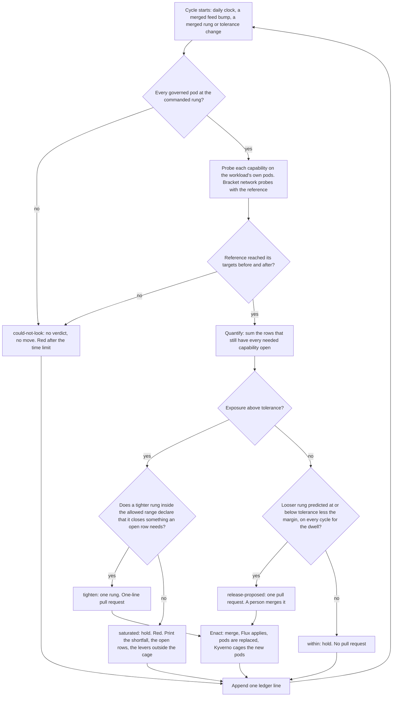
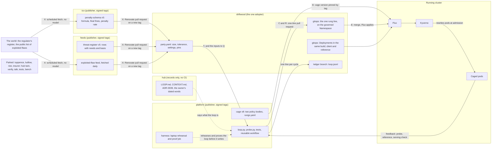

# TARGET: one loop, one ledger

Integrator's merged design, 2026-11-14. Read-only pass. Nothing here has been built, run, moved or removed. This file is the only file written. **Revised 2026-11-14 after an independent critic's review. This file is superseded wherever `DISTILLATION.md` sections 5.6 and 7 or `LEDGER.md` differ. Section 16, at the end, lists each superseded passage, maps the decision numbers and gives the line offset this revision caused.**

**The yardstick.** The owner's sentence of 2026-11-14 outranks every other document:

> "quantified risk and a reactive ratcheting process cage to mitigate the quantified risk until the risk is within financial tolerance of the organisation"

**What was merged.** Four designs (`designs/first-principles.md`, `subtractive.md`, `owner-words.md`, `the-room.md`), three judges, four keystone checks (K1 to K4). All three judges chose owner-words. It is the spine here. Summed scores: owner-words 130, first-principles 123, the-room 115, subtractive 102.

**Citations.** `repo/path:line` is a path under the `fresh/` clones of 2026-11-14. AT:n is `hub/.scratch/drift-review-2026-08-27/evidence/AMBITION_TIMELINE.json` line n. T75:n is `hub/.scratch/ecosystem/issues/75-grilling-what-is-this-for-the-twelve-questions.md` line n. RA:n is `hub/.scratch/drift-review-2026-08-27/REGRILL-ANSWERS.md` line n. K1 to K4 are the files under `keystones/`. "Relayed" means a map, design or judge found it and I did not open the source.

**Opened and checked in this pass.** `platform/compose/composition.py:3191-3212`; `platform/wargamer/inventory.py:55-66`; `platform/graded/cage.py:66-112`; `driftwood/composed/policies/v7.0.0/cage-netpol.yaml:14-43` and `cage-tier.yaml:20-22`; `driftwood/gitops/flux-system/gotk-sync.yaml:21`; `driftwood/gitops/apps/namespace.yaml:30`; `driftwood/party.yaml:43,60,71-73,106`; `driftwood/gitops/apps/{api.yaml:5,pod.yaml:42,storefront.yaml:55}`; `driftwood/drift/five-facts.py:958-1000`; `ico/schema/to_fair_scenario.py:69,206-250`; `ico/penalty-schema/{v3,v4}/feed.json`; `feeds/threat-register/v4/feed.json` (driftwood row). Line counts are my own count of tracked text lines in the clones. Binary files count as nought. The totals agree with the maps: hub 1,767,230 (A3 gives 1,767,324), platform 76,365, driftwood 50,676 (D1), tuppence plus ludlow 92,082 (D2), the four publishers 108,731 (F1 gives 108,732).

---

## 1. Terms

- **Exposure**: the organisation's expected loss in pounds a year.
- **Tolerance**: the loss in pounds a year the organisation says it will bear. The record calls it appetite.
- **Cage**: the limits placed on a running process from outside. **Dial**: one such limit. **Rung**: a named set of dial settings. Rungs are ordered loosest to tightest and each keeps the dials of the rung before it. **Notch**: a move of exactly one rung.
- **Capability**: one thing a running process can do that a test can check, such as "open a connection to the internet".
- **Row**: one way a loss happens, published in a feed. It has events a year, pounds an event, and `needs`: the capabilities the loss requires. A row is open while every capability in its `needs` list is open. Closing any one of them closes the row. Alternative attack paths are published as separate rows.
- **Probe**: a test on the running cluster that reports one capability as open or closed.
- **Reference**: a pod outside the cage that runs the same network probe. It proves the network works, so a silence can be blamed on the cage.
- **Serving check**: a client in another namespace that asks the workload for a page and counts the answers.
- **Feed**: a published file of numbers about the world, cut under a signed version tag. **Publisher**: the party that cuts it. **Adopter**: the organisation that is caged.
- **Ledger**: a file with one line per run of the loop.
- **Cycle**: one pass of sense, price, compare, decide, enact.
- **Settled**: every governed pod is observed at the rung last commanded.
- **Three-point estimate**: a lowest, most likely and highest value. Its mean is (lowest + 4 x most likely + highest) / 6. The estate calls it a PERT triple.
- **Closed form**: a figure worked out by formula. **Monte-Carlo**: the same figure estimated by simulating many random years.
- **Pod, Deployment, Namespace**: Kubernetes' unit of running processes; the object that replaces pods when their template changes; a named area of a cluster.
- **Flux**: the tool that makes a cluster match git. **Kyverno**: the tool that rewrites a pod as the cluster admits it. **Renovate**: the tool that opens a pull request when a pinned dependency has a new version.
- **Kustomize**: the tool Flux uses to build a set of manifests and stamp shared values onto them. **Kustomization**: one such build. A stamp reaches only the manifests in its own build.
- **CI**: the automated jobs a repository runs on a schedule or on a change. **ADR**: an architecture decision record under `hub/docs/adr/`. **IPC**: the channels processes on one machine use to talk to each other.
- **Park**: leaves the working tree and CI, stays in git history or on an archive branch. **Cut**: leaves the tree with no archive branch, because it is a copy, generated output or session exhaust. Git history still holds it.

---

## 2. Mission

> Price the organisation's risk in pounds a year. Compare it with the pounds a year the organisation says it will bear. While risk is higher, tighten the cage on its running processes one notch, measure what the tighter cage stops, and price again. Stop when risk is within tolerance. Start again when the world changes.

55 words.

---

## 3. The loop



Loop steps on the diagram: Q is "Quantify". T is the tolerance read from `party.yaml`. C is the compare. R is "tighten" or "release-proposed". E is "Enact". X is "Cycle starts".

### 3.1 What "ratchet" means

1. **One notch per cycle.** A notch is exactly one rung, in ladder order. The loop takes it only when exposure is above tolerance and some tighter rung, inside the range the organisation allows, declares that it closes a capability an open row needs.
2. **No new notch until the last one is settled.** The loop reads the rung stamped on every governed pod first. If any pod is not at the commanded rung the outcome is could-not-look and nothing moves. After a time limit (10 minutes by default, a setting) the run goes red. At most one tightening pull request is open. While it waits for a merge, each cycle appends a ledger line marked `waiting_on_merge` and opens nothing.
3. **It holds.** With no change in the world the rung stays. The loop never loosens by itself.
4. **It lets go only when a person lifts the catch.** See 3.4.

Declarations in `rungs.yaml` answer one question only: could a tighter rung help? They never move money. Only a probe does.

The loop may pass through a rung that closes nothing an open row needs, on its way to one that does. The ledger shows that notch with zero gain. On a cluster that stays up, the next cycle starts as soon as the pods settle, so the cost is minutes.

### 3.2 The stop condition

Measured exposure is at or below tolerance, on settled pods, with a reference that worked. The verdict is `within`. The loop opens nothing and runs again on the next clock or change.

If a row has a missing number and cannot be priced, exposure is a lower bound. A lower bound above tolerance still tightens. A lower bound at or below tolerance gives `within-partial`, names the row, and never releases.

### 3.3 When no rung brings exposure within tolerance

The verdict is `saturated`. It is decided as early as possible: if no tighter rung in range declares a gain, the loop is saturated at the rung it is on. It does not climb for nothing.

The loop then:

1. holds, and ends the run red, every cycle, until the shortfall closes. It opens one issue per saturated episode, assigned to the person named in `party.yaml`, so a red run has a reader. The owner foresaw the state: "if the org finds itself deadlocked we may later need to consider a overrides or reconciler stage" (AT:2857). No reconciler is designed here;
2. prints the shortfall: exposure minus tolerance, in pounds a year;
3. lists the rows still open, with their amounts;
4. names the levers outside the cage and takes none of them. **Fix**: implement a control (the regulator feed's `control_weights` for the tier in use are listed by control id and weight, labelled editorial, with no pounds). **Transfer**: insure the shortfall. **Accept**: the organisation restates its tolerance, in a dated change to `party.yaml` that names no workload. **Stop running**: the organisation's decision, not a rung.

Every cycle the loop also prints the **unreachable part** (the sum of the rows no rung in range can close; the ledger field is `unreachable`) and `reachable: yes` or `no`, before it acts. If tolerance is not reachable the run is red from the first cycle. The loop still takes any notch in range that lowers the figure, because the sentence says "mitigate".

**The range.** By default the range ends at the tightest rung on which the workload still serves. A rung that stops the workload serving is entered only if the organisation has set `cage.may_stop_serving: true` in `party.yaml`. That is a dated, whole-organisation setting. It names no workload, so it is not an exemption (AT:2815). Nothing is ever denied: at the last rung the process still runs (T75:79). This default is owner decision 8.

**Serving is measured; the declaration is only a forecast.** `rungs.yaml` says which rungs are expected to stop a workload serving. The serving check says what happened. If the serving check fails after a notch onto a rung declared serving, and `may_stop_serving` is not set, the loop takes no further notch, ends the run red with the cause `serving-lost`, and opens a one-notch release proposal for a person at once. The margin and dwell do not apply, because the cause is the range, not the price. The loop still does not loosen by itself. If `may_stop_serving` is set, the loop records the count and carries on. A rung that crashes the workload outright is caught earlier: with `maxUnavailable: 0` and a readiness check the old pods keep serving, the rollout never settles, and the outcome is could-not-look, red after the time limit.

### 3.4 How loosening happens

Only by a release, one notch at a time.

- **When.** The verdict is `within`, and the exposure predicted one rung looser is at or below (1 - margin) x tolerance on every cycle for the dwell. Defaults: margin 20%, dwell 7 days. Both are settings in `party.yaml`.
- **Predicted from what.** From the capabilities last measured on that looser rung under the present cage version. If the ledger holds no such measurement, from the declarations, and the pull request says so.
- **Who.** The loop opens the pull request with the pounds before and after. A person merges it.
- **Damping.** One release proposal open at a time. A closed, unmerged proposal is not raised again for a half-life set in `party.yaml`, or until an input changes, whichever comes first. This is the owner's rule: "Flood guard with a half life. Point in time rejection does not mean never" (RA:28). Today's code uses 30 days (verdicts/L11, relayed). The margin of 20% and the dwell of 7 days are this design's own choice, with no outside source.
- **What causes it.** A publisher lowers a number, a flaw is patched, or the organisation restates its tolerance or size.

A person who loosens the rung line by hand is corrected, not blocked: the next cycle measures and tightens again if exposure is above tolerance.

### 3.5 The feedback, exactly

```
row is closed  when the probe found closed, this cycle, any one capability in its needs list
row amount   = mean(events a year) x ( mean(direct loss) + penalty_rate x mean(penalty at the adopter's turnover) )
exposure     = sum of the amounts of the rows that are not closed
```

- No rung carries a number. The typed table (0.30, 0.70, 0.92, 0.98, `platform/graded/cage.py:82-111`, "evidenced by nothing but this comment", `:71-72`) is dropped.
- A row with an empty `needs` list never closes. The cage earns nothing for it.
- A capability no probe can test counts as open.
- The figure is priced from this cycle's probe, never from the rung in git. If Flux did not apply, the pods were not replaced, or the network does not enforce the rule, the capability is still open and the figure does not fall.
- Each network probe is bracketed by the same probe from the reference, before and after. If the reference fails, the cycle is could-not-look. A broken network is never read as a closed capability. The estate already does this for one fact (`driftwood/drift/five-facts.py:958-1000`).

So the enacted cage changes the next figure through one route only: capabilities a probe finds closed on the workload's own running pods.

### 3.6 The one rule on unsourced numbers

**An unsourced number may raise the figure. Only a measured closure of a capability that a signed, dated `needs` list names may lower it.** The closure is measured. The claim that the closure stops the loss is not: the `needs` list is editorial, and the ledger prints its basis. A need that cites no outside source for the attack technique is ignored. Until the penalty rate and the fine tier are sourced, each priced row is an upper bound, not an estimate, and the ledger prints `bound: upper`.

Applied:

- An input with no cited basis is taken at its conservative end, if it has one. A penalty rate nobody has counted is 1. A fine tier the row does not cite is the higher tier.
- An input that is missing altogether has no conservative end. Its row is unpriced and exposure is a lower bound (3.2).
- Every ledger line prints `sourced_share` (the fraction of exposure whose every input has a counted or cited basis), the weakest basis among its inputs, and the break-even penalty rate.

This settles a clash between two grafts. The spine counted an uncounted penalty rate as 1. First-principles treated it as unpriced, which left driftwood at a lower bound of GBP 19,500 and a loop that never moves. A probability has a top end, so it is priced at 1. Whether the loop may act on such a figure is owner decision 7.

### 3.7 Outcomes

Six verdicts and one non-verdict:

| Outcome | Meaning | Loop does |
|---|---|---|
| `within` | exposure at or below tolerance | holds |
| `within-partial` | lower bound at or below tolerance, a row unpriced | holds, names the row, never releases |
| `tighten` | above tolerance, a rung in range declares a gain | one notch |
| `saturated` | above tolerance, no rung in range declares a gain | holds, red, shortfall and levers |
| `cage-ineffective` | a capability `rungs.yaml` declares closed at the commanded rung is measured open on settled pods | holds, red, names the capability, takes no further notch |
| `release-proposed` | within and the release rule met; or serving lost on a rung declared serving | opens one pull request for a person |
| could-not-look | pods not settled, reference failed, no cluster, or a feed or probe unreadable | no verdict, no move; red after the time limit. The only figure it may print is the uncaged one (every capability taken as open), labelled as such |

---

## 4. The numbers

### 4.1 Tolerance

- **Where it comes from.** Outside the loop. The organisation declares it in its own `party.yaml`: amount, currency, "a year", the statistic it limits, one line of basis, who declared it and when. It may be stated as a share of turnover; the loop turns that into pounds.
- **What exists.** GBP 40,000 for driftwood (`driftwood/party.yaml:60`), GBP 15,000 for tuppence, GBP 5,000 for ludlow. They first appear in an automated build commit of 2026-07-31 (platform 7a36bf7, relayed, K3). No owner sentence gives a figure (map A1). As a share of turnover they run backwards against size: driftwood's is 465 parts per million of GBP 86,000,000; ludlow's is about 0.03 (relayed).
- **Until the owner answers.** The loop compares against GBP 40,000 and prints `tolerance_basis: fixture 2026-07-31, not owner-declared` on every line. Owner decision 3.

### 4.2 Exposure

The formula is in 3.5. Where each part comes from:

| Part | Published by | Status today |
|---|---|---|
| Whether a capability is open | nobody; measured each cycle by the probe | new; not yet run |
| Which capabilities a row needs | threat publisher, in the row | not published; today's rows have no `needs` |
| Events a year, direct loss | threat publisher | editorial (`feeds/threat-register/v4/feed.json`, driftwood row: "DBIR retail-sector web-app-attack base rate, editorial midpoint") |
| Penalty size | regulator publisher | published fines and the statutory formula, scaled to turnover (`ico/schema/to_fair_scenario.py:206-250`) |
| Penalty rate (chance one breach draws a penalty) | regulator publisher | not counted: "no run of this repository has counted a regulator's own published enforcement register" (`ico/penalty-schema/v4/feed.json:65`) |
| Fine tier a breach draws | the row cites it | not cited; the composer prices the lower tier (`platform/compose/composition.py:3481-3482`, relayed, K2) |

**The fine moves.** Today the fine is its own line at an editorial one, two or four fines a year (`ico/schema/to_fair_scenario.py:69`). So it is a fixed 2.0781% of turnover for every adopter (relayed, F1) and measures size, not risk. In the owner's words the fine is "for a breach" (AT:324). Here it is a consequence of a breach row, so it rises and falls with the paths the cage opens and closes.

**The compared figure is the mean, in closed form.** It is exact, needs no seed, and can be checked by hand in a pull request (`platform/fair/fair.py:106-131`, relayed). The existing simulation rounds each year's event count, so anything rarer than one year in two simulates to nought (`fair.py:160`, relayed). A Monte-Carlo with Poisson counts lives in the tests as a cross-check. The owner asked for Monte-Carlo by name (AT:2263), so which statistic is compared is owner decision 5. If the owner picks a bad-year percentile, the simulation moves from the tests into `loop.py`, about 40 lines, and nothing else changes.

### 4.3 What a rung buys

Not a number. It is the sum of the rows the probes find closed after the rung is enacted. Two things would make that dishonest, and each has a guard:

- **A flattering `needs` list.** The list is the publisher's statement about how an attack works. It must be in a signed feed tag dated before any ledger line uses it. When unsure, the row lists fewer needs, so the cage earns less. Each need cites an outside source for the attack technique, and a need without one is ignored. The claim that closing a capability stops the loss stays editorial, and the ledger says so.
- **A thin register.** If the register holds only losses that pass through the caged process, the loop can report `within` because losses elsewhere were left out. The threat publisher must carry at least one row with empty `needs` for losses outside the cage (a stolen laptop, an insider). Its frequency and size are the publisher's, with a stated basis. This design does not invent them. Its size alone can decide `saturated`.

### 4.4 Is the pound cardinal, and is it an estimate?

It is cardinal: pounds a year on the same scale as the tolerance. Until the penalty rate and the fine tier are sourced it is an upper bound, not an estimate (rule 3.6): driftwood's GBP 16,280,871 is 18.9% of turnover a year in fines. The record made it ordinal, "not an expected annual loss", on a one-word reply (T75:78, T75:111; `driftwood/composed/HEADER.yaml:1371-1372`, relayed). An ordinal cannot be within a tolerance stated in pounds. All four designs agree. T75:111 records the ordinal choice as delegated, so the sentence of 2026-11-14 decides it. The reversal is listed under `DISTILLATION.md` decision 7.

A cardinal figure on unsourced inputs is a bound, and says so on every line. Today `sourced_share` is nought.

### 4.5 Driftwood's arithmetic on committed inputs

My arithmetic, closed form, from the files named above. Driftwood's one priced threat row: 2, 4, 9 events a year (mean 4.5); GBP 1,000, GBP 4,000, GBP 9,000 an event (mean GBP 4,333). Direct loss: GBP 19,500 a year. Turnover GBP 86,000,000 (`driftwood/party.yaml:43`). Tolerance GBP 40,000. A second driftwood row, `scheduled-agent-misuses-write-credential`, has a published frequency and no magnitude: "This register publishes no loss magnitude for this row" (`feeds/threat-register/v4/feed.json:44`, `:64`). The twin and the composer supplied its magnitude, and both are parked. Feeds v5 must publish the magnitude with a basis. Until then the row is unpriced and driftwood can reach only `within-partial`. The row is not dropped: if the loop's own merge job runs, it is a scheduled agent with a write credential.

| Regulator feed and tier | Mean penalty per breach | Exposure, path open, rate 1 | Times over | Break-even penalty rate |
|---|---|---|---|---|
| v3, lower tier (driftwood's pin today, `gotk-sync-ico.yaml:34`; the tier the composer prices) | GBP 823,556 | GBP 3,725,501 | 93 | 1 in 181 |
| v4, lower tier (signed since September, not yet adopted) | GBP 301,824 | GBP 1,377,707 | 34 | 1 in 66 |
| v3 or v4, higher tier (what rule 3.6 selects until a row cites a tier) | GBP 3,613,638 | GBP 16,280,871 | 407 | 1 in 793 |

`E(p) = 19,500 + p x 4.5 x penalty`. Break-even is the rate at which E equals GBP 40,000.

What the table says:

- At rate 1 driftwood is far above tolerance under every reading. The loop's behaviour is the same in all three rows.
- Below the break-even rate driftwood is within tolerance with no cage beyond the loosest rung, and the loop has nothing to do.
- So whether driftwood needs any ratcheting turns on a count the regulator publishes and nobody in the estate has made. The count: could not determine in this pass (no network).
- The spine quoted GBP 3,731,329 for the first row. That figure mixed a simulated mean with the closed form. The comparator is the closed form, so the figure is GBP 3,725,501.

The record's own figures, for comparison: driftwood GBP 1,807,494 uncaged; a partial sum of GBP 36,150 against GBP 40,000 at the top rung with a null verdict, under tolerance only because of the typed 0.98 and with the supersede line and the cage's GBP 15,000 run cost left out (K3).

---

## 5. The cage

### 5.1 The target ladder (cage version 8)

One rule chooses the dials: **a dial is a notch only if it closes a capability a row can need and a probe can see.** One rule orders them: **the dial that stops the workload serving comes last.**

| Rung | Dials added | Capability closed | Probe | Still serves? |
|---|---|---|---|---|
| baseline | no host network, process or IPC namespace; not privileged; no privilege escalation; CPU and memory ceilings | `host` | read back from the pod | yes |
| restricted | non-root; all Linux capabilities dropped; read-only root filesystem; default service-account token not mounted | `write-root`, `sa-token` | write a file in the app container; look for the token file | yes |
| quarantine | egress to name lookup only | `egress` | connect out from the pod to a sink outside the namespace, bracketed by the reference | yes |
| isolated | no ingress, no egress | `inbound`, `dns` | request from the client namespace; a name lookup; bracketed | no |

- An unlabelled or unknown rung falls to `isolated`, as now. Always caged (AT:2780).
- Gone from the cage body: the firewall sidecar (its image exists in no registry and the stand-in sleeps, `driftwood/.github/workflows/drift-sample.yml:68-70`, `platform/graded/waf-placeholder/Dockerfile:14-19`, relayed); the eviction class; every reduction and cost figure.
- The owner named the firewall (AT:1005). It returns as a dial between quarantine and isolated when a real image exists and its share of a standard attack test set can be measured. Until then it earns nothing.
- The service-account token is switched off on the Namespace's default ServiceAccount, because a rewrite at admission runs after the token is already mounted (the-room).

### 5.2 Re-caging what is running

Today the cage policy fires only when a pod is created or updated (`cage-tier.yaml:20-22`), the network policy generator does not synchronise (`cage-netpol.yaml:14-16`), and the three workloads are bare Pods (`api.yaml:5`, `pod.yaml:42`, `storefront.yaml:55`). A new rung would never reach a running process.

In the target:

- The workloads are Deployments with `maxUnavailable: 0` and a readiness check.
- The one rung line stays where it is today: the tier label on the governed Namespace (`gitops/apps/namespace.yaml:30`). The cage still reads the rung from the Namespace alone, so a workload cannot declare its own cage.
- One Kustomization builds the Namespace and the Deployments together. In that build Kustomize copies the rung into an annotation on each pod template. The annotation's only job is to change the template. A rung change therefore replaces the pods, and the new ones are caged at admission.
- The adopter's own Flux source follows its own `main`. A merged notch is an enacted notch. This removes the self-pin that sits 164 commits behind `main` (`gotk-sync.yaml:21`). The Namespace carries `kustomize.toolkit.fluxcd.io/prune: disabled`, so a mis-edit cannot garbage-collect it and its pods.
- The cage version stays pinned to the platform's signed tag. A notch is the adopter's line. A version is the publisher's. Two axes, kept apart.

One graft was named by the judges and is not used: a second Flux source for the tier alone, with the apps left on a tag pin. It protected a rule of the old image scan (`platform/wargamer/inventory.py:55-66`: exactly one tag-and-commit source). That scan is gone by the time this lands (step 6). A separate build would also stop the stamp reaching the pod templates, because a stamp reaches only its own build. The prune guard from the same graft is kept.

Not tested in this pass: that Flux applies the Namespace label before the new pods arrive in one build. Step 3 checks it.

### 5.3 Which cage the early steps run on

Steps 1 to 4 of the sequence run on the cage as served today, version 7. `rungs.yaml` for version 7 states the truth about it: `restricted` and `quarantine` share one reach shape, and every rung above `baseline` admits ingress from the same namespace only (`cage-netpol.yaml:43`). So on version 7 the first notch already stops a public shop serving outsiders. Those steps are measure-only. Step 5 measures version 8 as a candidate, still measure-only. The first notch made by the loop comes at the cut-over (step 6), on version 8.

---

## 6. Components



Line budgets count authored code, configuration and hand-kept data. They do not count fetched data, the ledger or licences.

| # | Repo | Component | Job | Step | Lines | Reuse or new |
|---|---|---|---|---|---|---|
| 1 | platform | `loop/loop.py` | Price each row by its measured state; read tolerance; decide; rewrite the one rung line; write the ledger line; `--what-if` reruns with one input changed | Q T C R | 280 | Lifted from `fair/fair.py:106-131`, `risk/enforce.py:81-98`, `wargamer/tier_pr.py:327-360`, `ico/schema/to_fair_scenario.py:206-250` |
| 2 | platform | `loop/probe.py` | Read each pod's stamped rung; probe each capability on the workload's own pods; bracket with the reference; run the serving check | feedback | 170 | Condensed from `driftwood/drift/five-facts.py` (cluster reader, facts 6 to 8, the bracket at `:958-1000`). The inward probe is new |
| 3 | platform | `loop/inventory.py` | Scan the served images; match against the exploited-flaw feed; emit one row | Q | 90 | Shrink of `wargamer/inventory.py` (289) and `feeds/to_fair_scenario.py` (439) |
| 4 | platform | `loop/test_loop.py` | The semantics of section 3 as tests; closed form against a Poisson Monte-Carlo | evidence | 170 | New |
| 5 | platform | `cage/` policy bodies | One rewriting policy, one network-policy generator, a kustomization | cage | 120 | `distribution/policies/v7.0.0/cage-tier.yaml` (43), `cage-netpol.yaml` (45), edited to the ladder in 5.1 |
| 6 | platform | `cage/rungs.yaml` | Per rung: dials, capability closed, probe, whether it stops serving | R, feedback | 40 | New; replaces `graded/cage.py:82-111` |
| 7 | platform | `cage/kyverno-test/` | One pod per rung and its expected result, so a consumer can test locally | evidence | 80 | Shrink of `graded/tests/` |
| 8 | platform | `harness/` | Laptop rehearsal: local cluster, Kyverno 1.18.2, Flux, a git server on the host, a test party and test rows, a label-only cage | evidence | 200 | `driftwood/scripts/up.sh`, `driftwood/git-server/` (69), `driftwood/kind/` |
| 9 | platform | `.github/workflows/loop.yml` | Reusable: verify the pinned tags, build or reach the cluster, probe, price, decide, open the pull request, append the ledger | all | 220 | Shrink of `driftwood/.github/workflows/propose-tier.yml` (390) and `drift-sample.yml` (485) |
| 10 | platform | `.github/workflows/proof.yml` | Unit tests; harness run; label-only negative control; policy-removed control | evidence | 80 | New |
| 11 | platform | `.github/workflows/cut-release.yml` (the file name stays, because driftwood's check of who signed a tag names it) | Cut and sign the version tag; the bump is declared | E | 120 | Shrink of `cut-release.yml` (210) and `release.yml` (166) |
| 12 | ico | `penalty-schema/v5/feed.json` | Formula, cap, final fines, penalty rate, each with basis and date | Q | 150 | Trim of `penalty-schema/v4/feed.json` (557) plus one field |
| 13 | ico | fetch and release | Count the regulator's register on a clock, no model; a person merges and tags, so the regulator's path stays human-gated | X | 250 | The count is new work: ico ships no fetcher of the register today (`ico/.github/workflows/fetch.yml:23-24`). The rest is a shrink of `.github/workflows/fetch.yml` (215), `cut-release.yml` (116), `release.yml` (137) |
| 14 | feeds | `threat-register/v5/feed.json` | Rows: events a year, direct loss, `needs`, the tier cited, basis; rows for losses outside the cage | Q | 90 | `threat-register/v4/feed.json` (179) plus `needs` |
| 15 | feeds | exploited-flaw fetch and release | Fetch the public list daily; tag | X | 300 | Shrink of `fetch/cve.py` (142), `fetch/lib.py` (173), `.github/workflows/fetch.yml` (217) |
| 16 | driftwood | `party.yaml` | Size; tolerance with basis; release margin and dwell; `may_stop_serving`; merge mode; feed pins | T | 30 | Shrink of `party.yaml` (133) |
| 17 | driftwood | `gitops/` | The governed Namespace with the one rung line; three Deployments, Service, ServiceAccount, built together so the rung is stamped onto the pod templates; client and reference in their own namespaces; Flux sources (own repository on `main`, cage by signed tag); engine pin | E | 230 | Shrink of `gitops/` (741) |
| 18 | driftwood | `renovate.json` | Bump the cage tag, the feed tags and the loop's own tag | X | 35 | Shrink of `renovate.json` (158) |
| 19 | driftwood | `.github/workflows/loop.yml` and a cut-down `renovate-run.yml` | Caller: daily clock, merged change, manual run. The Renovate runner, because `renovate.json` alone switches Renovate off | X | 25 as first budgeted; about 65 with the runner | New; replaces nine workflows |
| 20 | driftwood | `README.md` | Where things are | record | 20 | Shrink |
| 21 | hub | `LOOP.md` | The owner's sentence and dated words; section 3; the basis of every number; open questions | record | 150 | New; replaces `NORTH-STAR.md` (143) |
| 22 | hub | `CONTEXT.md` | The loop's terms only | record | 60 | Shrink of `CONTEXT.md` (958) |
| 23 | hub | `docs/adr/0039-loop-semantics.md` | The one decision record; names what it supersedes | record | 60 | New |
| 24 | hub | `README.md` | Where things are | record | 30 | Shrink |
| | | **Total** | | | **3,000** | |

By repository: platform 1,570; ico 400; feeds 390; driftwood 340; hub 300. Against 24,636 lines on today's chain (FACTS item 10) and 2,095,084 tracked text lines in the nine repositories.

The spine's budget was 2,000. The grafts add about 500 (bracket, serving check, settle read, harness, proof job). The reusable workflow is budgeted at 220, not 110: a judge found 110 not credible for a job that replaces 875 lines including cluster bring-up.

**Where the ledger lives.** Until the cut-over, the line is appended through the estate's existing observation lane: the declared list of paths a scheduled job may commit (`driftwood/.github/workflows/propose-tier.yml:74`). That is the judges' graft, used as far as it goes. After the cut-over the hub's delivery tool behind that lane is parked, so the ledger moves to its own branch that only the workflow's identity writes. The repository's own notes already name a branch for clock output (`driftwood/.github/rulesets/README.md`). The lane's idea is kept as a check: the loop job may write the ledger line and the one rung line, nothing else. Whether the forge's live rules would refuse that push: could not determine. The one ruleset file in the repository restricts declaration paths only, and its notes say it was not in force on 2026-08-28.

**The ledger line**, one per cycle:

```json
{"ts":"...","org":"driftwood","run":"...","commit":"...","source":"loop","cluster":"throwaway",
 "feeds":{"ico":"v3.0.0","threat-register":"v4"},"cage":"7.0.0",
 "rung_commanded":"isolated","rung_observed":"isolated","pods":["..."],
 "probe":{"write-root":0,"sa-token":1,"egress":0,"inbound":0,"dns":0},
 "reference":{"egress":1,"inbound":1,"dns":1},"serving":{"ok":0,"total":120},
 "exposure":16280871,"priced":[{"row":"driftwood headline threat","amount":16280871,"bound":"upper"}],
 "unpriced":["scheduled-agent-misuses-write-credential"],
 "unreachable":16280871,"reachable":false,
 "tolerance":40000,"tolerance_basis":"fixture 2026-07-31, not owner-declared",
 "verdict":"saturated","pr":null,"merged_by":null,
 "sourced_share":0.0,"weakest_basis":"editorial","break_even_penalty_rate":0.00126}
```

The values shown are what step 4 would print on today's inputs (section 7). `source` is `composer` for the "before" rows of step 1. `cluster` is `none`, `harness`, `throwaway` or `persistent`.

**What the 2022 thesis still does here.** Policy is a versioned dependency: the cage and the feeds are signed tags, adopted by pull request, delivered by Flux. The seven "-ables" are the acceptance list and cost no lines: all in git (visible); the pull request body states pounds before and after (communicable); one data file per publisher (consumable); components 4, 7 and 10 (testable); `loop.py --what-if` on a laptop (usable); Renovate (updatable); the ledger (measurable). `rungs.yaml` carries the why of every dial.

---

## 7. The recommended options, walked together

The recommended answers, in the numbering of `DISTILLATION.md` section 7, are: release by proposal (1); the loop merges tightenings once the owner has authorised the App route and its test has passed, and until then a person merges every notch (2); GBP 40,000 labelled as a fixture until restated (3); the mean (4); tighten on unsourced numbers but never unattended onto a non-serving rung (5); cost printed, not compared (6); floor removed and rung reset (8); throwaway cluster first (9). Cardinal and whole-organisation exposure are decided. Taken together, on today's inputs, the ledger would read as follows. This is a prediction from files, not an observation.

| Step | Cage, feeds | Rung | Exposure | Verdict | What it shows |
|---|---|---|---|---|---|
| 1 | v7; composer's own figures | isolated (declared and observed) | uncaged GBP 1,807,494; partial residual GBP 36,150 | null, `source: composer` | The "before" record, from today's chain, untouched |
| 2 | v7; pinned feeds; no cluster | none read | GBP 16,280,871, printed as the uncaged figure | could-not-look, no verdict | The arithmetic runs. No probe, so no decision |
| 4 | v7; pinned feeds; daily throwaway cluster | isolated, observed | GBP 16,280,871, an upper bound on the priced row; one row unpriced | `saturated`, red | The top rung is in force and the figure has not moved, because no published row says what the cage closes |
| 5 | v8 and threat-register v5 as candidate inputs; driftwood's pins unmoved | isolated, observed | the unreachable part: the rows with empty `needs` | `within` or `saturated`, by the publisher's outside-the-cage row | The cage is credited for the first time, by measurement |
| 6 | v8 and v5 adopted; reset to baseline | baseline | GBP 16,280,871 plus the outside-the-cage rows | depends on `needs` | See below |

At step 6 the outcome depends on what the threat publisher says the row needs:

- **Walk A, by hand: the row needs only `inbound`** (the plainest reading of a web-application attack that takes data out in replies). Day 1, `baseline`: exposure = 4.5 x (GBP 4,333 + 1 x GBP 3,613,638) = GBP 16,280,871 against GBP 40,000. Only `isolated` closes `inbound`, and `isolated` stops the shop serving, so it is outside the range. Unreachable: GBP 16,280,871. Verdict `saturated`, red, no notch. Every later day reads the same, and nothing is ever released, because release needs `within`. That is the honest answer on today's numbers: the only cage that brings driftwood within tolerance is one in which the shop is not a shop. Both the spine and first-principles reached the same finding.
- **Walk B, by hand: the publisher writes `needs: [egress]`, with an outside citation.** Day 1, `baseline`: GBP 16,280,871, verdict `tighten`, one notch to `restricted`. Day 2, `restricted`: the egress probe still gets through, GBP 16,280,871, a notch at zero gain to `quarantine`. Day 3, `quarantine`: the egress probe is refused while the reference gets through, the row closes, and exposure is the outside-the-cage rows alone. The verdict is `within` only if those rows are at or below GBP 40,000 and the second row has a published magnitude; otherwise `saturated` or `within-partial`. That is three days on throwaway clusters. Each notch waits for a person to merge until the owner has authorised the App route of `DISTILLATION.md` decision 2 and its test has passed. If the publisher splits the threat into several rows (one that needs `egress`, one that needs `write-root`), the figure falls row by row in the same way.
- **If the owner sets `may_stop_serving: true`**: the loop climbs to `isolated` in three cycles, two of them at zero gain. The serving count falls to nought and the ledger shows it.
- **If the regulator publisher counts a penalty rate below break-even** (about 1 in 793 at the higher tier): driftwood is within tolerance at `baseline`. The demonstration is then the tolerance step (lower it in a dated commit and watch the loop respond) and the break test (section 11).

Without the range limit as recommended, the first automatic act of the new loop would take a shop off the network on a penalty rate of 1 that nobody has counted. That is why the recommendation is "not unattended, for now". **Tuppence cannot be priced by this loop at all**: it is parked, and its twin line, 81.8% of its figure (K3), is gone. As a what-if, driftwood's row at tuppence's size (GBP 861,741,000) and tolerance (GBP 15,000) gives 4.5 x (GBP 4,333 + GBP 32,893,885) = GBP 148,041,982. On tuppence's own row (10 events a year at GBP 32,500) the direct loss alone is GBP 325,000, above GBP 15,000 at any penalty rate. At rate 1 it is GBP 329,263,850, which is 38% of turnover. Tuppence would read `saturated` and never release unless a serving rung closes its row.

---

## 8. How each disagreement was resolved

| # | Disagreement | Resolution | Why |
|---|---|---|---|
| 1 | What carries the feedback: a probe, or a typed reduction read at the enacted tier | **Probe.** Settled here | K2: the typed table is the open loop's core defect. With it, a cage of labels alone lowers the money. Subtractive's figure survives only as the "before" row, labelled `source: composer` |
| 2 | One notch: every rung in order, or skip to the nearest rung that lowers the figure | **Every rung in order**, but only when a rung in range declares a gain. Settled here | Three designs agree. A skip moves on a prediction. Passing through measures each rung, which the release rule needs. The guard stops a climb that buys nothing |
| 3 | Release: automatic both ways, by proposal, or never | **Owner decision 1.** Target works under: tightens by itself, releases by a proposal a person merges, after a margin and a dwell | Map A1 could not determine what the owner meant. One-way is where the estate is stuck (K1). The margin and dwell stop one release causing the next tightening |
| 4 | Who merges a tightening | **Owner decision 2**, an authorisation. Target works under either: a `merge` setting, and the ledger shows the wait | It reverses ADR-0023 and ADR-0024. It matches the substance of T75:80 (the assistant approves and merges everything in development) and departs only from its story (a person does). The same question covers feed bumps. The identity that merges, and its limits, are in `DISTILLATION.md` decision 2 |
| 5 | How the world arrives: pinned feeds and Renovate, or read the newest tag | **Pinned feeds and Renovate, one mechanism.** Non-major bumps merge by themselves if decision 2 allows. Settled here | The pin makes every ledger line recomputable and every change a diff. The stall was the merge, not the pin. It keeps the 2022 thesis |
| 6 | Where the cage is enacted | **Owner decision 10** (money or a machine). Target stages it: laptop harness, then the daily throwaway cluster, then a cluster that stays up. Each ledger line says which | Only a cluster that outlives a cycle re-cages a process that was already running |
| 7 | Repair the composer, or replace it | **Replace**, with a staged cut-over. Settled here | Three designs and all three judges. Subtractive's base is 38,913 lines whose feedback is modelled. The cut-over rule (section 10, step 6) answers the "two systems for seven steps" flaw |
| 8 | The fine: its own yearly line, or a consequence of a breach | **Consequence of a breach.** Rate 1 and the higher tier until cited, by rule 3.6. Settled here; acting on it is owner decision 7 | The owner's words are "for a breach" (AT:324). The yearly line measures only size |
| 9 | Tolerance figure and unit | **Owner decision 3.** Target carries a basis line and accepts a sum or a share of turnover | No design can supply the number |
| 10 | Mean or bad year | **Owner decision 5.** Target compares the closed-form mean; Monte-Carlo is a test | The owner asked for Monte-Carlo by name. A percentile reads nought for anything rarer than one year in twenty |
| 11 | Whose exposure; and may the loop take the service to a non-serving rung | **Owner decisions 6 and 8.** Target: the whole organisation's exposure; the range ends at the tightest serving rung unless the organisation says otherwise | The tolerance is the organisation's, so the risk compared with it must be too; whose exposure is decided, not asked. The owner's doctrine allows a non-functional cage (AT:2962) but does not say unattended, on uncounted numbers |
| 12 | How many adopters and publishers | **One adopter; two publishers in their own repositories.** Settled here; archiving needs decision 12 | One adopter removes ludlow's currency fault and tuppence's missing twin line. Separate signed publishers are what make "the world changed" a dated event |
| 13 | Cage cost: dropped, a column, or in the table | **Owner decision** (`DISTILLATION.md` decision 6). Not settled here: the owner said tightening "makes your thing more expensive to run" (AT:1026; also AT:1005, AT:2962, AT:1229). Recommended: `rungs.yaml` declares each rung's running cost with a basis and the ledger prints it, outside the comparison | The four cost figures today are typed with no source |
| 14 | Saturation: decide early, or climb | **Early.** Settled here | A notch that buys nothing is the "best practice" decision the owner ruled out (AT:324) |
| 15 | Is the pound cardinal | All four designs say yes. **Decided: cardinal.** T75:111 records the ordinal choice as delegated, so the sentence of 2026-11-14 settles it. The reversal is recorded | An ordinal cannot be within a tolerance in pounds |
| 16 | Where the design lives: the existing repositories, or one new small repository | **The existing repositories.** Settled here. The laptop harness from the-room is kept as the rehearsal ground inside platform | A new repository drops the real publishers, the real adopter and the signed-tag mechanism, which are what make react real. The-room's proof method is kept; its home is not |
| 17 | An uncounted penalty rate: count it as 1 (spine), or treat the term as unpriced (first-principles graft) | **Count it as 1.** Settled here, as rule 3.6. A missing number, which has no top end, still makes a lower bound | A probability has a top end. The other reading leaves driftwood at a lower bound of GBP 19,500 and a loop that never moves. Acting on the figure is owner decision 7 |
| 18 | The tier on its own Flux source (a graft from subtractive) | **Not used.** The adopter's own source follows `main` and one build renders Namespace and Deployments. The prune guard is kept. Settled here | The rule the graft protected is gone at the cut-over, and a separate build would stop the rung stamp reaching the pods (5.2) |

---

## 9. The flaws the judges found in the spine, and the repairs

| Flaw | Repair |
|---|---|
| Nothing on its feedback path has run | Step 3 rehearses probe, ratchet and re-caging on the laptop harness and in a CI job before driftwood is touched. Every ledger line names its cluster kind |
| No settle rule | 3.1 point 2 |
| No reference bracket; a broken network reads as closed | 3.5 |
| The unsourced claim moved from the rung to the row | 4.3: `needs` in a signed tag dated before use; fewer needs when unsure. The claim is now public and falsifiable. It is still editorial, and the ledger says so |
| First cluster output would be "nought, within" because the register is thin | Order changed: the probes run first on feeds with no `needs`, so the first cluster row reads full exposure, `saturated`. An outside-the-cage row is required before any credit |
| First moves were releases merged by a person | Order changed: reset to `baseline` (decision 9), then the loop makes the first moves |
| Only a non-serving rung fits; no serving check | Serving check on every line; decision 8; ladder reordered so serving ends at the last rung |
| Penalty rate default of 1 drives the loop to break the shop | Decision 8 keeps that notch out of unattended range; break-even printed on every line |
| Release has no margin or dwell | 3.4 |
| Ludlow kept but currency conversion parked; tuppence kept but its twin line dropped | Both adopters parked. Proportion to size is shown with `--what-if turnover=...` |
| React stalls at Renovate merges | Decision 2 covers feed bumps; the feeds clock may tag mechanical data |
| Cuts `composed/` and parks `compose/` in one move | Staged cut-over with a stated trigger (step 6) |
| A 110-line reusable workflow | Budget 220, plus an 80-line proof job |
| The "fix" lever is lost with the composer | Named in the saturated message from the regulator feed's `control_weights`, without pounds. Its pound partition parks with the composer |
| Small citation slips | `kind: Pod` is at `storefront.yaml:55`. The tier label reached `main` on 2026-08-31, not 08-28 (K1) |

---

## 10. Sequence

Eight steps. Each leaves something that runs. Two rules hold throughout:

- **One writer.** While the old chain runs, the new loop only measures. It gains its write path only after the old schedules have stopped.
- **Check before parking.** No park commit merges until an import walk from every entry point still on a schedule shows it reaches nothing being parked, and every function lifted into `loop.py` is listed with its source `file:line`.

1. **Mission and the "before" record.** Write `hub/LOOP.md` with the owner's sentence. Add one step to today's `propose-tier.yml` that appends a ledger line, `source: composer`, through the existing observation lane. Park the hub's off-loop areas and stop the hub's CI: nothing in either chain reads the hub working tree, because the adopters' workflows check the hub out at the signed tag `twin/v0.1.0` (`driftwood/.github/workflows/twin-sweep.yml:164-169`) and fetch its delivery tool by commit (`observation-delivery.yml:45`). *Runs:* today's chain, unchanged, now with a daily record of uncaged total, tolerance, declared rung and observed rung. *Needs:* decisions 11 and 12 for the parking; the "before" record needs none.
2. **The arithmetic, executable.** `loop.py`, `test_loop.py`, and `rungs.yaml` for cage version 7. Run against driftwood's pinned feeds with no cluster. *Runs:* one command prints exposure, tolerance, the unreachable part, break-even and could-not-look. The tests show one notch, settle, saturation, release and the unsourced rule.
3. **Rehearse on the harness.** `probe.py`, the candidate version 8 cage, Deployments, the rung stamp, the reference, the serving check. `proof.yml` runs it headless: a positive run, the label-only negative control, and a run with the rewriting policy removed. All inputs are test fixtures and never reach driftwood's ledger. *Runs:* a CI job that fails if the figure falls without a probe being refused. *Measures:* whether the local network plugin enforces selective egress; rollout time; whether the cluster allows a debug container in the workload's pod.
4. **Sense the real adopter, measure-only.** The reusable `loop.yml` runs daily in driftwood beside the old chain, on its own throwaway cluster built from `main`. No pull request. *Runs:* the first ledger line that depends on a cluster (section 7, step 4).
5. **Publish what the cage closes and what the threats need.** Platform cuts cage 8.0.0 through its existing release path, with the computed-semver gate still in place. Feeds cuts threat-register v5 with `needs`, the tier each row cites, and the outside-the-cage rows. Ico cuts v5 with the `penalty_rate` field, counted if the count has been made, absent if not. **Driftwood's pins do not move yet.** The old chain still judges every pull request: its adopter gate refuses a platform bump without signed computed-semver evidence and a major without an owner acceptance record (`driftwood/.github/scripts/adopter-gate.py:394-399`, `:1041-1048`, relayed, K4), its compose-check diffs `composed/`, and the old composer would have to price the new feeds or the "before" record stops. So the measure-only loop takes the new tags as candidate inputs, named by tag and commit in its caller workflow, and builds its throwaway cluster with the candidate cage. Nothing the old chain reads changes. *Runs:* the figure now follows measured closures, on the tags that will be adopted.
6. **Cut over and free the ratchet.** Trigger: seven consecutive daily cluster lines from step 5, and `proof.yml` green. The cut-over is judged by the gates it removes: tier binding refuses a rung looser than the old selection (`platform/shift-left/tier_binding.py:66-81`, relayed, K2), compose-check diffs `composed/`, and the adopter gate refuses the new cage major. So it is two changes in order. **First:** remove the old gates and schedules (`shift-left.yml`, the adopter gate, `propose-tier.yml`, `drift-sample.yml`, `twin-sweep.yml`) and cut `composed/` and `selection-policy/`. If any of them is a required check, a person with admin rights changes the repository's rules before this; whether they are required: could not determine. **Second:** move the pins to cage 8.0.0 and the v5 feeds by Renovate pull request, the 2022 thesis end to end; remove the floor; follow `main`; turn the workloads into Deployments with the rung stamp; reset the rung to `baseline` with `cause: reset` in the ledger; give the loop its write path. Platform parks the composer, its import closure and computed semver in one change. *Runs:* the loop, alone. One rung per cycle, each a pull request from the workflow, pods replaced, probed before and after. *Needs:* decisions 2, 8 and 9; a person merges the major-version pull requests.
7. **A disturbance nobody in the estate writes.** The feeds clock fetches the public list of exploited flaws daily and tags it. A flaw on the list, found in a served image, is a row. *Runs:* a newly listed flaw raises the figure and the loop tightens; the image is patched, the figure falls, and after the dwell the loop proposes a release for a person. Both moves come from outside. *Needs:* the owner's authorisation for a tag in `driftwood/api` and `driftwood/storefront`, the repositories that build the served images (`hub/docs/adr/0036-*.md:43-44`).
8. **A cluster that stays up, and the last parking.** A cluster on a machine the owner controls, with a self-hosted runner beside it. Park what remains. Archive tuppence, ludlow, nist and insurer. *Runs:* seven live repositories (the five here and driftwood's two image repositories), one loop, one ledger, and the break test for real. *Needs:* decisions 10 and 12.

The "before" record in step 1 and all of steps 2 to 5 need no owner decision and no money. They change nothing the old chain reads: one appended workflow step, one new caller workflow, and new tags in the publishers. The parking in step 1 needs decisions 11 and 12. Step 6 is the first step that changes what runs.

---

## 11. Proof

**What an observer sees, on driftwood.** On today's inputs items 1 to 3 cannot occur: driftwood reads `saturated` at baseline (section 7, walk A). They need walk B's `needs` list, or `may_stop_serving: true`, or a counted penalty rate below about 1 in 793, or a restated tolerance. With one of those and nothing else prepared:

1. *A notch, closed by measurement.* Ledger line n: exposure above tolerance at rung r, with the capabilities the probe found open. A one-line pull request opened by the workflow, its body giving pounds before and after. A merge. A Flux revision. New pod identifiers. A probe refused that completed the cycle before, while the reference still gets through. The serving count unchanged. Ledger line n+1: a lower figure, lower by exactly the rows that closed.
2. *The stop.* Lines repeat until one reads `within`. The next run opens nothing.
3. *The world changes.* A publisher cuts a tag after its scheduled fetch. Renovate opens a pull request. After the merge the next line is above tolerance and the loop takes one more notch.
4. *The break test.* Someone suspends Flux and deletes the network policy by hand. Git still says the tighter rung. The next probe gets through and the figure returns to the uncaged amount. Flux resumes, the policy returns, the figure drops. This is the single observation that tells feedback from a lookup. Today's estate cannot pass it.
5. *The negative control,* on every change to the loop: the same run with a cage that is only the Namespace label. Every probe stays open and the figure does not fall. If it falls at all, the money is following the label and the build fails.
6. *Saturated is loud.* With a row no rung in range can close, the run is red and names the row, the shortfall and the levers.
7. *The release.* The disturbance reverses. After the dwell one proposal opens and waits for a person.

Every line can be recomputed by hand from the feed versions and the capability list it names.

**What would make it staged.**

- An exposure moved by a synthetic figure or a throwaway copy, as today's only band-crossing capture is (`hub/talk/captures/verify_e2e_verify-e2e-step3-price-crosses-band-pr-opens.out:8`, relayed).
- A reduction typed per rung, anywhere.
- Exposure computed from the rung in git instead of from the probe.
- A lower figure with no probe refused, or with no reference that got through.
- A rung line edited by a person or an agent session and presented as the loop's.
- A merge by an agent session presented as a person's, or the reverse. The ledger records who merged.
- A cluster created after the merge, presented as a running process being re-caged. Lines from the throwaway cluster say `throwaway`.
- A tolerance, a `needs` list or an outside-the-cage row committed after the exposure it decides was seen. The ledger carries the commits and the tag dates.
- `within` reached only because the register leaves out losses outside the cage.
- A shortened margin or dwell that is not said.
- A probe or sidecar image that exists in no registry.

**What the proof cannot show, and should say.** That the frequencies are right. That closing a capability stops every variant of an attack. That driftwood needs any cage beyond `baseline`: on a counted penalty rate it may not.

---

## 12. Owner decisions

Only questions that change the design. The target works under each recommended option.

1. **What does "ratcheting" mean: can it release?** *Why it matters:* it decides whether the cage can ever come down; one-way is where the estate has sat since August, and two-way without a damper can flap. (a) One-way. (b) Tightens by itself; releases one notch by a proposal the loop opens after a 20% margin and 7 days, merged by a person. (c) Both ways by itself. **Recommend (b).** A refused release is raised again after a half-life (RA:28).
2. **Who merges?** *Why it matters:* every hop of the loop stalls at a merge today; this is an authorisation and reverses ADR-0002, ADR-0023 and ADR-0024. The owner's answer of 2026-09-02 was that the assistant approves and merges everything in development, while the story says a person does (T75:80): option (b) matches that in substance, option (a) only the story. Which identity merges, hop by hop, and the three limits on it are in `DISTILLATION.md` decision 2. It covers tightenings, non-major feed bumps, and the feeds clock tagging mechanical data. (a) A person merges everything; the ledger shows the wait. (b) The loop merges tightenings and non-major feed bumps through a merge job that runs its own diff check, because a pull request opened with the default token starts no checks; a person merges releases, tolerance changes and major versions; the feeds clock may tag the exploited-flaw list. (c) The loop commits straight to `main`. **Recommend (b).**
3. **What is the tolerance, in what unit, on what basis?** *Why it matters:* it is the setpoint of the whole loop, and today's GBP 40,000 is a build fixture with no owner sentence behind it. (a) GBP 40,000, now declared by you. (b) A share of turnover you name. (c) The firm's self-insured retention. (d) A share of the balance sheet (AT:345, AT:387). **Recommend (b), with one line of basis.** Until answered the loop uses GBP 40,000 labelled as a fixture.
4. **Is the pound a real estimate?** *Why it matters:* "within financial tolerance" cannot be tested on an ordinal figure; this reverses the "yes" of 2026-09-02 that made it ordinal. (a) Cardinal, printed with its weakest basis and sourced share. (b) Ordinal. **Now decided, not asked: (a).** The ordinal choice was delegated (T75:111).
5. **Mean or bad year?** *Why it matters:* it fixes what the tolerance limits, and you asked for Monte-Carlo by name on 2026-08-19. (a) The mean, closed form, with Monte-Carlo as a test. (b) A bad-year percentile by Monte-Carlo. **Recommend (a).**
6. **Whose exposure is compared?** *Why it matters:* it decides whether the loop can end saturated, or always converges by leaving out what the cage cannot touch. (a) The whole organisation's. (b) Only the part that runs through caged processes. **Now decided, not asked: (a).** The tolerance is the organisation's.
7. **May the loop act on numbers nobody has sourced?** *Why it matters:* today that is the penalty rate (taken as 1), the fine tier (taken as higher: about 4 times the lower tier on driftwood's v3 pin, 12 times on v4) and every frequency; under "no" nothing moves until someone counts them. (a) Yes, labelled on every line. (b) No: idle until sourced. **Recommend (a), with 8(b).**
8. **May the loop, unattended, move a workload to a rung where it stops serving?** *Why it matters:* on today's numbers, with 7(a), the first automatic act could take a shop off the network on an uncounted rate of 1. (a) Yes, as your words of 2026-08-22 and 2026-09-02 allow. (b) Not unattended: the range ends at the tightest serving rung until the organisation sets `may_stop_serving: true`. **Recommend (b) for now, (a) once the penalty rate is counted.**
9. **May driftwood's floor be removed and its rung reset to `baseline`?** *Why it matters:* with the floor and the rung both at the top, no loop can be observed; the floor is recorded as "Owner-adopted 2026-10-23" (`driftwood/party.yaml:105-106`) and no quotation was found. (a) Yes, recorded as `cause: reset`. (b) No. **Recommend (a).**
10. **Where does the cage run?** *Why it matters:* only a cluster that outlives a cycle shows a running process being re-caged, and it costs money or a machine. (a) A cluster that stays up, on a machine you control or rent, with a self-hosted runner. (b) The daily throwaway cluster only. **Recommend (b) now, (a) for the proof.**
11. **Is the loop now the purpose?** *Why it matters:* it is what lets the eco-system, twin, truth surface, calibration programme, three adopters and talk leave the working tree; the chain you gave on 2026-09-02 was talk, reference build, fourth adopter, open-source argument (T75:75). (a) Yes: they are by-products and are parked. (b) No: name what stays. **Recommend (a).**
12. **Do you authorise the archiving?** *Why it matters:* these are acts only you can authorise, and one of them protects work that exists nowhere else. Three parts, each answered alone: (i) archive tuppence, ludlow, nist and insurer on the forge; (ii) push an archive of everything local that is in no remote history, before anything local is pruned: 40 branches, 8 detached checkouts and 1 stash (the first count of 31 tips was low); (iii) you, not an agent, make the change to `hub/.claude/`, which holds the guard on agent writes. **Recommend yes to each, (ii) first.**

---

## 13. The ledger of what exists

26 rows. Every tracked path in the nine repositories falls in exactly one row. Lines are tracked text lines on 2026-11-14.

| id | Area | Paths | Lines | Proposed | Stakes |
|---|---|---|---|---|---|
| L01 | Hub: the owner's own words | `hub/.scratch/drift-review-2026-08-27/{evidence/AMBITION_TIMELINE.json, evidence/DECISION_LEDGER.json, appendices/, REGRILL-ANSWERS.md, REPORT.md}`, `.scratch/ecosystem/issues/75-*.md`, `.scratch/ecosystem/review-2026-09-02/evidence/purpose/PURPOSE.md` | 18,772 | keep | high |
| L02 | Hub: thesis and lineage | `hub/research/0[1-3]-*.md`, `docs/PRD.md`, `docs/HISTORY.md`, `docs/ARCHIVE.md`, `docs/agents/`, `CLAUDE.md`, `LICENSE`, `.gitignore` | 2,531 | keep | normal |
| L03 | Hub: NORTH-STAR.md | `hub/NORTH-STAR.md` | 143 | park | normal |
| L04 | Hub: glossary and front page | `hub/CONTEXT.md`, `hub/README.md` | 1,002 | shrink | normal |
| L05 | Hub: decision records | `hub/docs/adr/` | 4,646 | shrink | normal |
| L06 | Hub: planning text, notes and spikes | rest of `hub/.scratch/`, rest of `hub/docs/`, `hub/research/` (other 11), `hub/spikes/`, `hub/explorations/` | 187,123 plus 401 binary files | park | normal |
| L07 | Hub: twin, calibration programme, tests, benches | `hub/twin/`, `hub/tests/`, `hub/bench/`, `conftest.py`, `pytest.ini`, `bin/` | 143,516 | park | normal |
| L08 | Hub: truth surface and CI | `hub/verify/`, `hub/talk/`, `hub/.github/`, `tts.py`, `clone-estate.sh` | 69,717 | park | normal |
| L09 | Hub: agent settings and skills | `hub/.claude/` | 2,438 | park | normal |
| L10 | Hub: October copies, run records and strays | `hub/.scratch/ecosystem/patches/`, `.scratch/ecosystem/research/resume-*/`, `t/`, `forged.yaml`, `fleet`, `policy`, `.scratch/0001-*.patch` | 1,337,342 | cut | high |
| L11 | Platform: sources of the new loop | `platform/fair/`, `risk/`, `wargamer/`, `feeds/` | 6,548 | merge | high |
| L12 | Platform: the cage | `platform/graded/`, `platform/distribution/` | 10,680 | shrink | high |
| L13 | Platform: the old chain | `platform/compose/`, `party/`, `shift-left/`, `honesty/`, `tcor/`, `engine/`, `party.yaml` | 25,033 | park | high |
| L14 | Platform: computed semver | `platform/computed-semver/` | 14,507 | park | high |
| L15 | Platform: off the loop | `platform/implementations/`, `identity/`, `access/`, `posture/`, `eud/`, `currency-controller/`, `recovery-expense/`, `wardley/`, `break-glass/`, `oscal/`, `policy/`, `docs/`, root `verify-*`, `lib*.sh` | 17,664 | park | normal |
| L16 | Platform: CI and front page | `platform/.github/`, `README.md`, `CONTEXT.md`, `LICENSE`, `.gitignore` | 1,933 | shrink | high |
| L17 | Driftwood: the declaration | `driftwood/party.yaml`, `gitops/`, `deploy/`, `renovate.json`, `README.md`, `LICENSE`, `.gitignore` | 1,428 | shrink | high |
| L18 | Driftwood: sampler and bring-up | `driftwood/drift/`, `git-server/`, `kind/`, `scripts/` | 7,074 | merge | high |
| L19 | Driftwood: generated tree and duplicate selector | `driftwood/composed/`, `selection-policy/` | 26,437 | cut | normal |
| L20 | Driftwood: CI | `driftwood/.github/` | 6,718 | shrink | high |
| L21 | Driftwood: off the loop | `driftwood/twin/`, `inventory/`, `observations/`, `scenarios/`, `accepted-majors/`, `tests/`, root `verify-*.sh` | 9,019 | park | normal |
| L22 | Tuppence and ludlow | both repositories, whole | 92,082 | park | normal |
| L23 | Ico | the repository, whole | 6,497 | shrink | high |
| L24 | Feeds | the repository, whole | 85,412 | shrink | high |
| L25 | Nist and insurer | both repositories, whole | 16,822 | park | normal |
| L26 | Local-only and recovered material | the owner's working copy: 40 branches, 8 detached checkouts and 1 stash in no remote history (first counted as 31 tips), 215 empty worktree directories, the untracked keynote build; `troy/.scratch/` | 112,849 (14,449 recovered text lines; about 98,400 keynote text lines, per A3; nought in the worktrees) | park | high |

Reasons and checks, row by row:

- **L01.** The only tracked copy of the owner's dated words (map A1). Superseded: do not move. Keep 12,103 lines in place, byte for byte, and park the assistant's 6,669 lines of August analysis (`LEDGER.md` L01). *Check:* the kept files are byte-identical and in place; every AT, T75 and RA citation in `LOOP.md` resolves.
- **L02.** The 2022 thesis and the June delivery design are the lineage of enact and react. *Check:* the PRD has a header naming `LOOP.md` as senior; the two pointers in `CLAUDE.md` still resolve.
- **L03.** Its one sentence states an eco-system and a talk; `LOOP.md` replaces it. *Check:* no kept file, skill or agent instruction still names it as the authority.
- **L04.** About 24 of 120 glossary entries serve the loop (map H12, relayed). *Check:* every term in `LOOP.md` is defined; the "ordinal" Price entry and the per-line Appetite entry are gone; one cage vocabulary remains.
- **L05.** Superseded: all 37 stay in place; ADR-0039 lands first, then dated banners (`LEDGER.md` L05). As first proposed: keep 0001 and 0002, amended, and add 0039; the other 35 leave as history. *Check:* 0015, 0019, 0020, 0021, 0022, 0023, 0024 and 0026 carry a "superseded by 0039" line before they move; ADR-0025 and ADR-0037 are authorisations, so the owner says whether they stand.
- **L06.** Specs, tickets, reviews and June research of parked features; none runs. *Check:* the archive branch is pushed before removal; only the thesis line and "policy carries its why" are carried from `talk-spec/the-whole-model.md` into `LOOP.md`, not the whole file; the 401 media files are on the archive; the issue-tracker convention in `docs/agents/` still points somewhere real.
- **L07.** No forecast, score or skill moves driftwood's figure, and the calibration programme has no caller (K4). The target drops driftwood's GBP 758 twin line. *Check:* signed tag `twin/v0.1.0` (commit 0e353029) stays fetchable until every adopter's emitter is parked; nothing under `platform/loop` or `driftwood` imports `twin`.
- **L08.** It grades the build, not exposure; 61 of its 117 passes are self-proof (FACTS). The ledger replaces it. *Check:* hub commit f546d2d9 stays reachable while driftwood's old workflows download from it (`driftwood/.github/workflows/observation-delivery.yml:45`); no bot commits reach hub `main` after parking; "could not look is not a pass" survives as a test in `test_loop.py`.
- **L09.** It guards the assistant's build, not the loop (map H3, relayed). *Check:* the change is the owner's own commit, never an agent's; any skill still wanted is re-homed first.
- **L10.** Copies of other repositories' diffs, session logs, and stray pointers; git history keeps them all. *Check:* (1) a sample of `patches/` matches commits in the named repositories; (2) `research/resume-*` does hold owner instructions: `resume-2026-10-04/explicit-publication-authorization.json` records `user_words: "approve"`. So the row is parked, not cut, after an index of those approvals is written (`LEDGER.md` L10); (3) twelve kept or parked files cite paths inside it (ADR-0024, ADR-0033, `hub/verify/cited-truth`, the three `inventory/PROVENANCE.json`), so record the last commit that holds it; (4) `docs/HISTORY.md` names the repositories the `fleet` and `policy` pointers point at; (5) removal is an ordinary commit, with no history rewrite; (6) the research notes beside it (`05-`, `06-`, `94-`, `kyverno-*`, `ticket-*`) are in L06, not here.
- **L11.** They hold the only working closed form, tolerance reader, one-line tier edit and exploited-flaw match. *Check:* the lifted closed form reproduces GBP 1,784,371 for today's fine line and GBP 3,725,501 for driftwood at a penalty rate of 1 on the pinned feeds; a closed pull request is still a veto, as a test; nothing left on a schedule imports the removed modules.
- **L12.** One served cage tree, `rungs.yaml` and a consumer test replace two authoring copies, six older trees and the typed table. *Check:* every tag that serves 7.0.0 and older remains; version 8 compiles on Kyverno 1.18.2; `restricted` and `quarantine` differ in what a probe sees; an unlabelled rung falls to `isolated`; no reduction or cost figure survives anywhere.
- **L13.** `loop.py` replaces its pricing and compare paths. *Check:* parked only at the cut-over trigger of step 6; never present without `computed-semver/engine_compatibility.py` and `engine/declaration.py`, which it loads on every run (`composition.py:3191-3212`); tools tag v6.3.0 stays fetchable; the control-weight "fix" lever is recorded in `LOOP.md` as parked.
- **L14.** Its engine rule is loaded by the composer on every run and its gate runs before every platform tag (K4); with the composer parked and the bump declared it has no caller. *Check:* parked in the same change as L13, not before; `cut-release.yml` no longer calls the gate; one test asserts each rung closes at least what it closed in the last release.
- **L15.** Shelved by the owner or unwired (maps P2, P3, relayed). *Check:* the daily sampler applies `identity/gitsign-verifier`, so confirm `loop.yml` verifies tags without it first; nothing under `loop/` or `cage/` imports these.
- **L16.** Three workflows remain: loop, proof, release. *Check:* a signed 8.0.x tag is cut and verified by driftwood's loop before the old workflows go; the certificate identity pattern is unchanged; the fetch, cloud-release and recovery-expense schedules are stopped.
- **L17.** About 1,428 lines become about 300. *Check:* the owner approved removing `overlay.floor` and the assurance bands and resetting the rung; the adopter's own Flux source follows `main`; one build renders the Namespace and the Deployments, so a rung change alters the pod templates; the cage still reads the rung from the Namespace alone; the Namespace carries the prune guard; tolerance has a basis line.
- **L18.** The only probe and bracket code that has been observed running, and the only historical observations. *Check:* the bracket order survives (reference, cage, reference); `samples.jsonl` and `workload-samples.jsonl` are copied byte for byte to the ledger branch; the August Flux study is archived.
- **L19.** Generated output and a second copy of the selector. *Check:* cut only in the cut-over change; `selection-policy/` stays while `party.yaml` still publishes forward-intel; the last signed driftwood tag still carries `composed/`, so every past price stays reachable.
- **L20.** It holds today's only running quantify (06:47) and daily observation (06:20). *Check:* the old gates (tier binding, compose-check, adopter gate) are removed before the pull request that resets the rung and moves the pins, because they would refuse it; if any is a required check, the repository's rules are changed first by a person with admin rights; the loop gains its write path only after the old schedules stop; the merge rules match the owner's answer to decision 2; the caller pins the platform loop by signed tag.
- **L21.** The twin line is GBP 758 of GBP 1,807,494; the image scan is regenerated in the workflow. *Check:* `party.yaml` no longer lists `publishes` or `workload_cages`; the scan step reproduces the image list in `inventory/images.json`.
- **L22.** Near-clones (76 byte-identical files, relayed). The new loop cannot price either without parked parts: 81.8% of tuppence's figure comes from the twin and ludlow's turnover is in US dollars. *Check:* schedules disabled; tags intact; tuppence's `reset/` and ludlow's `implementation-retirements/` are on the archive; no live workflow names either.
- **L23.** The owner's first example and the only published magnitudes. *Check:* tags v3.0.0, v4.0.0 and v4.0.1 remain; `penalty_rate` is counted with its basis or absent, never typed; the statutory cap rule survives; the fetch counts the register instead of hashing a fixture.
- **L24.** The `needs` lists decide what the cage earns, and the exploited-flaw list is the only disturbance nobody in the estate writes. *Check:* `needs` and the outside-the-cage rows are in a tag dated before any ledger line that uses them; the 58,882-line raw capture leaves; existing tags stay.
- **L25.** The catalogue moves no pound and the scorer has scored nothing; the premium sits outside the compare (map F1, relayed). *Check:* nist tags stay while the old chain composes; control ids in the saturated message come from the ico feed; the insurer returns only if the owner counts transfer.
- **L26.** Unpushed work and the only record of how the calibration programme was commissioned. *Check:* all 40 branches, 8 detached checkouts and 1 stash are pushed to an archive namespace, or bundled, by the owner before any local prune; `interview.md` and `OWNER-INSTRUCTION.md` are copied into L01; the 215 directories hold no regular files before they are pruned.

---

## 14. Documents that must change, because the sentence wins

| Document | What changes |
|---|---|
| `hub/NORTH-STAR.md` | Replaced by `LOOP.md` |
| `hub/CONTEXT.md` | Add Tolerance, Compare, Ratchet, Rung, Notch, Capability, Probe, Settled, Saturated. Remove Price as "ordinal" and Appetite as compared per line |
| `hub/docs/PRD.md` | A header naming `LOOP.md` as senior |
| ADR-0001 | Other parties' versions stay pinned by signed tag and commit. The adopter's own source follows its own branch |
| ADR-0002 | A notch is not a dependency adoption. Non-major feed bumps may merge without a person if decision 2 allows |
| ADR-0012 | The signed composed artefact is cut. The ledger line and the pull request are the record |
| ADR-0015, ADR-0022 | One rule replaces both: the loop tightens, a person releases. No typed reductions, no floor, no per-line selection |
| ADR-0018 | The rung stays on the Namespace and nowhere else. A copy in a pod-template annotation exists only to force the rollout; the cage does not read it |
| ADR-0020, ADR-0026 | A breach of tolerance now moves the cage or turns the run red. A row that cannot be priced makes a lower bound, not a null verdict |
| ADR-0021 | Superseded. One selector |
| ADR-0023, ADR-0024 | The clock writes a ledger line and may open and merge a tightening, if decision 2 allows |
| ADR-0005, ADR-0011, ADR-0014, ADR-0031, ADR-0032 | Parked with the version fan-out, computed semver and the twin |
| T75:111 | The delegated decision that the pound is ordinal is reversed by the sentence of 2026-11-14, and recorded as a reversal |
| `platform/graded/cage.py:68-111` | The typed table goes |
| `platform/computed-semver/coverage.py:508-513` | `cage-ratchet-one-way` stops being an open limit and becomes defined behaviour |
| `driftwood/party.yaml:105-106`, `driftwood/gitops/apps/namespace.yaml:30` | Floor and rung both at the tightest rung |
| `driftwood/gitops/flux-system/gotk-sync.yaml:21` | The tier no longer follows a hand-moved self-tag |

---

## 15. Corrections carried, and what could not be determined

Corrections from the keystone checks, applied above:

- Computed semver is on the quantify path as wired. The composer loads its engine rule on every run and refuses without it (K4). FACTS and map P1 said otherwise.
- "The hub twin is off the loop" is false as a short form. Twin model code produces tuppence's GBP 84.2M line (K4). The claim holds for forecasting, scoring, skills and the calibration programme.
- The tier label reached `main` on 2026-08-31. The proposer has been tighten-only since 2026-09-10 (K1).
- Driftwood's GBP 36,150 is a partial sum with a null verdict, not a verdict of within (K3).
- The compared aggregate does move with the tier the code selects. It never follows the declared or enacted tier (K2).
- The calibration programme's purpose was chosen by the owner by the bare letter "A" on 2026-10-30. About 29,000 of its 49,343 lines appear in no owner-confirmed text (K4).

Could not determine:

- The chance a reported breach draws a penalty. The counts are public; no network in this pass.
- Which fine tier a customer-data breach draws. The composer prices the lower; one design argued for the higher.
- The size of losses outside the cage.
- Whether the throwaway cluster's network plugin enforces selective egress; whether the cluster allows debug containers; rollout time. Step 3 measures them.
- Whether version 8 compiles on Kyverno 1.18.2. Nothing was run.
- Whether `shift-left` and tier binding are required checks on the adopters' `main` (needs the forge).
- What the owner meant by "ratcheting".

Method note: one scratch script was written to the session's temporary directory to count lines and was then removed. Nothing in the repositories, the clones or the maps was changed.

---

## 16. Revision of 2026-11-14: what is superseded

An independent critic reviewed this file with `DISTILLATION.md` and `LEDGER.md`. Where they differ from this file, they win. Nothing has been built, moved or removed.

**Line offset.** The revision added three lines. Lines 173 to 374 of the earlier text now sit one line lower, and every later line three lower. Citations made before the revision are low by that much: `verdicts/L20` cites `:416` (now 419), `verdicts/L01` cites `:533` and `:562` (now 536 and 565).

**Decision numbers.** Sections 3 to 10 and section 12 of this file use the first, twelve-question numbering. Section 7's opening paragraph and every passage added in the revision use the numbering of `DISTILLATION.md`.

| `DISTILLATION.md` section 7 | This file, section 12 |
|---|---|
| 1. Can the cage release | 1 |
| 2. Who merges, and under which identity | 2 |
| 3. Tolerance, unit and basis | 3 |
| 4. Mean year or bad year | 5 |
| 5. Act unattended on unsourced numbers, and how far | 7 and 8 |
| 6. Does the cost of a tighter cage enter the comparison | none: new |
| 7. Is the loop the purpose; what is set aside | 11 |
| 8. Remove the floor, reset the rung | 9 |
| 9. Where the cage runs | 10 |
| 10. Archiving, and the image tags | 12 |
| Decided, not asked: the figure is cardinal | 4 |
| Decided, not asked: the whole organisation's exposure | 6 |

**Passages corrected in place.** The meaning of `needs` (sections 1 and 3.5). The one tightening pull request (3.1). Who is told when saturated (3.3). `unreachable` in place of a second meaning of "floor" (3.3, 6, 7). The half-life on a refused release (3.4, 12.1). The rule on numbers and the upper bound (3.6, 4.4). The outcome `cage-ineffective` (3.7). The second driftwood row (4.5, the sample ledger line). Components 11, 13 and 19 (6). The two walks by hand and the tuppence what-if (7). Cost, cardinal and T75:80 (8, rows 4, 11, 13, 15; 12.2 to 12.7). The count of local work in no remote history (12.12, section 13 row L26). The notes on L01, L05, L06, L10 and L26 (13).

**Passages that stay as first written and are superseded.**

- **Section 13, the "Proposed" column.** It shows the first proposals. The final call for every row is in `LEDGER.md`: eight rows changed, and L10 moved from cut to park.
- **Section 6, the total of 3,000 lines.** The blind checks put it nearer 3,600 (`DISTILLATION.md` 5.6). The job that merges a tightening has no budget.
- **"No model" on the fetches (section 6).** It describes a count, which needs no model. It is not a ban. The owner's rule stands: "A model may judge on a GitHub clock, within thresholds" (T75:172).
- **Section 8 row 5 and section 9, "non-major bumps merge by themselves if decision 2 allows".** Renovate's pull requests start no checks, and feeds holds no key for the App. `DISTILLATION.md` decision 2 names who merges each hop and what could not be determined.
- **Section 6 counts five repositories.** Seven stay live: driftwood's served images are built in `driftwood/api` and `driftwood/storefront`, outside the nine (`driftwood/gitops/apps/api.yaml:19`, `storefront.yaml:69`). `LEDGER.md` row L27.
- **Section 3, the flowchart.** It shows neither the outcome `cage-ineffective` nor the wait while a tightening pull request is unmerged. Sections 3.1 and 3.7 carry both.
- **Section 5.1, the tag of cage version 8.** It is `policy/v8.0.0`, following platform's existing `policy/v7.0.0`.
- **Section 10 step 1, "the hub's off-loop areas".** The helper `twin/other_hand.py` moves to `platform/loop/` before the twin is parked (`LEDGER.md` A5).
