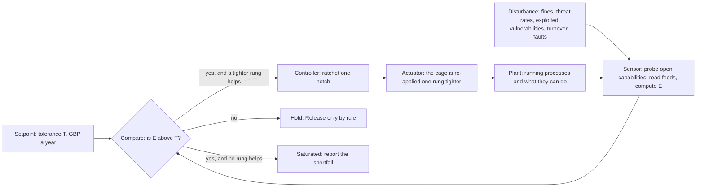
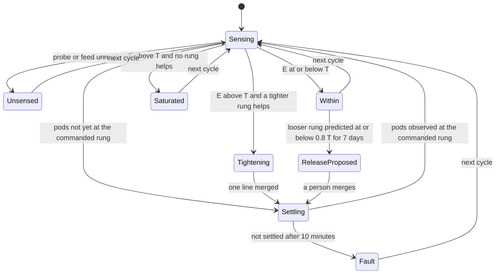

# First-principles design: the loop as a control system

Designer's starting point: control theory, not the repository. Written 2026-11-14. Read-only pass: nothing here has been built, run or removed.

Citations are `repo/path:line` against the clones in `fresh/`. "A4", "P2" and so on are the maps in `maps/`.

## Terms

Loop terms. The design in section 2 uses only these.

- **Exposure (E)**: the organisation's expected loss in pounds a year from the things that can still go wrong.
- **Tolerance (T)**: the most expected loss a year the organisation says it will carry. The record calls it appetite.
- **Cage**: the set of limits placed on a running process from outside. The process does not choose them.
- **Rung**: one named setting of the cage. Rungs are ordered from loosest to tightest. Each rung keeps every limit of the rung below it.
- **Notch**: one step from a rung to the next tighter rung.
- **Ratchet**: a controller that moves the cage one notch tighter and holds it there. The **pawl** is the catch that stops a ratchet slipping back.
- **Capability**: one thing a process can do that a probe can test, for example "open a connection to an internet address".
- **Scenario**: one way a loss can happen, with how often (events a year), how much (pounds an event), and which capabilities it needs.
- **Feed**: a published file of numbers about the world, such as a regulator's fines or a threat rate. Each version has a tag.
- **Probe**: a test run against the live system that reports what a process can actually do.
- **Canary**: a small process placed in the cage, or just outside it, whose only job is to run probes.
- **Cycle**: one pass of sense, compare, decide, enact.
- **Settled**: the running processes are observed at the rung that was last commanded.
- **Saturated**: exposure is above tolerance and no tighter rung would lower it.
- **Hysteresis**: a gap between the level that tightens and the level that releases, so the cage does not flap.
- **Dwell**: how long a release condition must hold before it counts.
- **Dead time**: the delay between commanding a notch and seeing it on the running processes.
- **Three-point estimate**: a minimum, a most likely value and a maximum. Its mean is (min + 4 x most likely + max) / 6. This is the PERT mean.
- **Closed form**: a figure worked out by a formula. **Monte-Carlo**: the same figure estimated by simulating many random years.

Tool names. Sections 3 onward use these when mapping the design to the estate.

- **Pod**: Kubernetes' unit of one or more running processes. A **Namespace** is a named group of pods. A **Deployment** replaces its pods when their template changes.
- **Flux**: the tool that makes a cluster match what a git repository declares.
- **Kyverno**: the tool that rewrites a pod as it is admitted to the cluster. Here it applies the cage.
- **Network policy**: a Kubernetes rule saying which connections a pod may make or receive.
- **Renovate**: the tool that proposes a change when a pinned dependency has a newer version.
- **Signed tag**: a version label in git, signed so a reader can check who published it.
- **CVE**: a publicly listed software vulnerability. **KEV** is the public list of CVEs known to be exploited.
- **WAF**: a web application firewall. **DNS**: the internet's name lookup service.
- **Adopter**: an example organisation that runs the loop. **Publisher**: a party that publishes a feed.

## 0. Summary

1. The estate has a controller with no feedback. The priced exposure never reads the cage that is in force (`platform/compose/composition.py:3832`, `:3845`, `:5207-5215`). In control terms that is not a loop.
2. The one link between a rung and money is four typed numbers that their own file calls "evidenced by nothing but this comment" (`platform/graded/cage.py:71-72`).
3. This design removes the numbers. A rung closes named **capabilities** (things a running process can do, such as connect to the internet). A loss **scenario** names the capabilities it needs. A probe on the running pod says which capabilities are still open. Exposure is the sum of the scenarios that can still happen. No rung carries a reduction figure.
4. The ratchet moves one notch per cycle, only after the last notch has been observed on the running pods. It tightens on a measurement. It releases only on a proposal a person merges, after a margin and a waiting period.
5. Saturation, where the tightest useful rung still leaves exposure above tolerance, is a named verdict with a priced shortfall. Two of three adopters sit there today and nothing says so (`tuppence/composed/HEADER.yaml:1343-1347`).
6. Budget: 1,340 lines for the loop, 675 lines of existing release pipelines (525 untouched, 150 shrunk), 320 lines for a real-world feed. 2,335 in all, against 24,636 lines of code on today's chain (A4).
7. One adopter, two publishers, one persistent cluster. Everything else is parked.
8. An honest finding to carry into the panel: under sourced numbers the cage may have no authority over most of driftwood's exposure. The design reports that instead of hiding it.

## 1. Mission

> State the organisation's technology risk as pounds of expected loss a year. Compare it with the tolerance the organisation has declared. While the risk is above tolerance, tighten the cage around its running processes one notch at a time, and re-measure. Stop when risk is within tolerance. Start again whenever the world changes.

53 words.

## 2. The loop on paper

This section names no file. It is the design. Section 5 maps it to code.

### 2.1 Terms

The loop terms are defined at the top of this document. This section uses no tool name.

### 2.2 The six parts

| Part | In this loop | Unit |
|---|---|---|
| Setpoint | Tolerance T, declared by the organisation | GBP a year |
| Sensed quantity | Exposure E, computed from what the running processes are observed able to do and from today's feeds | GBP a year |
| Controller | The ratchet: an integer rung k. It adds one when E is above T and a tighter rung would help. It subtracts one only under the release rule | rung |
| Actuator | The cage: at rung k a fixed set of capabilities is removed from every process in the governed namespace | capabilities closed |
| Plant | The running processes, and the scenarios that need what those processes can do | scenarios open |
| Disturbance | The world: fines, threat rates, newly exploited vulnerabilities, the organisation's size. Also faults: a cage that was commanded and did not arrive | changes E without the controller acting |

### 2.3 The plant model

For each scenario s:

- f_s: events a year, as a three-point estimate. It comes from a published feed.
- m_s: pounds an event. It is the direct loss plus, for each regulator, the chance a breach draws a penalty times the penalty. Each term is a three-point estimate from a published feed, scaled to the organisation's own turnover.
- needs_s: a list of alternative paths. Each path is a list of capabilities that must all be open. An empty path means the scenario needs nothing the cage can close.

A scenario is **open** when at least one of its paths has every capability observed open.

    E = sum over open scenarios of mean(f_s) x mean(m_s)

That is the whole model. Four properties follow, and each is a design requirement.

1. **Monotone.** A tighter rung only closes capabilities. Closing a capability can only close scenarios. So E never rises when the cage tightens. The loop cannot have positive feedback.
2. **Bounded.** The lowest E the cage can reach is the sum of the scenarios with an empty path. Call it the floor. If T is below the floor, the loop cannot converge. The loop computes the floor every cycle and prints `reachable: yes` or `no` before it acts.
3. **No typed reductions.** A rung has no "reduces exposure by 70%" figure. What a rung buys is whichever scenarios it closes. That differs by organisation and changes when feeds change.
4. **Authority is per scenario.** The cage has authority over a scenario only if the scenario names a capability the cage can close. It has none over a loss that does not pass through the process, such as a mis-sent email or a missing risk assessment.

### 2.4 Why the sensor must read the plant

The sensor has two halves.

- **World half**: read the newest published version of each feed.
- **Plant half**: probe the running processes. It takes three kinds of probe, because capabilities face three ways.
  - *Outward*: a canary inside the cage tries to connect out, to look up a name and to write to its own root filesystem.
  - *Inward*: a canary outside the cage tries to connect in to each caged process. A second inward probe runs from the canary inside the cage to its neighbours.
  - *Read-back*: the rung and the privilege settings are read off each running process as the system admitted it.

A capability counts as closed only when the probe that faces it fails. A capability no probe can test counts as open.

E is computed from the capabilities the probes find open. It is not computed from the rung that was declared, nor from the rung the controller last chose. If the change was never applied, if the processes were not restarted, or if the network layer does not enforce the rule, the capability is still open, the scenario is still open and E does not fall. The loop sees its own actuator fail. A loop that computes E from the declared rung would report success in all three cases. That is the difference between feedback and a lookup.

## 3. Loop semantics

These are the parts the record never defined (A1, question 5; FACTS item 4).

### 3.1 What "ratchet" means

**One notch per cycle. A new notch is allowed only when the last one is settled.**

Reasons:

1. Each notch is checked by the probe before the next. If rung two was commanded and its capabilities are still open, the fault is found at rung two. A jump to rung four would hide where it failed.
2. Each notch takes function away from the workload. Stopping at the first rung that fits gives the least cage that does the job.
3. It is what the word says. A ratchet moves one tooth and holds.

One consequence must be stated. Rungs are cumulative, so the loop will pass through a rung that closes no scenario when a rung beyond it closes one. That notch buys nothing by itself. The ledger shows it as a notch with zero gain. The loop takes it only because the ladder has one order.

The cost is time above tolerance. The loop limits it by running the next cycle as soon as the notch is settled, not a day later. With a dead time of minutes, four notches take well under an hour. Dead time on a persistent cluster: could not determine; it has never been measured, because no tier change has ever reached a cluster (A4, hop 7). The only measured Flux latency is the restore of a hand-edited object in 46 seconds to about 2 minutes on a local cluster (`driftwood/drift/forced-campaign-samples.jsonl`, cited in A4). The design target is 10 minutes.

Jumping straight to the fitting rung is the alternative. It is honest only if the model is trusted to predict the plant. The estate's history says not to: restricted and quarantine were priced 22 points apart while enacting the same network reach (`driftwood/composed/policies/v7.0.0/cage-netpol.yaml:43-45`; `platform/graded/cage.py:90`, `:96`).

### 3.2 One-way, or able to release

**The pawl holds against drift and lifts only by rule.** Tightening and releasing are not symmetric.

- **Tighten** on a measurement: observed E is above T. Automatic.
- **Release** on a prediction: the model says E at the next looser rung, with today's feeds, would be at or below 0.8 x T. That must hold on every cycle for 7 days. Then the loop opens a proposal to release one notch. A person merges it.

Why the asymmetry: exposure at a looser rung cannot be measured without going there. A release therefore rests on the model, so it carries a margin, a wait and a human. A tightening rests on an observation and errs on the safe side.

Why these numbers:

- **Margin 20%.** After a release E sits at or below 0.8 x T. A feed must then move exposure up by a quarter before the cage tightens again. One release cannot cause the next tightening.
- **Dwell 7 days.** Longer than the dead time (minutes) and longer than the feeds' daily cadence (`feeds/.github/workflows/fetch.yml:30`), so a release rests on at least seven separate readings of the world.

Both are settings in the organisation's declaration, not constants in code.

What releases the pawl, in practice: a disturbance reverses (a vulnerability is patched, a threat rate falls); the organisation raises T; or a scenario is closed some other way.

A one-way ratchet is the alternative. The estate shows what it does. Each adopter's tier was set by hand to the tightest rung on 2026-08-28 (FACTS item 1). The tighten-only proposer arrived on 2026-09-04 and removed the only way down. Every adopter is still there. The record had rejected exactly this eleven days earlier: "It ratchets the estate toward deny and never recovers" (`hub/docs/adr/0015-adopter-runs-the-proposer-and-it-opens-the-pr.md:68-69`). The code carries it as an open limit (`platform/computed-semver/coverage.py:508-513`).

### 3.3 The stop condition

Observed E is at or below T, on settled pods. The verdict is `within`. The controller makes no change. The loop keeps sampling.

If any scenario cannot be priced, E is a lower bound. A lower bound above T still tightens. A lower bound at or below T gives the verdict `within-partial`, names the unpriced scenario and never releases. Today an unpriced line turns the whole verdict to `null` (`driftwood/composed/HEADER.yaml:1376-1381`).

### 3.4 When the tightest rung still leaves exposure above tolerance

The verdict is `saturated`. The controller:

1. stops stepping. It does not climb when no rung beyond would lower E, and it does not open the same proposal again;
2. records the shortfall, E minus T, in pounds a year;
3. lists the open scenarios with their amounts. These are the ones the cage has no authority over;
4. exits non-zero, so the cycle shows red.

Saturation is decided as early as possible. If no tighter rung would lower E, the loop is saturated at the rung it is on. It does not climb to the top for nothing. An organisation whose exposure is all outside the cage's authority stays at the loosest rung with a `saturated` verdict. Today such an organisation sits at `isolated`, with a shop that can reach nothing (D1, surprises).

The loop names the other treatments and takes none of them:

- **Fix**: implement a control so a scenario closes or shrinks. The estate already has this feedback for regulator control weights (`platform/compose/composition.py:3655-3665`).
- **Transfer**: insure the shortfall.
- **Accept**: the organisation raises T. That is a signed change to its own declaration, made with the shortfall in front of it.
- **Stop running**: the organisation's decision. It is not a rung. The owner's words: "something could find itself unable to run, but that's only because it doesn't fit the cage, not because we deliberately deny it" (A1, 2026-09-02).

### 3.5 How loosening happens

Only by the release rule in 3.2, one notch at a time, by a merged proposal. A person may also edit the tier line by hand. The next cycle then measures E at that rung and tightens again if it is above T. The loop does not need a gate against a loose edit: it corrects it.

### 3.6 The feedback, exactly

At cycle n the controller commands rung k+1 by changing one line in git. Flux applies it. The pods are replaced and Kyverno cages the new pods at rung k+1. At cycle n+1:

1. the sensor reads the rung stamped on every governed pod. If any pod is not at k+1, the verdict is `settling` and nothing else happens. After 10 minutes unsettled the verdict is `fault`;
2. the sensor tries each outward capability from the canary inside the cage, and each inward capability from the canary outside it;
3. every scenario whose paths all contain a capability now observed closed is marked closed;
4. E(n+1) is the sum over the scenarios still open.

So the enacted cage changes the exposure figure through one route only: capabilities observed closed on running pods. Nothing else in the cage moves E.

### 3.7 States

`Unsensed` and `Fault` never change the cage. No measurement, no move.

### 3.8 What this adds to the owner's sentence

The sentence does not carry these. Each is added because a loop cannot be specified without it.

| Addition | Why it is needed |
|---|---|
| Release rule with margin and dwell | Without it the cage either never loosens, which is where the estate is stuck, or it flaps |
| Saturation verdict | "Until within tolerance" is silent on the case where that cannot be reached |
| Sensor on the running system | Without it the actuator does not change the sensed quantity |
| A cluster that persists between cycles | "Process cage" needs a process that is still running when the cage changes |
| Unsourced reduction earns nothing; unpriced scenario makes a lower bound | Otherwise the figure cannot be compared with a tolerance |
| Tightening merges without a person | "Reactive". Put to the owner in section 8 |

## 4. The numbers

### 4.1 Where tolerance comes from

From outside the loop. A setpoint is never computed by the controller. The organisation declares one figure in its own repository: an amount, a currency, "a year", the statistic it limits, and one line saying on what basis it was chosen.

The present figures have no basis. £40,000, £15,000 and £5,000 date from an automated build on 2026-07-31 (FACTS item 6; P2 section 1). No owner sentence gives a figure (A1, tolerance table). Ludlow declares £5,000 against a turnover of USD 197.6bn (P2, surprise 2). The figure is an owner decision (section 8).

### 4.2 Where each rung's reduction comes from

There is none to source. That is the point of the design. What has to be sourced instead:

| Number or claim | Who publishes it | How it can be sourced or measured |
|---|---|---|
| A rung closes capability c | Platform, in the ladder | **Measured each cycle** by a probe. The existing sampler already tests an outward connection to `1.1.1.1` from inside the cage (`driftwood/drift/five-facts.py:178`, `:589-606`). It has no inward probe. The inward one is new, and it matters most: see 5.4 |
| Scenario s needs capability c | Threat publisher, in the feed row | A statement about how the attack works. Reviewable, and falsified by one counter-example. When unsure, the row lists fewer needs, so the cage earns less |
| Events a year for scenario s | Threat publisher | Counted from a public base rate, with the count and its date in the row. Today's one row per adopter says "DBIR retail-sector web-app-attack base rate, editorial midpoint" (`feeds/threat-register/v4/feed.json`, driftwood row) |
| Direct loss an event | Threat publisher | Today editorial (same row, `lm_basis.kind`) |
| Penalty size | Regulator publisher | Published fines and the statutory formula, scaled to turnover. This part is real today (`ico/penalty-schema/v4/feed.json`, `formula` and `real_examples_gbp`) |
| Chance a breach draws a penalty | Regulator publisher | Penalties issued in a year divided by breaches reported in that year. The feed says no one has counted it: "no run of this repository has counted a regulator's own published enforcement register" (`ico/penalty-schema/v4/feed.json`, `frequency.basis.could_not_look`). Could not determine the count in this pass: no network |

Two rules make the figure safe to compare:

- A scenario with no stated needs is treated as needing nothing: the cage gets no credit for it.
- A scenario with no price makes E a lower bound (3.3).

The estate's own twin reached the same conclusion about typed reductions: "No rung carries a number, and the loader refuses one ... A reduction per rung would be a free multiplier" (`hub/twin/enforcement-grades.yaml:10-14`). The platform did the opposite. This design sides with the twin's rule and drops the twin.

The alternative carrier for feedback is the regulator's control-weight partition (`platform/compose/composition.py:3628-3665`). I rejected it for the cage, for three reasons. The weights are editorial by the feed's own account ("no regulator publishes an apportionment of a penalty across NIST SP 800-53 controls", `ico/penalty-schema/v4/feed.json`, `control_weights[].basis.could_not_look`). A fractional weight is another typed reduction. And it gives the cage nothing on the line that is priced: driftwood's fine line is `uk-gdpr/lower-tier` (`platform/compose/composition.py:3481-3482`), whose weights are four management controls, pl-2, ra-3, ca-2 and ir-8 (`driftwood/composed/HEADER.yaml:1398-1413`). No cage dial writes a plan or an assessment. The partition stays as the "fix" treatment outside this loop.

### 4.3 How exposure is computed

**Closed form.** Mean frequency times mean magnitude, summed over open scenarios.

Reasons:

1. The loop needs one scalar to compare. A sampled figure adds sensor noise, and sensor noise near the threshold is what makes a controller flap.
2. Three-point inputs cannot support a claim about the tail.
3. The closed form already exists in 20 lines (`platform/fair/fair.py:111-131`) and gives the same answer. Driftwood's fine line: closed form £1,784,371; the committed Monte-Carlo figure is £1,787,177. Threat line: £19,500 against £19,559. Both within 0.3% (my arithmetic from `ico/penalty-schema/v3/feed.json`, the v3 converter and `driftwood/party.yaml:43`).
4. The Monte-Carlo path has a defect at low frequency. It rounds each year's event count to a whole number, so anything rarer than once in two years simulates to exactly zero (`platform/fair/fair.py:160`, per P2). Honest frequencies for fines are that rare.

The owner did ask for Monte-Carlo, in his own words: "You've got nothing about Monte Carlo modelling and continuous refreshing of things. Have you not built that?" (A1, 2026-08-19). So this is put to the owner (section 8). If tolerance is meant as a limit on a bad year, the sensed statistic becomes a percentile, the simulation comes back as one function, and nothing else in the loop changes.

### 4.4 Is the money figure a real estimate

**It has to be, and today it is not.**

The record made the pound "an ordinal, auditable comparison instrument", "not an expected annual loss", on a one-word reply (`hub/.scratch/ecosystem/issues/75-grilling-what-is-this-for-the-twelve-questions.md:111`; `driftwood/composed/HEADER.yaml:1371-1372`). An ordinal can rank two options. It cannot be within a tolerance stated in pounds. The owner's sentence needs a cardinal figure: an estimate of expected loss in pounds a year, on the same scale as T. This design commits to cardinal.

Today's figure fails as an estimate for one plain reason. The fine line assumes one to four fines a year for every adopter (`ico` at tag `v3.0.0`, `schema/to_fair_scenario.py:38`: "plausible regulatory-incident frequency"). That is 98.9% of driftwood's priced exposure (FACTS item 7), and divided by turnover it is the same 2.0781% for all three adopters (F1, surprise 4). It measures size, not risk.

The repair is the structure in 2.3: a fine is a consequence of a breach, not a separate yearly event. With the committed figures for driftwood (4.5 breaches a year, £4,333 direct loss, £823,556 mean penalty):

    E(p) = 4.5 x (4,333 + p x 823,556) = 19,500 + p x 3,706,002

where p is the chance a breach draws a penalty. E equals the £40,000 tolerance at p = 0.0055, about 1 breach in 181. Above that, driftwood is over tolerance uncaged. Below it, driftwood is within tolerance at the loosest rung and the loop has nothing to do. Whether driftwood needs any ratcheting at all turns on a count the regulator publishes and the estate has never made. This is arithmetic on committed inputs, not an estimate of p.

Every ledger line prints the weakest basis among its inputs (`counted`, `published` or `editorial`). A figure resting on an editorial input is still cardinal. It is a weak estimate, and it says so.

## 5. Components

Budget in lines. "Reuse" names the best existing file and its present size.

### 5.1 The loop

| # | Component | Repo | Job | Loop step | Lines | Reuse |
|---|---|---|---|---|---|---|
| 1 | `party.yaml` | driftwood | Turnover, tolerance (amount, statistic, basis), release margin and dwell | T | 20 | Shrink `driftwood/party.yaml` (133) |
| 2 | `gitops/apps/` | driftwood | The governed Namespace with the one tier line; three workloads as Deployments; a canary inside the cage and a canary in its own uncaged Namespace; a kustomize replacement that copies the tier into each pod template so a tier change replaces the pods | E (plant and command) | 160 | `driftwood/gitops/apps/namespace.yaml` (30), `storefront.yaml` (79), `api.yaml` (23), `pod.yaml` (58), `kustomization.yaml` (9). Today the workloads are bare Pods |
| 3 | `gitops/flux-system/` and engine | driftwood | Flux source on this repo's `main`; Flux source on the platform cage at a signed tag; Kyverno at 1.18.2; cluster config | E | 115 | `gotk-sync.yaml` (58, today pinned by hand to `v4.0.0` at `:21`), `gitops/platform/platform-pin.yaml` (52), `gitops/engine/kyverno.yaml` (46), `kind/driftwood.yaml` (7) |
| 4 | `.github/workflows/loop.yml` | driftwood | Hourly, on a change to the tier or tolerance, and by hand: read feeds, sense, decide, open the one-line proposal, merge a tightening, append the ledger | X, glue for E | 90 | Shrink `.github/workflows/propose-tier.yml` (390) |
| 5 | `renovate.json` | driftwood | Proposes a newer cage version tag. Upkeep of the actuator, not a loop step | E upkeep | 15 | Shrink `renovate.json` (158) |
| 6 | `loop/ledger.jsonl` | driftwood | One row a cycle: time, feed versions read, observed rung, capabilities open, E, T, floor, verdict, weakest basis, link to the change | Proof | 0 | New. Data, not code |
| 7 | `loop/loop.py` | platform | `exposure()`, `tolerance()`, `decide()`, `write_tier()`, `ledger_row()` | Q, C, R | 200 | Assembled from `fair/fair.py:106-131` (closed-form mean), `risk/enforce.py:81-91` (tolerance reader), `wargamer/tier_pr.py:327-354` (one-line tier edit), and the penalty formula in `ico` `schema/to_fair_scenario.py:47-74` at tag `v3.0.0` |
| 8 | `loop/sense.py` | platform | Read each pod's stamped rung and privilege settings; probe outward from the inside canary and inward from the outside canary; print the open set | X (the feedback) | 130 | `driftwood/drift/five-facts.py:291-334` (cluster reader), `:518-548` (pod state), `:589-606` (outward connection probe). The inward probe is new |
| 9 | `loop/ladder.yaml` | platform | Rung to capabilities closed; capability to probe. No reduction, no cost | R | 30 | New. Replaces the table at `graded/cage.py:82-111` |
| 10 | `loop/test_loop.py` | platform | Pure-function tests: monotone, one notch, no flap, saturation, release, unsensed holds | Evidence | 120 | New |
| 11 | `distribution/policies/v8.0.0/` | platform | The cage bodies: one mutating policy, one network policy generator | E (actuator) | 90 | `distribution/policies/v7.0.0/cage-tier.yaml` (43), `cage-netpol.yaml` (45), `kustomization.yaml` (8), less the placeholder sidecar and the eviction class |
| 12 | `LOOP.md` | hub | The mission in the owner's words with dates; the terms; the semantics in section 3; the basis of every number; what is out | Record | 150 | New. Replaces `NORTH-STAR.md` (143) and the loop terms of `CONTEXT.md` (958) |
| 13 | `penalty-schema/v5/feed.json` | ico | Penalty formula, final fines, and the counted chance a breach draws a penalty | Q, disturbance | 140 | `penalty-schema/v4/feed.json` (557) |
| 14 | `threat-register/v5/feed.json` | feeds | Scenario rows: events a year, direct loss, needs, basis | Q, disturbance | 80 | `threat-register/v4/feed.json` (179) |
| | **Loop subtotal** | | | | **1,340** | |

Of the 1,340: 570 are logic (rows 4, 7, 8, 9, 10), 400 are Kubernetes and Flux declarations (rows 1, 2, 3, 5, 11), 220 are feed data, 150 are prose.

### 5.2 Existing release pipelines, kept

| # | Component | Repo | Job | Loop step | Lines | Reuse |
|---|---|---|---|---|---|---|
| 15 | Cage release pipeline | platform | Cuts and signs the cage version tag | E support | 150 | Shrink `.github/workflows/cut-release.yml` (210) and `release.yml` (166): no computed-semver gate |
| 16 | Publisher release pipelines | ico, feeds | Cut and sign feed tags | X support | 525 | Unchanged: `ico/.github/workflows/cut-release.yml` (116), `release.yml` (137); `feeds/.github/workflows/cut-release.yml` (135), `release.yml` (137) |

### 5.3 The real-world disturbance (sequence step 7)

| # | Component | Repo | Job | Loop step | Lines | Reuse |
|---|---|---|---|---|---|---|
| 17 | Exploited-vulnerability feed and scenario | feeds, platform | Daily fetch of the public list of exploited vulnerabilities and their exploit scores, tagged with no person in the path; one scenario row from the vulnerabilities present in the adopter's served images | X, Q | 320 | Shrink `feeds/fetch/cve.py` (142), `fetch/lib.py` (173), `.github/workflows/fetch.yml` (217); `platform/wargamer/inventory.py` (289); `platform/feeds/to_fair_scenario.py` (439) |

**Total budget: 2,335 lines** (1,340 + 675 + 320). Today's chain is 24,636 lines of code in 67 files (A4, section a).

### 5.4 The ladder

| Rung | Capabilities it closes, beyond the rung below | Enacted by |
|---|---|---|
| baseline | None. The constant floor applies at every rung: no host network, process or IPC namespace; no privilege escalation; not privileged; CPU and memory ceilings | Mutating policy |
| restricted | Run as root; Linux capabilities; write to the root filesystem | Mutating policy |
| quarantine | Reach from outside the namespace; connect to the internet; connect to the rest of the cluster | Network policy |
| isolated | Reach from inside the namespace; DNS | Network policy |

The names are kept. Two rungs change meaning: `restricted` no longer changes network reach, so that every notch closes something different. Today restricted and quarantine enact the same network policy (`driftwood/composed/policies/v7.0.0/cage-netpol.yaml:43-45`).

What today's data does on this ladder. The threat feed holds one scenario for driftwood: a web-application attack on the shop (`feeds/threat-register/v4/feed.json`, driftwood row, `source`). Such an attack needs reach from outside the namespace and nothing else the cage can close. So for driftwood today:

- `restricted` closes no scenario. The loop passes through it at zero gain;
- `quarantine` is the first rung that lowers exposure, and it does so by taking the shop off the public network;
- the capability that decides it is inward reach. That is the one the estate has never probed.

More rows, with a counted basis, would give the lower rungs something to close. Until they exist the ledger shows the cage for what it is on this data: one useful notch, and a blunt one.

The loop has to say what each rung does to function. At `quarantine` a public shop cannot be reached by its customers. That is the owner's own doctrine: a cage "may ultimately degrade to something that is too expensive to run or not functional" (A1, 2026-08-22). The ledger makes the trade visible. It does not soften it.

## 6. Scope calls

**One adopter.** A control loop has one plant. Tuppence and ludlow are near-clones: about 600 lines of declaration each and the rest copied machinery (FACTS, duplicates). Three plants triple the upkeep and add no loop behaviour. "Proportionate to the organisation's size" is shown on one plant by stepping the setpoint: lower T and watch the ratchet respond.

**Two publisher repositories, as they are; not one, not four.** A publisher is a disturbance source outside the loop boundary. `ico` carries the owner's own example, the regulator's fine (A1, 2026-07-23). `feeds` carries threat rates and exploited vulnerabilities. Both already cut signed tags, so keeping them costs nothing. `nist` and `insurer` move no figure the loop compares (F1, table "Which feeds move an adopter's money figure") and are parked. Signature checking inside the loop is not in the owner's sentence: the first build trusts repository access control and records the tag and commit it read.

**Versioned policy through Flux is the enact mechanism. Renovate is not the react mechanism.** The 2022 thesis fits the actuator exactly: the cage bodies are a dependency, pinned to a signed tag, moved by a reviewed proposal. Nobody wants the actuator to change shape unreviewed. It does not fit the sensor. Feeds are measurements of the world. A measurement held behind a pin and a merge is a sensor with unbounded delay: two feed proposals have sat unmerged for 40 days (F1, surprise 2), and A2 names the conflict (summary item 6). So the loop reads the newest tag of each feed at sense time and records what it read. Renovate keeps one job: proposing a newer cage version.

**Flux tracks the adopter's `main`.** A merge is the enactment. Today five manual acts stand between a merge and a cluster (FACTS item 9), including a self-pin 164 commits behind `main`. The platform cage stays pinned to a signed tag.

**Three cage dials.** Privilege, inbound reach, outbound reach. Each closes a capability a scenario can name and a probe can test. CPU and memory ceilings stay in the cage as a constant, because "you're always caged" (A1, 2026-08-20), but they do not vary by rung until a scenario is priced against them. The eviction class leaves the body: no scenario names it. The WAF sidecar leaves the body: its image is `sleep infinity` and exists in no registry (`platform/graded/waf-placeholder/Dockerfile:14-19`; `driftwood/.github/workflows/drift-sample.yml:68-70`). The cost column is dropped: the cost of a cage was the owner's idea on 2026-07-31, but today's sentence does not compare cost, and the four figures are unsourced.

**The twin: parked.** It contributes £758 of £1,807,494 to driftwood (A4, component 11). No adopter calls its pricing engine (FACTS, duplicates). It refuses the compare step by design (H4, summary). Its rule that no rung carries a number is kept; its code is not.

**The truth surface: parked, replaced by the ledger.** It answered an agent-process failure, not a need of the loop (FACTS, accretion). Its line counts scripts; it carries no money (H15, summary 3). One idea survives: a check that could not look is not a pass. That is the `unsensed` verdict.

**Computed semver: parked.** It feeds no loop step and every real release computed major (FACTS, off the loop). The cage version is a hand-set semver number. One test asserts that each rung closes at least what it closed in the last release.

**The calibration programme: parked.** It qualifies a language model to do the twin's judgement chores. It does not calibrate money and has no operational caller (A5; H5). The recovered spec confirms the purpose: "models to perform this estate's existing judgement skills only after earning measured permission" (`troy/.scratch/calibration-programme/spec.md:7`). With the twin parked it has no subject.

**The talk material: parked.** The owner called the talk a by-product (A1, 2026-09-02, Q9). When the loop runs, the ledger is the demonstration and a talk can be rebuilt from it.

## 7. Disposition

Keep: stays as it is. Shrink: stays, smaller. Merge: its useful lines move into a named component. Park: leaves the working tree and the scheduled jobs, stays in git history or on an archive branch. Cut: removed, with no intent to bring it back.

Nothing is removed in this pass. This is the proposal.

### hub

| Area | Call | Note |
|---|---|---|
| `LOOP.md` | New | Component 12 |
| `CLAUDE.md`, `LICENSE`, `docs/agents/` | Keep | |
| `README.md` | Shrink | Points at `LOOP.md` and the four live repos |
| `NORTH-STAR.md` | Park | Superseded by `LOOP.md` |
| `CONTEXT.md` | Merge | About 12 loop terms move into `LOOP.md`; the rest parks |
| `docs/adr/` (37) | Park | 0001 and 0002 stay live as the enact decisions; the rest carry a "superseded by LOOP.md where they differ" line and move to the archive |
| `docs/PRD.md`, `docs/HISTORY.md` | Park | The enact part is summarised in `LOOP.md` |
| `docs/` PDF, qualification, reference-case, source-metadata, twin-release, transport, show-and-tell, archive, references, upstream | Park | Calibration and talk records |
| `research/03-blogs-thesis.md` | Keep | The 2022 thesis, source of the enact step |
| `research/` (other 13), `spikes/`, `explorations/` | Park | June research |
| `.scratch/drift-review-2026-08-27/evidence/AMBITION_TIMELINE.json`, `DECISION_LEDGER.json` | Keep | The only record of the owner's words (A1, component 1) |
| `.scratch/ecosystem/issues/75-*.md` | Keep | The purpose round (A1, component 6) |
| `.scratch/drift-review-2026-08-27/` (rest) | Park | |
| `.scratch/ecosystem/` tickets, map, reviews | Park | 169 tickets; history lives in git |
| `.scratch/ecosystem/` October patch copies and run logs | Cut | 1.3M lines of other repos' diffs (FACTS, accretion) |
| `.scratch/talk-spec/`, `twin/`, `computed-semver/`, `policy-composition/`, `multi-org-estate/`, `real-estate/`, `faithful-floor/`, `govern-what-you-dont-control/`, `laya-loophole/`, `demo-feedback/` | Park | Specs and tickets of parked features |
| `.scratch/0001-*.patch` | Cut | Stray |
| `twin/` (all: pricing, forecasting, governance, plumbing, calibration, `capabilities/`, `invariants/`, `task_contract/`, `task_prompts/`) | Park | Maps H1 to H6 |
| `verify/` (all 50 directories) | Park | Maps H7, H8. `test_loop.py` and the ledger replace the loop-facing ones |
| `tests/`, `conftest.py`, `pytest.ini` | Park | Maps H9, H10: twin and calibration tests |
| `bench/` | Park | Calibration programme |
| `talk/`, `tts.py` | Park | Truth harness, captures, deck (H11) |
| `.github/` (truth, truth-delivery, twin, release) | Park | The hub has no code left to gate or release |
| `.claude/` | Shrink | Keep project instructions; park twin skills and the enact-guard hook |
| `bin/`, `clone-estate.sh` | Park | Twin CLI shim; truth-gate cloner |
| `fleet/`, `policy/`, `t/`, `forged.yaml` | Cut | Stray stubs and fixtures; nothing references `t/` (H10) |

### platform

| Area | Call | Note |
|---|---|---|
| `loop/` | New | Components 7 to 10 |
| `distribution/policies/v8.0.0/` | New from v7.0.0 | Component 11 |
| `distribution/policies/v7.0.0/` | Keep | Until v8.0.0 is served, then park |
| `distribution/` (rest: fan-out, renderers, v1 to v6, verify scripts) | Park | Multi-version coexistence is thesis machinery, not loop (P1) |
| `fair/` | Merge | 26 lines into `loop.py`; the simulation parks, ready if the owner chooses a percentile |
| `risk/` | Merge | 11 lines into `loop.py`; the Audit/Deny comparator parks |
| `graded/` | Merge | Bodies to v8.0.0; table replaced by `ladder.yaml`; selector, twin-agent table, OSCAL object, tests and verify script park; `waf-placeholder/` cut |
| `wargamer/` | Merge | The one-line edit into `loop.py`; `inventory.py` shrinks into component 17; the rest parks |
| `feeds/` | Shrink | The vulnerability converter core into component 17; stale fixtures park |
| `compose/` | Park | `loop.py` replaces the pricing and compare paths; no `composed/` tree is rendered |
| `computed-semver/` | Park | |
| `shift-left/` | Park | The tier-binding gate is not needed when the loop corrects a loose tier |
| `currency-controller/` | Park | Pods are replaced by the Deployment rollout |
| `engine/` | Park | The adopter declares its own engine |
| `party/`, `party.yaml` | Park | `loop.py` reads four fields; the platform bears no risk in this loop |
| `tcor/`, `break-glass/`, `recovery-expense/`, `implementations/`, `policy/`, `honesty/`, `oscal/`, `wardley/` | Park | Off the loop (P2, P3) |
| `identity/`, `access/`, `posture/`, `eud/` | Park | Already shelved by the owner (P3) |
| root `verify-*.sh`, `verify-release-signing.py`, `lib.sh`, `lib-selfcheck.sh`, `docs/` | Park | |
| `.github/` | Shrink | Component 15, plus one job that runs `test_loop.py` |
| `README.md`, `CONTEXT.md` | Shrink | Rewrite to describe `loop/` and the ladder |
| `LICENSE` | Keep | |

### driftwood

| Area | Call | Note |
|---|---|---|
| `party.yaml` | Shrink | Component 1. `overlay.floor: isolated` (`:106`) goes |
| `gitops/apps/` | Shrink | Component 2. Tier resets to `baseline` |
| `gitops/flux-system/`, `gitops/engine/`, `gitops/platform/`, `kind/` | Shrink | Component 3. The five feed sources go: Flux does not need feeds |
| `gitops/composed/` | Park | No composed tree |
| `deploy/` | Merge | Into `gitops/apps/` |
| `.github/` | Shrink | To `loop.yml`; nine workflows and the gate scripts park |
| `renovate.json` | Shrink | Component 5 |
| `loop/` | New | The ledger |
| `drift/` | Merge | Probe functions into `sense.py`; the sampler, the August Flux study and their logs park |
| `inventory/` | Shrink | A list of vulnerability ids, regenerated, for component 17 |
| `composed/` | Cut | Generated output, 26,062 lines (D1) |
| `selection-policy/` | Cut | Duplicate selector (FACTS, duplicates) |
| `accepted-majors/`, `scenarios/`, `observations/`, `tests/`, `twin/` | Park | |
| `git-server/`, `scripts/`, `verify-*.sh` | Park | The cluster pulls from the real remote |
| `README.md` | Shrink | |
| `LICENSE` | Keep | |

### tuppence, ludlow

Whole repositories: **park**. Stop their schedules. This covers `reset/` (tuppence) and `implementation-retirements/` (ludlow). Either can return as a second plant by copying about 400 lines of declaration.

### ico

| Area | Call | Note |
|---|---|---|
| `penalty-schema/` | Keep | v5 adds the counted penalty chance (component 13) |
| `schema/` | Merge | The 28-line penalty formula into `loop.py`; legacy key, pre-envelope schema and the October adapter park |
| `.github/` | Shrink | `cut-release.yml` and `release.yml` stay (component 16); the hashing clock and bump gates park |
| `verify-*.sh` | Park | |
| `party.yaml`, `README.md`, `DISCLAIMER.md`, `LICENSE` | Keep | |

### feeds

| Area | Call | Note |
|---|---|---|
| `threat-register/` | Keep | v5 adds `needs` (component 14); the converter and adapter park |
| `cve/`, `fetch/`, `bump.py` | Shrink | Component 17. The 58,882-line raw capture is cut |
| `.github/` | Shrink | Release pipeline stays; the fetch clock tags mechanical data itself |
| `eol/`, `fx/`, `converters/`, `market-moves/`, `news/`, `recovery-expense/` | Park | Move no figure for driftwood (F1) |
| `verify-*.sh` | Park | |
| `party.yaml`, `README.md`, `LICENSE` | Keep | |

### nist, insurer

Whole repositories: **park**. The catalogue is NIST's own and can be read upstream. The scorer in `nist/publisher-reliability/` has scored nothing (F1, surprise 6). Insurance is one of the treatments the loop names at saturation; it is not a step of this loop.

### Outside the nine repositories

The untracked local keynote build and the recovered planning text under `troy/.scratch/` stay where they are, as backups. Neither is input to the loop.

### Documents that must change, because the sentence wins

| Document | What conflicts |
|---|---|
| `hub/NORTH-STAR.md:30`, `:69-75` | The one sentence states an eco-system. Step 3 (`:71`) has a band crossing and no stop condition |
| `hub/docs/PRD.md:82` | Lists a risk-intelligence agent as a non-goal; has no money, tolerance or compare (A2) |
| `hub/.scratch/ecosystem/issues/75-*.md:111` | Makes the pound ordinal. The loop needs it cardinal |
| `driftwood/composed/HEADER.yaml:1371-1372`, and the hub check that requires that sentence (`hub/verify/pound-seam/`) | Same |
| `hub/docs/adr/0015-*.md:68-69` | Rejects a ratchet by name |
| `hub/docs/adr/0022-*.md:47-53`, `:112`, `:168-169` | Tighten-only, a floor, loosening as an unassisted human edit, a per-line selection |
| `hub/docs/adr/0020-*.md:18-19`; `platform/compose/composition.py:5197-5198` | "A breach of the aggregate is priced and shown, never denied": nothing acts on a breach. In the loop a breach tightens the cage. Still no deny |
| `hub/docs/adr/0021-*.md`; `driftwood/selection-policy/selection_policy.py:162-165` | The selector is kept twice on purpose (P3, summary; A4, section d). The loop has one |
| `hub/docs/adr/0023-*.md:86` | A clock "may never commit a declaration: a tier, a pin, a floor". Here the loop commits a tighter tier |
| `hub/docs/adr/0024-*.md:47` | "A human still merges a reviewed tier PR". Here a tightening merges itself; a release still waits for a person |
| `hub/docs/adr/0002-*.md:9` | Every bump by a Renovate proposal a person merges, in every environment. Kept for the cage version; dropped for feed data |
| `hub/docs/adr/0019-*.md:26` | "The subscription is the pin." The loop reads the newest feed tag and records it |
| `driftwood/gitops/flux-system/gotk-sync.yaml:21` | The cluster follows a hand-moved self-tag. Here it follows `main` |
| `hub/CONTEXT.md` | No term for compare, ratchet, notch or stop (H12, summary 5); two cage vocabularies |
| `platform/graded/cage.py:62-111` | Typed reductions and costs |
| `platform/computed-semver/coverage.py:508-513` | Carries the one-way ratchet as an open limit. The release rule closes it |
| `driftwood/party.yaml:106`, `driftwood/gitops/apps/namespace.yaml:30` | Floor and tier both at the tightest rung |

## 8. Owner decisions

Only the owner can settle these. Each changes the design.

| # | Question | Options | Recommendation |
|---|---|---|---|
| 1 | Does "ratcheting" hold for ever, or can it release? | (a) One-way; loosening is a hand edit. (b) Tightens automatically; releases by a proposal after a 20% margin and 7 days, merged by a person. (c) Moves both ways automatically | (b). One-way leaves no way down: the estate has sat at the tightest rung since 2026-08-28. Symmetric can flap |
| 2 | One notch a cycle, or straight to the rung that fits? | (a) One notch, re-measure, next cycle starts when settled. (b) Jump | (a) |
| 3 | What does tolerance limit, and what is the figure? | (a) Expected loss a year, closed form. (b) Loss in a bad year (for example 1 in 20), by Monte-Carlo. Figure: keep £40,000 for driftwood, or state it as a share of turnover | (a). Then name the figure and one line of basis. £40,000 is 4.65 basis points of driftwood's turnover |
| 4 | Is the pound a real estimate? This reverses the "yes" of 2026-09-02 that made it ordinal | (a) Cardinal: an estimate with its weakest basis printed. (b) Ordinal: then "within tolerance" cannot be tested | (a) |
| 5 | Who merges a tightening? | (a) The loop, because signing the tolerance is the standing instruction. (b) A person, every notch; the wait shows in the ledger | (a). A release always waits for a person |
| 6 | What happens at saturation? | (a) Report the shortfall, hold, go red. (b) Add a last rung that stops the workload. (c) Nothing, as today | (a). It matches "not because we deliberately deny it" |
| 7 | Is the loop the mission, with the eco-system, twin, three adopters, coexisting policy versions and talk as by-products? | (a) Yes: park them. (b) No: name which are part of the mission | (a). The purpose on record from 2026-09-02 is a different chain (A1, surprise 3); the owner should say which stands |
| 8 | Where does the persistent cluster run? | (a) A local cluster on a machine the owner controls, with a self-hosted runner beside it. (b) A small rented machine. (c) None: a throwaway cluster each cycle | (a). (c) cannot show a running pod being re-caged |
| 9 | May the feeds clock tag mechanical data (the exploited-vulnerability list) with no person merging? | (a) Yes, for mechanical data only. (b) No | (a). Otherwise the only real-world disturbance stalls, as now (`feeds/.github/workflows/fetch.yml:8-9`) |
| 10 | May driftwood's floor be removed and its tier reset to the loosest rung? The floor is recorded as "Owner-adopted 2026-10-23" (`driftwood/party.yaml:104-106`), though no quotation was found (D1). The tier was set by hand on 2026-08-28 | (a) Yes. (b) No | (a). With the floor at the top rung no loop can be observed |

## 9. Sequence

Eight steps. Each leaves something that runs.

1. **The loop on paper, executable.** Write `loop.py`, `ladder.yaml` and `test_loop.py`. Feed it today's committed feeds and a typed-in list of open capabilities. *Runs:* one command prints driftwood's exposure, tolerance, floor and verdict. The tests show one notch, no flap, saturation and release.
2. **Honest numbers.** Publish `threat-register` v5 with `needs` on each row and `penalty-schema` v5 with the counted chance a breach draws a penalty. *Runs:* the same command prints a cardinal estimate with its weakest basis. It may print `within` at the loosest rung or `saturated`. Either is the first true verdict the estate has had.
3. **An actuator that reaches running pods.** Cut cage v8.0.0. Make the workloads Deployments. Point Flux at `main`. Stand up the persistent cluster. *Runs:* editing the one tier line by hand replaces the pods at the new rung within minutes. Dead time is measured for the first time.
4. **A sensor on the plant.** Write `sense.py` and the two canaries, one inside the cage and one outside. *Runs:* one command prints each pod's rung and the open capabilities, inward and outward. Exposure is now computed from observation.
5. **Close the loop.** Add `loop.yml`. Remove the floor. Reset the tier to `baseline`. *Runs:* the loop runs hourly and on change. The ledger gets its first rows. If exposure is above tolerance the first real notch in the estate's history lands.
6. **The limit cases, for real.** Lower T in a signed commit and watch the ratchet respond. Lower it below the floor and get `saturated`. Suspend Flux and get `fault`. Raise T and wait for the release proposal. *Runs:* each verdict has a ledger row from the real system.
7. **A disturbance nobody in the estate writes.** The feeds clock fetches and tags the exploited-vulnerability list daily. The adopter's image scan becomes one scenario. *Runs:* the loop reacts to the outside world with no person in the path.
8. **Park the rest.** Stop every scheduled job that is not the loop or a release. Move parked areas to archive branches. Replace `NORTH-STAR.md` with `LOOP.md`. *Runs:* four live repositories, one loop, one ledger.

Steps 1 and 2 need no cluster and no owner money decision. Step 3 waits on owner decision 8. Step 5 waits on decisions 5 and 10.

## 10. Proof

### What an observer sees

On the persistent cluster, with the committed feeds, and a tolerance committed before the first run:

1. A ledger row: exposure above tolerance at `baseline`, floor below tolerance, verdict `tighten`. A one-line change appears on the tier line and is merged.
2. Within the dead time, the pods are replaced. `kubectl get pods -L posture.acme.io/tier` shows the new rung. The canaries can no longer do what that rung closes: outward from inside, inward from outside.
3. The next row: exposure recomputed from the open capabilities the probes found. It is lower by the amount of the scenarios that closed, or unchanged if that notch closed none.
4. Rows repeat until one reads `within`, at a rung below the top. No further change is opened.
5. A feed publishes a new version, or the organisation lowers T. The next row shows exposure above tolerance again and one more notch.
6. **The break test.** Someone suspends Flux, or deletes the network policy by hand. The next row shows the capability open again, exposure back up and verdict `fault` or `tighten`. The figure followed the plant, not the declaration. This is the single observation that tells feedback from a lookup.
7. T is set below the floor. The loop stops where no notch helps and prints `saturated` with the shortfall and the scenarios it cannot touch.
8. The disturbance reverses. Seven days later a release proposal opens and waits for a person.

Every row can be recomputed by hand from the feed versions and the capability list it names.

### What would make it staged

- Exposure moved by a synthetic residual placed either side of the band. Today's only band-crossing evidence is exactly that (`hub/talk/captures/verify_e2e_verify-e2e-step3-price-crosses-band-pr-opens.out:8`, cited in A4).
- A reduction typed per rung, anywhere.
- Exposure computed from the tier in git instead of from the probe.
- A throwaway cluster created at the target rung, so no running pod ever changes cage.
- A feed value edited by hand with no outside source behind it. A change to the estate's own `ico` stand-in counts only if it mirrors a real publication and cites it.
- Tolerance chosen after seeing exposure, so the loop lands on a convenient rung. The commit times show the order.
- A person merging between steps while the account says the loop did it. The record already has this gap: documents say "a human merges" and 94 of 127 merges on driftwood are by the app identity (A4, hop chain).
- The dwell or the margin shortened for the showing without saying so.
- A sidecar or probe image that exists in no registry.

### What the proof cannot show, and should say

- That the scenario frequencies are right. They are published estimates with a stated basis.
- That closing a capability stops every variant of an attack. It shows the named capability is closed on the running pod.
- That driftwood needs a cage tighter than `baseline` at all. On counted numbers it may not (4.4). If so, the honest demonstration is the setpoint step and the break test, and the ledger says the organisation is within tolerance uncaged.

## 11. Could not determine

- The chance a reported breach draws a penalty. The counts are public; no network in this pass.
- Scenario frequencies beyond the one row per adopter the threat feed holds today.
- Dead time on a persistent cluster.
- Whether the network plugin on the chosen cluster enforces network policy. The daily throwaway cluster does (`driftwood/drift/samples.jsonl`, facts 6 and 7, per A4).
- Whether the v8.0.0 body compiles on Kyverno 1.18.2 after the sidecar and eviction class are removed. Nothing was run.
- Whether kustomize applies the Namespace label before the Deployments in one reconcile, so new pods are caged at the new rung. To be checked at step 3.
- What the owner meant by "ratcheting": one-way, or stepwise with release (A1, question 1). Decision 1.
