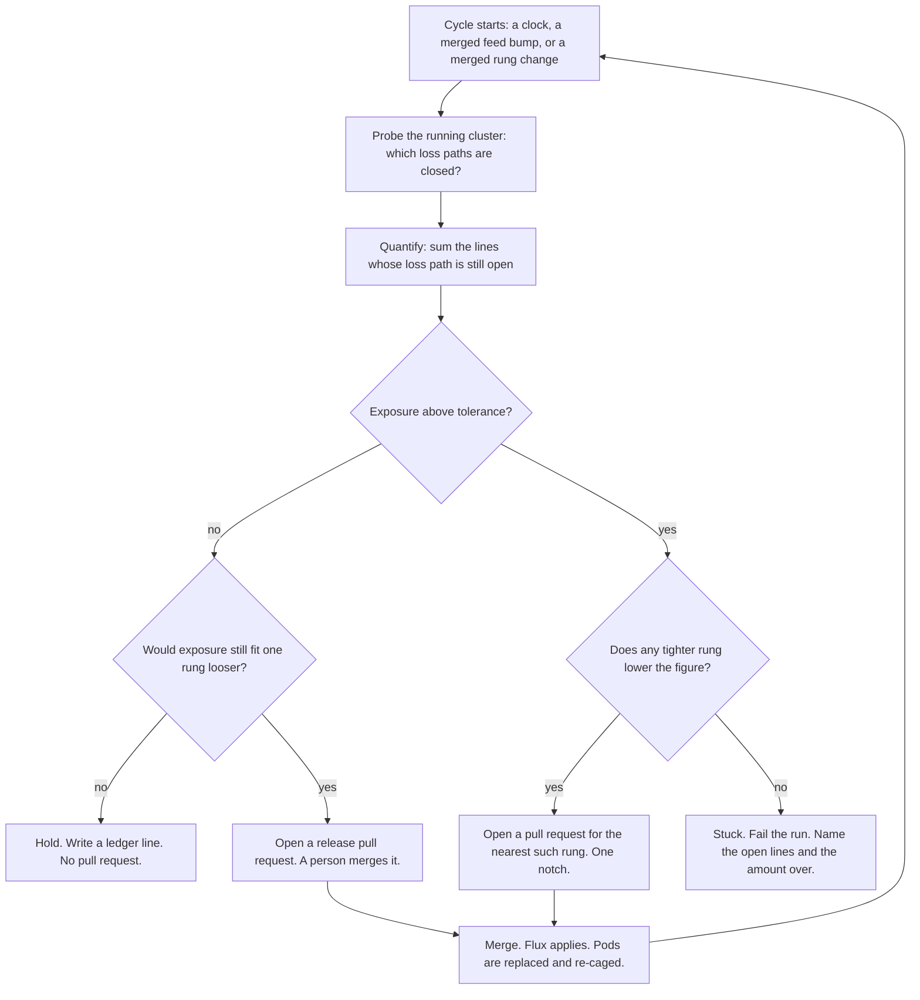
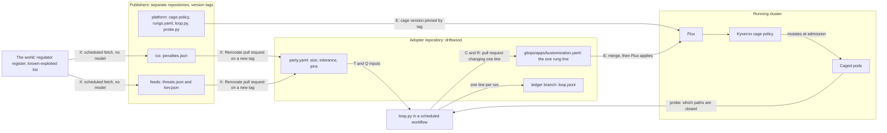

# Design from the owner's own words

Designer's starting point: the owner's dated sentences (map A1) and the 2022 thesis (`hub/research/03-blogs-thesis.md`). Written 2026-11-14. Read-only pass: nothing was run, nothing was changed.

**The rule of this design.** Every element cites an owner sentence, or it is marked ASSUMPTION and sent to section 7 for the owner. These do not count as owner sentences: a bare "agree", "yes", "Lgtm" or a letter; the 2026-07-23 19:59 thesis line whose authorship map A1 could not determine; the "Owner-adopted 2026-10-23" stamps in each `party.yaml`; anything "as recorded by the assistant".

**Citations.** Paths are `repo/path:line` under the `fresh/` clones. Shorthand for the owner-quote record, all under `hub/`:

- **AT:n** = `.scratch/drift-review-2026-08-27/evidence/AMBITION_TIMELINE.json` line n
- **DL:n** = `.scratch/drift-review-2026-08-27/evidence/DECISION_LEDGER.json` line n
- **T75:n** = `.scratch/ecosystem/issues/75-grilling-what-is-this-for-the-twelve-questions.md` line n
- **RA:n** = `.scratch/drift-review-2026-08-27/REGRILL-ANSWERS.md` line n
- **PURPOSE:n** = `.scratch/ecosystem/review-2026-09-02/evidence/purpose/PURPOSE.md` line n
- **03:n** = `research/03-blogs-thesis.md` line n
- **TODAY** = the owner's sentence of 2026-11-14, quoted in the task and in `FACTS.md:9`

**Words used here.**

- *Exposure*: the organisation's expected loss in pounds a year.
- *Tolerance*: the loss in pounds a year the organisation says it will bear. The record calls it appetite.
- *Cage*: the limits placed on a running process. *Dial*: one such limit. *Rung*: a named set of dial settings. *Notch*: a move from one rung to the next.
- *Loss path*: the route by which a process causes a loss, for example "a client outside the namespace reaches it".
- *Probe*: a small test that tries a loss path on the running cluster and records whether it is open or closed.
- *Publisher*: a party that publishes numbers under a version tag. *Adopter*: an organisation that consumes them and is caged.
- *Ledger*: a file with one line per run of the loop.
- *Three-point estimate*: a lowest, most likely and highest value for one quantity. The estate calls it a PERT triple.
- *Monte-Carlo*: finding the spread of outcomes by simulating many random years.
- *Pod*: one running copy of a process on a Kubernetes cluster. *Deployment*: the object that keeps a set of pods running and replaces them when their template changes. *Namespace*: a named area of a cluster; each adopter has one. *Admission*: the moment the cluster accepts a new or changed pod.
- *Kyverno*: the policy engine that alters a pod at admission. *Flux*: the tool that makes the cluster match what git says. *Kustomize*: the part of Flux that stamps shared settings onto a set of manifests. *Renovate*: the tool that opens a pull request when something a repository depends on has a new version.
- *Known-exploited list*: the public catalogue of software flaws seen used in real attacks, kept by the US agency CISA.
- "Relayed" beside a citation means a mapping reader found it and I did not open the source myself.

---

## 1. Mission

> Price each organisation's risk in pounds a year, from published facts scaled to its size. Compare that with what the organisation says it will bear. While it is over, tighten the cage on its running processes one notch, never refusing them. When the facts change, price again. Stop when the figure is within tolerance.

54 words.

### 1.1 The owner's sentences behind each loop step

| Step | Owner's own sentence | Cite |
|---|---|---|
| Q quantify | "change the regulator financial fine we might get for a breach and then make the controls and everything else proportinate and grounded in that rather than making emotional or simply 'best practice' decisions" | AT:324 |
| Q, money on the books | "it might enable one to actually put technological risk on the balanace sheet of the business" | AT:345 |
| Q, size | "its proporiate to the org right? maybe think about describing it as a cost per customer?" | AT:2291 |
| T tolerance | "the overarching risk appetite. the biz might be willing to expose it self to" | AT:338 |
| T, C, stop | "until the risk is within financial tolerance of the organisation" | TODAY |
| R ratchet | "tightens and also makes your thing more expensive to run by partially mitigating the risk which can be factored into the balance sheet" | AT:1026 |
| R, cage not gate | "you could allow a degraded or resource constrained state ... less a go/no-go decision, but more colour than that" | AT:1005 |
| R, always | "you're always caged even if it's a permissive one. It's the spec of the cage that can change" | AT:2780 |
| R, end stop | "there is no real gate anymore. Just cages. That may ultimately degrade to something that is too expensive to run or not functional" | AT:2962 |
| E enact | "flux is a integral part/enabler to this (unless we prove otherwise)" | AT:1488 |
| E, how | "we've built a Mutating admission controller more than a Approving admission and control" | T75:79 |
| X react | "You've got nothing about Monte Carlo modelling and continuous refreshing of things. Have you not built that?" | AT:2263 |
| X, source | "the ico might be able to publish a machine readable financial penalty" | AT:429 |

No owner sentence before TODAY names the compare step, the stop condition or the word "ratchet" (`maps/A1-owner-words.md:11-15`). So the semantics in section 2 are this design's reading of one sentence. Each reading is marked.

---

## 2. Loop semantics



### 2.1 What "ratchet" means

A ratchet moves one tooth at a time, holds without effort, and lets go only when someone lifts the pawl. This design takes all three properties.

- **One notch per cycle.** The loop moves to the nearest tighter rung that lowers the figure, then measures again before it moves further. It does not jump to the rung a table says will fit. A rung that would lower nothing is passed over, so one notch is sometimes two rungs; the dials of the rung passed over still apply, because each rung builds on the last. Reason: only this form uses feedback. The next notch is decided on a measurement of the last one. It is also the proportionate form: the least constraint that is enough. Owner basis: "partially mitigating the risk" (AT:1026); "informed risk based decisions that should be proportinate" (AT:331). ASSUMPTION on the step size: no owner sentence says "one notch".
- **It holds.** If nothing changes, the rung stays. The loop never loosens on its own.
- **It releases only by a deliberate act.** When the figure would still fit at the next looser rung, the loop opens a release pull request with the pounds before and after. A person merges it. Owner basis for release existing at all: "It's the spec of the cage that can change" (AT:2780); "if a running application falls behind on patching it could still potentially run, but with contrained iops, cpu, memory, network" (AT:1005), which makes the cage depend on a state that can recover; "Point in time rejection does not mean never" (RA:28). ASSUMPTION: map A1 could not determine whether the owner means one-way. Decision 1.

Today the estate is a one-way ratchet with no tooth left. All three adopters declare the tightest rung and a floor at the tightest rung (`driftwood/gitops/apps/namespace.yaml:30`, `driftwood/party.yaml:106`). The code names one-way as an open limit, `cage-ratchet-one-way` (`platform/computed-semver/coverage.py:508-513`).

### 2.2 The stop condition

`exposure at the observed rung <= tolerance`. The loop writes a ledger line with `within=true` and opens nothing. It runs again on the next clock or the next change. Source: TODAY. Nothing else stops it.

### 2.3 When the tightest rung still leaves exposure above tolerance

Two cases. The loop tells them apart.

1. **A tighter rung would still help, and there is one.** Keep going. The last rung leaves the process with no reach at all. It still runs. It does not function. The owner has already answered this: "the pod stopping is just the implementation of the incoming policy because it does not fit in an available cage" (AT:2773); "something could find itself unable to run, but that's only because it doesn't fit the cage, not because we deliberately deny it" (T75:79). There is no deny.
2. **No tighter rung lowers the figure.** The loop never takes a notch that buys nothing. It holds, fails the run so somebody sees it, and writes `state=stuck` with the amount over and the lines that keep it over. Owner basis: grounded "rather than making emotional or simply 'best practice' decisions" (AT:324). A cage that constrains a process and removes no exposure is exactly that.

When stuck, the cage has done all a cage can. What is left needs a different lever. The owner has named four: move the risk to an insurer (AT:548); recover it by litigation or from a supplier (AT:2808); fix something cheaper elsewhere (AT:1229); or restate the tolerance. None of the four is in the kernel. The kernel only names them in the stuck message. Decision 8.

Restating the tolerance is not an exemption. "there must never be an exemption ledger EVER" (AT:2815). The test: a change to `party.yaml` that names no workload, team or rule, is dated, and applies to the whole organisation is the organisation codifying how it operates (AT:1054). A file that names a workload and excuses it is banned.

### 2.4 How loosening happens

Three routes, all through git.

- The world improves: a publisher lowers a number, or an image is patched and leaves the known-exploited list. The next cycle finds that the figure fits one rung looser and opens a release pull request.
- The organisation raises its tolerance or restates its size in `party.yaml`. Same result.
- A person lifts the pawl: merges the release pull request. Never the loop.

One release pull request may be open at a time. A closed one is not raised again until an input changes. That is the whole of the owner's "Flood guard with a half life" (RA:28) that this design keeps.

### 2.5 The feedback: how the enacted cage changes the next figure

This is the part the estate lacks. Today the price never reads the cage. `prices[].amount` is always the uncaged figure, and the only place a rung lowers a number uses the rung the code *proposes*, not the one in force (`platform/compose/composition.py:5206-5215`). The reduction per rung is a typed constant "evidenced by nothing but this comment" (`platform/graded/cage.py:71-72`).

This design replaces both.

1. **No rung carries a number.** A rung is a list of dials. Each dial names the loss path it closes. That is "carry the why" applied to the cage: "Purposeless policy is potentially practically pointless policy" (03:75).
2. **Each exposure line names its loss path.** The publisher of the line says by which route the loss happens.
3. **A line counts in full while its path is open, and counts zero once its path is closed.** Nothing in between, until a dial has a measured share (section 3.3). The reduction a rung buys is therefore derived: it is the sum of the lines whose paths that rung closes. The estate already has this shape once, for the twin's own agent: reduction "derived, not typed", from the misuse paths a rung closes (`platform/graded/cage.py:145-150`, `:248-270`).
4. **"Closed" is measured on the running cluster, each cycle.** The probe tries each path: a connection out from a caged pod, a connection in from another namespace, a connection in from the same namespace. It records open or closed. The estate already does this for one rung: `fact_7_the_bottom_rung_reaches_nothing_while_the_reference_reaches` (`driftwood/drift/five-facts.py:123`, target `1.1.1.1` at `:178`).
   The probe tests the workload's own pods. For the way out, it adds a short-lived debug container to the workload's pod, which shares that pod's network. For the way in, it connects to the workload's pod from a client pod in a separate probe namespace and from one in the same namespace. It uses a small public image pinned by digest. It does not use the firewall placeholder, which today doubles as "the container the probe connects from" (`driftwood/.github/workflows/drift-sample.yml:64-66`) and which this design removes. If a cluster refuses debug containers, the probe falls back to a pod with the same labels in the same namespace and the ledger line says `probe_subject=same-labels`. That weaker form shows the namespace's cage, not that pod's. Not tested in this pass.
5. **The loop prices from the probe's answer, not from git.** If git says `quarantine` but the probe gets through, the line counts in full and the figure stays up. A label alone lowers nothing.
6. **Enact must re-cage what is running.** The cage policy fires only when a pod is created or updated (`driftwood/composed/policies/v7.0.0/cage-tier.yaml:20-22`) and the workloads are bare Pods (`driftwood/gitops/apps/storefront.yaml:34-35`). So today a new rung would never reach a running process. In this design the workloads are Deployments and the rung is written by kustomize into both the Namespace and the pod template. A rung change alters the template, the pods are replaced, and admission cages the new ones. Not tested in this pass.

The rule on unsourced numbers, stated once: **an unsourced number may raise the figure; only a measured closure may lower it.**

---

## 3. The numbers

### 3.1 Tolerance

**Where it comes from:** the organisation declares it in its own `party.yaml`. Owner basis: AT:338, AT:2927, TODAY.

**What exists:** £40,000, £15,000 and £5,000, fixtures. `tuppence/party.yaml:18` and `ludlow/party.yaml:18` say they were copied from `platform/risk/appetite.json`; map P2 dates that file to platform commit 7a36bf7 of 2026-07-31, "Estate build: 27 tickets implemented via dependency-wave workflow" (relayed). As a share of turnover they run backwards: driftwood 465 parts per million, tuppence 17, ludlow 0.03 (my arithmetic from `driftwood/party.yaml`, `tuppence/party.yaml:22,34`, `ludlow/party.yaml:23,35` and ludlow's turnover in pounds as relayed by map F1). The largest firm tolerates the least. That contradicts "its proporiate to the org" (AT:2291).

**This design:** tolerance is declared as a share of turnover and the loop turns it into pounds. The owner asked for size-relative money twice (AT:2291, AT:2298). ASSUMPTION: no owner figure exists. Decision 3.

### 3.2 Exposure

One formula, per line, summed over the organisation:

```
line = events_per_year x (direct_loss_per_event + penalty_rate x penalty(turnover))     if its path is open
line = 0                                                                                 if the probe finds its path closed
exposure = sum of lines
```

- `events_per_year` and `direct_loss_per_event`: three-point estimates from the threat publisher, each with a stated basis. Reuse of `feeds/threat-register/v4/feed.json`.
- `penalty(turnover)`: the regulator's published formula and final fines, scaled to the adopter's own turnover. Reuse of the core of `ico/schema/to_fair_scenario.py:206-250`. Owner basis: AT:324, AT:2298.
- `penalty_rate`: the chance that one breach draws a penalty. New field on the regulator's feed. Until that feed carries a counted rate, the loop uses 1: every breach draws a penalty. That is the rule of section 2.5 applied: it is the highest figure, and the line says it is unsourced. A threat row with no path is treated the same way: it counts as a path no rung closes.
- The consequences of one breach add up inside one event. Owner basis: "the org may be subject to multiple fines or other consequences for a single breach, so you may need to consider the worst case scenario" (AT:2857). The estate's simulator already does this (`platform/fair/fair.py:133-176`).

This moves the fine. Today the fine is its own line at its own made-up frequency of one, two or four fines a year (`ico/schema/to_fair_scenario.py:69`), so it depends on size alone. For driftwood it is £1,787,177 on £86,000,000, or 2.078% of turnover; map F1 found the same ratio for the other two (relayed). In the owner's sentence the fine is "for a breach". Here it is a consequence of a breach event, so it rises and falls with the paths the cage opens and closes. That is what lets the cage mitigate it honestly.

**Closed form or Monte-Carlo: both, for different jobs.**

- The figure that is compared is the mean, in closed form: `(low + 4 x likely + high) / 6` for each estimate, multiplied through. It is exact, it needs no seed, and a reviewer can check it by hand in the pull request. Reuse `platform/fair/fair.py:106-131`.
- Monte-Carlo stays, because the owner expects it by name (AT:2263). It reports the bad year: the 95th percentile. It is printed beside the mean on every ledger line. Reuse `platform/fair/fair.py:133-176` with one repair: line 160 rounds each year's event count, so any frequency below one in two years simulates to zero. Draw the count from a Poisson distribution instead.
- The mean is the comparator because the bad-year figure is blind to rare events. A loss with a 1% yearly chance has a 95th percentile of nothing. ASSUMPTION on which figure is compared. Decision 4.

### 3.3 Where each rung's reduction comes from

It is not a number on the rung. It has two parts, and each has a source.

| Part | What it is | Source |
|---|---|---|
| Which path a dial closes | A structural claim: "no egress rule means no connection out" | Measured each cycle by the probe on the running cluster |
| How much loss runs through that path | The line's own frequency and magnitude | The threat publisher's feed, each number with a basis |

So a rung's reduction is "the lines it closed, as the probe saw them". It can be checked by anyone: remove the network policy and the probe gets through.

Dials that only make an attack harder, without closing a path, earn no pounds. That covers non-root, read-only root filesystem and dropped capabilities. They are on at every rung anyway (section 5.4).

One dial needs a measured share and can have one: the web application firewall. Its reduction would be the share of a standard attack test set that it blocks, measured against the real sidecar. From general knowledge, not checked in this pass: the OWASP Core Rule Set has graded strictness levels and a regression test tool, which would give "more waf rules" (AT:1005) a measured figure per level. Today the sidecar is an image that "exists in NO registry" and a stand-in that sleeps (`driftwood/.github/workflows/drift-sample.yml:68-70`; `platform/graded/waf-placeholder/Dockerfile:14-19`: "a sleeping busybox is not a WAF"). It earns nothing until it is real.

### 3.4 Is the money figure a real estimate?

**Yes. This design makes it cardinal: pounds of expected loss a year.** The owner's own sentences ask for balance-sheet money three times (AT:345, AT:387 "go deep on the balance sheet", AT:1026). The record made it ordinal on a one-word "yes" to an either-or question (T75:78, decided at T75:111), and the composed header now says "not an expected annual loss" (`driftwood/composed/HEADER.yaml:1371`). "Within financial tolerance" cannot be tested with an ordinal. Own sentences outrank the bare reply. Decision 5.

A cardinal figure built on unsourced inputs is a poor estimate, not an ordinal one. The remedy is to source the inputs, and to say on every line how much of the figure is sourced. The ledger prints `sourced_share`: the fraction of the exposure whose frequency, magnitude and penalty rate all carry a counted or cited basis. Today that fraction is nought. The threat rows say `editorial` (`feeds/threat-register/v4/feed.json`, driftwood row). The regulator's feed says its frequency is "an editorial band and NOT a counted base rate" and names what would close it: "a fetch that counts actions per year from the regulator's register and a stated population in scope" (`ico/penalty-schema/v4/feed.json`, `uk-gdpr.higher-tier.frequency.basis`).

Three inputs must be sourced for the figure to be worth comparing: breach frequency per path, the penalty rate per breach, and the tolerance. None is hard to state. None is sourced today.

### 3.5 The arithmetic on the recorded figures, untuned

**The record as it stands, with unsourced reductions counted as nought.** No adopter is within tolerance at any rung.

| Adopter | Exposure | Tolerance | Times over |
|---|---|---|---|
| driftwood | £1,807,494 | £40,000 | 45 |
| tuppence | £102,869,480 | £15,000 | 6,858 |
| ludlow | £3,086,299,082 | £5,000 | 617,260 |

Sources: `driftwood/composed/HEADER.yaml:1368,1377`; `tuppence/composed/HEADER.yaml:1336,1344`; `ludlow/composed/HEADER.yaml:1396,1405`. With the record's typed reductions only driftwood fits, by £3,850 (`driftwood/composed/HEADER.yaml:1376-1377`), at the rung where its shop has no network. Tuppence is recorded as `breaches_band: true` (`tuppence/composed/HEADER.yaml:1347`) and nothing follows.

**This design's formula on driftwood's recorded inputs.** Driftwood has one threat row: "cart/checkout PII exfiltration", frequency 2, 4, 9 a year, direct loss £1,000, £4,000, £9,000, source "DBIR retail-sector web-app-attack base rate, editorial midpoint". Means: 4.5 events a year, £4,333 an event. The recorded fine line of £1,787,177 at a mean of 2.17 fines a year gives £824,851 a penalty. The penalty rate is not sourced anywhere, so the result is a range:

| Penalty rate per breach | Exposure with the path open | Against £40,000 |
|---|---|---|
| 1 in 1 | £3,731,329 | 93 times over |
| 1 in 10 | £390,683 | 10 times over |
| 1 in 100 | £56,618 | 1.4 times over |
| 1 in 1,000 | £23,212 | within, at the loosest rung |

Break-even is a penalty rate of about 1 in 180. So whether driftwood needs any cage beyond the loosest turns on one number nobody has looked up. Until it is looked up the loop uses 1 in 1, so driftwood's first ledger line with the path open reads £3,731,329.

**What the ratchet would then do.** A web-application attack takes data out through the front door, in replies to inbound requests. Its path is "a client outside the namespace reaches the process". With the cage as served today that path closes at `restricted`, which lets in only the same namespace (`driftwood/composed/policies/v7.0.0/cage-netpol.yaml:42-45`). With the reach shapes of section 5.4 it closes at `quarantine`. Either way it closes at the rung where the shop stops serving outsiders. So on the recorded numbers, at any penalty rate above 1 in 180, the only cage that brings driftwood within tolerance is one in which the storefront no longer works as a shop. The proportionate middle rung for this threat is the firewall dial, and that dial is a placeholder. That is a finding, not a tuning. It is also exactly the owner's "may ultimately degrade to something that is ... not functional" (AT:2962).

**Limits of this arithmetic.** The path I gave the row is my reading of its own source text. The register holds one threat per organisation. A fuller register would hold losses that pass through no caged process, and those would leave the loop stuck above tolerance. Whether any adopter reaches tolerance on sourced inputs: could not determine.

---

## 4. Components



Line budgets count authored code, configuration and hand-kept data. They do not count fetched data, the ledger, licences or short READMEs in the publisher and adopter repositories.

| # | Component | Job | Loop step | Lines | Reuse or new |
|---|---|---|---|---|---|
| 1 | `platform/loop/loop.py` | Read inputs. Price each line. Read tolerance. Decide hold, tighten, propose release or stuck. Rewrite the one rung line. Append the ledger line. `--what-if` reruns with one input changed. | Q T C R | 260 | New file, mostly lifted: `platform/fair/fair.py:96-176`; `platform/risk/enforce.py:81-98`; `platform/wargamer/tier_pr.py:327-360`; `ico/schema/to_fair_scenario.py:206-250`; the known-exploited match from `platform/feeds/to_fair_scenario.py` |
| 2 | `platform/cage/` policy bodies | The cage: one mutating policy, one policy that generates network policies, four priority classes | cage | 160 | Reuse `platform/distribution/policies/v7.0.0/cage-tier.yaml` (43), `cage-netpol.yaml` (45), four priority classes (64). Two edits: hardening on at every rung; three reach shapes instead of two |
| 3 | `platform/cage/rungs.yaml` | For each rung: its dials, the loss path each closes, the probe that proves it. The cage's "why" | R, feedback | 40 | New. Replaces the table at `platform/graded/cage.py:82-111` |
| 4 | `platform/cage/kyverno-test/` | One pod per rung and the expected result, so a consumer can test against the cage locally | evidence | 80 | Shrink of `platform/graded/tests/` (1,214) |
| 5 | `platform/loop/probe.py` | Try each loss path on the cluster. Record open or closed, the rung label on the pods, and their identifiers | feedback | 120 | Condensed from `driftwood/drift/five-facts.py` facts 6 to 8 and `drift/served_apps.py` |
| 6 | `platform/.github/workflows/loop.yml` | Reusable workflow: check out the pinned feeds and verify their tags, reach the cluster, run probe then loop, open the pull request, append the ledger | all | 110 | Shrink of `driftwood/.github/workflows/propose-tier.yml` (390) and `drift-sample.yml` (485) |
| 7 | `platform/loop/test_loop.py` | The semantics of section 2 as tests: one notch, never loosens alone, stuck, no credit without a probe, release is proposed | evidence | 130 | New |
| 8 | `platform/.github/workflows/release.yml` | Cut a signed version tag on merge | E | 40 | Shrink of `platform/.github/workflows/cut-release.yml` and `release.yml` |
| 9 | `ico/penalties.json` | The regulator's formula, cap, final fines and penalty rate per breach, each with a basis and a date | Q | 150 | Reuse `ico/penalty-schema/v4/feed.json`, plus the one new field |
| 10 | `ico` fetch and release | `fetch.py` counts the regulator's register. `fetch.yml` proposes a change. `release.yml` tags on merge | X | 160 | Shrink of `ico/.github/workflows/fetch.yml` (215), `cut-release.yml` (116) |
| 11 | `feeds/threats.json` | Per sector: the threat, its loss path, frequency and direct loss, each with a basis | Q | 80 | Reuse `feeds/threat-register/v4/feed.json` (179), plus `path` |
| 12 | `feeds` fetch and release | `fetch_kev.py` reads the known-exploited list and its exploit scores. `fetch.yml` and `release.yml` as for ico | X | 160 | Shrink of `feeds/fetch/cve.py` (142), `fetch/lib.py` (173), `fetch.yml` (217) |
| 13 | `driftwood/party.yaml` | Size, tolerance, the pinned feed versions | T | 25 | Shrink of `driftwood/party.yaml` (133) |
| 14 | `driftwood/gitops/` | Namespace. The kustomization that holds the one rung line. Workloads as Deployments. Flux sources: own repository by branch, cage by pinned tag. The Kyverno engine pin | E | 160 | Shrink of `driftwood/gitops/` (534) |
| 15 | `driftwood/renovate.json` | Bump the cage tag, the two feed tags and the loop's own tag | X | 35 | Shrink of `driftwood/renovate.json` (158) |
| 16 | `driftwood/.github/workflows/loop.yml` | Caller: a daily clock, a merged pull request, a manual run | X | 20 | New, replaces nine workflows |
| 17 | `tuppence` and `ludlow` | A `party.yaml` each and a caller that prices without a cluster | Q T C | 80 | Shrink of each `party.yaml` |
| 18 | `hub/MISSION.md` | The owner's sentences with dates, the table of section 1.1, the semantics, the open questions | record | 100 | New. Replaces `hub/NORTH-STAR.md` |
| 19 | `hub/CONTEXT.md` | The loop's terms only | record | 60 | Shrink of `hub/CONTEXT.md` (958) |
| 20 | `hub/README.md` | Where things are | record | 30 | Shrink |
| | **Total** | | | **2,000** | |

Against 24,636 lines of code on the chain today and 331,785 lines of code in the estate, as counted by map A4 (relayed, `maps/A4-does-the-loop-run.md:164-170`).

The ledger line, one per run:

```
{"ts":..., "org":"driftwood", "run":..., "commit":..., "rung_declared":"baseline", "rung_observed":"baseline",
 "closed":["host"], "probe_subject":"own-pods", "pod_uids":[...], "exposure_mean":3731329, "exposure_p95":...,
 "tolerance":40000, "within":false, "action":"tighten", "next_rung":"quarantine", "pr":...,
 "sourced_share":0.0, "cage_cost":"unmeasured"}
```

---

## 5. Scope calls

### 5.1 One adopter or three

**One adopter is enacted. Three are priced.** Proportionality is an owner sentence (AT:2291) and it cannot be shown with one size, so all three `party.yaml` files are priced by the same `loop.py` from the same feeds. Only driftwood has a cluster, a cage and a ledger of real notches. The other two repositories shrink to a declaration. Their copied machinery, about 12,000 shared lines each as counted by map D1 (relayed), is the drift. The owner: "We don't need to necessarily build everything to demo that" (AT:1250).

### 5.2 Separate publisher organisations or one repository

**Two separate publishers, each tiny.** The regulator as a publisher is the owner's first example (AT:429). Paid feeds from other parties are the owner's too (AT:2312), and so is "a broader whole eco-system, with the orgs as an example consumers" (`hub/.scratch/drift-review-2026-08-27/REPORT.md:9`). It is also what makes react real: the world changes in someone else's repository and arrives as a pull request. So `ico` and `feeds` stay separate, each cut to one data file, one fetch and one tag workflow. `nist` and `insurer` are parked: no owner sentence asks for a control catalogue, and on insurance the owner asked only a question (AT:548). Version tags stay signed at release and checked in the loop's workflow before use. The gates built around signing are parked.

### 5.3 Is versioned policy through Flux and Renovate the mechanism, or separable?

**It is the mechanism, twice.** Enact is Flux applying the adopter's git and a cage pinned to a publisher's version tag. React is Renovate opening a pull request when a publisher cuts a new tag. That is the 2022 thesis doing the loop's work: "It should have a version number. It should follow semantic versioning. It should live in a Git repository" (03:25-26); "the policy is just like a linting pack as a dependency, update a eslint rule pack and it could find issues in your code" (PURPOSE:111-112).

**A notch is not a version bump.** A version is the publisher's: which cage is on offer. A rung is the adopter's: where its own figure sits against its own tolerance. A publisher cannot know that. So the notch is one line in the adopter's own git under one pinned cage version. "It's the spec of the cage that can change" (AT:2780) has two axes and this keeps them apart.

**Pull against push.** ADR-0002 says every adoption is pulled by the consumer through a reviewed pull request. A ratchet is pushed by exposure (`maps/A2-original-thesis.md:118`). This design keeps both. A dependency bump is pulled and reviewed. A notch is the organisation's own declared tolerance being carried out, so the loop may open and merge it without a person. The reviewed decision was the tolerance. Who merges is decision 6.

**One simplification.** The adopter's own Flux source follows its own main branch. Today it pins its own tag, moved by hand, 164 commits behind (`driftwood/gitops/flux-system/gotk-sync.yaml:21`; `git rev-list --count v4.0.0..HEAD` in the driftwood clone gives 164). Nothing bumps it (`driftwood/gitops/apps/storefront.yaml:12`). Pins are for other parties' versions. With this, a merged notch is an enacted notch.

Serving several cage versions at once on one cluster is 2022 lineage (03:40-41) but not in the loop. It is parked until a breaking cage change must roll through more than one enacted adopter.

### 5.4 Which Kubernetes dials

Every dial is one the owner named, and each must close a named path or it is not a rung.

| Dial | Owner's words | Path it closes | Where |
|---|---|---|---|
| No host network, process or IPC namespace; no privilege; non-root; read-only root; drop all capabilities | "we should encourage least privilage and zero trust, so its not really earning a tighter network policy" (AT:1019) | `host` | Every rung. Least privilege is not earned or lost |
| Egress to DNS only | "contrained ... network" (AT:1005) | `outbound` | From `restricted` |
| Ingress from the same namespace only | same | `inbound-external` | From `quarantine` |
| No ingress, no egress | "not functional" (AT:2962) | `inbound-internal` | `isolated` |
| CPU and memory ceilings, falling with each rung | "contrained iops, cpu, memory" (AT:1005) | None priced today. Bounds what a runaway process takes from its neighbours | Every rung, as now. Earns no pounds until a publisher prices that loss |
| Web application firewall rules | "more waf rules applied to it (so more expensive to run)" (AT:1005) | A measured share of `inbound-external` | Parked until a real image exists |
| Disk input and output | "iops" (AT:1005) | Not built. Could not determine a plain Kubernetes dial in this pass | Nowhere yet |

The four rung names and the four priority classes stay. What changes is that each rung now differs from the last by one closed path. Today `restricted` and `quarantine` share one network shape (`driftwood/composed/policies/v7.0.0/cage-netpol.yaml:43-45`) and are priced 22 points apart.

An unlabelled or unknown rung falls to `isolated`, as now. "nothing runs without a cage" (AT:2801).

### 5.5 The twin

**Parked, apart from one flag.** The owner's own sentences for the twin are about asking "what if": "giving gameplay opportunities" (AT:1215), "running scenarios of 'what if somehting changes'" (AT:1201), "testing them with wargaming" (AT:1054). The smallest thing that does that is the loop itself rerun with one input changed: `loop.py --what-if penalties.cap=x2`. That is 20 lines in component 1. `hub/twin` is 65,870 lines in 171 tracked files (my count). The adopter's emitter imports its loader, schema and evidence modules, not its pricing (`driftwood/twin/emit-forward-intel.py:98-101`). Maps H1 and H2 found no forecast or score that moves an adopter's figure (relayed).

### 5.6 The truth surface

**Parked. The ledger replaces it.** No owner sentence asks for it; the section "carries no owner attribution at all" (map A1, `maps/A1-owner-words.md:185`). Its newest line, run 491 of 2026-11-12, is a count of checks, `pass=117`, and carries no money figure (`hub/talk/truth.log:183`). The 2022 word is "measurable", and the owner's test for it was "a GitHub PR search away" (03:162-163). One ledger line per run and the pull requests themselves meet that.

### 5.7 Computed semver

**Parked.** The owner asked for semantic versions and for old lines to stay patchable (AT:2941). The rule that computes the bump is the assistant's (map A1, `maps/A1-owner-words.md:187`). In this design the publisher declares its bump by the plain 2022 rule, and the consumer sees what a new version does to it in the place that matters: the Renovate pull request runs the loop and prints pounds before and after.

### 5.8 The calibration programme

**Parked whole.** It tries to let a local model earn permission to do the twin's judgements. The recovered interview shows how it was commissioned: the owner's replies were "A", "2 A", "3 existing resources" and "4 yes", and "No additional owner reason was supplied" (`backup/.scratch/calibration-programme/interview.md:11`, `:19`, `:23`, `:35`). Those are letters, not sentences. Its registry is empty: `hub/twin/qualification-registry.json` holds `"entries":[]`. Map H5 found no caller outside tests and benches (relayed). The loop's own calibration need is different and small: source three inputs (section 3.4).

### 5.9 The talk material

**Parked on its own branch.** The owner called it "by product / marketting tools" (T75:83). A talk about this system is a reading of the ledger. `hub/.scratch/talk-spec/the-whole-model.md` states the loop in a minute and is the one file folded into `MISSION.md`.

### 5.10 Cage cost

**Beside the compare, not inside it.** The owner said the cage costs more to run and that this "can be factored into the balance sheet" (AT:1026). So the ledger carries a `cage_cost` column. It does not steer the ratchet. If it did, the loop would become a cost optimiser, and TODAY's sentence says tighten until within tolerance. The column reads `unmeasured` until a real sidecar gives a real compute figure. The typed costs of 500 to 15,000 (`platform/graded/cage.py:84-107`) are dropped.

### 5.11 What the owner asked for that the loop sentence does not contain

| Asked for | Cite | Kernel, around, or nowhere | Why |
|---|---|---|---|
| Policy as a versioned dependency | 03:25-26; PURPOSE:111-112 | Kernel | It is E and X |
| Flux | DL:385; AT:1488 | Kernel | It is E |
| The seven "-ables" | 03:60-66 | Kernel, as the acceptance list. No lines | Visible: all in git. Communicable: the pull request body states pounds before and after. Consumable: one YAML and one JSON per publisher. Testable: components 4 and 7. Usable: an adopter runs `loop.py` on its own laptop. Updatable: Renovate. Measurable: the ledger |
| Carry the why | 03:75 | Kernel | `rungs.yaml`: every dial names its path. It is also where the reduction comes from |
| Constraint, not denial; always caged | AT:1005; AT:2780; AT:2962; T75:79 | Kernel | No validating deny anywhere |
| Never an exemption ledger | AT:2815; AT:1054 | Kernel, as a ban | No file names a workload and excuses it |
| Proportionate to size; per customer; share of revenue | AT:2291; AT:2298 | Kernel | The penalty and the tolerance both scale with turnover |
| The balance sheet | AT:345; AT:387 | Kernel | A cardinal figure and a ledger |
| The cage costs more to run | AT:1026 | Around | A column beside the compare (5.10) |
| Monte-Carlo | AT:2263 | Kernel, as the bad-year reporter | The mean compares (3.2) |
| Continuous refresh | AT:2263 | Kernel | The clock and Renovate |
| Several consequences for one breach | AT:2857 | Kernel | Consequences add inside an event |
| The regulator publishes a machine-readable penalty | AT:429 | Kernel | Publisher one |
| Falling behind on patching; end of support as intelligence | AT:1005; AT:485 | Kernel, one line | A known-exploited flaw in a served image is an exposure line. It is also the natural route to a real release |
| Paid feeds, news feeds, an economic platform for feeds | AT:2312; AT:2305 | Around | Two publishers prove the shape. A market is not built |
| The attack-cost landscape shifts | AT:506 | Around | It arrives as a new version of the threat feed. Nothing to build |
| Insurance practice; recovery by litigation; risk moved to a supplier | AT:548; AT:2808 | Nowhere now | Named in the stuck message only. Returns on decision 8 |
| The digital twin, gameplay, "is it cheaper to do the pay rises?" | AT:1215; AT:1201; AT:1229 | Around | `--what-if` (5.5) |
| War-gaming | AT:1054 | Around | The same flag |
| A model opens the pull request; a model does it all in the end | AT:513; RA:35 | Around | The loop opens pull requests with no model. A model may later propose a feed change like any contributor |
| Gathering with no model, then skills for reasoning; a model may judge on a clock | RA:74; T75:172 | Gathering is kernel. Skills and model permission are nowhere now | The fetch has no model in it. Nothing in the loop needs a judgement |
| Privilege if signed or attested | AT:1005 | Nowhere now | A per-workload condition sits one step from an exemption. Revisit only with a path and a probe |
| Policy version as an identity on credentials; a peer refusing older versions | AT:1019 | Nowhere | Shelved: "The identity plane, shelved for this build (ticket 90; owner, ticket 75 Q12, 2026-09-02)" (`hub/talk/verify-exclusions.txt:6`) |
| Inheritance like classes; patch old version lines | AT:2913; AT:2941 | Around | Version tags are kernel. Mash-up and several live versions wait for a second policy publisher |
| A person appears to merge; development mode | T75:80; `hub/twin/ENACT_MODE.why:4-7` | Around | Decision 6 |
| Flood guard with a half life | RA:28 | Around | One open proposal at a time (2.4) |
| Dated, reviewed, removed if undefended | 03:145-148 | Around | Every number carries a date and a basis. No machinery |
| The last mile to non-technical readers | 03:156 | Around | The ledger line and the pull request body in plain English. The handbook is parked |
| The talk; a reference build; a fourth adopter; the open-source argument | T75:75; T75:83 | Talk: nowhere in the tree. Fourth adopter: served by an adopter being 240 lines | |
| The 2022 locked door | 03:122-128 | Nowhere | Overruled by the owner on 2026-09-02 (T75:79) |

---

## 6. Disposition

Verbs: **keep** as is; **shrink** to the lines in section 4; **merge** into a named component; **park** (leaves the working tree and CI, stays in history or on an archive branch); **cut** (leaves the tree with no archive branch, because it is a copy or is generated). Nothing is removed in this pass.

### hub

| Area | Verdict |
|---|---|
| `.scratch/drift-review-2026-08-27/evidence/AMBITION_TIMELINE.json`, `DECISION_LEDGER.json`, appendices A and B | **Keep.** The only tracked copy of the owner's words (map A1, `maps/A1-owner-words.md:196`). Move beside `MISSION.md` |
| `.scratch/ecosystem/issues/75-*.md`; `review-2026-09-02/evidence/purpose/PURPOSE.md` | **Keep**, same reason |
| Rest of `.scratch/drift-review-2026-08-27/` | Park |
| `.scratch/ecosystem/` tickets, map, briefs, reviews | Park |
| `.scratch/ecosystem/` October copies of other repositories' diffs and agent run records (1.34 million lines) | **Cut.** They duplicate what the other repositories' histories hold |
| `.scratch/talk-spec/` | Park on a talk branch. `the-whole-model.md` merges into `MISSION.md` |
| `.scratch/twin/`, `computed-semver/`, `policy-composition/`, `multi-org-estate/`, `real-estate/`, `faithful-floor/`, `govern-what-you-dont-control/`, `laya-loophole/`, `demo-feedback/`, the stray patch | Park |
| `twin/` whole: pricing, forecasting, governance, plumbing, invariants, capabilities, calibration programme, enactment guard | Park. `twin/calibration.md` (how to write a three-point estimate) merges into the `feeds` README |
| `verify/` (51 directories) | Park. Replaced by `test_loop.py` and the ledger |
| `tests/`, `conftest.py`, `pytest.ini`, `bench/`, `t/`, `forged.yaml` | Park |
| `talk/` whole: truth gate, captures, truth log, observation delivery, local clock, deck; `tts.py` | Park |
| `docs/adr/` | Keep 0001 to 0003 as lineage, with 0002 amended. Park the rest as history |
| `docs/PRD.md`, `docs/HISTORY.md`, `docs/ARCHIVE.md`, `docs/agents/` | Keep. The PRD gains a header: `MISSION.md` outranks it |
| Other `docs/` (calibration custody, twin release, show-and-tell, upstream, references) | Park |
| `NORTH-STAR.md` | Park. Replaced by `MISSION.md` |
| `CONTEXT.md`, `README.md` | Shrink |
| `research/01` to `03` | Keep: the lineage |
| `research/10` to `22`, `spikes/`, `explorations/`, `fleet/`, `policy/`, `bin/`, `clone-estate.sh` | Park |
| `.github/` (truth, truth delivery, twin CI, release, rule sets) | Park. The hub holds documents and needs no CI |
| `.claude/skills/` | Park |
| `.claude/settings.json` (the agent's tool-call guard) | Leaves with the twin, but it governs agent permissions, so the owner makes that change, not an agent |
| `CLAUDE.md`, `LICENSE` | Keep |

### platform

| Area | Verdict |
|---|---|
| `fair/` | Merge the estimate, closed-form and simulation functions into `loop.py`. Park `severity.py`, scenarios, verify |
| `risk/` | Merge the tolerance reader. Park the older Audit or Deny comparator and demo material |
| `graded/` | Shrink. Policies become `cage/`. The typed table and selector go. Tests shrink to component 4. Park the installer, the firewall placeholder, the twin-agent table, the verify script |
| `distribution/` | Shrink to one served cage tree at a tag. Park the several-versions fan-out and its guards |
| `compose/` | Park. Its pricing and compare wiring is replaced by `loop.py`. The handbook render parks with it. So does the estate's one closed feedback today: marking a regulator's control as implemented takes its weight off the fine line (`platform/compose/composition.py:3853-3858`). That is the "fix" lever, not the cage, and its weights are `kind: editorial` in the regulator's feed. It returns as one field on a line if decision 8 admits fixing |
| `wargamer/` | Merge the 34-line label edit. Park the fold, the pull-request writer, the rejection ledger, the demo war-game. The image scan becomes one step in `loop.yml` |
| `feeds/` (platform's converter and fixtures) | Merge the known-exploited rule. Park the rest |
| `shift-left/` | Park. The loop reads the cluster, so a declaration looser than the price shows up as a higher figure next cycle |
| `party/` | Park. `loop.py` refuses a `party.yaml` with no size or tolerance |
| `computed-semver/`, `tcor/`, `break-glass/`, `recovery-expense/`, `implementations/`, `currency-controller/`, `policy/`, `oscal/`, `honesty/`, `wardley/` | Park |
| `engine/` | Park. The Kyverno pin lives in the adopter's `gitops/` |
| `identity/`, `access/`, `posture/`, `eud/` | Park. Already shelved by the owner |
| Root `verify-*.sh`, `verify-release-signing.py`, `lib*.sh`, `party.yaml`, `CONTEXT.md`, `docs/` | Park |
| `.github/` | Shrink to `loop.yml` and `release.yml`. Park the fetch clock, cloud release, recovery-expense, scripts, rule sets |
| `README.md`, `LICENSE` | Shrink; keep |

### driftwood

| Area | Verdict |
|---|---|
| `party.yaml`, `gitops/`, `renovate.json`, `README.md` | Shrink |
| `composed/` (26,062 generated or copied lines) | **Cut.** Generated from tags; copies of other repositories |
| `selection-policy/` | Park. A second copy of the selector |
| `scenarios/`, `accepted-majors/` | Park. A merged Renovate pull request is the acceptance |
| `twin/`, `observations/` | Park |
| `inventory/` | Park. The scan runs in the workflow and is not committed |
| `drift/` | Merge the probe logic into `probe.py`. **Keep** `samples.jsonl` and `workload-samples.jsonl` as the record before the ledger. Park the August Flux study |
| `deploy/`, `kind/`, `git-server/`, `scripts/`, `tests/`, root `verify-*.sh` | Park |
| `.github/` (nine workflows, scripts, tests, rule sets, actions) | Shrink to the 20-line caller |
| `LICENSE` | Keep |

### tuppence and ludlow

Shrink to `party.yaml`, a caller, `README.md` and `LICENSE`. Park everything else, including tuppence's `reset/` and cloud lane and ludlow's `implementation-retirements/`. Cut `composed/` as for driftwood.

### ico

| Area | Verdict |
|---|---|
| `penalty-schema/` | Shrink to the current `penalties.json`. Earlier majors live in their tags |
| `schema/to_fair_scenario.py` lines 1 to 574 | Merge the scaling core into `loop.py` |
| `schema/to_fair_scenario.py` lines 575 to 899, widening tests, release-cage schema | Park |
| `schema/v1`, `v2`, the demo key, `sign.sh`, `verify.sh` | Park. Retired already |
| `.github/` | Shrink to fetch and release. Park the bump gates and tests |
| `verify-*.sh`, `party.yaml` | Park |
| `README.md`, `DISCLAIMER.md`, `LICENSE` | Keep |

### feeds

| Area | Verdict |
|---|---|
| `threat-register/` | Shrink to `threats.json`. Park the adapter block |
| `cve/`, `fetch/cve.py`, `fetch/lib.py` | Shrink to `fetch_kev.py` and a slim fetched file |
| `fetch/source/cve.json` (58,882 lines of capture) | **Cut.** A raw capture of a public source |
| `eol/` | Merge as a row of `threats.json` when it matters; until then park |
| `fx/`, `converters/` | Park. Turnover is stated in pounds |
| `market-moves/`, `news/` | Park. Illustrative, never tagged, no reader |
| `recovery-expense/` | Park |
| `bump.py` | Park. The publisher declares its bump |
| `.github/` | Shrink to fetch and release |
| `verify-*.sh`, `party.yaml` | Park |
| `README.md`, `LICENSE` | Keep |

### nist and insurer

Park both repositories whole. `nist`: 18 control identifiers are used; three quarters of the repository is a scorer that has scored nothing (map F1, relayed). `insurer`: the premium sits outside the compare and two of three quotes have no reader (map F1, relayed). The insurer returns if decision 8 says so.

### Local and untracked material (map A5, relayed)

| Area | Verdict |
|---|---|
| 215 directories under the local `.scratch/worktrees`, holding no regular files | Cut. There is nothing in them to archive |
| 31 local branch tips, all calibration, PDF or Linux work, not on the remote | Park. The owner pushes them to an archive namespace first, so they are not lost |
| The untracked keynote build, `.scratch/talk-spec/keynote-v1` | Park with the talk material. It stays outside the repositories |

### The recovered backup

`backup/.scratch/calibration-programme/` and `backup/.scratch/ecosystem/research/`: park with the calibration programme. Keep `interview.md`; it is the only record of how the programme was commissioned.

### Documents that must change, because the sentence wins

| Document | What changes |
|---|---|
| `hub/NORTH-STAR.md` | Replaced by `MISSION.md`. Its one sentence states an eco-system and a talk. Section 4 step 3 is a lookup, not a ratchet |
| `hub/CONTEXT.md` | The Appetite entry (compared per line). Price as "ordinal". Add Tolerance, Compare, Ratchet, Rung, Notch, Loss path, React. About 100 machinery terms leave |
| `hub/docs/PRD.md` | A header naming `MISSION.md` as senior. "Advisory metadata is never consumed by the engine": the why is now consumed by the loop |
| ADR-0001 | Other parties' versions stay pinned by signed tag and commit. The adopter's own source moves from a tag-and-commit pin to its branch |
| ADR-0002 | A notch is not a dependency adoption and may merge without a person |
| ADR-0005, ADR-0014 | The several-versions fan-out and its orphan guard are parked. "Unclaimed is caged" survives as the policy's own default: no rung label means `isolated` |
| ADR-0012 | The signed composed artefact is cut. The ledger line and the pull request are the record |
| ADR-0018 | The rung line moves from the Namespace manifest to the kustomization, which writes it onto the Namespace and the pod templates |
| ADR-0015 and the 2026-09-04 note on ADR-0022 | They disagree on the proposer's direction. One rule replaces both: tighten by the loop, release by a person |
| ADR-0021 | Superseded. One selector, no second implementation to compare |
| ADR-0022 | Superseded. No typed reductions, no floor, no per-line selection, one total |
| ADR-0020, ADR-0026 | A line that cannot be priced no longer voids the verdict. It counts as stated and lowers `sourced_share` |
| ADR-0024 | The clock writes a ledger line and may open and merge a notch |
| ADR-0011, ADR-0031, ADR-0032 | Parked with computed semver and the twin |
| T75:111 | The delegated decision that the pound is ordinal goes back to the owner |
| `platform/graded/cage.py:68-111`; `platform/computed-semver/coverage.py:508-513` | The typed table goes. `cage-ratchet-one-way` stops being an open limit and becomes defined behaviour |
| Each adopter's `party.yaml` | `overlay.floor: isolated` goes: it makes the selector decorative. Tolerance restated. The "Owner-adopted 2026-10-23" stamps go unless the owner confirms them |
| `platform/policy/README.md:28,64` | Still says "Deny -- bottom rung, it does not run" |

---

## 7. Owner decisions

Only questions that change the design. Each ASSUMPTION above lands here.

1. **What did you mean by "ratcheting"?**
   - (a) One way only. It never loosens. The record calls this a defect (ADR-0015:68).
   - (b) It tightens and loosens by itself as the figure moves.
   - (c) It tightens by itself, one notch at a time, holds, and loosens only when a person merges a release the loop proposes.
   - **Recommend (c).** It is what a ratchet does, and it fits "falls behind on patching" (AT:1005) and "Point in time rejection does not mean never" (RA:28).

2. **Which exposure is compared with the tolerance?**
   - (a) The whole organisation's, including losses no process cage can touch. The loop may end stuck above tolerance.
   - (b) Only the part that runs through caged processes. The loop always converges, and the rest is someone else's problem.
   - **Recommend (a).** The sentence says "of the organisation". The loop shows the split and never takes a notch that buys nothing.

3. **What is each organisation's tolerance, and in what unit?**
   - (a) A fixed sum, as now: £40,000, £15,000, £5,000.
   - (b) A share of turnover, set by the organisation.
   - (c) A sum per customer (AT:2291).
   - **Recommend (b).** Today's sums run backwards against size. I have no figure to offer; a real one might start from a money threshold the firm already signs, such as its auditors' materiality level. The figure is yours.

4. **Which figure is compared: the expected year or the bad year?**
   - (a) The mean. (b) The 95th percentile from Monte-Carlo.
   - **Recommend (a), with (b) printed beside it.** The bad-year figure reads nought for anything rarer than one year in twenty.

5. **Is the pound a real estimate for the balance sheet?** The record says ordinal, on a "yes" (T75:78).
   - **Recommend: yes, a real estimate of expected loss a year, printed with the share of it that is sourced.** An ordinal cannot be "within financial tolerance".

6. **Who merges a tightening?** You said the narrative should be that a person does it (T75:80), and also that a signature check is "a stepping stone for allows the ai to do it all" (RA:35).
   - (a) A person, always. The loop stalls at every merge, as it does now: "A HUMAN merges it, and a human then dispatches" (`feeds/.github/workflows/fetch.yml:8-9`).
   - (b) The workflow merges a tightening when checks pass. A person merges a release, a tolerance change and a dependency major.
   - **Recommend (b).**

7. **Where does the caged process run?** No persistent cluster exists (`driftwood/gitops/apps/storefront.yaml:51`: "no citable run of this estate has had a persistent cluster").
   - (a) A small cluster that stays up. Costs money or one of your machines.
   - (b) A throwaway cluster inside each run: bring it up at the last rung, apply the change, watch the pods be replaced, probe, tear down. Costs nothing.
   - **Recommend (a) for the proof, (b) until then.** Only (a) cages a process that was already running yesterday.

8. **When the loop is stuck above tolerance, which other levers exist?** Insurance (AT:548), recovery (AT:2808), a cheaper fix elsewhere (AT:1229), or restating tolerance.
   - **Recommend: the kernel reports and stops. Restating tolerance is a dated, whole-organisation change to `party.yaml`. The insurer comes back only if you want transfer to count.**

9. **Is the loop now the purpose, with the talk, the eco-system and the twin as by-products?** On 2026-09-02 you gave a chain: talk, reference build, fourth adopter, open-source argument (T75:75).
   - **Recommend: yes.** It is what lets the twin, the truth surface and the talk leave the working tree.

10. **May the loop tighten on a number nobody has sourced?**
    - (a) Yes, and say so on the line. (b) No: the loop idles until inputs are sourced.
    - **Recommend (a), with sourcing as step 5.** Under (b) nothing runs for weeks.

---

## 8. Sequence

Each step leaves something that runs.

1. **Mission and arithmetic.** Write `MISSION.md`; put decisions 1 to 5 to the owner. Write `loop.py` as pure functions with `test_loop.py`. Run it against driftwood's present pinned feeds with no cluster. Those feeds carry no path and no penalty rate, so every line counts as open and the rate is 1. *Runs:* one command prints `exposure= tolerance= rung= within=` and appends the first ledger line: £3,731,329 against £40,000.
2. **Feedback first.** The threat publisher cuts a tag that adds a `path` to each row; Renovate brings it to driftwood. Write `rungs.yaml` for the cage as it is served today, version 7, where `restricted` and `quarantine` share one reach shape. Write `probe.py`. Run both on the daily throwaway cluster that already exists. *Runs:* a daily ledger line that depends on the cluster. At today's `isolated` it reads nought, `within=true`, and names the looser rung that would still fit.
3. **Free the ratchet.** Remove the floor. Turn the workloads into Deployments, with the rung written into the pod template by the kustomization. Point Flux at the adopter's own branch. The loop now proposes releases, one rung at a time, and a person merges each. Nobody sets a rung by hand. *Runs:* the first rung changes since 2026-08-28, each with pods replaced and a probe before and after. The loop holds at the loosest rung that still fits.
4. **A cage where each rung closes one path.** Hardening on at every rung, three reach shapes, the placeholder firewall out, `rungs.yaml` updated to match. Publish as a new signed platform tag. Renovate proposes it to driftwood. *Runs:* versioned policy delivered by Flux and adopted by pull request, the 2022 thesis end to end. If the new shapes reopen a path, the probe sees it, the figure rises, and the loop takes its first real tightening: caused by a publisher's new version, as "update a eslint rule pack and it could find issues in your code" (PURPOSE:111-112). Ticket 74, open since 2026-09-01, closes on that tightening or the first one after it.
5. **Source the three numbers.** The regulator's feed gains a counted penalty rate. Threat rows gain a cited frequency. The owner states tolerance. Each arrives as a tag and a Renovate pull request. *Runs:* react on real changes; `sourced_share` rises above nought; the rung moves up or down as the sourced figure requires.
6. **Unstick react.** Publishers tag on merge, with no manual dispatch. Merging follows decision 6. *Runs:* one change in the outside world reaches a ledger line with no hand on it.
7. **The patching line.** Add the known-exploited line: a flaw on the public list, found in a served image, is an exposure line. *Runs:* a newly listed flaw raises the figure and the loop tightens; the image is patched, the figure falls, the loop proposes a release and a person merges it. Both moves come from the outside world.
8. **Park.** Move everything in section 6 to archive branches. Tuppence and ludlow become priced declarations. CI is the loop, two fetches and three tag workflows. *Runs:* the same loop, in about 2,000 lines.

---

## 9. Proof

**What an observer sees, on one organisation, with nothing prepared for them.**

1. *A notch, closed by measurement.* Ledger line n: exposure above tolerance at rung r, with the paths the probe found open. A pull request opened by the workflow, its body giving the pounds before and after and the one changed line. A merge. A Flux revision. New pod identifiers. The probe now refused on a connection it completed the cycle before. Ledger line n+1: a lower figure.
2. *The stop.* Lines repeat until one reads `within=true`. The next run holds and opens nothing.
3. *The world changes.* A publisher cuts a new version tag after its scheduled fetch. Renovate opens a pull request on the adopter. After the merge the next ledger line is above tolerance again, and the loop takes another notch. Later the number falls back; the loop proposes a release; a person merges it; the rung loosens.
4. *The figure follows the cage, not the label.* The observer suspends Flux and deletes the network policy by hand. Git still says the tighter rung. The next probe gets through and the ledger figure returns to the uncaged amount. Flux is resumed, the policy returns, the figure drops. This is the test the present estate cannot pass.
5. *Stuck is loud.* With an exposure line whose path no rung closes, the run fails and names the line and the amount over.

**What would make it staged rather than real.**

- Any input is synthetic or sits on a throwaway copy, as the present step-3 capture does (`hub/talk/captures/verify_e2e_verify-e2e-step3-price-crosses-band-pr-opens.out:8`: "a SYNTHETIC residual ... not driftwood's real priced position").
- The rung line was edited by a person or an agent session, not by the workflow.
- The lower figure comes from a typed constant, not from a probe that was refused.
- The cluster was created after the merge, so no process that was already running was re-caged.
- The tolerance, or a row's loss path, was chosen after seeing the exposure. Guard: both are committed before the feed change that moves the figure, and the ledger carries the commit.
- `within=true` is reached only because the register leaves out losses that pass through no caged process.
- A ledger line cannot be tied to a workflow run, a commit and pod identifiers.
- The merge was done by hand while the story told is that the machine did it, or the reverse.

**What this design cannot yet show.** That any adopter reaches tolerance on sourced numbers. On the recorded numbers the answer for driftwood turns on a penalty rate nobody has looked up, and the only fitting rung is one where the shop does not serve. The proof above shows the loop closing. Whether it closes *within tolerance* with the shop still working depends on decisions 2 and 3 and on a firewall that is real.
