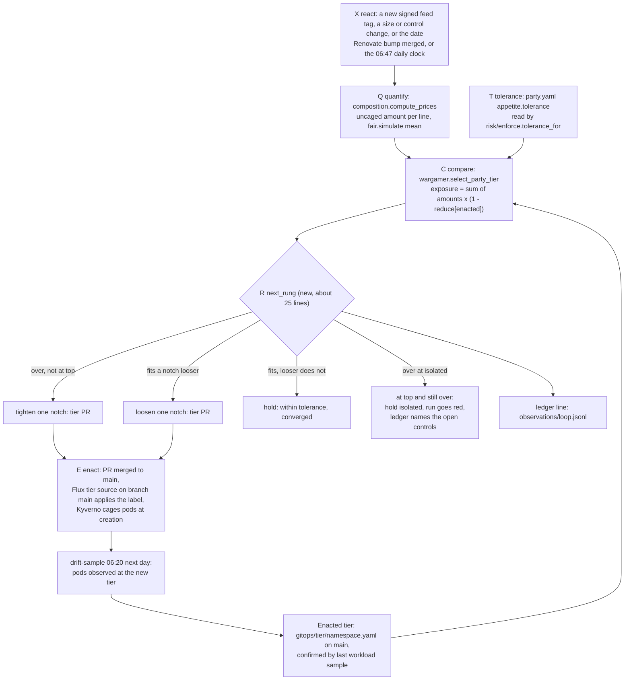

# Subtractive design: close the loop that already exists

Designer's starting point: the chain as found (map A4: 67 files, 24,636 lines of code). Keep only what already runs and serves the loop. Repair each break with the smallest edit. Write as little new code as possible, and count every changed and new line.

Date: 2026-11-14. Evidence is cited as `repo/path:line` against the FRESH clones. "Could not determine" means I did not find out.

Terms used throughout:

- **Exposure**: the organisation's expected loss in pounds a year, after the cage it is actually running under.
- **Uncaged amount**: what composition already computes per priced line (`prices[].amount`), before any cage.
- **Rung** (or tier): one of the four cage settings, `baseline`, `restricted`, `quarantine`, `isolated`, loosest first (`platform/graded/cage.py:128`).
- **Enacted tier**: the rung declared on the governed Namespace on `main` (today `driftwood/gitops/apps/namespace.yaml:30`; moved to `gitops/tier/namespace.yaml` in step 1), which Flux applies from `main`, and which the daily sampler has seen stamped on the running pods.
- **Notch**: a move of one rung.
- **Ledger**: one new append-only file, `driftwood/observations/loop.jsonl`, one line per daily run.

---

## 1. Mission (55 words)

> State the organisation's technology risk as pounds a year. Compare that with the pounds a year the organisation says it can bear. While risk is higher, tighten the cage on running workloads one notch, put it in force, and price again with that cage. Stop when risk fits. Loosen when it fits a notch looser.

---

## 2. Loop semantics: the parts the record never defined

### What "ratchet" means here

- **One notch per cycle, not straight to the fitting rung.** The owner's word is "ratcheting", and the feedback only means something if each notch is put in force and seen before the next is chosen. Today's code jumps straight to the fitting rung in one lookup (`platform/graded/cage.py:343-347`). The cycle is one day: the proposer runs at 06:47 UTC (`driftwood/.github/workflows/propose-tier.yml:42-43`), and the sampler sees the result at 06:20 the next day (`driftwood/.github/workflows/drift-sample.yml:33`). From `baseline` to `isolated` takes at least three days.
- **Two-way, one notch at a time.** It tightens when exposure is over tolerance. It loosens when exposure at the next looser rung would still fit. What releases it is the world changing, never a person waiving: a fine falls, a control is implemented (the one sourced lever already in code, `platform/compose/composition.py:3628-3665`), a feed is revised, or the owner changes tolerance. The direction is an owner decision (D1), because "ratchet" can mean strictly one-way. I recommend two-way. ADR-0015 rejected a tighten-only proposer because it "ratchets the estate toward deny and never recovers" (`hub/docs/adr/0015-adopter-runs-the-proposer-and-it-opens-the-pr.md:68-69`), and the estate has done exactly that since 2026-08-28.
- **It cannot oscillate.** The rule is deterministic. If `isolated` fits and `quarantine` also fits, it loosens to `quarantine`. At `quarantine` it does not tighten again, because `quarantine` fits. It moves again only when the uncaged amount or the tolerance changes.
- **The guard against running ahead.** The proposer moves only if the last workload sample (`driftwood/drift/workload-samples.jsonl`, under 36 hours old) shows every served pod labelled with the tier declared on `main`. Otherwise the decision is "hold: not yet enacted", and the ledger says so. This makes E observed before R acts again.

### Stop condition

Exposure at the enacted rung is at or below tolerance, and exposure at the next looser rung is above it (or the enacted rung is `baseline`). The loop keeps running daily, because X never stops. "Stopped" means it holds.

### When the tightest rung still leaves exposure above tolerance

I designed this branch first. It is today's state for tuppence and ludlow (`tuppence/composed/HEADER.yaml:1343-1347`). With any reduction that has a source, it becomes the normal case for driftwood as well (see section 3).

1. The tier stays `isolated`. Nothing is denied. The owner's most explicit doctrine is "something could find itself unable to run, but that's only because it doesn't fit the cage, not because we deliberately deny it" (`hub/.scratch/ecosystem/issues/75-grilling-what-is-this-for-the-twelve-questions.md:79`).
2. The propose-tier job ends red with one line: `OVER TOLERANCE AT THE TIGHTEST CAGE: exposure £X, tolerance £Y, shortfall £Z`. It goes red again every day until the shortfall closes. A red scheduled run is the escalation. It needs no new component.
3. The ledger line names the levers outside the cage that the evidence already prices. These are the open weighted controls on the regulator line, each with its pound figure. They come from the hole partition composition already writes (`platform/compose/composition.py:3628-3665`; for driftwood pl-2, ra-3, ca-2 and ir-8, `driftwood/composed/HEADER.yaml:1398-1413`). Implementing one takes its weight off the line, so the next cycle can loosen.
4. The other way out is the owner raising tolerance. That is an owner act, recorded in `party.yaml` like any other edit.

### Loosening

Loosening goes through the same tier PR as tightening (`platform/wargamer/tier_pr.py:871-1034`), with the direction in the title and body. A human can veto any notch by closing its PR. The existing rejection ledger (`platform/wargamer/rejection_ledger.py`) derives the veto from closed, unmerged PRs and suppresses a repeat of the same proposal while the price curve is unchanged. I keep that unchanged.

### The feedback, exactly

At cycle *t*:

`exposure_t = U_t × (1 − reduce[enacted_t])`

- `U_t` is the sum of the uncaged amounts of the party's exposure lines (`EXPOSURE_KINDS = ("feed", "twin")`, `platform/compose/composition.py:5086`) on day *t*. It changes only with the world: feed versions, declared size, implemented controls, and the date.
- `enacted_t` is the tier on `main`, read the way the proposer already reads it (`tier_pr.declared_tier`, `platform/wargamer/tier_pr.py:201`), and confirmed by the sampler as above.
- `reduce` is the four-row table (`platform/graded/cage.py:84-111`), one fraction per rung. Since it is one constant per rung, the sum over lines factors.

So a merged notch changes the compared figure at the very next cycle, by the factor `(1 − reduce)`. Today the compared figure uses each line's *proposed* tier (`platform/compose/composition.py:5207-5215`), so the enacted cage never reaches it. That is the open loop A4 found.

**Where the comparison runs.** In the proposer, at run time, not in the signed composed artefact. `U_t` comes from that morning's recompose into the runner's temporary directory (`propose-tier.yml`, the `--evidence "${RUNNER_TEMP}/recomposed/..."` argument). `enacted_t` comes from the Namespace on `main`. If the composer read the Namespace instead, `composed/` would depend on the label, and every tier PR that edits only the label would fail shift-left's compose-check, which diffs the regenerated `composed/` against the committed copy (`driftwood/.github/workflows/shift-left.yml:500-502`). Keeping the decision out of `composed/` avoids that circle. `composed/` stays pure Q, and C and R live in `wargamer.select_party_tier`. (Composition reads the tier label today only to detect `infra`, `composition.py:1539-1554`. I could not determine whether any other composed field echoes the label. If one does, the tier PR would fail compose-check, and the fix is to drop the echo.)

**Honest limit.** This feedback is modelled, not measured. The enacted cage changes the figure through `reduce`, not through observed losses. The loop is a real control process: it really reads what is in force and really changes what is in force. But how much each notch buys is asserted until section 3's sourcing lands. The proof in section 9 says so on the page.

---

## 3. The numbers

### Tolerance

- **Today:** `appetite.tolerance: { amount: 40000, currency: GBP }` (`driftwood/party.yaml:60`). It is read by `platform/risk/enforce.py:81-98` (`tolerance_for`, `:94`) through `platform/compose/composition.py:1947`. The figures 40,000, 15,000 and 5,000 come from the 2026-07-31 fixture `risk/appetite.json` (commit 7a36bf7). They have no owner sentence behind them (`maps/A1-owner-words.md:67-75`).
- **Design:** one number, pounds a year, declared by the owner for the one kept adopter (owner decision D2). The reader stays as it is. `appetite.assurance_bands` (`driftwood/party.yaml:50-55`) is a second £40,000 declaration that only `platform/break-glass/break-glass.py:82` reads. It goes when break-glass is parked. It is marked "Owner-adopted 2026-10-23", so its removal is listed with D7.

### Each rung's reduction

- **Today:** 0.30, 0.70, 0.92 and 0.98, "self-declared, evidenced by nothing but this comment" (`platform/graded/cage.py:71-72`).
- **Smallest repair (step 2):** a separate `REDUCE_BASIS` constant beside `TIERS` gives each rung a basis string, `"assumed: platform calibration, not measured"`. It sits outside the `TIERS` rows so that no table-against-policy drift check that walks those rows can trip (I could not determine which checks the platform `cut-release.yml` runs). The ledger and the tier PR body print that basis next to every exposure figure. This asserts nothing new. It stops the number hiding.
- **How it could be sourced (step 8, owner decision D4).** Each rung would carry the list of controls its dials actually put in force. Examples: `ac-6` least privilege, from dropping all capabilities and running as non-root; `sc-7` boundary protection, from the generated NetworkPolicy. Those controls would then be added to the `implemented` set that `_open_lines` already subtracts (`platform/compose/composition.py:3655-3665`). A rung's reduction on a line becomes the publisher's weight on the controls that rung enforces, only while the sampler sees the dial in force (facts 6 and 7 already probe reach). This reuses the one lever in code that removes a published share, about 40 changed lines. Two facts must be said plainly:
  - the ICO weights are themselves "the publisher's editorial partition" (`ico/penalty-schema/v4/feed.json`, `control_weights.*.basis.could_not_look`);
  - driftwood's dominant line is partitioned over pl-2, ra-3, ca-2 and ir-8 (management controls), and **no pod dial enforces any of them**. Under sourced reductions, the cage would remove nothing from 98.9% of driftwood's exposure, and the loop would sit at "at top, still over". The design handles that state (section 2). The owner should know it before choosing D4.
- **Measured:** could not be measured in this estate. Measuring loss reduction needs incident outcomes, and the estate has none (the recovery-expense ledger holds no records: `platform/recovery-expense/pilot-2027.json:26-28`). The nearest measurable thing is that the dial is in force, which the sampler already observes.

### How exposure is computed

Keep the existing Monte-Carlo: 10,000 seeded beta-PERT years, with the mean as the amount (`platform/fair/fair.py:133-176`). It runs. The owner asked for "Monte Carlo modelling" (2026-08-19, `maps/A1-owner-words.md:60`). With seed 42 it is deterministic, so the ledger is reproducible. A closed form exists (`fair.expected_ale`, `platform/fair/fair.py:111-130`) and is already used where the simulation rounds rare events to zero. Swapping engines would be new work for no change in the decision. Exposure is then one multiplication per rung.

### Is the pound a real estimate?

Not today. Composition stamps every total "an ordinal, auditable comparison under one perspective; not an expected annual loss" (`ORDINAL_STATEMENT`, `platform/compose/composition.py:5094-5095`), on a one-word "yes" (T75:78, T75:111). "Within financial tolerance" needs a figure that can be compared with money, so the design treats the amount as a **cardinal estimate of expected annual loss with a stated basis** (owner decision D3). Two things make that honest:

1. The label changes. `ORDINAL_STATEMENT` and `ORDINAL_BASIS` (`composition.py:5094-5100`) are reworded to "expected annual loss under the bases named beside it". The selfcheck that insists on the word (`composition.py:7402-7410`) is renamed to insist on a `basis`. That is about 12 changed lines.
2. The dominant input gets a source. The ICO line is annualised at an editorial 1, 2 or 4 fines a year (`ico/schema/to_fair_scenario.py:69`, `DEFAULT_WARN_LEF`), so the line is a fixed 2.0781% of turnover for every adopter (`maps/F1-publishers.md:130`). A sourced base rate would be the count of monetary penalties against the count of controllers in a year. That is a one-constant change in the ico converter plus a basis field, released as a new ico tag. I could not determine the rate. If it were around one in a thousand a year (an unverified illustration, not a finding), driftwood's line would fall by roughly three orders of magnitude and the loop would hold at `baseline`. The design does not depend on which way that falls. It depends only on the figure being stated with its basis.

Documents that must change for D3: T75 item 4 (as a superseded decision); `hub/CONTEXT.md` entries Price and Exposure; ADR-0020 and ADR-0021 where they call the pound ordinal; the `driftwood/composed/HEADER.yaml` basis text (regenerated).

---

## 4. Components

Line counts are `wc -l` from inside each FRESH repo, taken 2026-11-14. Large JSON data payloads are left out of the component lines and named separately: `feeds/cve/v3/feed.json` 13,903, `driftwood/inventory/images.json` 5,447, and the generated `driftwood/composed/` tree. "Kept" means the file stays and runs. "New" means written by this design.

| # | Component | Job | Loop step | Kept lines | Reuse |
|---|---|---|---|---|---|
| 1 | Party declaration | Size, tolerance, feed pins | T | 93 (133 less 40 parked) | `driftwood/party.yaml` |
| 2 | Regulator fine publisher | Penalty schema, converter, daily clock, signed release | Q, X | 2,982 | `ico/penalty-schema/{v3,v4}`, `ico/schema/to_fair_scenario.py` (adapter block 575-899 parked), `ico/.github/` |
| 3 | Threat and KEV publisher | Threat register and converter, CVE clock, signed release | Q, X | 2,373 | `feeds/threat-register/`, `feeds/cve/rule.yaml`, `feeds/fetch/{lib,cve,threat-register}.py`, `feeds/bump.py`, `feeds/.github/` |
| 4 | Composer and its import closure | Prices every line (the uncaged amounts); writes evidence and HEADER | Q | 16,979 (17,017 + 2 new − 40 in step 7) | `platform/compose/{composition,handbook,comparison_history,consumer_retirement,quote_assessment,publisher_reliability}.py`, `platform/party/{party_artefact,pin_content,assurance_bands}.py`, `party/schema.json`, `platform/distribution/{cage_body,render-*}.py`, `platform/engine/namespaces.yaml`, `platform/feeds/to_fair_scenario.py` |
| 5 | FAIR engine | Monte-Carlo mean per line | Q | 516 | `platform/fair/fair.py`, `fair/severity.py` |
| 6 | Rung table and `next_rung` | Reduction per rung with basis; the one-notch decision | C, R | 697 (668 + 29 new) | `platform/graded/cage.py` |
| 7 | Tolerance reader | Reads `appetite.tolerance`; `tcor` stays only because `wargamer.py:51` imports it | T | 689 | `platform/risk/enforce.py`, `platform/tcor/tcor.py` |
| 8 | Proposer | Reads the enacted tier and that day's amounts, calls `next_rung`, opens the tier PR in either direction, honours vetoes; inventory proposer for the CVE line | C, R, E | 3,575 (3,540 + 35 new) | `platform/wargamer/{wargamer,tier_pr,rejection_ledger,inventory}.py`, `platform/honesty/proposer_bounds.py` |
| 9 | Served cage bodies | Kyverno `cage-tier` mutation, `cage-netpol`, PriorityClasses, version fan-out | cage | 745 | `platform/distribution/policies/v7.0.0/`, `distribution/versions.yaml` |
| 10 | Adopter cluster declaration | Namespace tier label on its own branch-tracked source, three workloads, Flux sources and pins, engine pin | cage, E | 734 (703 + 32 new − 1) | `driftwood/gitops/` (insurer pin parked; new `gitops/tier/`, `gotk-sync-tier.yaml`) |
| 11 | Adopter clocks and CI | Daily propose, Renovate bump and recompose, PR compose-check, composed-tag release | X | 2,303 | `driftwood/.github/workflows/{propose-tier,renovate-run,shift-left,cut-release,release}.yml`, `renovate.json`, `.github/scripts/{complete-feed-bump.sh,read-pins.py,verify-pinned-checkouts.py,platform-tools.py}`, `platform-tools-pin.yaml`, `scripts/render_composed.py` |
| 12 | Pin helper | `read-pin` and `verify-commit` subcommands that propose-tier calls | support | 1,514 | `driftwood/.github/scripts/adopter-gate.py` (shrink later; its acceptance steps leave shift-left) |
| 13 | Enactment observer | Daily throwaway cluster from the real remotes; pods sampled at their tier | proof of E | 4,242 | `driftwood/.github/workflows/{drift-sample,observation-delivery}.yml`, `driftwood/drift/{five-facts,cage_probe,served_apps}.py`, `drift/window.yaml` (OSCAL step removed) |
| 14 | Control catalogue | Holes vocabulary for the regulator line's partition | Q | 945 (data) | `nist/catalog/` |
| 15 | Tools release path | Cuts the signed compiler tag driftwood runs | E (of code) | 376 | `platform/.github/workflows/{cut-release,release}.yml` |
| 16 | Ledger and loop record | One line per run; one page that says what the loop is | proof | 150 new | `driftwood/observations/loop.jsonl` (new, data), `hub/LOOP.md` (new) |
| | **Total kept** | | | **38,913** | |

This total is larger than A4's 24,636 because A4 counted `composition.py` without the eight modules it imports at load time (`composition.py:367-382`, `:1391-1470`) and left out the observer. That is the price of the subtractive start: the composer drags its import closure. Shrinking that closure is a later, separate job, and I do not count on it.

### The diff, function by function

| File | Function or place | Change | Changed | New | Deleted |
|---|---|---|---|---|---|
| `platform/graded/cage.py` | `REDUCE_BASIS` beside `TIERS` | one basis string per rung | 0 | 4 | 0 |
| `platform/graded/cage.py` | `next_rung(uncaged_total, enacted, tolerance)` | **new.** Exposure at the enacted rung; returns `tighten`, `loosen`, `hold` or `at-top`, with exposure, the modelled exposure after the move, and the shortfall. Unknown or `infra` fails closed to `isolated`. | 0 | 25 | 0 |
| `platform/compose/composition.py` | `aggregate_section`, `untiered` branch (`:5225-5241`) | a `cve` line with `absence_only` and `inventory_cve_count > 0` (the scan looked and KEV holds none of it) counts as 0, not untiered. This ends `breaches_band: null` on driftwood (`driftwood/composed/HEADER.yaml:1380`). The ledger's basis line names the KEV feed version, which has been frozen at `cve/v3.0.0` since 2026-10-03 behind an unmerged proposal (`maps/A4-does-the-loop-run.md:54`). | 6 | 0 | 0 |
| `platform/compose/composition.py` | `aggregate_section` return | add `uncaged_total`, the sum the proposer reads | 0 | 2 | 0 |
| `platform/compose/composition.py`, `platform/compose/handbook.py` | `aggregate_section` per-line verdict (step 7) | drop `selected_tier_residual_total` and `breaches_band`, which sum each line's own price-selected rung. Once the floor goes, they disagree with the ledger: ICO at `isolated` £35,744 + threat register at `baseline` £13,691 + twin £531 ≈ £49,966, a printed breach on the day the loop holds within at £36,150. Estimate; I did not count the handbook lines that render it | 10 | 0 | 40 |
| `platform/compose/composition.py` | `ORDINAL_STATEMENT`, `ORDINAL_BASIS`, selfcheck `:7402-7410` | reword to an expected annual loss with a basis (only if D3 says cardinal) | 12 | 0 | 0 |
| `platform/wargamer/wargamer.py` | `select_party_tier` (`:251-327`) | replace the strictest-line fold and tighten-only `held` with: sum the amounts of the lines that fold into the Namespace, call `cage.next_rung(total, current, tolerance)`, clamp to a floor if one is still declared; keep the same return keys (`tier`, `held`, `basis`, ...) so `tier_pr` still works | 40 | 25 | 0 |
| `platform/wargamer/wargamer.py` | `wargame_cage_tier` (`:330-358`) | today a row drifts only when a line's tier changed between the old and new pin (`"drift": bool(price.get("changed"))`, `:354`, set at `composition.py:3878`), and `proposer_bounds.confidence` grades by price movement. So with no feed change nothing is ever proposed. Emit one party row when the selection moves, with `drift: True` and `tolerance: None`, so it is graded at structural confidence the way `wargame_agent_cage` already is (`:361-375`). The row carries a synthetic `price` (the strictest line, for the fields `run()` and `_propose_tier` dereference) and a stable `control` such as `party-tier`, so the dedupe key (`proposer_bounds._key`, `:70-74`) and branch name stay one per party. Estimate only: I did not read `_propose_tier`, `_land` (`tier_pr.py:667-742`) or `_move_evidence` (`:404`) in full, nor whether day 2's PR reuses day 1's merged branch name | 30 | 0 | 0 |
| `platform/wargamer/tier_pr.py` | `_tightens` (`:854-868`) becomes `_moves`, and its one caller in `_land` (`:714`) | allow exactly one notch in either direction, re-judged against what `origin/main` declares at write time | 11 | 0 | 0 |
| `platform/wargamer/tier_pr.py` | `run` (`:871-1034`), `_party_paragraph` (`:564`) | read `appetite.tolerance` through `enforce.tolerance_for` and pass it to `select_party_tier`; the PR title and body say tighten or loosen, exposure before and after, tolerance, reduction basis | 14 | 4 | 0 |
| `platform/wargamer/tier_pr.py` | `_open_or_update_pr` (`:386`) | `gh pr merge --auto --squash` when `LOOP_AUTOMERGE=1` (only if D5 authorises it) | 0 | 6 | 0 |
| selfchecks in `cage.py`, `wargamer.py`, `tier_pr.py` (`:1036-1705`), `composition.py` aggregate | update tighten-only asserts; add one-notch, loosen, at-top and enacted-tier cases | 85 | 20 | 0 |
| `driftwood/.github/workflows/propose-tier.yml` | new steps: observed-tier guard, ledger append (into the existing `OBSERVATION_LANE`), red at top; drop the insurer checkout and pins | 10 | 48 | 6 |
| `driftwood/.github/workflows/shift-left.yml` | remove the tier-binding step (`:524-557`) and the adopter-gate compose, matrix and body steps (about `:200-300`) | 0 | 0 | 154 |
| `driftwood/.github/workflows/drift-sample.yml` | remove the OSCAL lane step | 0 | 0 | 25 |
| `driftwood/gitops/flux-system/gotk-sync-tier.yaml` | **new.** A `GitRepository` `driftwood-tier` on `ref: {branch: main}` and a `Kustomization` over `./gitops/tier` | 0 | 26 | 0 |
| `driftwood/gitops/tier/kustomization.yaml` | **new.** Lists `namespace.yaml` | 0 | 5 | 0 |
| `driftwood/gitops/apps/kustomization.yaml` | drop `namespace.yaml` (it moves to `gitops/tier/`) | 0 | 0 | 1 |
| `driftwood/gitops/tier/namespace.yaml` (moved) | rewrite the stale comment (`:22-29`); add `kustomize.toolkit.fluxcd.io/prune: disabled` so moving the object between Kustomizations cannot garbage-collect the Namespace and its pods on a persistent cluster; the tier value changes only through PRs (the D6 reset in step 4) | 15 | 1 | 0 |
| `driftwood/gitops/flux-system/gotk-sync.yaml` | the apps self-pin moves once, by hand, to a new tag whose `gitops/apps/` no longer holds the Namespace (never again for a tier change); the apps `Kustomization` gains `dependsOn: driftwood-tier`, so pods never apply before their Namespace | 4 | 0 | 0 |
| `driftwood/party.yaml` | remove `overlay.floor` (D7), insurer and recovery-expense inherits, forward-intel `publishes`, `workload_cages`, `assurance_bands` | 0 | 0 | 40 |
| `driftwood/renovate.json` | remove twin and insurer managers; `automerge` on feed managers (D5) | 0 | 4 | 30 |
| `driftwood/gitops/flux-system/gotk-sync-insurer.yaml` | park | 0 | 0 | 38 |
| `platform/.github/workflows/{cut-release,release}.yml` | step 7: declared semver plus gitsign, without the computed-semver gate (`cut-release.yml:104-176`, `release.yml:120`) | 15 | 0 | 40 |
| **Code totals** | | | **252** | **170** | **374** |

Documents, counted apart: `hub/LOOP.md` about 150 new; `hub/docs/adr/0039-the-loop-ratchets-one-notch-both-ways.md` about 60 new; `hub/NORTH-STAR.md` rewritten to about 40; `hub/CONTEXT.md` cut to the loop terms (Exposure, Tolerance, Rung, Enacted tier, Notch, Ledger) and the delivery terms.

An option, not in the totals. If the owner funds a persistent cluster (D8), the three bare Pods (`driftwood/gitops/apps/{pod,storefront,api}.yaml`, all `kind: Pod`) become Deployments, about 30 changed lines. `tier_pr.apply_tier_declaration` (`:327-360`) also stamps a `posture.acme.io/tier` annotation on each pod template, about 15 new lines. Without this, a running pod is never re-caged: `cage-tier` fires at CREATE and UPDATE only (`driftwood/composed/policies/v7.0.0/cage-tier.yaml:20-22`), and `cage-netpol` has `synchronize: enabled: false` (`cage-netpol.yaml:14-16`).

---

## 5. Scope calls

**One adopter: driftwood.** The three adopters are near-clones with drifting copies (76 byte-identical files, `maps/D2-tuppence-ludlow.md:247`). The loop needs one organisation to show it closes. tuppence and ludlow add no loop behaviour, only the "at top, still over" outcome, and driftwood reaches that on any real feed or tolerance change. Their tolerances against their sizes (£5,000 against a USD 197.6bn turnover) are fixture values that would mislead an observer.

**Publishers stay as separate organisations with signed tags (ico, feeds, nist). insurer is parked.** This is what runs today. driftwood checks each one out at a `{tag, commit}` pin and verifies it (`propose-tier.yml`, `verify-pinned-checkouts.py`). Folding them into one repository would mean rewriting pins, workflows and composition's parent loading. That is new work, not removal. Separate signed tags are also what make "the world changed" a datable, attributable event, which is the X trigger. insurer's premium sits outside the compare (`maps/F1-publishers.md:84`), so it is off the loop.

**Versioned policy through Flux and Renovate is the enact and react mechanism here, and I keep it.** In the found chain, Renovate is the only parent-side trigger (`driftwood/renovate.json`), and Flux is what applies the label to a cluster. The policy bodies and the apps stay tag-pinned, which is the 2022 thesis. Only the tier label moves: it goes to its own Flux source that tracks `main`, because the label is the loop's actuator and the adopter's own configuration, not a dependency. The self-pin to a tag was the main enactment break: 164 commits behind, moved by hand (`driftwood/gitops/apps/storefront.yaml:12`), and a commit cannot pin a tag that contains itself. I do not switch the whole apps source to `branch: main`, because `platform/wargamer/inventory.py:55-66` refuses an apps source that does not "pin a tag and full commit", and the CVE line depends on that scan. A second source for one file is the smaller change. I could not determine whether `five-facts.py` refuses a branch-tracked `GitRepository` among the ones it inspects. Step 1 shows that on the first daily sample. In principle the loop is separable: a job writing the label with `kubectl` would close it too. But that is new code, and it would lose the reviewed-PR veto.

**Cage dials: v7.0.0 exactly as served.** These are CPU and memory ceilings, PriorityClass, read-only root with non-root and all capabilities dropped, a generated NetworkPolicy, and a WAF sidecar (`maps/A4-does-the-loop-run.md:63-77`). Changing a dial means a new policy version through the release path. Known defects stay visible in the ledger's basis line:
- `restricted` and `quarantine` generate the same NetworkPolicy (`cage-netpol.yaml:43-45`);
- the WAF image exists in no registry (`drift-sample.yml:68-70`);
- the owner's "iops" dial is absent.

**Fates.**
- **Twin:** park. It moves £758 of £1,807,494 (`maps/A4-does-the-loop-run.md:190`).
- **Truth surface:** park. It grades the build, not exposure; 61 of its 117 passes are self-proof (`hub/talk/truth.log:183`).
- **Computed semver:** park in step 7, once the platform release workflows stop calling it. It is a release-time dependency today (`platform/.github/workflows/cut-release.yml:162`).
- **Calibration programme:** park. It has no caller, its registry is empty, and its tracked planning has no mention of reductions or tolerance (grep of `troy/.scratch/calibration-programme`; the only hits are captured gate output).
- **Talk material:** park. The owner called it a "by product" (T75:83).

---

## 6. Disposition of what exists

**Park** means it leaves the working tree and CI and stays in git history, on an `archive/2026-11` branch per repo. Whole repositories are archived on GitHub, which needs owner authorisation (D9). **Cut** means it is deleted outright, being an exact copy or superseded. One fact makes parking safe: every consumer reads its parents at signed tags, so removing a directory from a publisher's working tree changes nothing an adopter already pins.

### hub (map areas A1, A2, A3, A5, H1 to H15)

| Directory | Disposition | Why |
|---|---|---|
| `NORTH-STAR.md` | shrink (rewrite to about 40 lines) | its eco-system sentence and seven principles conflict with the owner's sentence |
| `CONTEXT.md` | shrink | about 24 of 120 entries serve the loop (`maps/H12-adrs-glossary.md:173`) |
| `README.md`, `LICENSE`, `CLAUDE.md` | keep (README edited to point at `LOOP.md`) | |
| `docs/adr/` | keep as history; add ADR-0039 superseding 0015 point 7, 0020 (where a breach does nothing), 0021, 0022 (floor, tighten-only), 0031 | records |
| `docs/` (PRD, other docs) | keep the PRD and HISTORY as history; park the rest | |
| `research/` | keep `03-blogs-thesis.md` and `22-prd-decision-register.md`; park the rest | provenance of the 2022 thesis |
| `twin/` | park | H1 to H6: no adopter money or tier depends on it beyond 0.04% |
| `verify/` | park (cut the `tier-binding/` copy) | H7, H8: checkers of an estate this design replaces; tier-binding duplicates platform |
| `talk/` (truth harness, captures, deck) | park | H11 |
| `tests/` | park | H9, H10: they test parked code |
| `bench/` | park | calibration programme |
| `spikes/`, `explorations/`, `fleet`, `policy`, `forged.yaml`, `bin/`, `tts.py`, `clone-estate.sh`, `conftest.py`, `pytest.ini` | park | off the loop |
| `t/` | cut | three stray fixtures nothing references (`maps/H10-tests-b.md:152`) |
| `.github/` (`truth.yml`, `truth-delivery.yml`, `twin.yml`, `cut-release.yml`, `release.yml`) | park | truth surface and twin CI |
| `.claude/` | park (owner action; it holds the ENACT hook) | guards the assistant's build, not the loop (`maps/H3-twin-governance.md:73`) |
| `.scratch/computed-semver`, `demo-feedback`, `faithful-floor`, `govern-what-you-dont-control`, `laya-loophole`, `multi-org-estate`, `policy-composition`, `real-estate`, `talk-spec`, `twin` | park | planning records (H13, H14, A3) |
| `.scratch/ecosystem` | park; cut the October patch copies and run logs inside it | 1.34M lines of copies of other repos' diffs (`maps/A3-accretion-timeline.md:22`) |
| `.scratch/drift-review-2026-08-27` | park, except `evidence/AMBITION_TIMELINE.json` and `DECISION_LEDGER.json`, which stay under `docs/provenance/` | the only tracked owner quotations (`maps/A1-owner-words.md:196`) |
| `.scratch/0001-*.patch` | cut | a stray patch |

### platform (P1, P2, P3)

| Directory | Disposition | Why |
|---|---|---|
| `compose/` | keep the six imported modules; park `cloud_composition.py`, `fixture_inventory.py` and the tests of parked features | component 4 |
| `fair/` | keep (scenarios and tail script parked) | Q |
| `graded/` | keep `cage.py`; park `policies/` authoring copies, `tests/`, `verify-graded.sh`, `up.sh`, `prune-retired.py`, `waf-placeholder/` (the served copies live in `distribution/`) | R; the authoring copies duplicate `distribution/policies/v7.0.0/` |
| `risk/` | keep `enforce.py`; park `PR.md`, `verify-risk-tuned.sh`, `scenarios/` | T |
| `tcor/` | keep `tcor.py` (imported by `wargamer.py:51`); park scenarios and verify | import dependency |
| `wargamer/` | keep `wargamer.py`, `tier_pr.py`, `rejection_ledger.py`, `inventory.py`; park `propose-policy-pr.sh`, `verify-*` | R, E |
| `honesty/` | keep `proposer_bounds.py`; park `calibration.py`, `reflexive.py`, `incidents.json`, scenarios | imported by `tier_pr` |
| `party/` | keep `party_artefact.py`, `pin_content.py`, `schema.json`, `assurance_bands.py` (imported by `party_artefact.py:71`); park the publisher-reliability test and the verify script | imported by composition |
| `distribution/` | keep `policies/v7.0.0/`, `versions.yaml`, `cage_body.py`, `render-*.py`; park older policy trees once no adopter pins them, plus `render-version-tree.py` and verify | served cage bodies |
| `engine/` | keep `namespaces.yaml`; park the rest (adopters declare their own engine) | composition reads `engine/namespaces.yaml` (`composition.py:1544`) |
| `feeds/` | keep `to_fair_scenario.py`; cut the stale fixture copies of the feeds repo | CVE converter |
| `computed-semver/` | park in step 7 | release-time only; feeds no loop step |
| `shift-left/` | park (including `tier_binding.py`) | refuses any stepwise or loosening move |
| `identity/` | keep `gitsign-verifier` (drift-sample applies it); park the rest | |
| `access/`, `eud/`, `posture/`, `wardley/`, `oscal/`, `policy/`, `implementations/`, `recovery-expense/`, `break-glass/`, `currency-controller/` | park | off the loop or shelved (`maps/P2-platform-pound-and-cage.md:13`, `maps/P3-platform-rest.md:234`) |
| `party.yaml` | keep | the platform's own party record |
| `.github/` | keep `cut-release.yml` and `release.yml` (edited in step 7); park `fetch.yml`, `cloud-release.yml`, `recovery-expense.yml` | |
| root `verify-*.sh`, `verify-release-signing.py`, `lib*.sh` | park, unless `cut-release.yml` calls one (check in step 7) | |
| `README.md`, `CONTEXT.md`, `docs/` | shrink; `CONTEXT.md` and ADR-0001 are about insurer quotes and are parked | |

### driftwood (D1)

| Directory | Disposition |
|---|---|
| `party.yaml`, `gitops/`, `renovate.json`, `README.md`, `LICENSE` | keep (edited) |
| `composed/` | keep (generated; `composed/feeds/` copies are a shrink candidate once the composer stops writing them) |
| `inventory/` | keep (the CVE line) |
| `.github/workflows/{propose-tier,renovate-run,shift-left,cut-release,release,drift-sample,observation-delivery}.yml`, `.github/scripts/` (pin, tools and recompose helpers), `.github/actions/`, `.github/rulesets/` | keep (edited) |
| `.github/workflows/twin-sweep.yml`, `verify-identity-regexp.yml`, the twin scripts | park |
| `drift/five-facts.py`, `cage_probe.py`, `served_apps.py`, `window.yaml`, `samples.jsonl`, `workload-samples.jsonl` | keep |
| `drift/` August study (`probe.sh`, `forced-campaign.*`, `verdict.yaml`, `preconditions.yaml`, `*.md`), `oscal_lane.py`, `oscal-samples.jsonl` | park |
| `twin/`, `observations/twin-sweep.jsonl`, `verify-twin-overlay.sh` | park |
| `selection-policy/` | cut after step 5 (a duplicate of `cage.select_tier`). It is needed only while a forward-intel feed is published (`composition.py:4141-4145`); the twin-agent line records a refusal without it and is not an exposure kind (`composition.py:4697-4700`, `:5086`) |
| `scenarios/`, `accepted-majors/` | park (workload-cage planning and semver acceptance) |
| `scripts/` (KinD bring-up), `git-server/`, `kind/`, `deploy/`, `verify-reconcile.sh` | park |
| `verify-cage-probe.sh` | keep |
| `tests/`, `.github/tests/` | shrink to tests of kept scripts |

### tuppence, ludlow (D2)

Park both whole repositories (archive on GitHub, D9).

### Publishers (F1)

| Repo and directory | Disposition |
|---|---|
| `ico/penalty-schema/` | keep v3 and v4 plus rule and bump; park v1 and v2 (tags keep them) |
| `ico/schema/` | keep `to_fair_scenario.py` core; park the adapter block (`:575-899`) and `test_widening_cli.py`; cut the legacy v1/v2 schema and the demo ed25519 key (`maps/F1-publishers.md:35`) |
| `ico/.github/`, `party.yaml`, `README.md`, `LICENSE`, `DISCLAIMER.md` | keep |
| `ico/verify-*.sh` | park |
| `feeds/threat-register/`, `cve/`, `fetch/` (lib, cve, threat-register), `bump.py`, `.github/`, `party.yaml`, `README.md`, `LICENSE` | keep; park `fetch/source/cve.json` (58,882-line capture) and the release-proof gate tests |
| `feeds/eol/`, `fx/`, `converters/` | park (used by ludlow only; GBP needs no FX, since `_converted` returns early, `composition.py:3621`) |
| `feeds/market-moves/`, `news/`, `recovery-expense/` | park (unconsumed) |
| `feeds/verify-*.sh` | park |
| `nist/catalog/`, `.github/`, `party.yaml`, `README.md`, `LICENSE`, `NOTICE`, `DISCLAIMER.md` | keep |
| `nist/publisher-reliability/`, `tests/`, `scripts/` (verify) | park (scores nothing: `cohorts: []`) |
| `insurer/` | park whole repository (D9) |

---

## 7. Owner decisions (each changes the design)

| # | Question | Options | Recommendation |
|---|---|---|---|
| D1 | What does "ratcheting" mean? | (a) one-way: tighten only, as today; (b) two-way, one notch, released by the world changing | (b). Under (a), any temporary spike locks the estate at the top for good. That is the state since 2026-08-28. |
| D2 | What is driftwood's financial tolerance, in pounds a year? | (a) keep £40,000, now labelled owner-declared; (b) a share of turnover you name; (c) another figure you name | (c), or (a) explicitly re-declared. The current figure is a 2026-07-31 fixture with no owner sentence. |
| D3 | Is the pound a real expected annual loss or an ordinal score? | (a) cardinal, with a basis on every input; (b) stays ordinal | (a). "Within financial tolerance" compares money with money. (b) makes the stop condition meaningless. |
| D4 | Where do rung reductions come from? | (a) the current table, labelled "assumed"; (b) the adopter twin's 0.05/0.30/0.65/0.90, also assumed; (c) derived from the controls each rung's dials enforce, weighted by the publisher | (a) now, (c) as step 8. Know that under (c) the cage removes almost nothing from driftwood's dominant line, so "at top, still over" becomes the normal state. |
| D5 | Who merges a notch, and Renovate's feed bumps? | (a) a person merges each PR; (b) auto-merge after checks, with veto by closing the PR; (c) the clock commits straight to `main` | (b). (a) makes "reactive" mean "whenever someone looks". (c) loses the veto. This is an authorisation, so only the owner can give it. |
| D6 | Reset the Namespace to `baseline` so the loop climbs from the bottom on real data? | (a) yes, recorded in the ledger as `cause: reset`; (b) no, leave `isolated` and wait for a world change | (a). The current `isolated` was hand-written on 2026-08-28, never by the loop. |
| D7 | Remove the owner-adopted `overlay.floor: isolated` and `assurance_bands` (2026-10-23)? | (a) remove both; (b) keep the floor at a lower rung; (c) keep as is | (a). A floor at the top rung disables the loop (`maps/D1-driftwood.md:152`). |
| D8 | Fund a persistent cluster? | (a) yes: Deployments plus rollout annotation, so running pods are re-caged; (b) no: the daily throwaway cluster built from `main` is the enactment target, labelled as such | (b) now. Choose (a) only if you want to show a running process re-caged in place. Under (a), the WAF placeholder image must also be published or the dial dropped, and the Namespace's move between Kustomizations must keep its prune guard. |
| D9 | Archive repositories (tuppence, ludlow, insurer) and push archive branches? | yes or no | yes. |
| D10 | What happens at the top rung when still over? | (a) red run plus the ledger naming open controls; (b) also deny new workloads | (a). (b) contradicts your 2026-09-02 doctrine. |

---

## 8. Sequence (eight steps, each leaves something running)

1. **Give the tier its own source on `main`.** Move `namespace.yaml` to `gitops/tier/` behind a new `driftwood-tier` `GitRepository` on `branch: main`. Cut one driftwood tag whose `gitops/apps/` no longer holds the Namespace, and move the apps self-pin to it, the last hand move. Remove the tier-binding step from `shift-left.yml`. Park the hub's `truth.yml` and `twin.yml` now, because from step 2 the hub's pound-seam, tier-binding and fold-agreement checks would go red against the new selector. *Runs:* the 06:20 sample builds the cluster with the label taken from `main` (still `isolated`). The estate behaves as before, but any merged label now reaches pods the next morning.
2. **Close the loop in code (platform tools v6.4.0).** Add `next_rung` and the `basis` field; rewrite `select_party_tier`; emit one party row from `wargame_cage_tier`; add `_moves`; count the CVE absence as 0 and add `uncaged_total` in `aggregate_section`; update the selfchecks. Cut the tag through the existing platform `cut-release.yml`, with computed semver still in place. A pin PR moves `driftwood/.github/platform-tools-pin.yaml` to v6.4.0 and carries the recomposed `composed/`, as Renovate's bump commit already does. *Runs:* the daily proposer computes a two-way, one-notch decision. With the floor still `isolated` and exposure £36,150 against £40,000, it holds, and for the first time driftwood's compare gives a verdict (within).
3. **Ledger, guard and escalation.** Add three steps to `propose-tier.yml`: hold unless the last sample shows the declared tier; append one line to `observations/loop.jsonl`; end red at top. *Runs:* a daily, reviewable record of exposure against tolerance (`hold, within`).
4. **Release the ratchet (after D5, D6 and D7).** Apply auto-merge if authorised. One PR removes `overlay.floor` and `assurance_bands` and resets the Namespace to `baseline`; the ledger records it as `cause: reset`. *Runs:* the climb in section 9, one notch a day, each notch a proposer PR, each one observed on pods before the next.
5. **Park driftwood's off-loop parts.** Remove the twin, twin-sweep, the insurer pin, recovery-expense, workload cages, the OSCAL lane, the August study, the KinD bring-up, the identity-regexp workflow, accepted-majors and the adopter-gate acceptance steps. Then remove `selection-policy/` once the PR's compose-check shows composition no longer asks for it. *Runs:* the same loop. Shift-left's compose-check proves composition still accepts the shorter `party.yaml` (`party_artefact.py:388` checks `assurance_bands` only when present).
6. **Park the other repositories' off-loop parts.** Archive tuppence, ludlow and insurer (D9). In feeds, park eol, fx, market-moves, news, recovery-expense and the CVE raw capture. Park nist publisher-reliability. In ico, park the adapter block and cut the legacy schema. *Runs:* unchanged, because driftwood reads every parent at a signed tag.
7. **Park the hub's and platform's off-loop parts.** Park the twin, verify, the rest of the truth harness, tests, bench, spikes, `.scratch`, and the platform directories listed in section 6. Drop the per-line aggregate verdict from `aggregate_section` and the handbook. Edit the platform `cut-release.yml` and `release.yml` to declared semver plus gitsign, then park `computed-semver/`. Write `hub/LOOP.md` and ADR-0039, rewrite `NORTH-STAR.md`, and shrink `CONTEXT.md`. *Runs:* the loop, plus a platform release path that a v6.4.1 tag proves.
8. **Make the numbers say where they come from (after D2, D3, D4).** Re-declare tolerance. Reword `ORDINAL_*`. Release a new ico tag with a sourced fine frequency and its basis. If D4(c), add the per-rung control lists and feed them into `_open_lines` while the sampler sees the dials. *Runs:* the same loop, now on figures each of which names its source in the ledger.

---

## 9. Proof

**What an observer sees.** Three things, which must agree day by day:

1. `driftwood/observations/loop.jsonl`, one line per day: `{date, cause, pins, enacted_tier, observed_tier, sample_run, uncaged_total, exposure, tolerance, within, decision, proposed_tier, pr, reduction_basis, open_controls}`.
2. The tier PRs on driftwood, opened by the proposer identity, each merged or closed.
3. `drift/workload-samples.jsonl`, the pods' `posture.acme.io/tier` label from a cluster built that morning, with the tier label taken from `main` and the apps from their pinned tag.

The run on today's composed figures (driftwood, uncaged total £1,807,494, D4 option (a)) would read:

| Day | Enacted | Exposure | Tolerance | Decision |
|---|---|---|---|---|
| 0 (step 4 reset merged) | baseline | £1,265,246 | £40,000 | tighten, PR |
| 1 | restricted | £542,248 | £40,000 | tighten, PR |
| 2 | quarantine | £144,600 | £40,000 | tighten, PR |
| 3 | isolated | £36,150 | £40,000 | hold, within |

Each day's `observed_tier` should equal the previous day's merged tier. Then a real world change arrives. Candidates are the Renovate bump to ico `v4.0.0`, already signed since 2026-09-10 (`maps/F1-publishers.md:76`), an implemented control, or a re-declared tolerance. A new line then shows the loop react: tighten, loosen, or go red at the top with the open controls listed. (I could not determine the v4 line's pound figure, so I do not predict which.)

**What would make it staged rather than real.**

- Any exposure that does not come from that day's recomposed evidence. This includes a synthetic residual or a throwaway copy, as in the existing step-3 capture (`hub/talk/captures/verify_e2e_verify-e2e-step3-price-crosses-band-pr-opens.out:8`).
- A tier change on `main` not made by a merged proposer PR (a hand edit), unless the ledger records it as `cause: reset` or `manual`.
- `observed_tier` disagreeing with `enacted_tier` while the loop moves anyway. The guard should make this impossible, and the ledger would show it.
- Merges made by an agent session and presented as a person's. The ledger records the merger's identity as it is.
- **Disclosed, not hidden.** Until step 7 removes it, the HEADER's per-line `breaches_band` is selection evidence at each line's own rung. It can disagree with the ledger, and the ledger is the loop's compare.
- **Disclosed, not hidden.** The size of each notch's effect is the assumed `reduce`, so the proof shows the control loop closes. It does not show the cage reduces real losses. The ledger's `reduction_basis` says "assumed" on every line until step 8.
- **Disclosed, not hidden.** Under D8(b), "enacted" means a cluster built fresh each morning, with its tier label from `main`. That shows what `main` puts in force. It does not show a long-running pod re-caged in place, because admission fires once (`platform/currency-controller/README.md:14-18`) and the workloads are bare Pods. Under D8(a) it does.

---

## Documents that must change because the owner's sentence outranks them

- `hub/NORTH-STAR.md`: it states an eco-system and a touring talk, not the loop. Replace it with the mission above.
- ADR-0022 (floor; tighten-only, `:110-126`, `:166-169`) and ADR-0015 point 7: superseded by ADR-0039 (one notch, both ways).
- ADR-0020 and the `aggregate_section` docstring (`composition.py:5197-5198`): "a breach is priced and shown, never denied" stays true about denial. A breach now moves the cage or turns the run red.
- ADR-0021 (two implementations of the selector, pound seam): the second implementation is cut.
- ADR-0031 (twin agent cage): parked with the twin.
- T75 item 4 (ordinal pound): superseded if D3 is (a).
- `hub/CONTEXT.md`: add Tolerance, Enacted tier, Notch, Ledger and Ratchet (it has no entry for compare, ratchet or react today, `maps/H12-adrs-glossary.md:174`).
- `platform/computed-semver/coverage.py:508-513`: the open limit `cage-ratchet-one-way` is parked with computed semver; the limit itself is closed by D1(b).
- `driftwood/README.md`, and the comments in `party.yaml`, `namespace.yaml` and `wargamer.select_party_tier`.
