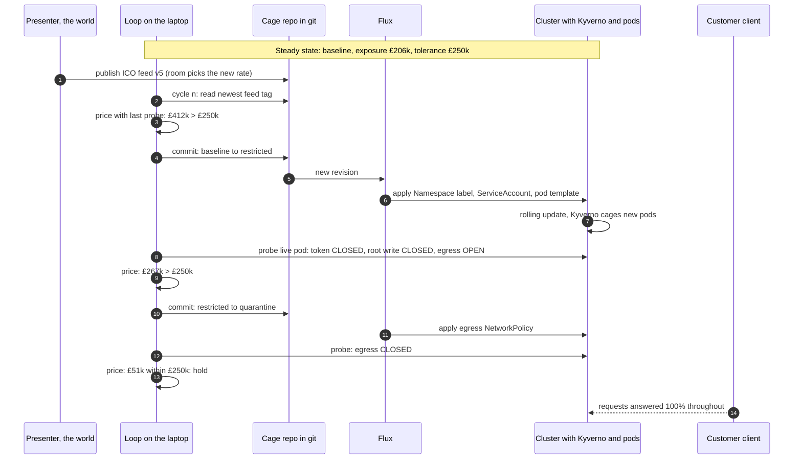
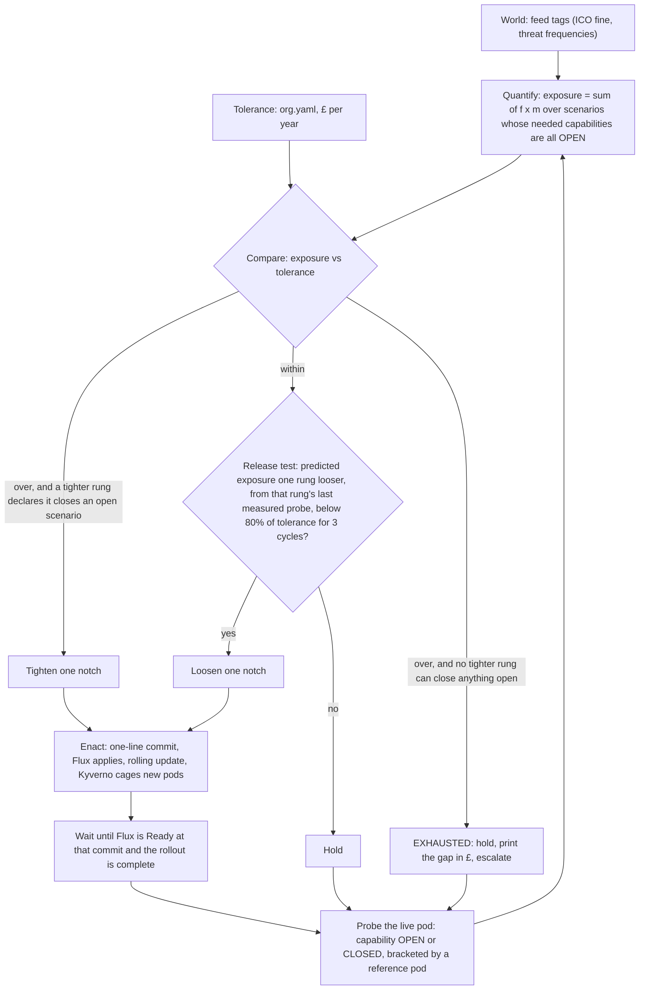

# The room: the smallest loop you can watch close

Designer's starting point: the demonstration. A room of principal engineers gives ten minutes. They must watch a change in the world lift exposure above tolerance, the cage tighten notch by notch, exposure fall back within tolerance, and the workload keep serving. Then: what has to exist for that to be true and not staged, and how a colleague gets it running on a laptop in fifteen minutes.

Read-only design, 2026-11-14. Citations are `repo/path:line` against the FRESH clones. "My arithmetic" marks figures I computed from files I read. Nothing here deletes anything.

Provenance of citations: I re-opened fair.py, cage.py, cage-tier.yaml, cage-netpol.yaml, five-facts.py, the ICO converter and v4 feed, the driftwood git server and workloads, drift-sample.yml, the WAF Dockerfile, the currency-controller README, coverage.py, composition.py near 3840 and 5198, the driftwood HEADER ordinal text, NORTH-STAR headings, PRD:82, ADR-0015:68 and the owner quotations at AMBITION_TIMELINE.json and T75. Line numbers for ADR-0002, ADR-0020/0021/0022/0026/0031/0032, driftwood/party.yaml, the HEADER holes list and the forced-campaign samples are taken from the maps (A1, A2, A4, D1, P2) and were not re-opened.

## Terms used

- **Exposure**: expected loss in pounds per year, summed over the organisation's loss scenarios. An estimate, in a real unit.
- **Tolerance**: the pounds per year of expected loss the organisation says it will carry. The record calls it appetite.
- **Scenario**: one way a loss happens. It has a yearly frequency, a money magnitude, and a list of capabilities it needs.
- **Capability**: something a running process can do that a scenario needs, such as "open a connection outside its namespace". Each one is tested by a probe.
- **Probe**: a command run inside the live workload pod that tests one capability and reports OPEN or CLOSED.
- **Rung**: one setting of the cage. Four rungs, loosest to tightest: baseline, restricted, quarantine, isolated.
- **Notch**: one step up or down the rungs.
- **Cycle**: one pass of probe, quantify, compare, decide, enact.
- **Ledger**: an append-only file with one line per cycle.
- **PERT triple**: a (lowest, most likely, highest) estimate. Its mean is (lowest + 4 x most likely + highest) / 6.
- **Closed form**: a figure computed directly by formula, not by random sampling.
- **Monte-Carlo**: estimating a figure by simulating many random years and averaging them.
- **Hysteresis**: loosening needs a wider margin than tightening, so the cage does not flap back and forth on a knife edge.
- **ICO**: the UK Information Commissioner's Office, which fines organisations for personal-data breaches.
- **Kyverno**: a Kubernetes admission controller; here it rewrites each new pod to fit the cage.
- **Flux**: a Kubernetes controller that makes the cluster match a git repository and puts back any change made by hand.

---

## 1. Mission

Price the organisation's risk in pounds a year. When that figure is above the organisation's financial tolerance, tighten the cage on the running workload one notch, measure what the tighter cage actually stops, and price again. Repeat until the figure is within tolerance. Loosen only when it is safely within. Never deny: the workload stays caged and running.

(58 words.)

---

## The demonstration: what the room sees



One terminal panel, refreshed each cycle (about 20 to 60 seconds):

```
cycle 7   feed ico/v5.0.0 (rate 8%, room's choice)   rung quarantine (2 commits by loop)
capability        probe     reference   scenarios it opens
inbound           OPEN      OPEN        all
egress-beyond-ns  CLOSED    OPEN        P1 exfiltration over egress
sa-token          CLOSED    n/a         P2 stolen service-account token
writable-root     CLOSED    OPEN        P3 web-skimmer written to disk
dns               OPEN      OPEN        P4 DNS tunnelling
exposure  £50,591 / yr   |#####.............................|  tolerance £250,000
          inputs: fine PUBLISHED (ICO feed); frequencies EDITORIAL (5 of 5)
decision  HOLD (within; release needs predicted <= £200,000 for 3 cycles)
serving   customers 1,214/1,214 ok in last 5 min (pods: shop-7c9..-x2k, shop-7c9..-p8d)
probe     network and token from the probe sidecar; root write from the app container
```

Beside it: `git log --oneline` of the cage repo (author: the loop) and `kubectl get pods -w` showing the new pods replacing the old.

The ten minutes:

| Minute | Beat | What is real |
|---|---|---|
| 0-1 | The loop in one sentence, the owner's own. Panel at steady state. | Live cluster, live probes. |
| 1-2 | Ask the room to pick the regulator's new rate: 6%, 8%, 20%, 60% or 80%. | The trigger is ours. Everything after it is not. |
| 2-6 | Two notches. Each is a commit, a Flux apply, a rollout, a probe, a price. | Money falls only when a probe sees a capability close. |
| 6-7 | Someone runs `kubectl label ns shop cage.rung=baseline --overwrite`. Flux puts it back. The next probe still reads CLOSED. | Drift is reverted; the loop cannot be talked out of a rung. |
| 7-8 | Revert the feed to v4. Hold cycles are probe-only (no commit, no rollout, about 15 seconds each), so three of them and one release fit in about two minutes, overlapping the questions: the loop releases one notch, to restricted, and stops there although baseline is under tolerance. | Hysteresis is visible. |
| 8-9 | Negative control (recorded in CI, replayable live): the same run with a label-only cage, the rung components stripped to the Namespace label, no dials. The label climbs, the probes stay OPEN, the money does not move, and the loop ends "declared isolated, measured like baseline; tightest rung, still over by £161,955". | The money follows the measurement, not the label. |
| 9-10 | Questions. Offer: "edit `scenarios.yaml` now and watch a different path." | No path is pre-recorded. |

What the room picks changes the ending, and that is the point. My arithmetic, with the inputs in section 3 and a tolerance of £250,000:

| Room's rate (multiplier on 4%) | Exposure at baseline / restricted / quarantine / isolated | Where the loop stops |
|---|---|---|
| 4% (no change) | £205,977 / 133,705 / 25,295 / 18,068 | baseline |
| 6% (1.5x) | £308,966 / 200,557 / 37,943 / 27,102 | restricted, 1 notch |
| 8% (2x) | £411,955 / 267,409 / 50,591 / 36,136 | quarantine, 2 notches |
| 20% (5x) | £949,832 / 616,557 / 116,646 / 83,319 | quarantine, 2 notches |
| 60% (15x) | £2,806,745 / 1,821,922 / 344,688 / 246,206 | isolated, 3 notches: still running, no longer serving |
| 80% (20x) | £3,742,327 / 2,429,230 / 459,584 / 328,274 | tightest rung, still over by £78,274 |

The last two rows are shown, not hidden. They are the honest ends of the owner's own doctrine: "something could find itself unable to run, but that's only because it doesn't fit the cage" (hub/.scratch/ecosystem/issues/75-grilling-what-is-this-for-the-twelve-questions.md:79).

If the room picks another rate, minutes 2 to 8 change like this, and nothing is re-cut:

- **6%**: one notch, to restricted, at about minute 3. Minutes 4 to 6 go to the drift beat and to inviting a second vote at a higher rate.
- **60%**: three notches. At isolated the customer counter falls to zero while the pods keep running. Say so: this is "doesn't fit the cage", the owner's end state, and the reason the loop escalates before it gets there.
- **80%**: three notches, then `EXHAUSTED` with the gap in pounds and the three levers outside the cage. The release beat is skipped; the time goes to the escalation line.

A cycle is a commit, a Flux apply (10-second interval, or an immediate `flux reconcile`), a rolling update of two replicas and five probes. I expect 30 to 60 seconds, so three notches fit inside four minutes. That is unmeasured until sequence step 1.

## The fifteen-minute laptop path

Prerequisites, all common: Docker running with about 4 GB of memory for the kind node, `kind` 0.32.0, `kubectl`, the `flux` CLI, `git`, `python3` with PyYAML. Nothing else: no GitHub account, no forge, no cloud.

```
git clone <loop repository> && cd loop     # 1,299 lines
./demo/up.sh                               # cluster, Kyverno, Flux, git server, workload, client
python3 -m loop.run --watch                # first ledger line within one cycle; panel appears
./demo/world.sh ico 8                      # in a second terminal: the world changes
```

| Stage | What happens | Budget (unmeasured) |
|---|---|---|
| Clone | One small repository | under 1 min |
| `kind create cluster` | One node, pinned image | 1 to 2 min |
| Kyverno 1.18.2 | Pinned manifest, wait for the admission controller | 2 min |
| Flux | `flux install`, four controllers | 1 to 2 min |
| Git server | Build the 19-line image locally, `kind load`, mount the host bare repo | 1 to 2 min (the build needs network once for `apt`) |
| Workload and client | Flux applies `cluster/` at baseline | 1 min |
| First cycle | Probes, price, first ledger line | under 1 min |
| **Total** | | **8 to 11 min on a warm image cache; first run on a slow connection could not be determined** |

Images pulled on the first run: the kind node image, Kyverno's controllers, Flux's controllers, the workload image, busybox for the probe sidecar and the client, and Debian slim for the git server build. After that the path works with no network: the loop reads feeds from local git tags, the git server is local, and the egress probe targets an in-cluster `outside` sink instead of 1.1.1.1. Pre-loading every image with `kind load` makes a venue with no network safe. `./demo/down.sh` deletes the cluster.

---

## 2. Loop semantics: the parts the record never defined



**Ratchet means one notch per cycle, and the next cycle measures before it moves again.** Not straight to the fitting rung. This is not style. If the loop could know a rung's effect without being on it, it could jump, and stepping would be theatre. In this design it cannot know: the reduction is whatever the probes see after the rung is enacted. Jumping would mean trusting a declaration, which is exactly the defect at platform/graded/cage.py:71-72 ("self-declared, evidenced by nothing but this comment"). So one notch, then measure.

**Two-way, with hysteresis.** The loop tightens freely and loosens reluctantly. It loosens one notch when the exposure *predicted* at the next looser rung is at or below 80% of tolerance for three consecutive cycles. The prediction uses the capability set *last measured* when the loop was on that rung, never the rung's declaration. The loop always arrives at a tight rung by passing through the looser ones, so a measurement exists. The 20% margin and three cycles are mine; they stop flapping on a knife edge, and they are two numbers in `org.yaml`. Reasons not to make it one-way: the record's own tighten-only proposer left every adopter stuck at the top rung (A4 summary 2; hub/docs/adr/0015-adopter-runs-the-proposer-and-it-opens-the-pr.md:68 had rejected exactly that), and the owner said "Point in time rejection does not mean never" (hub/.scratch/drift-review-2026-08-27/REGRILL-ANSWERS.md:28). Whether "ratcheting" was meant one-way is owner decision 2.

**What releases it.** Only a lower price: a feed version that lowers a magnitude or frequency, a scenario edited out (by reviewed change to `scenarios.yaml`), or a tolerance raised. No manual unlock, no exemption. A person who wants a looser rung changes an input the loop prices, in git, where it is reviewed. That fits "there must never be an exemption ledger EVER" (hub/.scratch/drift-review-2026-08-27/evidence/AMBITION_TIMELINE.json:2815).

**Stop condition.** The loop never stops running; it is reactive. The ratchet stops *tightening* the moment measured exposure is at or below tolerance. "Converged" is a state (within, release test not met, hold), not an exit.

**When the tightest rung still leaves exposure above tolerance.** Before each tightening the loop asks whether any tighter rung *declares* that it closes at least one scenario that is open now. If none does, tightening cannot help, so it does not tighten. It records `EXHAUSTED`, holds, prints the gap in pounds, and names the three levers outside the cage: raise the tolerance (a board decision), transfer the risk (insurance), or remove the cause (fix the code or add a dial that closes the capability). It never denies. If a tighter rung could help but would stop the service (isolated has no ingress), the loop goes there by default, because the owner said a cage may "degrade to something that is too expensive to run or not functional" (AMBITION_TIMELINE.json:2962). That default is owner decision 5. Declarations are used only for this "could it help" question. They never move money.

**How loosening happens.** As above: one notch, measured history, margin, three cycles. Loosening is also a commit by the loop, so it is reviewed history like a tightening.

**The feedback, exactly.** At cycle *t*:

```
exposure(t) = sum over scenarios s of   f_s  x  m_s(feeds at t)  x  product over c in needs(s) of open_c(t)
```

`open_c(t)` is 1 if the probe for capability *c*, run inside a live pod of the workload during cycle *t*, completed (connection made, file written, token present), and 0 if it was refused. Each network probe is bracketed by the same probe from a reference pod outside the cage, before and after. If the reference fails, the cycle is "could not look": no price, no decision, hold. A silence on a broken network is never read as a closed path. This bracket is the existing design at driftwood/drift/five-facts.py:958-1000, and the probe command is the existing `nc -w 4 -z` at driftwood/drift/five-facts.py:597.

So the enacted cage changes the next figure only through what the running pod can actually do. If one dial fails to bite (Kyverno down, say), the label changes but the pod can still write its root filesystem; that probe says OPEN and the money does not fall by that scenario's share. If every dial is stripped to the label alone, nothing falls, and the loop climbs to the top and ends `EXHAUSTED` with a "declared isolated, measured like baseline" line. Those are the controls in section 9.

There is no per-rung reduction number anywhere. This also satisfies the hub twin's own objection: "No rung carries a number ... A reduction per rung would be a free multiplier" (hub/twin/enforcement-grades.yaml:10-14). The record already had this pattern once, for the twin agent's cage: misuse paths with a `closed_at` rung instead of a coefficient (platform/graded/cage.py:189-206, 239-245, "Nothing in this table is a number about the world", :151). This design applies it to the workload and replaces the declared `closed_at` with a measurement.

---

## 3. The numbers

### Tolerance

Declared by the organisation in `org.yaml` as pounds of expected loss per year, with a one-line `basis`. The record has no source for its figures: £40,000 / £15,000 / £5,000 come from an automated build fixture of 2026-07-31 (A4 "Could not determine"; platform risk/appetite.json, commit 7a36bf7, per P2 section 1). Ludlow's £5,000 against a USD 197.6bn turnover shows they were never sized (P2 surprise 2).

My recommendation for the basis: the organisation's self-insured retention, the amount it has already agreed to carry before insurance pays. It is a real figure every insured firm has, and the insurer repository already treats tolerance as the attachment point (insurer/pricing/quote.py:242, per F1). For the demo shop (driftwood's £86m turnover, driftwood/party.yaml:42-60) I use £250,000, about 0.29% of turnover, labelled illustrative on screen. The real figure and its basis are owner decision 4.

### Where each rung's reduction comes from

It is not a number. It is the sum of `f x m` for the scenarios whose capabilities the probes see close. What is measured and what stays assumed:

| Part | Status | Source |
|---|---|---|
| Whether a capability is open on the running pod | **Measured** every cycle | probe, bracketed by reference |
| Which capabilities a scenario needs | **Sourced claim**, one line each, contestable | MITRE ATT&CK technique for each path (for example exfiltration over an unrestricted network path; container service-account token use; DNS as a covert channel) |
| Magnitude of the breach consequence | **Published** | ICO penalty feed, sized to turnover: ico/schema/to_fair_scenario.py:213-265 on ico/penalty-schema/v4/feed.json |
| Each path's yearly frequency | **Editorial**, labelled | threat-register style triples (feeds/threat-register/v4/feed.json); candidates for sourcing are breach-vector shares in public breach surveys |

The editorial frequencies are the remaining assumption, and the panel names them as editorial every cycle. In the demo that is every frequency, so every pound of the figure rests on one editorial number times one published one. The demo inputs, all editorial and labelled:

| Scenario | Needs | f per year | m |
|---|---|---|---|
| P1 exfiltration over egress after app compromise | inbound, egress-beyond-ns | 0.03 | ICO fine |
| P2 stolen service-account token used against the API | inbound, sa-token | 0.01 | ICO fine |
| P3 skimmer written into served files | inbound, writable-root | 0.01 | ICO fine |
| P4 exfiltration by DNS tunnelling | inbound, dns | 0.002 | ICO fine |
| U breach outside the cluster (stolen laptop, insider) | nothing the cage controls | 0.005 | ICO fine |

Scenario U matters. Most of the record's money is the ICO line, and its open holes are management controls (pl-2, ra-3, ca-2, ir-8) that no cage dial implements (A4 section b, driftwood/composed/HEADER.yaml:1398-1413). A design that let a CPU limit reduce that line would be staged by construction. Here, losses no dial can touch stay at full value as their own scenarios. They set a floor under exposure, and when that floor alone is over tolerance the loop says `EXHAUSTED` instead of caging uselessly.

Fine magnitude for the demo shop: the three imposed UK GDPR higher-tier fines (£12.7m, £18.4m, £20.0m) scaled by 4% x £86m / £17.5m give a PERT triple of (£2,496,457, £3,616,914, £4,717,714), mean £3,613,638. I checked this by running the estate's own `lm_triple` (ico/schema/to_fair_scenario.py:213) read-only on ico/penalty-schema/v4/feed.json at £86m.

The estate's composed ICO line is lower: £1,787,177 a year at 1/2/4 fines a year (driftwood/composed/evidence.json, the penalty-schema price), which is about £825,000 per event. The same converter gives a lower-tier mean of £823,556 on v3 at £86m, so my inference from the arithmetic, not from a field in the file, is that the composed line prices the *lower* tier (the price entry names no violation type). I use the higher tier because two of its three real examples (British Airways, Marriott) are breaches of customer data, the scenario shape here; the third (TikTok) concerns children's data. Which tier a data-exfiltration breach falls under is an input choice, and it moves every figure by about 12 times: on v4's lower tier (mean £301,824, same run) every pound in the tables scales by about 0.084 and the tolerance would need resizing with it. Owner decision 4 covers it.

### How exposure is computed: closed form

`exposure = sum of pert_mean(f) x pert_mean(m)` over open scenarios. The function exists: `expected_ale` at platform/fair/fair.py:111-131. Reasons:

1. The compare uses one number, the mean. A closed form gives it exactly, instantly and the same every run, so a room can check it by hand.
2. The existing Monte-Carlo cannot price these paths at all. `simulate()` rounds each simulated year's event count to an integer (platform/fair/fair.py:160), so any frequency below 0.5 a year simulates to exactly zero, as the file itself says (platform/fair/fair.py:116-122). Every demo path is below 0.5.
3. Monte-Carlo stays as a test: a Poisson-count simulation in `tests/` checks the closed form within sampling error.

The owner asked for "Monte Carlo modelling" in his own words (AMBITION_TIMELINE.json:2263). Choosing closed form is therefore owner decision 6. If tolerance means "the worst year in twenty we can survive" rather than "the average year", the compare must use a percentile, and Monte-Carlo (with Poisson counts) becomes the compare engine, about 40 more lines.

### Is the money figure real?

Yes, it must be, and this design takes that position. The record made the pound "an ordinal, auditable comparison ... not an expected annual loss" (driftwood/composed/HEADER.yaml:1371-1372) on a one-word "yes" (T75:78, T75:111). An ordinal figure cannot be compared with a tolerance in pounds; "within financial tolerance" has no meaning on it. Here exposure is an expected annual loss in GBP, conditional on stated inputs, in the same unit and definition as the tolerance. Its accuracy is bounded by the editorial frequencies, and the panel prints that share. Owner decision 3 confirms it.

---

## 4. Components

One new repository (name and home are owner decision 7; I call it `loop` here). Line budgets include comments.

| # | Component | Job | Loop step | Lines | Reuse or new |
|---|---|---|---|---|---|
| 1 | `org.yaml` | Turnover, tolerance and basis, release margin and cycles, feed pins as semver ranges | T | 15 | New; turnover from driftwood/party.yaml:42-60 |
| 2 | `scenarios.yaml` | Scenarios with f triple, magnitude source, needs list, basis label | Q | 45 | New; path-with-rung pattern from platform/graded/cage.py:189-206 |
| 3 | `world/ico/` feed v4 | UK GDPR higher-tier formula and imposed fines | Q, X | 45 | Reuse, trimmed from ico/penalty-schema/v4/feed.json |
| 4 | `demo/world.sh` | Publish a new feed tag with the room's chosen rate | X | 25 | New |
| 5 | `loop/money.py` | `pert_mean`, `expected_ale`, sized fine triple, `exposure(scenarios, feeds, open)` | Q | 60 | Reuse platform/fair/fair.py:106-131 and ico/schema/to_fair_scenario.py:213-265 |
| 6 | `loop/probe.py` | Five capability probes in the live pod, reference bracket, could-not-look | Q (feedback) | 90 | New code; method from driftwood/drift/five-facts.py:597 and :958-1000 |
| 7 | `loop/ratchet.py` | `decide(exposure, tolerance, rung, history) -> TIGHTEN, HOLD, RELEASE, EXHAUSTED, COULD_NOT_LOOK` | C, R | 50 | New; replaces platform/graded/cage.py:334-348, platform/wargamer fold and tighten-only clamp |
| 8 | `loop/run.py` | The cycle: follow feed tags, probe, price, decide, commit one line, wait for Flux and rollout, append ledger | E, X | 110 | New; replaces platform/wargamer/tier_pr.py and driftwood propose-tier.yml |
| 9 | `loop/view.py` | The terminal panel | (proof) | 60 | New |
| 10 | `cage/cage-tier.yaml` | Kyverno MutatingPolicy: always-on hardening; read-only root filesystem from restricted up | R, E | 60 | Reuse platform/graded/policies/cage-tier.yaml, cut to the dials a probe can see |
| 11 | `cage/rungs/{baseline,restricted,quarantine,isolated}/` | Kustomize components: Namespace label, default ServiceAccount token off, pod-template annotation (forces rollout), NetworkPolicy per rung | R, E | 80 | New; replaces platform/graded/policies/cage-netpol.yaml |
| 12 | `cluster/` | Namespaces shop, customers, reference, outside; workload Deployment (2 replicas, probe sidecar), Service; customer client | E | 110 | New; shape from driftwood/gitops/apps/ (which uses bare Pods) |
| 13 | `flux/` | GitRepository and Kustomization on the in-cluster git server, 10-second interval | E | 30 | Reuse shape of driftwood/gitops/flux-system/gotk-sync.yaml |
| 14 | `demo/up.sh`, `demo/down.sh` | kind (pinned 0.32.0), Kyverno 1.18.2, Flux, git server, seed, apply; and tear down | E | 80 | Reuse driftwood/scripts/up.sh structure; kind pin from driftwood/.github/workflows/drift-sample.yml:51 |
| 15 | `demo/git-server/` | lighttpd git-http-backend serving a host-mounted bare repo | E | 69 | Reuse driftwood/git-server/ (bakes the repo into an image today; changed to a hostPath mount so the loop can commit) |
| 16 | `tests/` | Ratchet decision table; closed form against Poisson Monte-Carlo; offline convergence with a fake probe | (proof) | 120 | New |
| 17 | `.github/workflows/loop.yml` | Unit tests; headless kind run of the demo; negative control; ledger uploaded | (proof) | 70 | New |
| 18 | `README.md` | The owner's sentence, the semantics above, quickstart, run sheet, what is assumed | (records) | 120 | New; owner fragments from hub A1 question 6 |
| 19 | `docs/adr/0001-loop-semantics.md` | The one decision record, superseding the hub ADR parts listed in section 5 | (records) | 60 | New |
| | **Total** | | | **1,299** | Python code 370 of it |

The cage dials, chosen by one rule: **a dial is a notch only if it closes a capability that a scenario needs and a probe can see.**

| Rung | Dials added | Capability it closes | Probe |
|---|---|---|---|
| baseline | No host network, PID or IPC; no privileged; no privilege escalation (always on, "you're always caged", AMBITION_TIMELINE.json:2780) | none priced | none |
| restricted | Read-only root filesystem (Kyverno); default ServiceAccount token not mounted | writable-root, sa-token | `touch /probe-w`; `test -f /var/run/secrets/kubernetes.io/serviceaccount/token` |
| quarantine | Egress only to DNS and own namespace; ingress only from `customers` | egress-beyond-ns | `nc -w 4 -z` to the `outside` sink (or 1.1.1.1 when online) |
| isolated | No ingress, no egress | inbound, dns | client request from `customers`; `nslookup` |

Whether kind's default network plugin enforces quarantine's *selective* egress (DNS and own namespace allowed, everything else refused) **could not determine**. The record observed only the deny-all case on kind 0.32.0 (driftwood/drift/five-facts.py:958-1000 ceiling text; fact 7). Step 2 measures it; if selective egress is not enforced, `demo/up.sh` installs a network plugin that is, and the minutes go up.

Cut, with reasons: the WAF sidecar (its image "exists in NO registry", driftwood/.github/workflows/drift-sample.yml:68-70, so the first notch on a laptop would be ErrImagePull; and it is `sleep infinity`, platform/graded/waf-placeholder/Dockerfile:14-19); CPU and memory limits and PriorityClasses (they close no capability any scenario needs; a CPU cap shrinks a mining bill, it does not close a path); the restricted/quarantine split as it stands (identical network reach, platform/graded/policies/cage-netpol.yaml, so 22 points of reduction rested on nothing visible); the floor (a floor at the top rung makes selection moot, P2 surprise 3).

Two mechanics the record lacked:

- **Re-caging running pods without downtime.** Admission fires once (platform/currency-controller/README.md:14-18) and driftwood's workloads are bare Pods (driftwood/gitops/apps/api.yaml:5, storefront.yaml:55, pod.yaml:42). Here the workload is a Deployment with 2 replicas, `maxUnavailable: 0`, a readiness probe, and the rung copied into a pod-template annotation by the rung component. Changing the rung changes the template, so the Deployment rolls and every new pod is admitted, and caged, under the new label. NetworkPolicy changes bite on running pods at once. Flux applies Namespaces before namespaced objects, so the label is in place before the new pods arrive.
- **One writer.** Only the loop commits to the cage repo's rung line. It commits straight to the bare repo on the host, which the git server pod serves to Flux. No forge, no merge queue: the place the record's react step stalled (A4 hop 7).

A known gap I flag rather than hide: a mutating webhook runs after the API server has already injected the service-account token volume, so setting `automountServiceAccountToken: false` in Kyverno would not remove it. The rung component switches the token off on the namespace's default ServiceAccount instead. A pod that opts back in explicitly will keep its token, and the probe will say OPEN and the money will not fall. The measurement catches what the dial misses. That is the design working.

Where the probes run, said plainly. The network probes and `sa-token` run in a small probe sidecar inside each workload pod; it shares the pod's network, its ServiceAccount token mount and the cage's per-container dials, so it sees what the app container sees on those. `writable-root` is tested in the app container itself with `kubectl exec`, because a sidecar's root filesystem is not the app's. If the app image has no shell, an ephemeral debug container targeting the app's process tests it through that process's root instead. The serving check runs from a different namespace. The sidecar is an instrument the demo adds to the workload; a real adopter would run the same probes from an ephemeral debug container instead.

Workload image: a small public HTTP service that runs as a non-root user and tolerates a read-only root filesystem with an `emptyDir` at `/tmp`. I would start with podinfo, pinned by digest. Whether it pulls anonymously and runs read-only **could not determine** offline; step 2 checks. Whether driftwood's own images on ghcr.io pull anonymously also could not be determined.

---

## 5. Scope calls

**One adopter, not three.** The three adopters are near-clones, and two of them cannot reach tolerance at any rung (tuppence 137x over, ludlow about 12,000x over: A4 section c), so they show only the exhausted state, which one adopter shows by a room vote. Proportionality to size, which the owner asked for ("its proporiate to the org right?", AMBITION_TIMELINE.json:2291), is one extra beat: a second `org.yaml` with ten times the turnover settles one rung tighter on the same cluster.

**One repository, not separate publisher organisations with signed tags.** The publisher eco-system is the owner's own idea (AMBITION_TIMELINE.json:2305, :2312) but not in the sentence, and it is where the weight sits: four repos, 108,732 lines, a few hundred numbers that move money (F1 summary). Here "the world" is a directory of versioned feed files and a change in the world is a new tag the loop follows; signing those tags is a later, separable step. A colleague can clone one repository in fifteen minutes, not nine.

**Versioned policy through Flux: Flux stays as the enact and drift-revert mechanism; Renovate and multi-version policy leave the loop.** Each notch is a commit that Flux applies and defends against hand edits (observed once, driftwood/drift/forced-campaign-samples.jsonl, 2026-08-15), and the owner wanted Flux visible (AMBITION_TIMELINE.json:1488); this is an added requirement, kept for auditability, not for effort spent. Renovate is replaced by the loop following the newest feed tag in a semver range (about 20 lines), because the merge Renovate waits on is where every react hop stalled (A4 hops 1, 2); the 2022 thesis of coexisting versions and pulled upgrades (ADR-0002, per A2 summary 6) is separable and parked.

**Kubernetes cage dials.** The four rungs in section 4, each closing a probe-visible capability, on Kyverno 1.18.2, the version the served cage bodies compile on. The Crossplane cloud cage is parked: no reduction, no provider, no resource (P2 row 15). A native Kubernetes mutating policy could later replace Kyverno; the record's own exploration kept Kyverno (hub/explorations/native-cel-without-kyverno.md, section 1).

**The twin: park.** No forecast, score or twin price changes any adopter's money or tier (H2 summary 2); the twin line is £758 of £1,807,494 (A4 row 11); its spec has no tolerance and refuses a compare by invariant (H14). It is an owner idea (digital twin, AMBITION_TIMELINE.json:1215) for a different question.

**The truth surface: park, and leave CI.** It answered an agent-process failure, not a need of the loop (FACTS "How the complexity accreted"), and 61 of its 117 passes are self-proof (H11 summary). The replacement is one ledger line per cycle and one CI job that runs the loop and asserts its shape (section 9).

**Computed semver: park.** It feeds no loop step and every real release computed major (FACTS "Off the loop").

**The calibration programme: park, out of every working tree and CI.** About 49k lines to qualify a 4B model for twin judgement skills; the qualification registry is empty; it does not touch the reduction table (A5 summary; A4 surprise 14). The recovered planning text in troy/.scratch stays where it is.

**Talk material: park.** The owner called the talk a by-product (T75:83). This ten-minute demonstration is the talk's live beat. The one-minute story (hub/.scratch/talk-spec/the-whole-model.md:15-17) is merged into the README's opening.

### Requirements I added that the sentence does not carry

| Added | Why |
|---|---|
| The workload keeps serving | Given by this design's starting point; consistent with "could still potentially run, but with contrained ..." (AMBITION_TIMELINE.json:1005). Measured by the customer client, not by pod phase. |
| Measured capabilities instead of declared reductions | Without it, "mitigate the quantified risk" is a multiplication by an unsourced constant. |
| Release with hysteresis | The sentence does not say whether the ratchet releases; the record's one-way version stuck at the top rung. Owner decision 2. |
| Reference-pod bracket | So a broken network can never read as a closed path. |
| Flux | Auditability and drift reversion; the owner's stated preference. |
| Fifteen-minute laptop path | Given by this design's brief. |

### Documents that would have to change if this design is taken

- hub/NORTH-STAR.md: the eco-system sentence (§1, :28-33), the §4 build order (:61-80) and the §5 truth surface (:81-90).
- hub/docs/PRD.md: the risk-intelligence non-goal (:82) and the delivery-only thesis (:23-30).
- hub/CONTEXT.md: Appetite, Exposure, Price ("ordinal"), Selection policy; add Ratchet, Probe, Capability.
- hub/docs/adr/0015 (proposer direction, :50, :68), 0020 and 0026 (hole priced, never refused), 0021 (the pound seam; twin emits, estate selects), 0022 (the ladder, the floor, tighten-only note at :110-126 and loosening as a human edit at :166-169), 0002 (pulled upgrades by reviewed PR, per A2), 0031/0032 (twin agent cage).
- T75 item 4 decision (:78, :111): the pound is cardinal, not ordinal.
- platform/compose/composition.py:5197-5198 ("a breach of the aggregate is priced and shown, never denied") and the HEADER basis text at driftwood/composed/HEADER.yaml:1371-1372.
- platform/graded/cage.py:60-80 (the comment) and :82-127 (the reduction table) and platform/computed-semver/coverage.py:508-513 (`cage-ratchet-one-way` as an open limit).
- hub/twin/enforcement-grades.yaml:10-14 needs no change: it already forbids per-rung numbers, and this design has none.

---

## 6. Disposition of what exists

Keep: stays in the working tree as is. Shrink: stays, made much smaller. Merge: its useful lines move into the new repository, then the rest is parked. Park: leaves the working tree and CI, stays in git history or on an archive branch. Cut: removed from the tree; only generated output, byte copies or strays (still in history).

### hub

| Area | Disposition | Reason |
|---|---|---|
| `README.md` | Shrink | Ten lines pointing at the new repository and the archive. |
| `CLAUDE.md` | Shrink | Agent instructions for whatever stays. |
| `NORTH-STAR.md` | Park | Superseded by the owner's sentence; §4 was "not mine" (T75:76). |
| `CONTEXT.md` | Merge | About 24 loop terms into the new README (H12 summary 4); rest parked. |
| `LICENSE` | Keep | |
| `docs/adr/` | Park | History. One new ADR in the new repo supersedes the loop parts. |
| `docs/PRD.md`, `docs/*.md`, `docs/agents/`, `docs/upstream` | Park | Delivery thesis, PDF and qualification notes; none runs. |
| `.scratch/drift-review-2026-08-27/` | Park | The 61 owner quotations (AT, DL) are provenance; the nine fragments go into the README with dates and cite the archive path. |
| `.scratch/ecosystem/` | Park | 169 tickets, 80 of them repairs of earlier tickets (H13); October dumps (70.5% of tracked lines, A3). |
| `.scratch/talk-spec/` | Park | The one-minute story merges into the README; the rest is design history and TTS assets. |
| `.scratch/twin/`, `laya-loophole/`, `computed-semver/`, `faithful-floor/`, `multi-org-estate/`, `policy-composition/`, `real-estate/`, `govern-what-you-dont-control/`, `demo-feedback/` | Park | Specs and tickets; nothing runs (H14). |
| `.scratch/0001-...patch` | Cut | Stray patch file. |
| `twin/` | Park | Off the loop (H1 to H6). |
| `verify/` | Park | The truth surface; checks of documents and of copies (H7, H8). |
| `talk/` | Park | 67.5% captures; harness grades the build (H11). |
| `tests/`, `conftest.py`, `pytest.ini` | Park | Test the parked twin, calibration and harness (H9, H10). |
| `bench/` | Park | Calibration programme and loophole rounds (H10, H5). |
| `spikes/`, `research/`, `explorations/` | Park | June and August investigations. |
| `.claude/` (ENACT hook, four skills) | Park | Guards the assistant's build, not the loop (H3). |
| `.github/` (truth, truth-delivery, twin, release workflows; rulesets) | Park | Leaves CI. |
| `bin/twin`, `clone-estate.sh`, `tts.py` | Park | Twin CLI, estate cloner, talk audio. |
| `fleet/`, `policy/` | Park | Two-line pointers to repos outside FRESH. |
| `t/`, `forged.yaml` | Cut | Stray Kyverno fixtures nothing references (H10 summary). |

### platform

| Area | Disposition | Reason |
|---|---|---|
| `fair/` | Merge | `pert_mean` and `expected_ale` (fair.py:106-131) into `loop/money.py`; Poisson simulation into tests. |
| `graded/` | Merge | `policies/cage-tier.yaml` into `cage/`, cut to probe-visible dials; `cage.py` table, `cage-netpol`, tests, verify, WAF placeholder parked. |
| `risk/` | Merge | The tolerance read is one YAML key; `decide()` is a duplicate comparator (P2 row 3). |
| `engine/` | Merge | The Kyverno 1.18.2 pin and checksum into `demo/up.sh`. |
| `compose/` | Park | 10,142-line composer replaced by `money.py` (A4 row 13). |
| `wargamer/`, `shift-left/`, `honesty/` | Park | Fold, tier PR, tier binding, bounds: replaced by `ratchet.py` and `run.py`. |
| `currency-controller/` | Park | Re-caging by version retirement; replaced by the rollout mechanic. |
| `computed-semver/`, `distribution/` | Park | Release-number honesty and multi-version coexistence; separable (P1). |
| `feeds/`, `party/` | Park | Converter and schema checks for the parked composer. |
| `tcor/`, `break-glass/`, `recovery-expense/`, `implementations/`, `policy/` | Park | Off the loop or duplicate selectors (P2 rows 10, 15-21). |
| `identity/`, `access/`, `eud/`, `posture/`, `wardley/`, `oscal/` | Park | Shelved by the owner or unwired (P3). |
| `.github/`, root `verify-*.sh`, `verify-release-signing.py`, `lib*.sh`, `party.yaml`, `docs/`, `CONTEXT.md`, `README.md`, `LICENSE` | Park | Repository parked whole once the merges land. |

### driftwood (the one adopter, carried into the new repo)

| Area | Disposition | Reason |
|---|---|---|
| `party.yaml` | Merge | Turnover and identity into `org.yaml`; tolerance re-declared with a basis. |
| `gitops/apps/` | Merge | Workload shape into `cluster/`, as Deployments not bare Pods. |
| `gitops/flux-system/` | Merge | GitRepository and Kustomization shape into `flux/`; the four publisher pins (`gotk-sync-{feeds,ico,insurer,nist}.yaml`) parked. |
| `gitops/engine/` | Merge | The Kyverno 1.18.2 pin into `demo/up.sh`. |
| `gitops/composed/`, `gitops/platform/` | Park | The ResourceSet for multi-version composed policy and the platform pin; replaced by the rung components. |
| `git-server/`, `kind/`, `scripts/up.sh`, `scripts/lib.sh`, `scripts/reset.sh` | Merge | Into `demo/`. |
| `drift/` | Merge | The probe command and reference bracket from `five-facts.py` into `probe.py`; the rest (2,471-line sampler, August drift study, logs) parked. |
| `composed/` | Cut | Generated output and byte copies of publisher feeds (26,062 lines, D1). |
| `twin/` | Park | Off the loop. |
| `selection-policy/` | Cut | A transliterated copy of platform's rule (driftwood/selection-policy/selection_policy.py:162-165). |
| `inventory/`, `scenarios/`, `accepted-majors/`, `observations/`, `deploy/`, `tests/`, `.github/`, `renovate.json`, `verify-*.sh`, `scripts/` (rest) | Park | CVE inventory (a later KEV beat), unvalidated recovery triples, semver acceptance, logs, CI. |
| `README.md`, `LICENSE`, `.gitignore` | Park | Repository parked whole. |

### tuppence and ludlow

| Area | Disposition | Reason |
|---|---|---|
| Whole repositories (including ludlow `implementation-retirements/`, tuppence `reset/`) | Park | Near-clones; cannot reach tolerance at any rung. A larger-turnover `org.yaml` replaces them for the proportionality beat. |

### Publishers

| Repo and area | Disposition | Reason |
|---|---|---|
| ico `penalty-schema/v4/` | Merge | UK GDPR higher-tier entry into `world/ico/`. |
| ico `schema/to_fair_scenario.py` | Merge | The sizing core (:213-265) into `money.py`; the adapter ABI (:575-899) parked. |
| ico `penalty-schema/v1-v3`, `schema/v1,v2` and key, `.github/`, verify scripts, docs | Park | Superseded versions, legacy demo key, release gates. |
| feeds `threat-register/` | Merge | Its triples and basis fields inform `scenarios.yaml` frequencies; converter and adapter parked. |
| feeds `cve/`, `fetch/`, `bump.py` | Park | The KEV clock is a second world-change beat after step 8. |
| feeds `eol/`, `fx/`, `converters/`, `news/`, `market-moves/`, `recovery-expense/`, `.github/`, verify scripts, docs | Park | Unconsumed, fixture-fed or GBP-irrelevant (F1). |
| nist (whole) | Park | The catalogue moves no pound; 76% is a scorer with zero cohorts (F1). |
| insurer (whole) | Park | Premium sits outside the compare (F1). Transfer is named in the `EXHAUSTED` text as a lever. |

### Outside the repositories

| Area | Disposition | Reason |
|---|---|---|
| troy/.scratch `calibration-programme/`, `ecosystem/research/` resumes | Park | Recovered planning text; stays in the owner's backup. |
| Local calibration branch tips and empty worktrees (A5) | Park | Not on any remote; leave as they are. |

---

## 7. Owner decisions

Only questions that change the design.

1. **Is the loop, demonstrable on a laptop, the definition of done?** Options: (a) yes, the eco-system, twin and talk are parked until it runs; (b) the eco-system stays the goal with the loop as its core. Recommend (a). The sentence of 2026-11-14 says "original vision and simplicity".
2. **What does "ratcheting" mean?** (a) one-way, tighten or hold, loosening only by a human edit; (b) two-way with hysteresis, as designed; (c) two-way without hysteresis. Recommend (b). The one-way version stuck every adopter at the top rung.
3. **Is the pound a real estimate?** (a) cardinal: expected annual loss in GBP on stated inputs; (b) keep the record's ordinal pound. Recommend (a). An ordinal figure cannot be "within financial tolerance".
4. **What are the money inputs: the tolerance, the per-path frequencies, and the fine tier?** Tolerance: (a) the organisation's self-insured retention; (b) a share of turnover; (c) a board figure with a written reason. Recommend (a), with £250,000 for the £86m demo shop until the owner gives a figure. Frequencies: (a) editorial, labelled, as in the demo; (b) sourced from a named public breach survey per path. Recommend (a) for the demo and (b) before any real adopter. Fine tier for an exfiltration breach: higher (BA, Marriott precedents) or lower (security of processing); about a 12x difference. Recommend higher, stated on screen.
5. **When even the tightest serving rung cannot reach tolerance, may the loop take the service down to isolated?** (a) yes, the owner's 2026-08-22 and 2026-09-02 doctrine; (b) no, hold at the tightest serving rung and escalate. Recommend (a), with the escalation line written the moment tolerance is predicted unreachable, so a person can act first.
6. **Mean or bad year, closed form or Monte-Carlo?** (a) compare the mean, closed form, Monte-Carlo as a test; (b) compare a percentile (for example 1 year in 20), Monte-Carlo with Poisson counts as the engine. Recommend (a) for the first version.
7. **Where does it live, and who may commit a notch?** Home: (a) a new small repository in the org; (b) a cleared-out driftwood repository, keeping its history and name; (c) a directory in the hub. Recommend (a): a colleague clones 1,299 lines, not a 3.48M-line hub or a repo whose history is 64.6% generated output. Writer: (a) the loop commits notches itself within the reviewed ladder, and people change tolerance, scenarios and ladder by reviewed PR; (b) every notch is a PR a person merges. Recommend (a). The owner's words point both ways: "the narrative and talk should be that it's a human doing it" (T75:80) against "A model may judge on a GitHub clock, within thresholds" (T75:172). Under (b) the demo needs a person on stage merging, and the record shows the merge is where the loop stalls.
8. **The demo trigger.** (a) the regulator's fine, the owner's own example (AMBITION_TIMELINE.json:324), with a hypothetical new rate the room picks, labelled hypothetical; (b) a real CISA KEV entry that matches a served image. Recommend (a) first, (b) as a later second beat.

---

## 8. Sequence

Each step leaves something that runs.

1. **Measure the laptop path.** `demo/up.sh` brings up kind 0.32.0, Kyverno 1.18.2, Flux, the git server and the workload with its customer client. Time it on a clean laptop and record the minutes in the README. "Fifteen minutes" is unmeasured until this step. Runs: a serving workload at baseline.
2. **Probe every rung by hand.** Apply each rung component with `kubectl apply -k`; `loop/probe.py` prints the capability table per rung with the reference bracket. This also checks the workload tolerates a read-only root filesystem. Runs: a measured table of what each rung closes.
3. **Money and ratchet offline.** `org.yaml`, `scenarios.yaml`, `world/ico/`, `money.py`, `ratchet.py`, tests, and `run.py --fake-probe` replaying the step 2 table. Runs: the decision sequence for every row of the demonstration's ending table, in a terminal, with no cluster.
4. **Close the loop with direct apply.** `run.py` enacts with `kubectl apply -k` and waits for the rollout. `demo/world.sh` publishes v5. Runs: the loop converging on a live cluster, ledger lines appended.
5. **Enact through git and Flux.** Swap enact to a one-line commit on the host bare repo; Flux applies. Add the drift beat. Runs: each notch visible in `git log`, reverted out-of-band edits.
6. **The panel and the run sheet.** `view.py`, the ten-minute run sheet, release and hysteresis beat, the proportionality `org.yaml`. Runs: the full demonstration, rehearsed.
7. **The proof job.** `.github/workflows/loop.yml` runs step 6 headless on kind: positive run (room rate fixed at 8%), the label-only negative control, and the Kyverno-removed partial control. Asserts the ledger patterns in section 9 and uploads the ledger. Runs: the claim checked on every change.
8. **Records and parking.** README with the owner's fragments, one ADR, CONTEXT terms; mark NORTH-STAR and the listed ADRs superseded; take parked areas out of working trees and CI (archive branches; archiving whole repositories is the owner's authorisation). Runs: one repository a colleague can clone, with nothing else on the critical path.

---

## 9. Proof

**What the observer sees.** One live cluster on the presenter's laptop. A panel showing exposure against tolerance, the rung, and five capabilities each with a probe and a reference result. The room picks the regulator's new rate. Within a minute the next cycle reads the new feed tag and the exposure bar crosses the tolerance line. A commit by the loop appears in `git log`. Flux events show the apply. `kubectl get pods -w` shows new pods replacing old ones with no gap. The next probe shows token and root-write CLOSED and the bar drops, still over. A second commit; egress CLOSED; the bar drops under the line; HOLD. The customer counter reads 100% throughout, and its log names the new pods answering. Someone edits the label by hand; Flux restores it; the money does not move. The feed is reverted; three cycles later the loop loosens one notch and stops short of baseline.

The ledger line that carries the claim, one per cycle:

```json
{"ts":"...","cycle":7,"feeds":{"ico":"5.0.0"},"rung":"quarantine","commit":"3f2a...",
 "probe":{"egress-beyond-ns":0,"sa-token":0,"writable-root":0,"dns":1,"inbound":1},
 "reference":{"egress-beyond-ns":1,"dns":1,"inbound":1},
 "exposure":50591,"tolerance":250000,"editorial_frequencies":"5 of 5","decision":"HOLD",
 "serving":{"ok":1214,"total":1214}}
```

The CI job asserts the closed loop as a pattern over these lines:

- Positive run: decisions read `HOLD ... TIGHTEN, TIGHTEN, HOLD`, each `TIGHTEN` followed by a commit, a change in at least one probe from 1 to 0, and a lower exposure; final exposure at or below tolerance; serving at least 99%.
- Negative control, label-only cage: the rung components carry only the Namespace label (no Kyverno policy, no ServiceAccount change, no NetworkPolicy). Every probe stays 1 at every rung, exposure stays £411,955 (my arithmetic, rate 8%), the decisions read `TIGHTEN, TIGHTEN, TIGHTEN, EXHAUSTED`, and the last line says "declared isolated, measured like baseline; over by £161,955". If this run's exposure falls at all, the money is following the label, and the demonstration is staged.
- Partial control, Kyverno policy removed but the other dials kept: `writable-root` stays 1, so exposure at each rung is higher than the positive run's by exactly P3's share (0.01 x the fine mean: £72,273 at 8%). It still settles at quarantine, at £122,864 instead of £50,591. This shows each dial's contribution separately. When admission is down the rollout may stall (webhook fails closed) or complete uncaged (fails open); either way the old or new pods are probed, the probe reads OPEN, and the ledger records "enact incomplete" after a timeout.

**What would make it staged rather than real.**

| Staged if | How the design rules it out |
|---|---|
| Exposure is computed from the rung name | Exposure reads only probe results; the negative control fails the build if it converges anyway. |
| Probes hit endpoints that always fail | Every network probe is bracketed by a reference pod that must reach the same target in the same cycle, or the cycle is could-not-look and no decision is made. |
| Rung changes come from a script outside the loop | One writer: the loop's identity is the only author of rung commits; the room sees `git log`. |
| The output is a replay | Pod ages, live `kubectl get pods -w`, and the room's own choice of rate, and its option to edit `scenarios.yaml` or the tolerance live. |
| The probe sees a friendlier container than the app | `writable-root` is tested in the app container; the sidecar shares the pod's network and token mount, and the cage dials apply per container. The limit is named on the panel. |
| "Keeps running" means `phase: Running` | Serving is counted by a client in another namespace hitting the Service, logging the answering pod. |
| The inputs were tuned to converge in two notches | The room picks the rate; the demonstration's ending table shows every ending, including isolated and exhausted, before the vote. |

**What stays assumed, said on screen.** The per-path frequencies are editorial. The panel prints the share of exposure that rests on them. The loop is real; the size of the figure is only as good as those inputs, and anyone can change them in one file.
