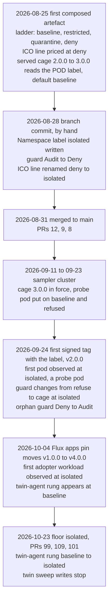

# K1 — "The ratchet has never moved and cannot move": refutation attempt

Read-only attack on the claim, 2026-11-14, against the fresh clones under `fresh/`.
Paths are `repo/path:line`. Commits are short hashes in the named repo.

## The claim

> No cage tier change has ever been proposed, merged or enacted for any adopter. All three adopters have declared the tightest rung, isolated, since 2026-08-28, each also sets floor: isolated since 2026-10-23, the proposer only tightens, and so the ratchet has never moved and cannot move.

## Verdict: partly refuted

The core survives. The tier label on each adopter's governed Namespace has held one value, `isolated`, since it was first written, and no surviving ref carries a proposal to change it.

Four parts do not survive as worded:

1. "No cage tier change has ever been merged or enacted" is false. The twin agent's cage rung moved `baseline` to `isolated` in all three adopters on 2026-10-23, by merged pull request, and it switched off a workflow job.
2. "Declared isolated since 2026-08-28" is the date a commit was written on a branch. It reached `main` on 2026-08-31, a signed tag on 2026-09-24, and the Flux pin that delivers the Namespace on 2026-10-04.
3. The first declaration was itself a move. It took each adopter from a served cage whose default was `baseline` (and under which no pod was ever seen running) to the top rung in one hand-made jump.
4. Moves did happen under the earlier Audit and Deny vocabulary, in both directions.

Terms. A **rung** or **tier** is one of four cage settings: `baseline`, `restricted`, `quarantine`, `isolated` (tightest). The **governed Namespace** is the one Kubernetes Namespace per adopter that carries the label `policy-as-versioned.dev/governed: "true"`. The **proposer** is the scheduled job `propose-tier.yml` that runs platform's `wargamer/tier_pr.py`. The **floor** is `overlay.floor` in `party.yaml`, a minimum rung.

## Timeline of what actually moved

## Clause by clause

### 1. "No cage tier change has ever been proposed"

**Holds, as far as surviving refs go.**

- The file that carries the label has three commits on any ref, in each adopter: the 2026-07-31 build, a 2026-08-25 work-in-progress commit, and the 2026-08-28 declaration (`git log --all -- gitops/apps/namespace.yaml`: driftwood 348b97c, tuppence b257966, ludlow 85cc202).
- A search of every ref for a literal `posture.acme.io/tier: <value>` in any file except the two large sample files finds only `isolated` in `gitops/apps/namespace.yaml`, plus one `baseline` in tuppence (see clause 2).
- A tier proposal branch would be named `wargamer/retune-tier-<party>-cage-tier-<source>-<kind>` (`platform/wargamer/tier_pr.py:1118`). No such ref exists in 127, 139 and 133 refs.
- Every commit by the `wargamer proposer` identity on any ref is one of two kinds: "update served image inventory" (driftwood 04e7b97, 56314ca, e6746fd, 18f1c3c, and the same pattern in tuppence and ludlow) or "retire feeds/threat-register@v1 ... pin to v2" (tuppence 25cdb0a, ludlow 9caad6c, both unmerged). None touches a Namespace.
- The hub's own ticket says the event has never happened and is still open (`hub/.scratch/ecosystem/issues/74-step-3-happens-once-for-real.md:4`, `:11-13`).
- The hub capture of step 3 ran on throwaway copies with a synthetic residual: "nothing written in either copy ... nothing opened" (`hub/talk/captures/verify_e2e_verify-e2e-step3-price-crosses-band-pr-opens.out:5-7`).

**Limits.** The clones hold no `refs/pull`. A proposal that was opened, closed and had its branch deleted cannot be seen. The `wargamer/retune-<party>-served-images` branch name is reused, so only the latest proposal survives under it. Could not determine whether a tier pull request was ever opened and closed.

**A window when a loosening proposal was possible.** The proposer began editing the Namespace on 2026-08-29 (driftwood 84defa0). The tighten-only clamp was written on 2026-09-04 (platform 698702a) and first tagged in platform v3.0.0 on 2026-09-10; platform v1.1.1, v2.0.0 and v2.0.1 have no `select_party_tier` and no `held` path in `wargamer/tier_pr.py`. On 2026-09-08 driftwood's proposer still ran platform at its v2.0.1 pin (driftwood 4882d8d `.github/workflows/propose-tier.yml:107`). From 2026-09-10 it ran `tier-propose` through a separate tools pin at v3.0.0, which has the clamp (driftwood 9b84982 `.github/workflows/propose-tier.yml:249`, `.github/platform-tools-pin.yaml`). So in driftwood, from the merge on 2026-08-31 to 2026-09-10, a crossing on one price line would have written that line's tier over `isolated`. The decision record says the same (`hub/docs/adr/0022-...md:112-118`; `hub/.scratch/ecosystem/issues/74-...md:30`). No evidence that it fired. The same window was not traced for tuppence and ludlow.

### 2. "All three adopters have declared the tightest rung, isolated, since 2026-08-28"

**True of the label's value. Wrong as a date for anything but a branch commit. And one adopter declares a second rung elsewhere.**

Dates, the same in all three adopters:

| Event | Date | Evidence |
|---|---|---|
| Label written, on branch `ecosystem/thin-slice` | 2026-08-28 22:11 to 22:12 +01:00 | driftwood 348b97c, tuppence b257966, ludlow 85cc202 |
| Reached `main` | 2026-08-31 17:23 +01:00 | driftwood bd19e8c (PR 12), tuppence b634205 (PR 9), ludlow 02fb6fb (PR 8) |
| First signed tag carrying the label | 2026-09-24, tag `v2.0.0` | `v1.0.0` and `v1.1.0` have no tier label; `v2.0.0` onward has it (read from each tag's `gitops/apps/namespace.yaml`) |
| Flux pin that delivers `./gitops/apps` moved off `v1.0.0` | 2026-10-04, to `v3.0.1` then `v4.0.0` | `gitops/flux-system/gotk-sync.yaml` history: driftwood aa92363, 98d1378; tuppence c70edb1, 0dd1cf6; ludlow 4f81da7, 6de0d00 |
| First pod of any kind observed at `isolated` | 2026-09-24, a probe pod in a probe namespace | `drift/samples.jsonl` row 76 (driftwood), row 73 (tuppence, ludlow) |
| First adopter workload observed at `isolated` | 2026-10-04 driftwood; 2026-10-16 tuppence and ludlow | first row of each `drift/workload-samples.jsonl` |

On the day the label was written, the cage the adopters served could not read it. `cage-tier` 2.0.0 and 3.0.0 read the tier from the pod's own label, knew three rungs, and turned any other value into `baseline`: `rawTier ... orValue('baseline')` and `tier in ['baseline','restricted','quarantine'] ? rawTier : 'baseline'` (driftwood `composed/policies/v3.0.0/cage-tier.yaml` at 055e340, the parent of the declaring commit). The word `isolated` was not a rung in any served policy until 4.0.0 arrived the next day (driftwood ceac84b, cb2bd3c).

**The counter-example to "any tier other than isolated".** tuppence declares `baseline` on a second Namespace, `tuppence-reset`, on `main` today (`tuppence/reset/workloads.yaml:52`, commit 54385b5, 2026-09-24). The file says why: policy 5.0.0 removed the `baseline` default for an unlabelled Namespace, so the label was added to keep the rung "the one it was" (`reset/workloads.yaml:21-29`). That is a declaration written to avoid a tightening. It is not a governed Namespace, the proposer never reads it, Flux does not deliver it, and no observation shows it running.

**Stand-ins.** The hub keeps two fixture Namespaces named after adopters at other rungs: `hub/verify/proportionality/namespaces/proportionality-driftwood.yaml:29` (`baseline`) and `proportionality-ludlow.yaml:29` (`quarantine`). They are fixtures in the hub, not adopter declarations. The capture read could not look at a cluster (`hub/talk/captures/verify_proportionality_verify-proportionality.out`, "could not look" lines).

### 3. "each also sets floor: isolated since 2026-10-23"

**Confirmed.** One commit each, no earlier value on any ref: driftwood d2c6f83 (PR 99, merged 5216921), tuppence d948edb (PR 109, merged 6868c98), ludlow 08839bf (PR 101, merged 6f8d4e9). Lines: `driftwood/party.yaml:106`, `tuppence/party.yaml:60`, `ludlow/party.yaml:62`. In signed tags from driftwood `v5.2.0`, tuppence `v4.3.0`, ludlow `v5.3.0`, all cut the same day. Each adopter records the change in `composed/floor-change.json` (`before.value: null`, `after.value: "isolated"`).

### 4. "the proposer only tightens"

**True since platform v3.0.0 (2026-09-10). False before. The decision record says both things.**

- Code at the tag the adopters pin, v6.3.0: `held = not (tightens or explicit_default)` and "held -- the proposer only tightens" (`platform/wargamer/wargamer.py:251-327`). The ladder is `("baseline", "restricted", "quarantine", "isolated")` (`wargamer.py:162`). "A loosening is a different question this proposer does not yet ask" (`wargamer.py:268-270`).
- Before the clamp the proposer wrote the price line's tier unconditionally (clause 1).
- Two decision records conflict. ADR-0015 (2026-08-24) says "Proposals go both ways" (`hub/docs/adr/0015-...md:50`) and "A tighten-only proposer. Rejected. It ratchets the estate toward deny and never recovers" (`:68`). ADR-0022 carries a later note, dated 2026-09-04 and marked delegated, headed "the proposer only tightens" (`hub/docs/adr/0022-...md:110`), which says "Loosening is not implemented, and that is the decision, not an omission" and "Until then a loosening is a human edit to the Namespace, in the open, under the binding check" (`:164-169`). ADR-0022's list of what it supersedes names ADR-0015 only for "a proposed Deny opens an issue" (`:94`), so ADR-0015's two sentences were never marked superseded. The later note is what the code does.

### 5. "No cage tier change has ever been merged or enacted"

**False. Three kinds of merged move exist. One has an observed effect.**

**(a) The twin agent's rung moved, was merged, and gated a job off.** Each adopter's composed evidence prices a cage for its own twin agent (a scheduled workflow), on the same four rungs: the `prices[]` line with `kind: agent-cage`, `subject: twin-agent`. Its `proposed_tier` in `composed/evidence.json` on `main`:

| Adopter | 2026-10-04 | 2026-10-23 | Commits |
|---|---|---|---|
| driftwood | `baseline` | `isolated` | aa92363, d2c6f83 |
| tuppence | `baseline` | `isolated` | c70edb1, d948edb |
| ludlow | `baseline` | `isolated` | 926d6b3, 08839bf |

The workflow reads that value as the agent's rung (`driftwood/.github/workflows/twin-sweep.yml:137-138`) and runs its write job only when the rung is not `isolated` (`:322`; tuppence `:214`; ludlow `:245`). The last sweep observation in every adopter is 2026-10-22 (`observations/twin-sweep.jsonl` last row: driftwood 12:54Z, tuppence 12:59Z, ludlow 13:04Z; last commits 9787b5e, bb120f0, 9ea1cae). The other daily clock kept writing to 2026-11-13. Platform's own code calls this "the twin agent's rung moved" and says the merged recompose is the proposal (`platform/wargamer/tier_pr.py:953-959` at v6.3.0). The cause of the silence is an inference from code and dates; run logs were not readable.

Line 322 is the job-level condition on the `write` job, the job that appends to `observations/twin-sweep.jsonl` (`twin-sweep.yml:321-322`, `:476`).

This is a cage rung change, for each adopter, merged, with a visible consequence. The floor caused it, and the artefact says so: the line's `policy_basis` at d2c6f83 reads "loosest tier whose caged residual (0.00 GBP) is within the tolerance (40000.00 GBP); clamped up to the party's declared floor 'isolated'", where its parent had no clamp and selected `baseline` (driftwood `composed/evidence.json`, the `agent-cage` line, at d2c6f83 and d2c6f83^). The line's amount is a fraction of a penny in both. So the move was not a response to priced risk, and the proposer did not open it.

**(b) The first declaration was a jump, not a starting state.** Before it, each adopter's computed tier for its largest line was `deny`, the top of an earlier ladder (`composed/evidence.json` at driftwood 2a50c15, tuppence b6ff40e, ludlow 0114dec: `ico/pricing => deny`). The served cage's default for a pod with no label was `baseline` (clause 2), though no pod was ever seen running under it. The 2026-08-28 commit wrote `isolated` by hand and cited the priced evidence as its reason (commit message of 348b97c; `driftwood/gitops/apps/namespace.yaml:23-30`). So the one move the Namespace has ever made was from "nothing declared, default `baseline`" to the top rung, in one step, with no proposal. On the only cluster ever sampled, the cage in force until 2026-09-23 was 3.0.0, and it tried to place the probe pod on `baseline`: "no PriorityClass with name cage-baseline-3-0-0 was found" (`driftwood/drift/samples.jsonl` between rows 37 and 75, 2026-09-11 to 2026-09-23; tuppence and ludlow between rows 34 and 72). From 2026-09-24 the same probe ran at `isolated` on `cage-isolated-5-0-0`.

**(c) Computed tiers moved in both directions while the label stood still.** Per-line `proposed_tier` in driftwood's merged evidence:

| Line | 08-25 | 08-28 | 10-04 | 10-23 |
|---|---|---|---|---|
| ICO penalty-schema | `deny` | `isolated` | `isolated` | `isolated` |
| feeds threat-register | `baseline` | `baseline` | `baseline` | `isolated` |
| twin forward-intel | none | `isolated` | `baseline` | `isolated` |

The twin line loosened on 2026-10-04 because its amount was re-priced from £1,897,646 to £758 in that commit (driftwood `composed/evidence.json` at aa92363^ and aa92363, the `twin` line). That is the one place a computed tier followed a change in the priced amount, and it went looser. The commit changed the inputs ("adopt authenticated policy7 and primary inventory inputs"); what in the world changed, if anything, could not be determined. Both loose lines were then forced to `isolated` by the floor on 2026-10-23, at unchanged amounts (d2c6f83; `driftwood/composed/floor-change.json`, lines for threat-register and forward-intel, `before_tier: baseline`, `after_tier: isolated`). tuppence and ludlow lines were `deny` then `isolated` throughout. The artefact itself says these are "selection evidence, not an enacted Namespace tier" (`floor-change.json`, `limit`).

**(d) Moves under the earlier Audit and Deny vocabulary.** Audit means report only; Deny means refuse at admission.

| Date | Change, all three adopters | Direction | Reached a signed tag |
|---|---|---|---|
| 2026-08-28 | `composed/governed-namespace-guard.yaml`: `Audit` to `Deny` (348b97c, b257966, 85cc202) | tighter | No. `v1.1.0` has `Audit`; `v2.0.0` already has the next form |
| 2026-09-23 to 24 | Same guard changes from a Deny check to a mutation that cages an unclaimed pod at `isolated`, plus an `Audit` report (driftwood 4d04ac0, tuppence 664967a, ludlow b7c1f36) | refuse becomes run-caged | Yes, `v2.0.0` |
| 2026-09-23 to 24 | `composed/orphan-guard.yaml`: `Deny` to `Audit` (same commits) | looser | Yes, `v2.0.0` |

None was opened by the proposer or triggered by a price. The risk-driven Audit to Deny step exists only as a sample text and an offline check: `platform/risk/PR.md:1-12` ("escalate driftwood cart-PII admission Audit → Deny ... Trigger: a number") and `platform/risk/verify-risk-tuned.sh`, both from 2026-07-31. `require-nonroot` is `Audit` in every policy version in all three adopters, so the "Audit-heavy" and "Deny-heavy" skins named in the Namespace comments are not in what is served.

### 6. "and so the ratchet has never moved and cannot move"

**"Never moved": holds only for the governed Namespace label after its first write, and only for the proposer.** See clause 5 for what did move.

**"Cannot move": holds for the proposer, for a simpler reason than the claim gives.** `isolated` is the last entry on the ladder and the proposer writes only when the new tier ranks higher (`platform/wargamer/wargamer.py:162`, `:316-318`). So the proposer can write nothing to a Namespace that declares `isolated`, whatever the prices and whatever the floor. The floor is not needed for that conclusion.

What the floor adds is different. It fixes the *selected* tier at `isolated` whatever the price (`wargamer.py:309-310`), which is why the twin agent's rung and two driftwood lines moved on 2026-10-23.

It does not hold for a person. A hand-made pull request can edit the label and the floor. The pull-request gate would refuse a label looser than the strictest priced line (`platform/shift-left/tier_binding.py:66-81`, run at `driftwood/.github/workflows/shift-left.yml:517-547`). At today's figures that line is `isolated` in all three adopters with or without the floor, because the ICO line selects it on its own (`floor-change.json`: ICO `before_tier: isolated`). So a loosening needs a lower price, a higher tolerance or a different reduction table first. Whether that gate is a required check on the repositories could not be determined.

## What was searched

- Every ref in driftwood (127), tuppence (139) and ludlow (133): branches, tags, observation branches. No `refs/pull`.
- Full all-ref history of `gitops/apps/namespace.yaml` and of `floor:` in `party.yaml`.
- A content search of all history for tier labels, enforcement actions and posture labels.
- Every version of `composed/evidence.json` on each `main`, for per-line tiers.
- Every signed tag's Namespace, floor and served policy versions.
- The working-tree observation files in full: `drift/samples.jsonl` (198, 204, 192 rows), `drift/workload-samples.jsonl`, `observations/twin-sweep.jsonl`. Every pod observed running is at `isolated` on a `cage-isolated-*` priority class. The only other rung that appears is in the refused `cage-baseline-3-0-0` admissions of 2026-09-11 to 2026-09-23.
- `platform/wargamer` at tags v1.1.1, v2.0.1, v3.0.0 and v6.3.0.
- `hub/talk/truth.log` (no line mentions a tier), the step 3, step 4, tier-binding and proportionality captures, ticket 74, ADR-0015 and ADR-0022.

## Could not determine

- Whether any tier pull request was opened and closed with its branch deleted. That needs the GitHub API.
- Whether an issue was opened for a `deny` line under ADR-0015 between 2026-08-25 and 2026-08-28.
- Earlier versions of `drift/samples.jsonl` and `drift/oscal-samples.jsonl` in history. The clones are partial and omit blobs over 1 MB (45, 49 and 39 missing blobs, all these two paths). The working-tree copies were read in full and look append-only.
- Why the twin sweeps stopped, beyond code and dates. Run logs were not readable.
- Whether the hub twin's own ladder (observe, warn, constrain, block) ever recorded a move for an adopter. All 39, 33 and 33 sweep rows say `moved` false or null; `hub/twin/enact.py` was read only at its header.
- Whether any cluster other than the daily throwaway one has ever existed.

## The claim, restated so it holds

The tier label on each adopter's governed Namespace has held one value, `isolated`, since it was first written by hand on 2026-08-28; it reached `main` on 2026-08-31, a signed tag on 2026-09-24 and the Flux pin that delivers it on 2026-10-04, and no surviving ref shows the proposer ever proposing a change to it. That first write was itself the only move: from a served cage whose default was `baseline` to the top rung in one jump, so the ladder has never been stepped a notch at a time. The proposer has only tightened since platform v3.0.0 (2026-09-10) and can write nothing above the top rung, so it cannot move the label again; a person still can, subject to a pull-request gate. Other cage settings did move by merged commit: each adopter's twin-agent rung went `baseline` to `isolated` on 2026-10-23 when `floor: isolated` was adopted, and its sweep writes stopped; the guard policies moved Audit to Deny and Deny to Audit in August and September; and tuppence declares `baseline` on a second, ungoverned Namespace. No declared or enacted rung has ever moved because a price moved; the one computed tier that followed a re-price (driftwood's twin line, 2026-10-04) went looser and changed nothing declared.
