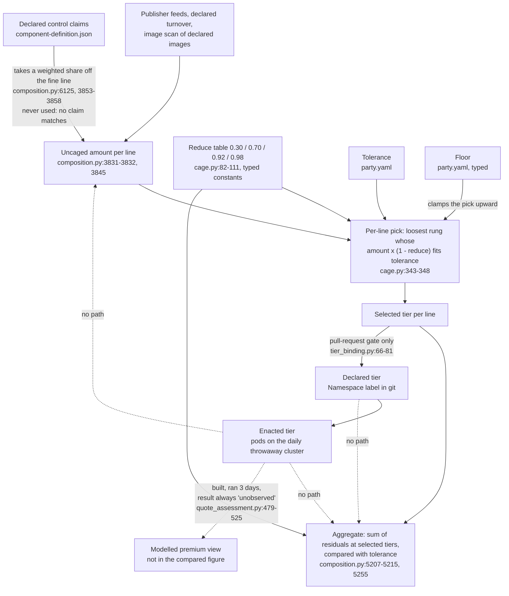

# K2 — "The loop is open": refutation attempt

Read-only attack on the claim, 2026-11-14, against the fresh clones under `fresh/`.
Paths are `repo/path:line`. Commits are short hashes in the named repo.
Platform is cited at HEAD (7beb126). The adopters run their tools at tag `v6.3.0` (`driftwood/.github/platform-tools-pin.yaml:11`, same tag in tuppence and ludlow). `git diff v6.3.0 HEAD` touches `compose/composition.py` only from line 7073 on, inside `selfcheck()`, and does not touch `graded/cage.py` or `fair/`. So every pricing line cited below is the code that produced the committed artefacts.

## The claim

> The loop is open: the priced exposure that is compared with tolerance never takes the enacted cage tier as an input, and the per-rung reductions that convert a rung into money (0.30, 0.70, 0.92, 0.98) have no source beyond a code comment. Nothing measured on a cluster feeds back into the money figure.

## Verdict: confirmed, but narrower than it reads

I could not break any of the three sentences as literally worded. I found five things the wording hides, (a) to (e) below, and three feedback paths that are built but have never delivered a number. Two of these matter most to a redesign: the compared figure does move when a tier moves, and the feedback step is not a blank page.

Terms.
- **Tier** or **rung**: one of four cage settings, `baseline`, `restricted`, `quarantine`, `isolated` (tightest).
- **Uncaged amount**: the yearly loss in pounds for one risk line before any cage is counted. It is `prices[].amount` in each adopter's `composed/evidence.json`.
- **Reduce**: the fraction of the uncaged amount a rung is said to remove.
- **Residual**: uncaged amount times (1 minus reduce).
- **Selected tier**: the rung the pricing code picks for a line. It is `proposed_tier` in the artefact.
- **Declared tier**: the label `posture.acme.io/tier` on the adopter's governed Namespace in git.
- **Enacted tier**: the rung seen on a running pod on a cluster.
- **Floor**: `overlay.floor` in `party.yaml`, a minimum rung the adopter types in.
- **Tolerance**: `appetite.tolerance` in `party.yaml`.

## What the code does

Solid arrows are code that runs. Dotted arrows are missing, or built and never fruitful.

## Sentence 1: "the priced exposure that is compared with tolerance never takes the enacted cage tier as an input"

**Holds as worded. But two figures are compared with tolerance, and both take a tier, just not the enacted one.**

### What is compared

1. **The per-line pick.** `select_tier` walks the four rungs and stops at the first where `uncaged x (1 - reduce) <= tolerance`, else `isolated`, then clamps up to the floor (`platform/graded/cage.py:334-348`). It is called for every feed line (`platform/compose/composition.py:3812-3813`, `:3831`, `:3857-3858`). Its inputs are the uncaged amount, the tolerance and the floor. It tries every rung as a what-if. It does not know which rung is in force.
2. **The aggregate.** `aggregate_section` sums `caged_residual(amount, proposed_tier)` over the exposure lines and tests `total > tolerance` (`composition.py:5207-5215`, `:5221`, `:5255`). The tier it uses is each line's own selected tier.

### What I searched for and did not find

- `composition.py` reads the Namespace tier label in one place only, to list the platform's own `infra` Namespaces (`composition.py:1539-1557`). No pricing function reads an adopter's declared tier.
- No file under `platform/compose/` that feeds `prices[]` reads a cluster. The uncaged amount is `new["uncaged_residual"]` from the scenario (`composition.py:3832`, `:3845`).
- The scenario's control state is fixed in code: `mode="warn"` on every feed line (`composition.py:3813`, `:3831`). The ICO converter also ships a `deny` state with frequency (0, 0, 1), "admission blocks the loss path" (`ico/schema/to_fair_scenario.py:77`, `:325-326`). Composition never selects it. So a second route by which enforcement could change money exists in the data and is switched off.
- The adopters' `selection_policy.select` takes a mapping of residuals, the tolerance and the floor, nothing else (`driftwood/selection-policy/selection_policy.py:83-140`).
- The twin line's amount is `base x elasticity`, annualised (`driftwood/twin/emit-forward-intel.py:262`; `composition.py:4242-4247`). No tier enters it.

### What the wording hides

**(a) The compared aggregate does move when a tier moves.** It moves with the selected tier, and the selected tier moves with a typed floor. Driftwood's own record shows it (`driftwood/composed/floor-change.json`, commit d2c6f83, 2026-10-23):

| Line | Uncaged | Tier before floor | Tier after floor | Residual before | Residual after |
|---|---|---|---|---|---|
| ICO penalty-schema | £1,787,177 | isolated | isolated | £35,744 | £35,744 |
| threat-register | £19,559 | baseline | isolated | £13,691 | £391 |
| twin forward-intel | £758 | baseline | isolated | £531 | £15 |
| **Sum** | | | | **£49,965** | **£36,150** |

Tolerance is £40,000. The "before" column in that file is a recomputation at current inputs (`composition.py:5138-5142`), so I also read the signed header on each side of the commit. It agrees: `selected_tier_residual_total` is 49,965.36 at d2c6f83^ and 36,149.88 at d2c6f83 (`driftwood/composed/HEADER.yaml:1347` and `:1348` at those commits). So typing `floor: isolated` into `party.yaml` took driftwood's printed aggregate from over the tolerance figure to under it. The Namespace label did not change: its file was last touched on 2026-08-28 (`git log -- gitops/apps/namespace.yaml`: 348b97c). No recorded verdict flipped, because `breaches_band` was `null` on both sides: the CVE line has no tier, so the sum is partial (`HEADER.yaml:1351`, `:1352` at those commits). The code says what the figure is: "selection evidence, not an enacted Namespace tier" (`composition.py:5176`).

That also shows the gap from the other side. Before 2026-10-23 the Namespace declared `isolated` while the aggregate priced two lines at `baseline`. The compared figure and the declared cage disagreed, and nothing noticed, because nothing reads the declared tier into the sum.

So the FACTS brief's paraphrase, "Tightening the cage does not change the number that is compared", is wrong as arithmetic. The accurate statement is: the number changes with the tier the code *selects*, never with the tier that is *declared* or *enacted*.

**(b) There is a one-way tie between selected and declared, as a gate, not an input.** `tier_binding.bind` refuses a pull request whose Namespace label is looser than the strictest selected line (`platform/shift-left/tier_binding.py:66-81`). The proposer reads the declared tier to decide whether to write (`platform/wargamer/wargamer.py:309-318`). While that gate holds, the residual at the declared tier is no larger than the sum the aggregate prints. That is a consistency check on git, not a measurement. K1 could not determine whether the gate is a required check.

**(c) Today's agreement is a coincidence of two typed values.** All three adopters have `floor: isolated` (`driftwood/party.yaml:106`, `tuppence/party.yaml:60`, `ludlow/party.yaml:62`) and declare `isolated` (`driftwood/gitops/apps/namespace.yaml:30`, `tuppence/gitops/apps/namespace.yaml:28`, `ludlow/gitops/apps/namespace.yaml:28`). So the selected tier equals the declared tier on every line. The figure matches the declared rung because both were typed the same, not because one reads the other.

**(d) One priced amount did change because a tier changed, in the wrong direction.** The `agent-cage` line prices the gap between the twin line's residual at `baseline` and at its selected tier (`composition.py:4625-4634`). When the floor moved the twin line's selected tier to `isolated`, the gap went from £0 to £515.67 and the line's amount from £0.0 to £0.000168 (`driftwood/composed/evidence.json` at d2c6f83^ and d2c6f83). So a tighter selected cage raised a priced amount. The line is outside the compared figure (`EXPOSURE_KINDS = ("feed", "twin")`, `composition.py:5086`) and is worth a fraction of a penny. It is the only place I found where any tier is an input to a `prices[].amount`. That rests on every call site of `caged_residual`, `select_tier` and `.select(` in `composition.py` before the selfcheck (lines 2431, 2534, 3144, 3812-3862, 4253-4256, 4704, 5155-5156, 5214). The others either record the uncaged amount (`:3146`, `:3832`) or record a residual at a selected tier outside `prices[]`: the `cages[]` list for restatements and workload decisions (`:2534-2541`). I did not read `compute_switching`, `price_supersede` or `price_quote` line by line. None of their kinds is in `EXPOSURE_KINDS`.

## Sentence 2: "the per-rung reductions (0.30, 0.70, 0.92, 0.98) have no source beyond a code comment"

**Holds. I looked for a dataset, a citation or a measurement and found none.**

A comment that says "no evidence" is a document, so I searched rather than trust it.

- **First commit.** 0.30, 0.70 and 0.92 arrive in platform 7a36bf7 (2026-07-31, "Estate build: 27 tickets implemented via dependency-wave workflow"). The comment beside them on that day: "reduce/cost are calibration knobs — tune to real WAF/eviction telemetry; the ORDERING ... is what the selection relies on" (`git show 7a36bf7:graded/cage.py`, the table header). 0.98 arrives with the `isolated` rung in platform 4e809f8 (2026-08-28). The values have not changed since. `TABLE_VERSION` is still `1.0.0` (`platform/graded/cage.py:80`).
- **The README calls them demo values.** "Tune to real WAF/eviction telemetry; the demo values keep the ordering" (`platform/graded/README.md:179-181`, text from 7a36bf7).
- **No telemetry exists to tune to.** The WAF sidecar is a placeholder image that "exists in NO registry" (`driftwood/.github/workflows/drift-sample.yml:68`); the stand-in is a busybox that runs `sleep infinity` (`platform/graded/waf-placeholder/Dockerfile:14-19`).
- **Search of all nine fresh repos** for the first three figures on one line, outside `hub/.scratch`: one hit, `platform/graded/cage.py` itself.
- **Search of `hub/.scratch`**: the figures appear in ticket 09 and ticket 15, which call them "calibration knobs" (`hub/.scratch/ecosystem/issues/09-the-cage-ladder-v2.md:28`, `issues/15-price-everything-that-was-counted.md:29`), and in the 2026-09-02 review, which calls them "self-declared by the platform" (`hub/.scratch/ecosystem/REVIEW-2026-09-02.md:71`). No file gives a basis.
- **Search of `hub/docs/adr`** for a reduce figure or a basis: none.
- **0.98 on its own.** This is the figure driftwood's position depends on, so I searched for it separately. It does not appear beside any cage, rung or reduce wording in `hub/docs/adr` or `hub/.scratch/ecosystem/issues`. ADR-0022, which decided the `isolated` rung, names no reduction at all, and records that the decision "rests on a bare agree, not a ratification" (`hub/docs/adr/0022-the-cage-ladder-tier-per-namespace-isolated-rung-floor-and-infra.md:35-39`). Ticket 26, which landed the rung, names no figure. The commit that added 0.98 (platform 4e809f8) does not mention it in its message.
- **Search of `backup/.scratch`** (the recovered calibration programme and October notes) for the figures, `reduce`, `cage-tiers` or `caged_residual`: none. The calibration programme does not address this table.
- **No owner sentence** asks for or supplies the figures (maps A1 and P2, "Could not determine").

### What the wording hides

**(e) There are three reduction sets, not one, and the comparison between them is weaker than the FACTS brief says.**

| Set | Where | Values | Basis |
|---|---|---|---|
| Platform pod table | `platform/graded/cage.py:82-111` | 0.30 / 0.70 / 0.92 / 0.98 | none; typed |
| Driftwood's own curve | `driftwood/twin/orgs/driftwood/responses/run-the-checkout-at-*.yaml:10-14` | 0.05 / 0.30 / 0.65 / 0.90 (mode) | grade 5, "Unmeasured calibration" |
| Tuppence's and ludlow's curves | `tuppence/twin/orgs/tuppence/responses/run-the-payments-api-at-*.yaml:7-19`; ludlow the same | 0.30 / 0.70 / 0.92 / 0.98 | copied from the platform table, grade 5 |
| Twin-agent table | `platform/graded/cage.py:145-151`, `:248-270` | derived per adopter, 0 / 0 / 0 / 1 today | derived from repository files |

- FACTS item 3 says "The adopter's own twin publishes different reductions". That is true of driftwood only. Tuppence and ludlow publish the platform's own four figures back, and say so: "The publisher's own figure, adopted rather than restated ... nothing observed them, nothing published evidence for them and nobody calibrated them" (`tuppence/twin/orgs/tuppence/responses/run-the-payments-api-at-isolated.yaml:10-19`).
- Driftwood's set once claimed a source. From 2026-08-28 to 2026-10-04 each response was grade 2 with a basis such as "Measured on this estate's own two prior incident post-mortems" (`git show 055e340:twin/orgs/driftwood/responses/run-the-checkout-at-baseline.yaml`). On 2026-10-04 (aa92363) all four went to grade 5: "The previously claimed incident post-mortems and break-glass drill have no record and are withdrawn" (`driftwood/twin/orgs/driftwood/responses/run-the-checkout-at-isolated.yaml:15-18`). So the one reduction set that ever cited a measurement was found to cite nothing. A grade 5 reduction is priced as zero by the adopter's own emitter (`driftwood/twin/emit-forward-intel.py:202-204`).
- The twin-agent table is the counter-pattern. Its reduce is "derived, not typed": one minus what the still-open misuse paths can land (`cage.py:248-270`), with the reach read from the adopter's own workflow files (`composition.py:4474-4562`). It reads git, not a cluster. It prices a line worth pennies. But it shows the estate already has one worked example of a reduction that names its basis.
- The hub twin forbids what the platform does: "No rung carries a number, and the loader refuses one ... A reduction per rung would be a free multiplier" (`hub/twin/enforcement-grades.yaml:10-13`).

How much rests on the constant: driftwood's fine line is 98.9% of its priced subtotal (£1,787,177 of £1,807,494). At 0.98 it leaves £35,744. At driftwood's own 0.90 it leaves £178,718. At 0.92 it leaves £142,974. Only the typed 0.98 puts driftwood under £40,000.

## Sentence 3: "Nothing measured on a cluster feeds back into the money figure"

**Holds as an outcome: no cluster measurement has changed a pound figure in any version of the three adopters' `composed/evidence.json` on `main`. It does not hold as "there is no code".** Map A4 says of the feedback hop "None ... no code". That is too strong. Three feedback paths are built. None has delivered a number.

### Path 1: implemented controls take money off the fine line. Built, declared not measured, never used.

- A control counts as implemented when the adopter selects it and a policy's claim covers it on the declared engine: `implemented = selected_set & counted` (`composition.py:6125`).
- The fine line's amount is then the sum of the regulator's weighted lines still open, and both tiers are re-picked on that share (`composition.py:3853-3858`).
- So an implemented control does change the compared figure. It is the one closed feedback in the pricing code. Its input is a claim in `component-definition.json`, which is a declaration, not an observation.
- It has never moved a price. In every version of `composed/evidence.json` on each adopter's `main`, the fine line's `amount` equals its `total`, and its four holes (pl-2, ra-3, ca-2, ir-8) are `recorded`, meaning open (history scan of all 32 driftwood, 31 tuppence and 29 ludlow versions; HEAD values in each `composed/evidence.json`).
- It cannot move for the cage. Composition prices the regulator's `lower-tier` partition (`composition.py:3481-3482`), whose controls are planning and assessment controls. The cage policies claim `ac-6` (`cage-tier`) and `ac-4` (`cage-netpol`) (`platform/oscal/component-definition.json`). `ac-6` carries weight 0.2 in the regulator's `higher-tier` partition, which composition does not price (`ico/penalty-schema/v3/feed.json:175-202`, `control_weights`). So the cage's own claims are one constant away from the price and do not reach it.
- Even if they did, the credit would be for the cage being present, the same at every rung. And the weights are editorial: "no regulator publishes an apportionment of a penalty across NIST SP 800-53 controls" (`ico/penalty-schema/v4/feed.json:294`, `control_weights` basis).

### Path 2: cluster samples set a modelled insurance premium. Built, ran for three days, always "unobserved".

- `quote_assessment.assess` reads one authenticated row of `drift/workload-samples.jsonl` and one of `drift/oscal-samples.jsonl` from a named sampler run (`platform/compose/quote_assessment.py:451-493`, `:513-515`). It checks each observed pod's manifest, images and policy-version label. It reads pass or fail per served check. It then sets `effective_premium = contract premium + uplift for each breached condition` (`quote_assessment.py:516-525`). Composition attaches the result to the premium line (`composition.py:6370-6388`).
- This is a cluster measurement wired to a pound figure. It is the nearest thing to a counter-example.
- It falls short four ways. It never produced a number: driftwood carried the selector `insurance/condition-observation.yaml` from 2026-10-18 (f0c734a) to 2026-10-21 (deleted in 6ec67c8), and every committed result was `state: unobserved`, `effective_premium: null`; the reason on 2026-10-18 was "quoted tag does not carry the quoted exposure digest" (`composed/evidence.json` at f0c734a, 613f53f, 8cdaf28). Tuppence and ludlow carry no premium line. The premium is not exposure: `EXPOSURE_KINDS` excludes it (`composition.py:5086`), so it is not in the figure compared with tolerance. The booked premium never changes: "the booked premium is unchanged" (`quote_assessment.py:535-537`). And it reads the policy-version label and check results, not the tier (`quote_assessment.py:489-492`).
- The insurer's own price takes no tier either. It is a rate on the adopter's uncaged total above the tolerance (`insurer/pricing/quote.py:22-23`, `:242-258`).

### Path 3: the hub twin gives pound credit only for an enactment seen through two independent channels. Built, reached by no adopter.

- `hub/twin/pricing.py:327-407` refuses mitigation credit unless the response has a corroborated enactment (`NOT_ENACTED`, `pricing.py:128`, `:368-384`). `hub/twin/corroboration.py:306-357` computes the grade from which channels observed it. One channel is "A continuous reconciler reporting the cluster matches its declared source" (`hub/twin/enactment-channels.yaml:135-142`).
- This is a designed closed loop: observe the control in force, then let its reduction count as money.
- No adopter figure passes through it. The adopters' emitters import `evidence`, `fixtures`, `Overlay`, `ModelRepo` and `schema` from the hub twin, not `pricing` (`driftwood/twin/emit-forward-intel.py:98-101`). No adopter overlay holds an enactment claim: driftwood's one claim is `kind: override` (`driftwood/twin/orgs/driftwood/claims/supply-constraint-position-2026-09-09.yaml:2`). A search of the whole hub outside `.scratch`, and of the three adopters, for a document of `kind: enactment` finds three files, all test material: `hub/tests/test_corroboration.py`, `hub/twin/fixtures.py` and `hub/twin/invariants/harness.py` (`:1950-1961`). No real overlay earns credit through the reconciler channel.
- The adopters' twin sweep does not read the cluster samples either: neither `driftwood/.github/workflows/twin-sweep.yml` nor `driftwood/twin/signals.yaml` names `drift/` or a samples file.
- Composition records the twin's curve only as a hash (`composition.py:4279`) and prices the twin line off the platform table (`composition.py:4253`, `:4277`).

### Measurements that do reach the compared figure, none from a cluster

- **Image scan.** The CVE line is priced from `inventory/images.json`, a Trivy scan of the images named in the adopter's signed, tagged manifests (`composition.py:5569`, `:3913-3917`; `platform/wargamer/inventory.py:38-136`, `:160-166`). It is a real measurement and it is in tuppence's compared figure: £437,107 uncaged, £8,742 at `isolated` (`tuppence/composed/evidence.json`, `cve` line; `tuppence/composed/floor-change.json`). It is not a cluster measurement: "no release or cluster activation is asserted" (`tuppence/inventory/PROVENANCE.json:18`). It measures what is declared to run, not what runs or how it is caged.
- **Publisher signature state.** Whether a feed pin is a signed tag is read from git and priced as a hole (`composition.py:3903-3909`).
- **Publisher reliability.** A measured publisher record can adjust a scenario (`composition.py:3785-3797`). No adopter artefact carries a `publisher_reliability_effect`.
- **Ungoverned Namespaces.** A Namespace without the `governed` label is priced as a share of the uncaged total (`composition.py:1829-1889`). Tuppence has two, at £26.4m and £85.4m (`tuppence/composed/evidence.json`, `ungoverned`). This is a declared label changing a priced figure. It is the governed label, not the tier, and it is a delta beside the exposure, not in the compared sum.

### What the cluster sampler does feed

Nothing that prices. The daily sampler writes `drift/*.jsonl`. Its readers are `quote_assessment.py` (path 2), `comparison_history.py` and `consumer_retirement.py` (which treat the sample files as observation lanes), `hub/twin/drift.py` (which reduces Flux drift samples and gives no verdict, `hub/twin/drift.py:14-16`), and the verify scripts.

## Where the claim's numbers stand

- 0.30, 0.70, 0.92, 0.98: correct (`platform/graded/cage.py:84`, `:90`, `:96`, `:107`).
- "A code comment": two comments and a README, all saying the same thing (`cage.py:68-72`; `platform/graded/README.md:38`, `:179-181`).
- Aggregates at HEAD: driftwood £36,150 against £40,000, verdict `null`; tuppence £2,057,390 against £15,000, `breaches_band: true`; ludlow £61,725,982 against £5,000, verdict `null` (`driftwood/composed/HEADER.yaml:1376-1381`, `tuppence/composed/HEADER.yaml:1343-1348`, `ludlow/composed/HEADER.yaml:1404-1409`). These match the FACTS brief.

## What was searched

- `platform/compose/composition.py`: every pricing, residual and aggregate function (`price_parent`, `_open_lines`, `_regime_holes`, `price_twin`, `_twin_agent_reach`, `price_twin_agent`, `price_ungoverned`, `workload_cages`, `floor_change_evidence`, `aggregate_section`, `exposure_section`, `compute_prices`, and the body of `_compose` from line 6060 to 6392). Every use of the tier label, of `implemented`, of `mode=`, and of the drift sample file names.
- `platform/graded/cage.py` in full, and its first version at 7a36bf7.
- `platform/compose/quote_assessment.py:395-545`; `platform/wargamer/wargamer.py:251-327`; `platform/shift-left/tier_binding.py:49-81`; `platform/wargamer/inventory.py` header and function list; `platform/fair/fair.py:253-259`.
- `hub/twin/corroboration.py` in full; `hub/twin/pricing.py:30-130` and `:300-430`; callers of `pricing.price`.
- `driftwood/twin/emit-forward-intel.py:90-330`; every adopter's `responses/*.yaml`; `driftwood/selection-policy/selection_policy.py:83-140`.
- Every version of `composed/evidence.json` on each adopter's `main`, for the fine line's amount against its total and for the premium's conditional view.
- Text search of all nine repos, `hub/.scratch` and `backup/.scratch` for the reduce figures.

## Could not determine

- Whether the adopters' twin lines would differ if their emitters called `hub/twin/pricing.price`. Not run; read-only pass.
- Whether a file outside the nine repos and `backup/.scratch` (a chat log, a slide) ever gave a basis for the four figures.
- Whether `quote_assessment` would return `met` or `breached` for any adopter today. The selector is gone and nothing was run.
- Why the regulator's `lower-tier` partition was chosen as the one to price rather than `higher-tier`. Only the constant was read (`composition.py:3482`).
- Whether the `tier_binding` gate is a required check on the repositories (needs the GitHub API).

## The claim, restated so it holds

The loop is open at the feedback step: of the two figures compared with tolerance (a per-line what-if over all four rungs, and an aggregate of each line's residual at the rung the code selects), neither reads the tier the Namespace declares or the tier a cluster enacts. The aggregate follows the selected tier, which a typed floor can move: driftwood's printed aggregate went from £49,965 to £36,150 against £40,000 on 2026-10-23 with the Namespace label unchanged and no verdict recorded on either side. The four reductions that turn a rung into pounds (0.30, 0.70, 0.92, 0.98) are typed constants from the 2026-07-31 and 2026-08-28 builds that their own file and README call calibration knobs and demo values; no dataset, citation or measurement backs them in the nine repos or the recovered planning text, and the one rival set that cited a measurement (driftwood's) withdrew it on 2026-10-04 for want of a record. No measurement taken on a cluster has changed a pound figure in any version of the three adopters' composed evidence on `main`. Three feedback paths are built and none has delivered a number: declared control claims take a weighted share off the fine line but no claim matches a priced control; cluster samples can set a modelled premium but returned "unobserved" on each of the three days it was wired; and the hub twin credits a reduction only for a corroborated enactment, which no adopter figure passes through.
