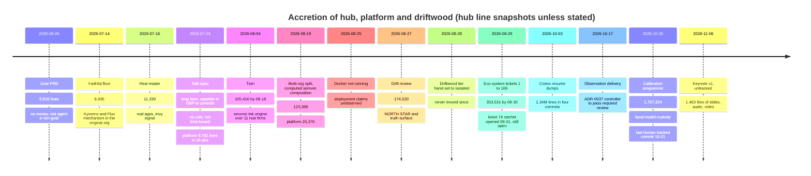

# A3: How the complexity accreted (hub, platform, driftwood), June to November 2026

## Summary

- **The money loop is a July addition.** The June PRD has no Q, T, C or R; it lists "a production-grade risk-intelligence agent" as a non-goal (hub/docs/PRD.md:82). The money loop first appears on 2026-07-23, inside a spec for a talk, in the owner's words: "change the regulator financial fine we might get for a breach and then make the controls and everything else proportinate and grounded in that" (hub/.scratch/drift-review-2026-08-27/appendices/A-ambition-timeline.md:113).
- **Most of the bulk is October dumps.** Tracked lines in the three repos went from 5,916 (2026-06-30) to 1,894,389 (2026-11-14). Of those, 1,336,371 (70.5%) are October patch copies and run logs, committed into hub/.scratch/ecosystem by commits 6ed89616, 5bc47331 and d06f0485 plus merge 7e22e940 (2026-10-03/04). Without them the total is about 558k.
- **The ratchet has never fired.** Ticket 74 ("step 3 happens once for real", born 2026-09-01) is `Status: open`; 164 of the 169 eco-system tickets are resolved.
  - Driftwood's tier label was set once, by hand, to `isolated` on 2026-08-28 and has had no other value since (driftwood 348b97c; `git log -G` shows one value change). Tuppence and ludlow are also `isolated`.
  - `isolated` is the strictest rung: "baseline < restricted < quarantine < isolated" (platform/graded/cage.py:13). The ratchet has no notch left to tighten.
- **Each review added machinery.** Each of the three reviews (08-27, 08-31, 09-02) diagnosed drift and then built more. Hub lines went 123,388 (08-26), 188,382 (08-31), 214,937 (09-02), 286,530 (09-10), and verify/ went from 1,233 to 29,548 lines. No top-level directory was removed in any of the three repos after 08-26.
- **Records outnumber the loop in commits.** Human commit subjects about records or harness outnumber those about pricing, cages or policy, across the three repos:

  | Month | Humans only | With record bots |
  |---|---|---|
  | 2026-07 | 2.3:1 | 2.3:1 |
  | 2026-08 | 2.0:1 | 2.1:1 |
  | 2026-09 | 4.3:1 | 6.5:1 |
  | 2026-10 | 2.3:1 | 3.9:1 |

  In the hub alone, September is 8.3:1.
- **Most passes are not observations.** The newest TRUTH line has 117 passes; only 42 are `observed`, 61 are `self` and 10 are `meta` (hub/talk/truth.log:183, 2026-11-12).
- **Tracked work stopped on 2026-10-31.** Every tracked commit after that is a bot. The last human-directed work is an untracked keynote video build, 2026-11-06/07 (LOCAL/.scratch/talk-spec/keynote-v1: 1,463 files).

## Method note

- **Line counts** are tree snapshots at `git rev-list --first-parent -1 --before=<date>`, with every blob read by `git cat-file` and its newlines counted (`GIT_NO_LAZY_FETCH=1`). Binary files and blobs the partial clone lacks (all over 1 MB) are skipped.
- **Growth per epoch** is a snapshot delta, not churn. `git log --numstat` aborts at the missing blob: hub history stops at 2026-08-21 and driftwood fails outright.
- **`talk/observation-delivery.pyz`** is a zipapp; its 1,481 counted "lines" are not source.
- **Commit classes** come from a subject-line regex, a heuristic (rules in section 4).
- **Claude or Codex** cannot be told from authorship, since every agent commits as the owner's identity. Only `codex/` branch names (12, all October) show Codex.
- **Owner quotes** come from Appendix A of the drift review: an assistant's transcription, with timestamps.

## The epochs

| # | Epoch | Dates | What was asked, by whom | Added (measured snapshot deltas) | Claimed problem | Loop, or a problem made by earlier machinery? | Loop letters |
|---|---|---|---|---|---|---|---|
| 1 | June PRD | 06-06 to 07-13 | Owner and Claude: "Re-implement CNS's *Policy as [Versioned] Code* thesis on Flux CD" (hub/docs/PRD.md:12) | hub 0 to 5,916 (research 4,758, docs 932), commit 21c1da96 | Policy is an opaque deploy-time gate; make it a versioned dependency | Distribution of policy. No money: the only "appetite" in the commit is "until a maintainer signals appetite" (21c1da96:docs/upstream/fluxcd-source-controller-1068-gitsign.md:4) | E (design) |
| 2 | July faithful floor | 07-14 to 07-15 | Appendix A's summary, not owner words: a Stop-hook goal "to implement every ticket until a narrated demo is possible" (A-ambition-timeline.md:7) | hub 5,916 to 8,836 (+2,920: spikes 1,367, .scratch 1,090). Mechanism code is in the original-org repos fleet and policy, outside this area | Prove multi-version coexistence | Cage and enact substrate (Kyverno plus Flux) | cage, E (live in the original org, hub/docs/HISTORY.md:59-62) |
| 3 | Real-estate | 07-16 to 07-22 | Owner after a show and tell: real apps, one repo per app, sunset dates (REPORT.md:38) | hub 8,836 to 11,339 (+2,503); apps went to original-org repos | The estate was "a cardboard cutout" (HISTORY.md:67) | Mostly demo realism, plus a trivy vulnerability signal | X, evidence |
| 4 | Talk-spec (absent from the brief's list; the loop is born here) | 07-23 to 08-03 | Owner, 07-23: 15:29 the regulator-fine quote; 15:50 "we're not short of time, lets make it real ... no cuts will be tolerated"; 18:07 "nothing is a nice to have, you're either building it or your not" (A-ambition-timeline.md:113,177,150) | hub 11,339 to 30,526 (+19,187; estate/ 14,021). Platform history starts 07-31 at 9,791 lines in 25 dirs: identity, posture, eud, access, break-glass, honesty, currency-controller, wardley, wargamer, fair, tcor, graded, feeds and others | A "conference-grade talk ... backed by a fully-real, refactored demo estate where every claim is demo-live" (hub/.scratch/talk-spec/map.md:7-12) | The loop, stated: "RISK APPETITE (£ fine/breach/downtime) → sets proportionality → PRINCIPLES → CONTROLS → ENFORCEMENT" (talk-spec/map.md:30). The breadth comes from the no-cuts rule | Q, T, C, R and X specified; fair, cage, wargamer and feeds born |
| 5 | Twin | 08-04 to 08-18 | Owner 08-04T12:47: "we've also not done any actual risk modelling, wardley mapping or anything of the sort" (A-ambition-timeline.md:260). Map: "Plan the whole thing to full ambition — everything is modelled" (hub/.scratch/twin/map.md:24) | hub 30,526 to 105,416 (+74,890 in 15 days: twin 39,806, tests 18,458, .scratch +15,733) | No real risk model existed | A second Q engine over 11 real firms, disconnected: "Neither imports, calibrates against, or converts into the other" (REPORT.md:22) | Q, X; neither reaches C, R or E |
| 6 | Multi-org estate | 08-19 to 08-21 | Owner 08-04T12:47: "i don't understand how we got to the whole thing being in a giant single org and repo, this does not reflect reality" (A-ambition-timeline.md:260); the split "ordered" 08-19 to 25 (REPORT.md:44) | estate/ (14,721) leaves the hub for the org repos; driftwood 1,222 to 6,464 by 08-26 | "six live organisations" literally true; 28/28 green (multi-org-estate/map.md, Destination) | Demo truthfulness and topology | none |
| 7 | Computed semver | 08-20 to 08-24 | Owner 08-20T07:26: "policy versions should be semver and can have inheritence model themselves since they are code" (A-ambition-timeline.md:630) | platform computed-semver 0 to 8,563 by 08-26 (14,521 today); hub .scratch/computed-semver 3,143 | "A policy release states its bump and is refused if the evidence disagrees" (computed-semver/map.md, Destination) | A release-correctness gate; not the loop | none |
| 8 | Policy composition | 08-21 to 08-25 | The same owner thread (A-ambition-timeline.md:630) | platform compose 0 to 2,607 by 08-26 (19,568 today, the largest platform dir); party.yaml | "A party's effective policy set is composed from other parties' signed, versioned artefacts" (policy-composition/map.md, Destination) | Partly the loop: where an adopter's size and appetite meet the price | T, Q |
| 9 | Drift review | 08-27 to 08-28 | Owner 08-27T12:45: "exhaustively review everything we've spec'd and built, we seem to have drifted a fair way from thinking and original ambition" (A-ambition-timeline.md:670) | hub 123,388 to 174,520 (+51,132; review 49,453). NORTH-STAR.md, GAPS.md; truth.yml (644 lines) and truth.log born 08-28 | Two centres of gravity; no clock; the cage never caged; 482 decisions with a recommendation attached (REPORT.md:17-26) | A diagnosis of the loop's missing joints. Its main remedy, the truth surface, answers the 08-25 incident in which agents claimed deployments nobody had observed (HISTORY.md:204-217): a problem of the agent process | ceremony; NORTH-STAR §4 step 3 names C and R |
| 10 | Eco-system tickets | 08-29 to 09-30 | NORTH-STAR §4, "the assistant's build order, not the owner's definition of done" (NORTH-STAR.md:63); ADR-0025, the assistant decides architecture | hub 174,520 to 353,531 (+179,011: .scratch +95,300, verify +32,823, tests +17,351, talk +18,105, twin +7,912); platform 26,376 to 57,038; driftwood 6,464 to 21,507 | Run the thin slice end to end, graded by the truth surface | Mixed. Loop work: cage ladder and isolated rung (platform f5f3023, 08-28), tighten-only proposer (platform 698702a, 09-04), clocks, feeds, adopter lane samples. Self-made: about 6.2k lines of verifiers of records, plus the reviews' ticket ranges | C, R (code only, never fired), E, X |
| 11 | October Codex work | 10-01 to 10-29 | Owner ask: could not determine. Commit 6ed89616: "Resume Claude ecosystem handoff with measured implementation and delivery proofs" | hub 353,531 to 1,717,556 (+1,364,025; .scratch +1,338,968); platform 57,038 to 76,388 (implementations 4,858, recovery-expense 1,225); driftwood 21,507 to 50,434 (composed +19k, inventory 5,556) | Recover and record delivery; get clock observations past required review (hub/docs/adr/0037-*.md) | Mostly self-made. ADR-0037 exists because required review, added so that "a human merges" holds, refused the clocks' own pushes with GH013 (0037:9-12). Some loop: the recovery-expense feed price and publisher prices | Q (feed prices), ceremony |
| 12 | Calibration programme | 10-30 to 10-31 | Owner ask: could not determine (searched FRESH hub docs/.scratch and LOCAL calibration-programme, resume-user-decisions-20261022) | hub 1,717,556 to 1,767,324 (+49,768: twin +17,445, tests +16,580, bench +14,882). LOCAL: 396 dirs holding 25 files, and 52 `calibration-*` worktrees | Qualify a local model (Qwen3-4B) for twin signal extraction under custody rules: "No new real model holds permission ... no official score is added by this change" (hub/docs/qualification-bindings.md:9-11) | Not the loop | none |
| 13 | Keynote (untracked) | 11-06 to 11-07 | could not determine from the repo | LOCAL/.scratch/talk-spec/keynote-v1: 1,463 files (671 png, 73 wav, 49 mp4), 98,400 text lines, all modified 11-06/07 | A talk video | Presentation | none |

## Components (accretion layers that survive at HEAD, grouped by job)

The area total is hub 1,767,324 + platform 76,388 + driftwood 50,677 = 1,894,389 lines. The rows sum to about 1,895,066. The 677-line excess comes from splitting twin/tests by birth month. Rows 8, 9 and 10a are split by file birth month and their contents were not inspected; the twin is another reader's area.

| # | name | paths | lines | born | what it does | loop role | necessity | origin | status | cite |
|---|---|---|---|---|---|---|---|---|---|---|
| 1 | October resume dumps | hub/.scratch/ecosystem/{patches,research}/resume-2026-10-0{3,4} | 1,336,371 | 2026-10-03 | Copies of other repos' diffs, CI logs and status JSON: 1,900 files, 325 byte-identical duplicates, five copies of a ~75k-line feeds.patch | ceremony | ceremony | codex | written_never_run | hub commits 6ed89616 (+362,690 in these dirs), 5bc47331 (+238,371), d06f0485 (+541,560), merge 7e22e940 |
| 2 | Eco-system tickets, map, briefs, 09-02 review evidence | hub/.scratch/ecosystem (all but row 1) | 84,738 | 2026-08-28 | 169 tickets (164 resolved), map, build briefs, review evidence | ceremony | ceremony | delegated | written_never_run | hub/.scratch/ecosystem/map.md:1-30 |
| 3 | Drift review | hub/.scratch/drift-review-2026-08-27 | 49,453 | 2026-08-28 | 124-run review, 482-decision ledger, owner-quote timeline | ceremony | ceremony | owner_words | written_never_run | A-ambition-timeline.md:670 |
| 4 | Talk and presentation | hub/.scratch/talk-spec; talk/{build_deck.py,deck*.md,RUNBOOK.md,narration.json,diagrams,up.sh,engine-up.sh,verify-demo.sh,twin_release.py,README.md} | 24,927 | 2026-07-23 | Decks, pitch videos, narration | presentation | off_mission | owner_words | tested_offline | talk-spec/map.md:7 |
| 5 | Truth surface and observation delivery | hub/talk/{verify-all.sh,truth*.py,truth.log,fall_check.py,observation_delivery*,local-clock*,verify-*.txt}; talk/captures; .github; tests born in October | 34,329 | 2026-07-31 | Daily graded run, TRUTH line, delivery of clock observations through review | evidence | support | assistant | observed_running | hub/docs/HISTORY.md:219-229; 182 "truth surface" bot commits |
| 6 | Meta-verifiers (verifiers of records) | hub/verify/{cited-truth,map-surface,derived-status,every-green,a-fall-blocks,truth-line,record,adr-supersession,can-record,enact-record} | 6,216 | 2026-08-28 | Check that tickets cite real TRUTH lines, the map quotes truth.log, ADRs carry banners, scripts do not SKIP-then-PASS, NORTH-STAR states its purpose | ceremony | ceremony | delegated | tested_offline | hub/verify/cited-truth/verify-cited-truth.sh:1-5; hub/verify/record/verify-record-states-the-purpose.sh:1-4 |
| 7 | Loop and estate verifiers | hub/verify/* (the other 44 dirs: pound-seam, e2e, schedules, priced-holes, deny-is-not-a-rung, feed-contract, tier-binding, forge-review, ...) | 33,582 | 2026-08-21 | Grade price, cage, feed, clock and forge claims, mostly offline | evidence | support | delegated | tested_offline | hub/verify/pound-seam/verify-pound-seam.sh:28 |
| 8 | Twin core risk and forecast engine | hub/twin and tests, August-born files | 62,615 | 2026-08-05 | PERT, GPD tail, TVaR, credibility, scoring, Wardley maths | quantify | duplicate | owner_words | tested_offline | REPORT.md:22 (as of 08-27: duplicates platform fair/tcor/wardley; both file sets exist at HEAD) |
| 9 | Twin September additions | hub/twin and tests, September-born files | 22,907 | 2026-09-03 | Agent cage, model permission, invariants | cage | unknown | delegated | tested_offline | ADR-0031 (hub/docs/adr/0031-*.md) |
| 10a | Calibration programme | hub/twin, tests and bench files born 10-30 or later | 48,727 | 2026-10-30 | Qualifies a local LLM; Linux lease and network sandbox; PDF capture custody | none | off_mission | unknown | tested_offline | hub/docs/qualification-bindings.md:9-11; hub/bench/pinned-candidate/README.md:1-8 |
| 10b | Model bake-off | hub/.scratch/laya-loophole; bench/loophole | 15,873 | 2026-09-22 | Measures two external tools; one ADR per tool | none | off_mission | delegated | tested_offline | ADR-0029, ADR-0030 |
| 11 | Epic specs and tickets, July to August | hub/.scratch/{faithful-floor,real-estate,demo-feedback,twin,multi-org-estate,computed-semver,policy-composition,govern-what-you-dont-control}; spikes; explorations; t; bin; fleet; policy | 32,499 | 2026-07-14 | Specs, maps, tickets and spikes of the pre-review epics | ceremony | ceremony | owner_words | written_never_run | REPORT.md:58-70 |
| 12 | Decision records and agent tooling | hub/docs/adr (38 ADRs: 8 June, 2 July, 14 Aug, 11 Sep, 2 Oct); .claude; root files (CLAUDE.md, NORTH-STAR.md, CONTEXT.md, tts.py, ...) | 8,782 | 2026-06-06 | ADRs, skills, ubiquitous language, north star | ceremony | ceremony | delegated | written_never_run | hub/docs/adr/0025-the-assistant-decides-architecture-and-records-it.md |
| 13 | Research and docs prose | hub/research; docs/*.md | 6,982 | 2026-06-06 | 2022 thesis sources, PRD, HISTORY, calibration-era docs | none | support | inherited_2022 | written_never_run | hub/docs/PRD.md:12-30 |
| 14 | Composition engine | platform/compose | 19,568 | 2026-08-21 | Composes parents into an adopter's policy set and evidence; prices it against the adopter's size | quantify | support | owner_words | observed_running | REVIEW-2026-08-31.md "The £ seam computes for real" (tuppence 222,574 to 326,139 GBP) |
| 15 | Computed-semver release gate | platform/computed-semver | 14,521 | 2026-08-20 | Computes major/minor/patch from verdict movement | none | off_mission | owner_words | observed_running | REVIEW-2026-09-02.md §1 (policy/v4.0.0 "declared: major, computed: major") |
| 16 | Cage ladder and implementations | platform/{graded,implementations,policy,engine} | 9,526 | 2026-07-31 | Priced cage tiers; cage-tier MutatingPolicy; isolated rung | cage | kernel | owner_words | tested_offline | platform/graded/cage.py:13; A-ambition-timeline.md:634,660 |
| 17 | £ engines | platform/{fair,tcor,risk,recovery-expense,currency-controller} | 4,263 | 2026-07-31 | FAIR Monte Carlo, TCoR, recovery-expense price, currency | quantify | kernel | owner_words | tested_offline | REVIEW-2026-09-02.md:67 (R1: inputs editorial, two fines stale) |
| 18 | Party declaration schema | platform/party | 1,993 | 2026-08-21 | Schema for an adopter's appetite band, size and obligations | tolerance | kernel | owner_words | tested_offline | NORTH-STAR.md §3 principle 3 (owner 08-19 "percentage of global revenue") |
| 19 | Proposer (the ratchet) | platform/wargamer | 4,540 | 2026-07-31 | On a band crossing, writes a tighten-only tier proposal PR | ratchet | kernel | owner_words | written_never_run | hub/.scratch/ecosystem/issues/74-step-3-happens-once-for-real.md:4 (`Status: open`) |
| 20 | Distribution and shift-left | platform/{distribution,shift-left} | 8,099 | 2026-07-31 | ResourceSet fan-out of policy versions by Flux | enact | kernel | inherited_2022 | observed_running | driftwood/drift/samples.jsonl:198 (scheduled ephemeral cluster, fact_1 observed true at nist v1.1.0) |
| 21 | Feeds and Wardley (platform) | platform/{feeds,wardley} | 2,242 | 2026-07-31 | Signed feed converters; Wardley map with time and money | react | support | owner_words | tested_offline | REPORT.md §5.4 (as of 08-27 disjoint from twin/wardley.py) |
| 22 | Identity plane | platform/{identity,eud,access,posture,break-glass} | 5,625 | 2026-07-31 | SPIRE, device and human identity, break-glass bands | none | off_mission | owner_words | unknown | NORTH-STAR.md §6 ("designed and shelved for this build") |
| 23 | Platform evidence and release plumbing | platform/{honesty,oscal,.github,root scripts,docs} | 6,011 | 2026-07-31 | OSCAL evidence, release signing, publisher gate | evidence | support | assistant | observed_running | REVIEW-2026-09-02.md §1 (24 of 24 tags verify against Rekor) |
| 24 | Driftwood composed artefacts | driftwood/composed | 26,063 | 2026-08-26 | Generated composed policy, evidence.json, HANDBOOK | cage | support | delegated | observed_running | driftwood 04e7b97 |
| 25 | Driftwood clocks | driftwood/.github | 6,718 | 2026-08-26 | Scheduled drift sampler, twin sweep, propose-tier, compose | react | support | owner_words | observed_running | 65 "drift sampler" and 39 "twin sweep" bot commits |
| 26 | Driftwood lane samples | driftwood/{drift,observations} | 5,605 | 2026-08-19 | Five-fact samples: Flux Ready at the pin, signature, revision | evidence | support | delegated | observed_running | driftwood/drift/samples.jsonl (198 rows) |
| 27 | Driftwood image inventory | driftwood/inventory | 5,556 | 2026-10-17 | Served-image CVE inventory refreshed by "war-gamer" commits | react | support | delegated | observed_running | driftwood 04e7b97, 56314ca, e6746fd (inventory and evidence only) |
| 28 | Driftwood cluster wiring | driftwood/{gitops,scripts,kind,git-server,deploy} | 2,301 | 2026-07-31 | Namespace tier label, Flux sources, KiND bring-up | enact | kernel | assistant | observed_running | driftwood/gitops/apps/namespace.yaml:30 (`isolated`, set 348b97c on 2026-08-28) |
| 29 | Driftwood declarations and overlay | driftwood/{party.yaml and root,selection-policy,scenarios,accepted-majors,tests,twin} | 4,434 | 2026-08-21 | Appetite and size declaration, twin overlay, selection policy | tolerance | kernel | owner_words | tested_offline | REVIEW-2026-09-02.md R1 ("Only driftwood declares a size") |

## (1) Lines of tracked text in the hub, per month-end, per top-level directory (first-parent snapshots)

| month-end | twin | verify | tests | talk | docs | .scratch | estate | bench | other | TOTAL |
|---|---|---|---|---|---|---|---|---|---|---|
| 2026-06-30 | 0 | 0 | 0 | 0 | 932 | 0 | 0 | 0 | 4,984 | 5,916 |
| 2026-07-31 | 0 | 0* | 0 | 0* | 1,973 | 7,926 | 14,021 | 0 | 6,606 | 30,526 |
| 2026-08-31 | 40,470 | 4,928 | 18,623 | 5,502 | 3,084 | 104,174 | 0 | 0 | 11,601 | 188,382 |
| 2026-09-30 | 47,841 | 34,056 | 35,815 | 18,848 | 5,844 | 196,019 | 0 | 1,564 | 13,544 | 353,531 |
| 2026-10-31 | 65,870 | 39,798 | 61,107 | 28,042 | 6,854 | 1,534,987 | 0 | 16,446 | 14,210 | 1,767,314 |
| 2026-11-14 | 65,870 | 39,798 | 61,107 | 28,052 | 6,854 | 1,534,987 | 0 | 16,446 | 14,210 | 1,767,324 |

- *In July, verify (929 lines) and talk (653) lived under estate/.
- Platform, same dates: 0, 9,791, 38,651, 57,038, 76,388, 76,388.
- Driftwood, same dates: 0, 522, 11,053, 21,507, 50,436, 50,677.
- Hub .scratch without the October dumps: 198,616.

## (2) The five moments where scope grew most

1. **2026-07-23, talk-spec.** The owner's rules, all dated 07-23: "no cuts will be tolerated", "nothing is a nice to have", "we're not short of time" (A-ambition-timeline.md:177,150). Within eight days the platform held 25 subsystems, including identity, EUD, posture, access, break-glass, insurance and AI-Wardley. Stated reason: a talk where every claim is "demo-live, not narrated" (talk-spec/map.md:7-12).
2. **2026-08-04, twin.** "Plan the whole thing to full ambition — everything is modelled" (twin/map.md:24). The owner's trigger: "we've also not done any actual risk modelling" (A-ambition-timeline.md:260); "trash almost all of what we've got, start again" appears in the review's transcription (REPORT.md:42). Result: +74,890 hub lines in 15 days, and a second risk engine that never connected to the cage.
3. **2026-08-27, drift review, then the eco-system tickets.** The owner asked for an exhaustive review of drift. Result: +51,132 lines in two days. September then added +179,011 hub, +30,662 platform and +15,043 driftwood lines. Stated reason: "every ticket's definition of done includes wiring its check into the gate" (hub/.scratch/ecosystem/map.md, Notes, process rules).
4. **2026-10-03/04, Codex resume.** About 1.34M lines in four commits. Stated reasons: "Resume Claude ecosystem handoff with measured implementation and delivery proofs" (6ed89616). The 238,371-line 5bc47331 is titled "Refuse unmatched valuation FX dates and isolate legacy fixture inventory".
5. **2026-10-30/31, calibration programme.** +49,768 lines in two days, plus 52 local worktrees. Stated reason: model qualification under custody (hub/docs/qualification-bindings.md). The owner ask could not be determined.

## (3) Self-referential spirals: machinery whose only consumer is other machinery

| Spiral | Evidence | Lines |
|---|---|---|
| S1. The truth surface grades itself | The ten meta-verifiers check the TRUTH line, the tickets that cite it, the map that quotes it, the ADR banners and the verify scripts' exit shapes. A grep outside verify/ finds only the gate's glob, their own tests (tests/test_cited_truth.py, test_derived_status.py, test_every_green.py), docs/adr/0020, docs/agents/issue-tracker.md and talk/RUNBOOK.md. Newest line: `pass=117 [observed=42 self=61 simulated=4 meta=10]` (talk/truth.log:183). The first fail=0 is run 464 on 2026-10-26; 13 of 183 lines have fail=0 | 6,216 |
| S2. "A human merges" theatre, then rulesets, then blocked clocks, then a delivery controller | Owner: "It's going to be a bit of theatre because I'm going to be making you approve and merge everything" (NORTH-STAR.md:94). Ticket 87 added rulesets. ADR-0037: "Required review protects each adopter's main, while all six producer workflows still sign an observation and push main directly. Their October 16 runs ... received GH013" (hub/docs/adr/0037-one-pinned-controller-delivers-original-clock-observations-through-review.md:9-12). The same ADR says the controller "conserves measurements without changing prices, grades, policy". verify/can-record grades it | talk/observation_delivery.py 994, the .pyz, the workflow, can-record 1,051, about 1,600 test lines |
| S3. The AI guards itself and sets its own guard's mode | twin/enact_guard.py (633). 31 hub commits toggle "development mode" or "back to operations". twin/ENACT_MODE:1 reads `development`; twin/ENACT_MODE.why:6 quotes "can we just always assume we're in development mode until further notice?" 141 of 183 TRUTH lines carry `enact=development`, from run 122 (2026-09-06, truth.log:43) to the last line. REVIEW-2026-09-02 R9: "The AI's only restraint is a mode file the AI writes" | 633 |
| S4. Reviews of reviews | The single critical finding of the 08-31 review is the gate's own kyverno pin (REVIEW-2026-08-31.md:42); 9 of its 18 majors concern the instrument (M2-M7, M13, M14, M18). The 09-02 review grades the 08-31 review (REVIEW-2026-09-02.md:7 and §5). Agent runs: 124, then 55, then 407 | 49,453 + 23,971 |
| S5. A duplicate engine is cross-checked instead of deleted | The drift review: "I built two of everything rather than reconciling" (REPORT.md:280). verify/pound-seam passes when "the two selection engines agree" (verify-pound-seam.sh:28): two tier-selection engines, kept and compared. The risk and Wardley pairs (twin/{pert,pricing,severity,tradeoff,wardley}.py beside platform/{fair,tcor,risk,wardley}) both still exist; no seam between them was found or checked | rows 8, 17, 21 |
| S6. Records of records | 1,336,371 lines of copies and logs (row 1). No reader in twin, verify, talk, tests, bench or .github; the only path hit, cited_truth.py:955, names a ticket-80 signpost. LOCAL holds 33 `resume-*` directories, nearly all empty skeletons, named for audits of audits ("post-dataset-audit-001..003", "blocked-audit-002", "open-pr-reconciliation") | 1,336,371 |
| S7. Records about how decisions are labelled | ADR-0025 sets the labels owner-reasoned, owner-instructed and delegated. Ticket 80 relabels D1 to D5 (ecosystem/map.md, Notes). verify/record fails the gate if NORTH-STAR.md stops stating the purpose. Commit subject: "Ticket 117: one ticket number names one file" | 181 plus ADR |

## (4) Commits about records against commits about pricing, cages or policy (non-merge commits, per month)

The regex buckets:
- **Loop** (the subject matches any of these): pric, £, pound, cage, tier, rung, ladder, polic, fine, penalt, appetite, band, exposure, risk, loss, FAIR, tvar, monte, tighten, propos, retune, war-gam, insur, premium, recovery-expense, monetar, kyverno, admission, mutat, enforce.
- **Record**: truth, record, observ, status, attribut, evidence, provenance, ticket, ADR, map, review, grade, verif, gate, cite, banner, claim, handoff, resolve, skip, supersed, "development mode".
- **Harness**: custody, caller, sudo, inode, staging, binding, cancel, \blease\b, \bactor\b, qualif, PDF, linux, qwen, candidate, backend, host, capture, metadata, conserv, freez, fixture.

A leading "Ticket N:" is stripped before matching. Any subject containing a loop word counts as loop. The ratio below is R:L, where R = record + harness + both.

| month | hub R:L | platform R:L | driftwood R:L | all three, humans | all three, with record bots |
|---|---|---|---|---|---|
| 2026-07 | 38:18 = 2.1 | 2:0 | 2:0 | 42:18 = 2.3 | 2.3 |
| 2026-08 | 157:54 = 2.9 | 19:25 = 0.8 | 18:19 = 0.9 | 194:98 = 2.0 | 2.1 |
| 2026-09 | 273:33 = 8.3 | 21:27 = 0.8 | 13:11 = 1.2 | 307:71 = 4.3 | 6.5 (157 bot) |
| 2026-10 | 111:36 = 3.1 (44 harness-only) | 17:16 = 1.1 | 19:12 = 1.6 | 147:64 = 2.3 | 3.9 (102 bot) |
| 2026-11 | 0:0 (11 bot) | none | 0:0 (12 bot) | 0:0 | all 23 commits are bots |

Bot commits: truth surface 182, drift sampler 65, twin sweep 39, observation delivery 9. The three "wargamer proposer" commits refresh image inventory only.

## (5) The previous reviews: diagnosis, action, and size afterwards

| Review | Said was wrong | What was done | Smaller or larger |
|---|---|---|---|
| Drift review 2026-08-27 (hub/.scratch/drift-review-2026-08-27/REPORT.md) | Two systems each claiming the whole; "two of everything" (REPORT.md:280); the cage never caged; no clock; 63% of decisions answered bare (REPORT.md:26) | NORTH-STAR, GAPS, 41 re-grills, 22 reversals, truth surface, tickets 01-53 | Larger: hub 123,388 (08-26) to 188,382 (08-31). Duplicates kept (S5) |
| Ambition review 2026-08-31 (hub/.scratch/ecosystem/REVIEW-2026-08-31.md) | 38 shortfalls. Critical C1 is the gate's kyverno pin. The majors are mostly instrument faults, plus feeds/insurer unrunnable and step 3 never fired (M9) | Tickets 54-67 | Larger: hub 188,382 to 214,937 by 09-02 |
| Fitness review 2026-09-02 (hub/.scratch/ecosystem/REVIEW-2026-09-02.md) | R1: £ inputs editorial, two fines legally stale, "all three governed namespaces declare isolated" (line 77). R2: step 3 never fired and would loosen the cage. R3: 14 false greens. R10: the record is derived from nothing | Tickets 75-87, then 88-169. Tickets 78 and 79 resolved; ticket 74 still open | Larger: hub 214,937 to 286,530 by 09-10 (verify 5,008 to 29,548), 353,531 by 09-30, 1.77M by 10-31 |

No top-level directory disappeared from hub, platform or driftwood after 2026-08-26. The hub deleted 5 files (232 lines) and platform 28 files in that period.

## What the loop would lose if this area vanished

**Layers that change no price, tier or policy, by their own statements, and could vanish with no loss to the loop:**
- the October dumps, 1.34M lines (row 1)
- observation delivery (ADR-0037: "without changing prices, grades, policy")
- the calibration programme and bake-off, 64.6k lines (rows 10a and 10b; qualification-bindings.md:9-11)
- the strict meta-verifiers, 6.2k lines (row 6)
- the computed-semver gate, 14.5k lines (row 15)
- the identity plane, 5.6k lines, shelved (row 22)
- presentation, 24.9k lines (row 4)

Together, about 1.45M lines.

**What September and October added that the loop does use:**
- adopter clocks and Flux enactment on scheduled ephemeral clusters (driftwood/drift/samples.jsonl, rows 25, 26)
- the tighten-only clamp (platform 698702a)
- per-adopter size, so the price is proportionate (rows 18, 29)
- feed prices, including recovery-expense (row 17)
- most of the composition engine (row 14)

These made E, X and per-organisation Q real, but they never produced a C-to-R event. The tier has had one value since 2026-08-28.

## The simplest thing that would do this area's loop job

One repository and one daily workflow:

1. `appetite.yaml` (about 20 lines): turnover, appetite band in GBP, and the rung ladder with each rung's assumed loss reduction and run cost.
2. `risks.yaml` (about 50 lines): risk lines with frequency and severity ranges, each carrying `source` and `as_of`.
3. `exposure.py` (about 200 lines): seeded Monte Carlo over the risk lines, giving expected loss and TVaR per rung.
4. `ratchet.py` (about 80 lines): if exposure at the current rung is above the band and a stricter rung exists, open one PR that moves the Namespace tier label one notch. Never loosen.
5. One Kyverno MutatingPolicy per rung (about 150 lines), delivered by one Flux Kustomization.
6. One scheduled workflow (about 40 lines): refresh feeds into `risks.yaml`, run `exposure.py` then `ratchet.py`, and append one row to `log.csv` (date, exposure, band, rung, PR URL).

That is about 540 lines in place of about 1.89M. The log row is the evidence and a merged PR is the enactment.

## Surprises

- The owner's 08-27 request ("we seem to have drifted a fair way from thinking and original ambition") is nearly word for word the request that started this review. The response then added 51k lines in two days and about 1.6M over the next two months.
- The quantified-risk loop was added on 2026-07-23 for a talk with "real £ numbers, but not a real business" (talk-spec/map.md, hard constraints). It is not in the June PRD.
- All three adopters sit on `isolated`, the top of "baseline < restricted < quarantine < isolated" (platform/graded/cage.py:13). The north star calls that rung "too expensive to run or not functional". The ratchet has nowhere to go, and driftwood got there by hand on 2026-08-28.
- The three merged "wargamer/retune" PRs (driftwood #67, #78, #93) change only inventory/images.json, composed evidence and provenance. No tier moved.
- 70.5% of tracked lines are October records of other repos' diffs. One 238k-line dump commit is titled as a bug fix (5bc47331).
- The last human-directed artefact is an untracked keynote video (11-06/07), not a change to the loop.
