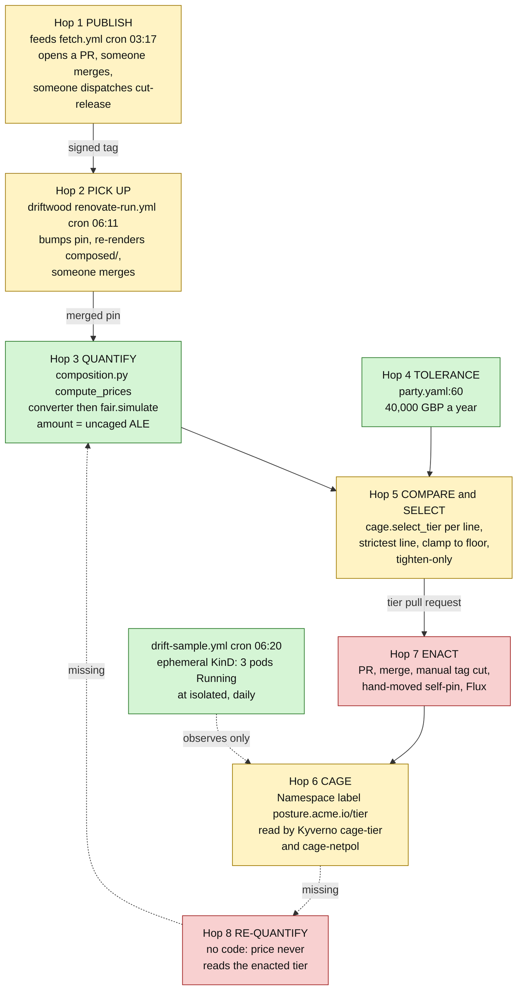

# A4 — Does the loop run today, end to end, for one adopter (driftwood)?

Read-only trace taken 2026-11-14 against the FRESH clones. Paths are `repo/path:line` under FRESH. Platform is cited at HEAD (7beb126); driftwood runs its tools at `v6.3.0` (`driftwood/.github/platform-tools-pin.yaml:11`), which differs from HEAD only by 26 lines of `compose/composition.py` and two test files (`git diff --stat v6.3.0 HEAD`). "AT" is the owner-quote corpus `hub/.scratch/drift-review-2026-08-27/evidence/AMBITION_TIMELINE.json`; "T75" is `hub/.scratch/ecosystem/issues/75-grilling-what-is-this-for-the-twelve-questions.md`.

## Summary

1. **No.** The chain from "a feed number changes" to "a running pod is constrained differently" has never fired end to end. Every hop except the last has code. Hops 1, 2 and 7 wait on a merge nobody has automated and on manual dispatches; hop 8 (feedback) has no code.
2. **The ratchet has no notch left.** All three adopters declared the top rung `isolated` on 2026-08-28 and set `overlay.floor: isolated` on 2026-10-23. The proposer only tightens, so every run ends "held". No tier proposal commit or branch exists on any remote ref of any adopter.
3. **What is observed running daily:** the publishers' fetch clocks, driftwood's re-compose and proposer (last evidence 2026-11-13), and a throwaway KinD cluster where three driftwood pods run at `isolated`. That is a static state re-created each day, never a tier transition.
4. **The loop is open.** The priced exposure never reads the enacted tier, and the per-rung reductions (0.30 / 0.70 / 0.92 / 0.98) are, in the code's own words, "evidenced by nothing but this comment".
5. **"Within tolerance" is not reached.** driftwood: £36,150 against £40,000, only at the top rung, only under the unsourced 0.98, and the artefact's verdict is `null`. tuppence: `breaches_band: true` (£2,057,390 against £15,000). ludlow: £61.7M against £5,000. Nothing acts on a breach.
6. **Kernel as found:** 67 files, 30,801 lines, of which 24,636 are code: 7.4% of the estate's code, 0.8% of all tracked lines.
7. **The same job is done several times over:** five money engines, six tier selectors, three reduction tables, four things that open proposal pull requests, and each adopter carries its own drifting copy of the machinery.

## The hop chain

Green: observed firing for real. Amber: the code runs, but the step that matters has not happened. Red: never fired, or no code.

**On "someone merges".** The documents say "a human merges". The record says otherwise: 94 of the 127 merge commits on driftwood `main` are by the app identity `pavc-other-hand[bot]` (18 of 19 on feeds, 9 of 13 on ico). No workflow in driftwood, feeds or ico merges a proposal; `observation-delivery.yml` delivers only the two observation clocks (`driftwood/.github/workflows/observation-delivery.yml:6-8`). So a merge is a manual act by a person or by an agent session holding the app's key. Which, I could not determine.

| Hop | Code (where) | Automatic or manual | Ever observed firing for real | What breaks the chain |
|---|---|---|---|---|
| **1. A feed value changes and is published** | `feeds/.github/workflows/fetch.yml:30` (cron 03:17), `feeds/fetch/*.py`, `feeds/bump.py`; publication is `feeds/.github/workflows/cut-release.yml`. ICO has the same shape (`ico/.github/workflows/fetch.yml`). | Fetch and the proposal PR are automatic. The merge is manual, and so is the release: "A HUMAN merges it, and a human then dispatches cut-release.yml. This workflow never releases" (`fetch.yml:8-9`). | **Clock: yes.** 410 signed bot commits on `feeds origin/observations`, latest 6d2b812 on 2026-11-14. **Publication from the clock: never.** Seven `fetch/*` proposal branches exist (2026-09-01 to 2026-10-05, latest `fetch/cve-3.1.0` 3d9a80a); none is reachable from `main`. Every published `feed.json` was written by a "Chris Nesbitt-Smith" commit (for example 37dfe4a, 2026-10-03). | The unautomated merge, then the manual dispatch. A proposal branch is keyed on feed and version, so while it stays open the clock exits "already open -- nothing to propose" (`fetch.yml:97-99`). The KEV feed has been frozen at `cve/v3.0.0` since 2026-10-03. |
| **2. The adopter picks it up** | `driftwood/.github/workflows/renovate-run.yml:24` (cron 06:11), `driftwood/renovate.json` (nine regex managers), `driftwood/.github/scripts/complete-feed-bump.sh` (re-renders `composed/` in the bump commit), gated by `shift-left.yml`. | PR is automatic, merge is manual. | **Once.** PR #20, `ea1c8db` merged as `27f1cf2` on 2026-09-01 (threat-register v1 to v2). The hub's own capture says it "moved the recorded pin and no money" (`hub/talk/captures/verify_e2e_verify-e2e-step2-renovate-pins-and-reprices.out:6`, run 491, 2026-11-12). Four later Renovate branches are unmerged (ico 4.x and feeds 1.x on 2026-10-28, platform 6.x on 2026-10-24, platform 5.x on 2026-10-19). Every other pin move on `main` is a "Chris Nesbitt-Smith" commit. | The unautomated merge. driftwood still pins ICO penalty-schema `v3` (`driftwood/party.yaml:71`) although `v4.0.0` was signed on 2026-09-10; composition prices the lag as a £200,751 "supersede" line instead of adopting it. |
| **3. Exposure in money is recomputed** | `platform/compose/composition.py:5521` `compute_prices` calls `price_parent` (`:3719`). That loads the converter from the **publisher's own pinned checkout** (`_converter`, `:831-840`): ICO's `schema/to_fair_scenario.py` at tag `v3.0.0`, feeds' `threat-register/to_fair_scenario.py`, and for CVE the platform's own `feeds/to_fair_scenario.py`. Then `cage.select(..., mode="warn")` (`:3813`), then `fair.summarize(fair.simulate(lef, lm))["ale"]` (`platform/graded/cage.py:363-364`, `platform/fair/fair.py:133-176`). The twin line is `price_twin` (`:4185`). | Automatic: daily at 06:47 into the runner's temp dir, committing nothing (`driftwood/.github/workflows/propose-tier.yml:43`, `:230-253`); on every PR (`shift-left.yml:480`); in Renovate's bump commit. | **Yes.** Proposer commit 18f1c3c (2026-11-13 14:55 UTC) can only exist if the re-compose and `tier-propose` steps before it exited 0 (`propose-tier.yml:230-283`, both under `set -euo pipefail`; the inventory step at `:285` has no `if: always()`). Committed result: `driftwood/composed/evidence.json`, last changed on `main` 2026-10-27 (e6746fd). | Nothing breaks it. What it computes: a PERT frequency triple and a PERT magnitude triple per line, 10,000 seeded Monte-Carlo years, and the mean is the amount. Priced subtotal £1,807,494 (`driftwood/composed/HEADER.yaml:1368`); 98.9% is one line, ICO penalty-schema £1,787,177, annualised at an editorial 1/2/4 fines a year ("warn/deny lef are editorial", `driftwood/composed/evidence.json:3357-3362`). The CVE line is unpriced: 418 scanned CVEs, none in the pinned KEV feed. |
| **4. Tolerance is read** | Declared at `driftwood/party.yaml:60`: `tolerance: { amount: 40000, currency: GBP }`. Read by `platform/risk/enforce.py:81-91` through `composition.py:1947`. Unit: GBP a year, "ONE quantity: an annual aggregate" (`composition.py:5184`). | A static declaration, edited by hand. | Set 2026-08-28 (710595c) and unchanged since. Read on every compose. | Nothing. A second declaration of the same £40,000, `assurance_bands.attest_at` (`party.yaml:54-58`), is read only by `platform/break-glass/break-glass.py:82`, not by the loop. |
| **5. Compare, and select a cage tier** | Per line: `platform/graded/cage.py:334-348` `select_tier` walks the four rungs loosest first and stops at the first where `ALE x (1 - reduce) <= tolerance`, else `isolated`, then clamps up to the floor. Per party: `platform/wargamer/wargamer.py:251-327` takes the strictest line. Write decision: `platform/wargamer/tier_pr.py:871-1034`. PR gate: `platform/shift-left/tier_binding.py:66-81`. Aggregate against tolerance: `composition.py:5179-5294`, display only. | Automatic: daily, and on a merged pin PR (`propose-tier.yml:41-51`). | **Selection: yes, daily.** **A tier proposal: never.** All 4 proposer commits on any driftwood ref are "update served image inventory"; tuppence and ludlow add one feed-pin retirement each. No `wargamer/retune-tier-*` branch exists. The band-crossing path has only run on synthetic copies: "a SYNTHETIC residual placed either side of driftwood's own signed appetite band ... the proposer HOLDS" (`hub/talk/captures/verify_e2e_verify-e2e-step3-price-crosses-band-pr-opens.out:8`, 2026-11-12). | The Namespace already declares `isolated` (`driftwood/gitops/apps/namespace.yaml:30`) and the floor is `isolated` (`driftwood/party.yaml:106`). The proposer writes only a tighter tier (`tier_pr.py:961`, `wargamer.py:323`), so it is held on every run. The aggregate verdict is `breaches_band: null` (`driftwood/composed/HEADER.yaml:1380`). It is a calculation over a four-row table, not a band table. |
| **6. What a tier is on the cluster** | One label, `posture.acme.io/tier`, on the governed Namespace. Read by Kyverno `MutatingPolicy cage-tier-7-0-0` (`driftwood/composed/policies/v7.0.0/cage-tier.yaml:31-36`) and `GeneratingPolicy cage-netpol-7-0-0` (`cage-netpol.yaml`), plus four `PriorityClass` objects. Four selectable tiers; a fifth, `infra`, may be declared but renders as `isolated` (`platform/shift-left/tier_binding.py:49-63`). See the dial table below. | Kyverno mutates pods at CREATE and UPDATE only (`cage-tier.yaml:20-22`). | **Yes, daily, at one rung.** `driftwood/drift/workload-samples.jsonl` last line (2026-11-13, run 43444424804): checkout-svc, storefront and api Running with `posture.acme.io/tier: isolated` and an injected `waf-sidecar`. `drift/samples.jsonl` facts 6 and 7: the bottom rung is admitted, runs, and reaches neither the API server nor 1.1.1.1. | No adopter workload has been observed at any rung but `isolated`. The WAF image `ghcr.io/acme/coraza-waf:cage` "exists in NO registry" (`driftwood/.github/workflows/drift-sample.yml:68-70`); the sampler side-loads a stand-in, so on any other cluster a hardened pod would sit in ErrImagePull. |
| **7. How a tier change reaches the cluster** | `tier_pr.py` opens a signed PR editing the Namespace label. Then: a manual merge; `cut-release.yml` is `workflow_dispatch` only (`driftwood/.github/workflows/cut-release.yml:21-22`); the Flux self-pin is `tag: v4.0.0` (`driftwood/gitops/flux-system/gotk-sync.yaml:21`) and is moved by hand; Flux `Kustomization driftwood` applies `./gitops/apps` (`gotk-sync.yaml:56`). | PR automatic. Merge, tag cut and pin move all manual. | **Never for a tier change, and never for any git change observed arriving.** Two nearby things are observed. (i) Static delivery, daily: facts 1 to 5, `apps_ref: v4.0.0`. (ii) Flux undoing an out-of-band `kubectl` edit, once, on the local KinD cluster: a hand-edited ConfigMap was restored in about 2 minutes and a deleted one in 46 seconds (`driftwood/drift/forced-campaign-samples.jsonl`, 2026-08-15T14:00:30Z to 14:02:34Z and 17:00:08Z to 17:00:54Z). That cluster reconciles from an in-cluster seeded git server (`drift-sample.yml:11-13`). | Five breaks. (a) The unautomated merge. (b) Manual tag cut. (c) The self-pin is 164 commits behind `main` and "no renovate customManager bumps" it (`driftwood/gitops/apps/storefront.yaml:12`). (d) The `GitRepository` object itself is applied by `kubectl apply -f gitops/flux-system/` (`drift-sample.yml:224`), not reconciled, and "no citable run of this estate has had a persistent cluster" (`storefront.yaml:51`). (e) Running pods are not re-caged: "Admission is a snapshot ... Both fire once, at admission, and never again ... Nothing else in the estate re-evaluates it" (`platform/currency-controller/README.md:14-18`); the workloads are bare Pods. |
| **8. Re-quantify after the cage tightens** | **None.** `composition.py` reads the Namespace tier label only to detect `infra` (`:1539-1554`). `prices[].amount` is always the uncaged ALE (`:3832`, `:3845`). The residual in the aggregate uses the *proposed* tier, not the enacted one (`:5207-5215`). | Not applicable. | Not applicable. | The loop is open here. The daily clock re-runs hop 3, but the answer does not depend on what hop 7 did. Nothing repeats until exposure is within tolerance. |

### The dials, by tier

From `driftwood/composed/policies/v7.0.0/cage-tier.yaml:36` and `cage-netpol.yaml:43-45`.

| Field on the pod | baseline | restricted | quarantine | isolated |
|---|---|---|---|---|
| CPU limit (ceiling) | 500m | 250m | 100m | 100m |
| Memory limit (ceiling) | 256Mi | 128Mi | 64Mi | 64Mi |
| PriorityClass value | -10 | -100 | -1000 | -10000 |
| Read-only root, non-root, drop ALL capabilities | no | yes | yes | yes |
| Injected `waf-sidecar` limits | none | 100m / 128Mi | 250m / 256Mi | 250m / 256Mi |
| Generated NetworkPolicy | none | same-namespace ingress, DNS-only egress | identical to restricted | no ingress, no egress |
| Claimed reduction in exposure (`platform/graded/cage.py:84-107`) | 0.30 | 0.70 | 0.92 | 0.98 |

Always on at every tier: no host network, PID or IPC; no privilege escalation; not privileged; `preemptionPolicy: Never`.

## (a) The kernel as found

The minimum set of files the chain touches today. 67 files, 30,801 lines.

| Hop | File | Lines |
|---|---|---|
| 1 | `feeds/.github/workflows/fetch.yml` | 217 |
| 1 | `feeds/fetch/lib.py`, `fetch/cve.py`, `fetch/threat-register.py` | 173 + 142 + 13 |
| 1 | `feeds/bump.py`; `threat-register/rule.yaml`, `bump.yaml`; `cve/rule.yaml` | 369 + 10 + 40 + 5 |
| 1 | `feeds/.github/workflows/cut-release.yml`, `release.yml`, `.github/scripts/publisher-release-gate.py` | 135 + 137 + 361 |
| 1, 3 | `feeds/threat-register/v4/feed.json`, `threat-register/to_fair_scenario.py` (the converter hop 3 loads) | 179 + 592 |
| 1 | `ico/.github/workflows/fetch.yml`, `cut-release.yml`, `release.yml` | 215 + 116 + 137 |
| 1 | `ico/penalty-schema/v3/feed.json`, `penalty-schema/rule.yaml` | 309 + 106 |
| 2 | `driftwood/renovate.json`, `.github/workflows/renovate-run.yml`, `.github/scripts/complete-feed-bump.sh` | 158 + 139 + 75 |
| 2 | `driftwood/.github/workflows/shift-left.yml`, `.github/scripts/adopter-gate.py` | 557 + 1,514 |
| 2 | `driftwood/.github/scripts/read-pins.py`, `verify-pinned-checkouts.py`, `platform-tools.py`, `.github/platform-tools-pin.yaml` | 43 + 89 + 108 + 12 |
| 2, 4 | `driftwood/party.yaml` | 133 |
| 2 | `driftwood/gitops/flux-system/gotk-sync-{feeds,ico,insurer,nist}.yaml`, `gitops/platform/platform-pin.yaml` | 40 + 38 + 38 + 40 + 52 |
| 3 | `ico/schema/to_fair_scenario.py` at tag `v3.0.0` (899 lines at HEAD), `platform/feeds/to_fair_scenario.py` | 221 + 439 |
| 3 | `driftwood/inventory/images.json`, `twin/forward-intel/v2/feed.json` | 5,447 + 72 |
| 3 | `platform/compose/composition.py` | 10,142 |
| 3 | `platform/fair/fair.py`, `fair/severity.py` | 436 + 80 |
| 3, 5 | `platform/graded/cage.py` | 668 |
| 4 | `platform/risk/enforce.py`, `platform/party/party_artefact.py` | 223 + 1,070 |
| 5 | `driftwood/selection-policy/selection_policy.py` | 291 |
| 5 | `platform/wargamer/wargamer.py`, `tier_pr.py`, `rejection_ledger.py`, `platform/honesty/proposer_bounds.py` | 930 + 1,794 + 296 + 231 |
| 5 | `platform/shift-left/tier_binding.py`, `driftwood/.github/workflows/propose-tier.yml` | 336 + 390 |
| 6 | `driftwood/gitops/apps/namespace.yaml`, `pod.yaml`, `storefront.yaml`, `api.yaml`, `kustomization.yaml` | 30 + 58 + 79 + 23 + 9 |
| 6 | `driftwood/composed/policies/v7.0.0/cage-tier.yaml`, `cage-netpol.yaml`, four PriorityClasses | 43 + 45 + 64 |
| 6 | `driftwood/gitops/engine/kyverno.yaml` | 46 |
| 7 | `driftwood/.github/workflows/cut-release.yml`, `release.yml` | 153 + 113 |
| 7 | `driftwood/gitops/flux-system/gotk-sync.yaml`, `gitops/composed/composed-set.yaml`, `scripts/render_composed.py` | 58 + 144 + 578 |

Not kernel, but the only thing that sees hop 6: `drift-sample.yml` (485), `drift/five-facts.py` (2,471), `drift/cage_probe.py` (391), `drift/served_apps.py` (255) = 3,602 lines.

Of the 30,801, 6,165 are JSON data (`images.json`, three `feed.json`, `renovate.json`), leaving 24,636 lines of code. `composition.py` alone is 41% of that, and inside it 3,010 lines are selfcheck functions and 2,890 are comments and docstrings (measured with `ast` and `tokenize`).

## (b) Is the loop closed?

**No, in two separate ways.**

1. **The enacted cage is not an input to the price.** `prices[].amount` is the uncaged ALE whatever the Namespace declares. The only place a tier reduces a figure is `aggregate_section` (`composition.py:5179-5294`), and it uses each line's *proposed* tier. Hand-editing the Namespace to `baseline` would change no priced number; only the `tier_binding` PR gate would object.
2. **The reduction has no source.** `residual = ALE x (1 - reduce)` with `reduce` = 0.30 / 0.70 / 0.92 / 0.98 (`platform/graded/cage.py:84-107`). The table's own comment: "They are the PLATFORM's, self-declared, evidenced by nothing but this comment" (`cage.py:71-72`). The composed artefact repeats it: "platform reductions are self-declared calibration, not measured effectiveness" (`driftwood/composed/evidence.json:6272`).

Three facts make the gap concrete for driftwood:

- 98.9% of the priced exposure is the ICO line, and its open "holes" are four management controls: pl-2, ra-3, ca-2 and ir-8, weighted 0.3 / 0.3 / 0.2 / 0.2 (`driftwood/composed/HEADER.yaml:1398-1413`; weights at `driftwood/composed/evidence.json:783-810`). No field in the dial table implements a plan or an assessment, yet the 0.98 is applied to that line.
- driftwood's own twin publishes a different reduction for the same rung, mode 0.90, at evidence grade 5, where "Grade5 grants no pound credit" (`driftwood/twin/orgs/driftwood/responses/run-the-checkout-at-isolated.yaml:12-17`). At 0.90 the ICO line alone would leave £178,718, over tolerance at every rung (my arithmetic from the published figures).
- driftwood's own twin curve says tighter costs more: net cost of risk £8,183.78 at baseline rising to £95,183.78 at isolated (`driftwood/twin/forward-intel/v2/feed.json:31-43`). Composition does not use that curve.

There is one feedback that is closed and sourced, and it is not the cage: implementing a control takes its regulator-published weight off the line's amount (`composition.py:3628-3665`, `:3852-3858`). At HEAD all four of driftwood's weighted holes are `recorded`, so that lever is not in use either. I did not check whether it has ever moved in history.

## (c) Does "ratchet until within tolerance" exist as behaviour?

**No. There is a single lookup, run once a day.**

- The only iteration is inside one function call: `for tier in ORDER: if caged_residual(...) <= tolerance: break` (`cage.py:343-347`). It solves for the loosest fitting rung in one shot, per price line, at pricing time. It does not step the running system a notch and re-measure.
- The write is one jump from the current tier to the selected one, tighten-only. There is no loosening path: "A loosening is a different question this proposer does not yet ask" (`wargamer.py:268-270`). The codebase names this as an open limit, `cage-ratchet-one-way` (`platform/computed-semver/coverage.py:508-513`).
- When no rung fits, `select_tier` falls to `isolated` and stops (`cage.py:346-347`). The aggregate check then reports the breach and does nothing: "It is NOT a refusal. There is no gate ... a breach of the aggregate is priced and shown, never denied" (`composition.py:5197-5198`).
- That end state is where the estate sits today (all three recomposed 2026-10-27):

| Adopter | Priced subtotal (uncaged) | Residual at `isolated` | Tolerance | Recorded verdict |
|---|---|---|---|---|
| driftwood | £1,807,494 | £36,150 | £40,000 | `null`: one line untiered (`driftwood/composed/HEADER.yaml:1376-1381`) |
| tuppence | £102,869,480 | £2,057,390 | £15,000 | `breaches_band: true` (`tuppence/composed/HEADER.yaml:1343-1347`) |
| ludlow | £3,086,299,082 | £61,725,982 | £5,000 | `null`: one line untiered (`ludlow/composed/HEADER.yaml:1404-1408`) |

- The word "ratchet" appears zero times in `hub/NORTH-STAR.md`, `hub/CONTEXT.md` and `hub/README.md`.

## (d) Where the same job is done twice

| Job | Copies |
|---|---|
| **Turn a frequency and a magnitude into pounds** | (1) `platform/fair/fair.py` (436), the one on the chain. (2) Hub twin: `twin/pricing.py`, `tradeoff.py`, `propagate.py`, `pert.py`, `severity.py`, `regimes.py` (2,281), not called by driftwood's emitter. (3) `driftwood/twin/emit-forward-intel.py:181-206`, its own inline `impact x (1 - reduction) + cost`. (4) `platform/tcor/tcor.py` (466), a risk-financing pricer no driftwood workflow calls. (5) `insurer/pricing/quote.py` (621). |
| **Pick a tier from a residual and a tolerance** | (1) `platform/graded/cage.py:334` `select_tier`. (2) `driftwood/selection-policy/selection_policy.py:83` `select`, repeated in tuppence and ludlow with three different hashes. (3) `platform/wargamer/wargamer.py:251` party fold. (4) `selection_policy.py:143` `select_party`, by its own account "a TRANSLITERATION of platform's" (`:162-165`). (5) `platform/shift-left/tier_binding.py`. (6) `hub/verify/tier-binding/tier_binding_estate.py` (405) and `hub/verify/pound-seam` check 9, which exist to confirm copies 1 to 4 agree. Also `platform/risk/enforce.py:101` `decide`, the older Audit/Deny selector. |
| **Say how much a rung reduces exposure** | (1) `platform/graded/cage.py:82-111`. (2) `driftwood/twin/orgs/driftwood/responses/*.yaml` (0.05 / 0.30 / 0.65 / 0.90 per `cage.py:74-75`). (3) The twin-agent table, `cage.py:155-206`. Against all three, the hub twin's ladder forbids the idea: "No rung carries a number, and the loader refuses one ... A reduction per rung would be a free multiplier" (`hub/twin/enforcement-grades.yaml:10-14`). |
| **Define the ladder** | Platform: baseline / restricted / quarantine / isolated. Hub twin: observe / warn / constrain / block (`hub/twin/enforcement-grades.yaml`). |
| **Declare the tolerance** | `appetite.tolerance` and `appetite.assurance_bands.attest_at`, both £40,000 (`driftwood/party.yaml:54-60`). |
| **Open a proposal PR** | Four things open one: `platform/wargamer/tier_pr.py` (with `inventory.py`); Renovate; the publishers' `fetch.yml`; each adopter's `twin-sweep.yml` write job (`:422`). Two more render a diff and stop: `platform/wargamer/propose-policy-pr.sh` and `driftwood/scripts/bump-nist-pin.sh` (`platform/wargamer/tier_pr.py:21-23`). `hub/twin/enact.py` (328) is the twin's own "enactment arm"; not traced. |
| **Convert a feed to a scenario** | Each converter exists at the publisher and again, byte-identical, vendored under every adopter's `composed/feeds/` as an offline fallback (md5 equal for threat-register, for cve, and for ICO at tag `v3.0.0`). The ICO converter at HEAD is 899 lines; the one driftwood prices with is 221. |
| **Adopter machinery** | driftwood, tuppence and ludlow each carry their own `five-facts.py` (2,471 / 2,536 / 2,396 lines), `propose-tier.yml`, `twin-sweep.yml`, `drift-sample.yml`, `shift-left.yml`, `emit-forward-intel.py`; only `cage_probe.py` and `served_apps.py` are byte-identical. |
| **Check the cage is in force** | `driftwood/drift/five-facts.py` facts 6 to 8; `hub/verify/e2e` step 4; `hub/verify/proportionality` live tail; `platform/graded/verify-graded.sh` (845). |

## (e) What fraction of the estate is on this chain

| Denominator | Lines | Kernel share |
|---|---|---|
| Kernel as found, all 67 files | 30,801 | |
| Kernel as found, code only | 24,636 | |
| Estate code (`*.py`, `*.sh`, `*.yml`, `*.yaml`; nine repos; hub `.scratch` excluded) | 331,785 | **7.4%** |
| Estate, all tracked lines, hub `.scratch` excluded | 563,683 | 5.5% |
| Estate, all tracked lines | 3,809,876 | 0.8% |

Per repo, all tracked lines: hub 3,482,021 (of which `.scratch` 3,246,193), platform 76,365, driftwood 50,676, tuppence 48,228, ludlow 43,854, feeds 85,412, nist 12,655, ico 6,498, insurer 4,167.

## Components

Area = all of driftwood, the platform modules on the chain, the four publishers, the hub's six loop-facing verify directories, and the part of the hub twin that driftwood's emitter imports. Total 201,454 lines. "Born" is the first commit of the path in its present repo; the platform and adopter repos were split out on 2026-07-31, so that date is a floor. In the role, necessity, origin and status columns the first word is the classification; anything after it is a qualifier.

| # | Name | Paths | Lines | Born | What it does | Loop role | Necessity | Origin | Status | Cite |
|---|---|---|---|---|---|---|---|---|---|---|
| 1 | Party declaration | `driftwood/party.yaml` | 133 | 2026-08-25 | Tolerance, size, feed pins, floor | tolerance | kernel | delegated: "decided by the assistant: `appetite.tolerance` is one quantity" (T75:111), owner answered "yes" (T75:78, 2026-09-02). The concept is the owner's: "the overarching risk appetite" (AT:338, 2026-07-23). The figures: no source found | observed_running | `party.yaml:60`, `:106` |
| 2 | Declared cluster state | `driftwood/gitops/`, `deploy/`, `kind/`, `accepted-majors/`, `scenarios/` | 919 | 2026-07-31 | Namespace tier label, three workloads, Flux pins | cage (also enact) | kernel | owner_words: "you're always caged even if it's a permissive one. It's the spec of the cage that can change" (AT:2780, 2026-08-20); tier-per-Namespace and the rungs are delegated (`hub/docs/adr/0022-...md:36-37`) | observed_running: static state only; a tier change never | `gitops/apps/namespace.yaml:30` |
| 3 | Adopter selection policy | `driftwood/selection-policy/` | 375 | 2026-08-28 | Second implementation of the tier pick | compare | duplicate of `platform/graded/cage.py:334` and `wargamer.py:251` | delegated (`hub/docs/adr/0021-...md:11-13`: owner answered "Lgtm") | observed_running: stamps the twin and agent lines | `selection_policy.py:162-165` |
| 4 | Rendered cage objects | `driftwood/composed/policies/`, `composed/*.yaml` machinery | 1,036 | 2026-08-25 | Kyverno policies and PriorityClasses Flux applies | cage | kernel | assistant: generated by the composer | observed_running: 34 objects live and equal (fact 4, 2026-11-13) | `composed/policies/v7.0.0/cage-tier.yaml` |
| 5 | Composed evidence | `driftwood/composed/evidence.json`, `HEADER.yaml`, `HANDBOOK.md`, `floor-change.json` | 8,316 | 2026-08-25 | The priced record: prices, holes, aggregate | quantify (also evidence) | support | assistant: generated | observed_running | `HEADER.yaml:1361-1432` |
| 6 | Vendored feeds | `driftwood/composed/feeds/` | 16,710 | 2026-09-10 | Copies of publisher feeds and converters, read only when a publisher's checkout is absent | quantify | duplicate of `feeds/`, `ico/`, `platform/feeds/` | unknown | unknown: a fallback; the committed composition did not use it ("every priced feed was read from its publisher's own pinned tree", `composed/evidence.json:6290`) | `platform/compose/composition.py:5711-5716` |
| 7 | Image inventory | `driftwood/inventory/` | 5,556 | 2026-10-04 | Trivy scan of served images, input to the CVE line | react | support | delegated (`hub/docs/adr/0035-...md:8-9`) | observed_running: but priced at nothing, 0 of 418 CVEs in KEV | `composed/evidence.json` cve line |
| 8 | CI glue on the chain | `driftwood/.github/workflows/{propose-tier,renovate-run,shift-left,cut-release,release,verify-identity-regexp}.yml`, `.github/scripts/` (less twin scripts), `renovate.json`, actions, rulesets | 3,980 | 2026-08-21 | Clocks, pin readers, PR gate, release cut | react (also compare, enact) | kernel | unknown: `hub/docs/adr/0024-...md:15-17` says the owner "settled the boundary on 2026-08-28", with no quotation | observed_running: tier PR never | `propose-tier.yml:43` |
| 9 | Five-fact sampler | `driftwood/drift/*.py`, `drift/samples.jsonl`, `workload-samples.jsonl`, `oscal-samples.jsonl`, `drift-sample.yml`, `observation-delivery.yml` | 4,250 | 2026-08-29 | Daily ephemeral cluster; seven facts and per-workload samples | evidence | support | unknown | observed_running: 65 sampler commits, latest 2026-11-13 | `drift/workload-samples.jsonl` last line |
| 10 | August Flux-drift probe and forced campaign | `driftwood/drift/probe.sh`, `forced-campaign.{sh,yaml,log}`, `forced-campaign-samples.jsonl`, `window.yaml`, `verdict.yaml`, `preconditions.yaml`, `drift/*.md` | 1,880 | 2026-08-10 | Measures whether Flux reverts out-of-band drift on the local KinD cluster, and how fast | evidence | support | unknown: "Decided via a `/wayfinder` grilling session, 2026-08-13/14" (`drift/forced-campaign.yaml:12`), no quotation read | observed_running: once, 2026-08-15, run by hand | `drift/forced-campaign.log:4-124` |
| 11 | Twin overlay and sweep | `driftwood/twin/`, `observations/`, `twin-sweep.yml`, two twin scripts | 2,884 | 2026-08-28 | Emits a forward-intel scenario; daily sweep | quantify (also react) | support: weak, £758 of £1,807,494 (0.04%) | delegated (`hub/docs/adr/0021-...md:11-13`) | observed_running: to 2026-10-22, silent since; "moved" path never fired (39 of 39 sweeps `moved: false`) | `driftwood/.github/workflows/twin-sweep.yml:322` |
| 12 | Tests, local bring-up, docs | `driftwood/tests/`, `.github/tests/`, `scripts/`, `git-server/`, `verify-*.sh`, README, LICENSE | 4,470 | 2026-07-31 | Unit tests; local KinD from a seeded in-cluster git server | evidence | support | unknown | tested_offline | `drift-sample.yml:11-16` |
| 13 | Composer | `platform/compose/composition.py` | 10,142 | 2026-08-25 | Prices every line, selects per-line tiers, renders `composed/` | quantify (also compare) | kernel | unknown | observed_running | `composition.py:5521`, `:3719` |
| 14 | FAIR engine | `platform/fair/` | 603 | 2026-07-31 | PERT Monte-Carlo to ALE, VaR, TVaR | quantify | kernel | owner_words for the ask: "change the regulator financial fine we might get for a breach and then make the controls and everything else proportinate and grounded in that" (AT:324, 2026-07-23). The method (FAIR, PERT, Monte-Carlo) is the assistant's (`hub/.scratch/talk-spec/issues/04-risk-proportionality-model.md:11-13`) | observed_running | `fair/fair.py:133-228` |
| 15 | Graded cage | `platform/graded/` (`cage.py` 668 plus policies, tests, verify 3,014) | 3,682 | 2026-07-31 | Tier table (reduce, cost, dials) and `select_tier` | cage (also ratchet) | kernel | owner_words for the idea: "its never an exemption it'll be a informed caging based on risk appetite/threat intel" (AT:2927, 2026-08-21). The rungs and the reduction numbers are delegated (`hub/docs/adr/0022-...md:36-37`) | observed_running: selection daily; dials seen at `isolated` only | `graded/cage.py:71-72`, `:334-348` |
| 16 | Appetite reader | `platform/risk/` | 326 | 2026-07-31 | Reads `appetite.tolerance`; also the older Audit/Deny `decide` | tolerance | kernel: for `enforce.py:81-91`; the rest is unused on this chain | delegated (T75:111) | observed_running | `risk/enforce.py:81-91` |
| 17 | Proposer | `platform/wargamer/`, `platform/honesty/proposer_bounds.py` | 4,770 | 2026-07-31 | Party fold, tighten-only clamp, opens the PR | ratchet (also enact) | kernel | delegated (`hub/docs/adr/0021-...md:11-13`); tighten-only contradicts `hub/docs/adr/0015-...md:68-69` | tested_offline: the tier path. Inventory and retirement paths are observed_running | `wargamer/tier_pr.py:871-1034` |
| 18 | Tier binding gate | `platform/shift-left/tier_binding.py` | 336 | 2026-09-04 | Refuses a Namespace looser than the priced tier, on PRs | compare | support | unknown | observed_running: PASS in hub run 491 | `tier_binding.py:66-81` |
| 19 | Converter, validator, policy source | `platform/feeds/`, `platform/party/`, `platform/distribution/policies/v7.0.0/` | 3,352 | 2026-07-31 | CVE and EOL converter; `party.yaml` schema check; source of the cage objects | quantify (also cage) | support | unknown | observed_running | `distribution/policies/v7.0.0/cage-tier.yaml` |
| 20 | feeds publisher | `feeds/` (whole repo; 79,217 lines are JSON) | 85,412 | 2026-08-28 | Fetch clock, bump rule, signed release, threat-register and KEV feeds | react | kernel | unknown | observed_running: the clock. Publication from the clock never merged | `feeds/.github/workflows/fetch.yml:8-9` |
| 21 | ico publisher | `ico/` | 6,498 | 2026-07-31 | Penalty schema and its converter: 98.9% of driftwood's exposure | quantify (also react) | kernel | owner_words: the regulator's fine as the changing input (AT:324, 2026-07-23, quoted in row 14) | observed_running: tags v3.0.0, v4.0.0, v4.0.1 | `ico/penalty-schema/v3/feed.json` |
| 22 | insurer publisher | `insurer/` | 4,167 | 2026-08-28 | Quotes a premium against the adopter's exposure; a cost line that selects no tier | none: on the tier chain | unknown | unknown | unknown: not traced | `driftwood/composed/evidence.json` premium line, £113,403 |
| 23 | nist publisher | `nist/` (8,139 lines are `publisher-reliability/`) | 12,655 | 2026-07-31 | Control catalogue and baselines; the holes the ICO line is partitioned by | quantify | support | unknown | unknown: not traced | `driftwood/composed/HEADER.yaml:1398-1413` |
| 24 | Pound seam check | `hub/verify/pound-seam/` | 2,275 | 2026-08-28 | Eleven consistency checks on each adopter's priced record | evidence | support | unknown | observed_running: in the hub gate, SKIP on the CVE line, run 491 | `pound_seam.py:1-60` |
| 25 | Tier binding, hub copy | `hub/verify/tier-binding/` | 480 | 2026-09-04 | Asks platform's binding question again across the estate | evidence | duplicate of `platform/shift-left/tier_binding.py` | unknown | observed_running: PASS, run 491 | `verify-tier-binding.sh:8-12` |
| 26 | Proportionality beat | `hub/verify/proportionality/` | 498 | 2026-08-21 | Same workload, two bands, two rungs: "the load-bearing live beat of the talk" | presentation | off_mission: serves the talk; re-proves `cage.select_tier` | unknown | tested_offline: live tail "could not look" in run 491 | `README.md:6-8`; capture `:14` |
| 27 | Twin-agent cage check | `hub/verify/twin-cage/` | 1,211 | 2026-10-03 | Checks each adopter's sweep workflow fits its priced rung | evidence | ceremony: cages the build's own agent, not a workload | unknown | observed_running: PASS, run 491 | capture `verify_twin-cage_verify-twin-cage.out` |
| 28 | Priced holes check | `hub/verify/priced-holes/` | 1,048 | 2026-09-03 | Every hole and ungoverned Namespace is a priced delta | evidence | support | unknown | observed_running: PASS, run 491 | capture `verify_priced-holes_verify-priced-holes.out` |
| 29 | End-to-end harness | `hub/verify/e2e/` | 1,722 | 2026-08-28 | Seven steps, one script each; steps 2 and 3 on synthetic throwaway copies | evidence | support | unknown | tested_offline: step 5 SKIP, step 4 graded from the sampler | `README.md:28-31`; captures cited above |
| 30 | Hub twin, imported part | 17 modules of `hub/twin/` reached from `driftwood/twin/emit-forward-intel.py:98-101` (`fixtures.py` alone is 5,951) | 11,768 | 2026-08-05 | Loads the overlay and renders the forward-intel scenario | quantify | support: weak, 0.04% of exposure | unknown | observed_running: to 2026-10-22 | `emit-forward-intel.py:98-101` |

The other 54,102 lines of `hub/twin/` and the rest of `platform/` (53,154 lines) are not reached by this trace and belong to other readers.

## What the loop would lose if this area vanished

Everything: this area is the loop. Taken piece by piece:

- **Lose rows 1, 2, 4, 13 to 17, 20, 21** and there is no quantified exposure, no tolerance, no cage on a cluster and no proposal. These are the kernel.
- **Lose row 9 (the sampler)** and there is no observation that a cage is in force at all. It is the only component that touches a cluster today.
- **Lose rows 3, 6, 25** and nothing changes: each is a second copy.
- **Lose rows 11 and 30 (the twin)** and driftwood's priced exposure falls by £758 in £1,807,494. No tier moves; the twin line selected `baseline` before the floor clamped it.
- **Lose rows 22, 23** and the premium line and the hole partition go. The tier does not move: the ICO line selects `isolated` with or without its partition.
- **Lose rows 10, 24, 26 to 29** and the loop runs exactly as it does now, unchecked.

What it would not lose, because it is not there: a tier transition on a running system, a sourced reduction, and any reaction to exposure above tolerance.

## The simplest thing that would do this area's loop job

About 450 lines, against 24,636 on the chain today.

1. **`exposure.yaml`, one table, about 30 lines.** One row per exposure line: `name`, `source` (a pinned feed and field), `lef: [min, mode, max]`, `lm: [min, mode, max]`, and `reduces: {restricted: x, quarantine: y, isolated: z, source: <url or observation>}`. A reduction with no `source` is 0. This replaces the per-rung constant with a per-line, sourced figure, which is the piece that closes the loop.
2. **`loop.py`, about 150 lines, four functions.**
   - `exposure(table, feeds, tier) -> pounds`: sum over lines of `pert_mean(lef) x pert_mean(lm) x (1 - reduces[tier])`. The closed form already exists in 12 lines (`platform/fair/fair.py:111-131`).
   - `tolerance(party) -> pounds`: one YAML read (`platform/risk/enforce.py:81-91` is 11 lines).
   - `ratchet(enacted_tier) -> tier`: `while exposure(tier) > tolerance and tier is not the top: tier = next(tier)`. It reads the **enacted** tier from the Namespace manifest, so the price depends on what is in force. If the top rung is still over tolerance, exit non-zero and say so: that is the escalation the estate lacks.
   - `write(tier)`: rewrite one label line (`platform/wargamer/tier_pr.py:327-360` is 34 lines).
3. **One cage, about 150 lines of YAML.** The existing `cage-tier` MutatingPolicy (43), `cage-netpol` GeneratingPolicy (45) and four PriorityClasses (64), unchanged.
4. **One workflow, about 80 lines.** Triggers: daily, and on a merged feed pin. Steps: run `loop.py`; open a PR that changes the one label; append one line to `observations/loop.jsonl` with `{date, exposure_before, tolerance, tier_before, tier_after, exposure_after}`. Flux tracks the branch the PR merges to, so merge is enactment, and the workloads become Deployments (or the job deletes the pods) so a new tier is actually admitted.
5. **`party.yaml`, about 20 lines.** `tolerance`, `turnover`, and the feed pins.

The observation line in step 4 is the whole evidence burden: one row per run that shows exposure before and after against tolerance. The estate has no such row today.

## Surprises

1. **The loop's stated end condition is recorded as failed, and nothing happens.** tuppence's signed artefact says `breaches_band: true`, 137 times over tolerance at the top rung (`tuppence/composed/HEADER.yaml:1343-1347`).
2. **driftwood is "within tolerance" by £3,850, on one unsourced constant.** £1,787,177 x 0.02 = £35,743 against £40,000. At 0.92 it is £142,974.
3. **The decision record rejected the proposer that shipped.** ADR-0015 (2026-08-24): "A tighten-only proposer. Rejected. It ratchets the estate toward deny and never recovers" (`hub/docs/adr/0015-...md:68-69`). Tighten-only arrived on 2026-09-04 (platform 698702a, "the proposer folds the party and only tightens"), and the estate now sits at the top rung, as predicted.
4. **The twin's write path is off.** At HEAD the sweep's write job runs only when the twin agent's priced rung is not `isolated` (`driftwood/.github/workflows/twin-sweep.yml:322`), and the rung is `isolated`. The last sweep observation is 2026-10-22 (9787b5e). The likely cause is the floor adopted the next day (d2c6f83), which clamped the rung from `baseline`; the gate itself dates from 2026-10-04 (aa92363). Two other commits touched the sweep on 2026-10-23 and 2026-10-24, so that cause is an inference: I could not read the run logs.
5. **The one reaction that does fire for real moves no money.** The image scan found 479 CVEs on 2026-11-13, up from 418, and the proposer opened a PR; the line still carries no amount, because the KEV feed it is matched against is frozen behind an unmerged proposal from 2026-10-05.
6. **The only real feed bump ever merged moved no money either** (PR #20, 2026-09-01).
7. **The hub twin forbids exactly what the platform does.** The twin's ladder refuses a number per rung as "a free multiplier ... the unfalsifiable claim" (`hub/twin/enforcement.py:14-17`); the tier that is actually selected comes from four such numbers.
8. **The adopter's own model says the cage costs more than it saves**: £95,184 net at `isolated` against £8,184 at `baseline`, and the twin's own cost for the isolated cage (mode £95,000 a year) is more than twice the tolerance.
9. **Two rungs are the same network cage.** `cage.py` lists four reach levels (`:87`, `:93`, `:99`, `:110`); `cage-netpol` generates two shapes, so restricted and quarantine get an identical NetworkPolicy (`cage-netpol.yaml:43-45`).
10. **The WAF in "WAF sidecar" is a placeholder image that exists in no registry** (`drift-sample.yml:68-70`).
11. **What a cluster would serve is five weeks behind `main`.** The apps self-pin is `v4.0.0` (2026-10-04); driftwood has since cut v5.0.0 to v5.3.0, and the composed-policy pin is `v5.3.0` (`gitops/composed/composed-set.yaml:73`). Two pins, moved by hand, in one repo.
12. **The quantify step began as about 40 lines.** `hub/.scratch/talk-spec/map.md:84-86` (born 2026-07-23) records "a ~40-line numpy `fair.py` reference already drafted". The path that computes the same mean today runs through a 10,142-line composer.
13. **The thesis sentence comes from a talk outline.** "Governance is a proportionate, informed, continuously re-tuned response to quantified risk" is the thesis line of `hub/.scratch/talk-spec/the-whole-model.md:15-17` (2026-07-23). The word "ratchet" is in none of the hub's three top-level documents.
14. **`LOCAL/.scratch/calibration-programme` does not address the reduction table.** A grep for `reduce`, `0.98`, `cage-tiers` and `tier table` across it returns no file.

## Could not determine

- Whether any tier pull request was ever opened and then closed with its branch deleted. That needs the GitHub API; only surviving refs were read.
- What triggers the `pavc-other-hand[bot]` merges: a person, or an agent session holding the app's key.
- Whether the 2026-11-13 proposer run was the 06:47 schedule or a manual dispatch, and what its log printed.
- Why the twin sweep has been silent since 2026-10-22. The code and dates fit the rung gate, but the run logs were not readable.
- Whether the "Chris Nesbitt-Smith" commits that moved pins and published feeds were typed by the owner or made by an agent under the owner's identity.
- Whether any persistent cluster exists outside the repositories. The only statement found is the file comment at `driftwood/gitops/apps/storefront.yaml:51`.
- Whether the implemented-controls lever has ever moved a price in history. Only HEAD was read.
- The insurer and nist repositories were measured but not traced; their status is unknown.
- A source for the tolerance figures (£40,000, £15,000, £5,000) and for the four reduction numbers.
